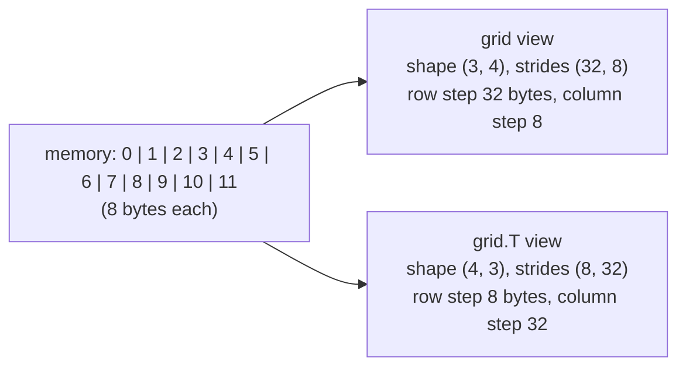

# Data Types and Array Attributes: The Complete Guide

> 📚 **Before you start**
>
> - [What is a NumPy Array?](what-is-a-numpy-array.md), for the idea that every element shares one type
> - [Creating, Indexing and Slicing Arrays](creating-indexing-and-slicing-arrays.md), for building arrays to experiment with
> - [Python Programming › Getting Started with Python](../../python-programming/course.md#m2), for Python's own `int`, `float`, `bool` and `str`

## Introduction

A cricket scoreboard shows runs as whole numbers, the run rate with two decimals, and the batter's name as text. Nobody would store a batter's name in the runs column, and nobody would write the run rate as a whole number. Each column has a natural **type**, and choosing it well keeps the scoreboard correct and readable.

NumPy arrays work the same way, except the stakes are higher. Python's `int` can grow as large as you like, but a NumPy `int8` can only count to 127; one more and it silently wraps round to -128. A `float32` keeps only about seven significant digits. A fixed-width string column can quietly chop "samosa" down to "samo". And a single wrong type can make an array use eight times more memory than it needs. These are not rare edge cases: they are the bugs that turn up when real data meets default settings.

By the end of this article you will know every NumPy data type you are likely to meet, how to choose and convert between them, the rules NumPy 2 uses when two types meet in one calculation, and every attribute an array carries, including the `strides` that explain how one block of memory becomes a grid.

> 💡 **Key Insight**
>
> A NumPy dtype fixes **how many bytes each element uses and how those bytes are read**. That buys speed and compact memory, but it also means values have hard limits. Always know your dtype: Python will not warn you when an `int8` overflows inside an array.

---

## Core Explanation

### 1. What a dtype is

Every array has a `dtype` attribute, which is a `numpy.dtype` object. It records the **kind** of value (integer, float, string...), its **size in bytes**, and its **byte order**.

```python
import numpy as np

runs = np.array([45, 102, 8, 67])
rate = np.array([7.5, 8.25, 6.0])
print(runs.dtype, runs.dtype.kind, runs.dtype.itemsize)
print(rate.dtype, rate.dtype.kind, rate.dtype.itemsize)
print(np.dtype("int8"), np.dtype("f4"), np.dtype(np.uint16))
```

Output:

```
int64 i 8
float64 f 8
int8 float32 uint16
```

You can name a dtype in several equivalent ways: a NumPy type object (`np.int8`), a string name (`"int8"`), or a short code (`"i1"`, meaning a signed integer of 1 byte; `"f4"` is a 4-byte float). Python types work too: `dtype=int` means the default integer (`int64`) and `dtype=float` means `float64`.

### 2. The full list of dtypes

| Kind code | Family | dtypes | Bytes | Typical use |
|---|---|---|---|---|
| `b` | boolean | `bool` | 1 | masks, yes/no flags |
| `i` | signed integer | `int8`, `int16`, `int32`, `int64` | 1, 2, 4, 8 | counts, ids, scores |
| `u` | unsigned integer | `uint8`, `uint16`, `uint32`, `uint64` | 1, 2, 4, 8 | pixel values (0 to 255), byte data |
| `f` | floating point | `float16`, `float32`, `float64` (also `longdouble`) | 2, 4, 8 | measurements, prices, ML weights |
| `c` | complex | `complex64`, `complex128` | 8, 16 | signal processing |
| `U` | fixed-width Unicode string | `<U5` and so on | 4 per character | short labels |
| `S` | fixed-width bytes | `S5` and so on | 1 per byte | raw byte data, legacy files |
| `T` | variable-width string | `StringDType()` (NumPy 2) | varies | text of any length |
| `O` | Python object | `object` | 8 (a pointer) | anything else, slowly |
| `M` | date and time | `datetime64[D]`, `datetime64[s]`... | 8 | timestamps |
| `m` | time difference | `timedelta64[D]`... | 8 | durations |
| `V` | structured / raw | `[("name", "U10"), ("age", "i4")]` | sum of fields | record-like rows |

The defaults are `int64` for integers, `float64` for floats and `bool` for booleans. Smaller types save memory but have smaller ranges.

### 3. Integer ranges and overflow

An integer with *n* bits can hold 2ⁿ different values. Signed types split them between negative and positive; unsigned types use them all for zero and up. `np.iinfo` reports the limits:

```python
for t in [np.int8, np.uint8, np.int16, np.int32, np.int64]:
    info = np.iinfo(t)
    print(f"{info.dtype}: {info.min} to {info.max}")
```

Output:

```
int8: -128 to 127
uint8: 0 to 255
int16: -32768 to 32767
int32: -2147483648 to 2147483647
int64: -9223372036854775808 to 9223372036854775807
```

What happens when an array calculation goes past the limit? Inside arrays, integers **wrap around** silently, like an odometer rolling over:

```python
small = np.array([100, 120], dtype=np.int8)
print(small + small)            # 200 and 240 do not fit in int8
pixels = np.array([250, 10], dtype=np.uint8)
print(pixels + 10)              # 260 wraps to 4
print(pixels - 20)              # -10 wraps to 246
```

Output:

```
[-56 -16]
[ 4 20]
[230 246]
```

No error, no warning. This is the number one bug when editing images, where pixels are `uint8`: brightening by adding 50 makes bright pixels go dark. The fix is to convert to a wider type first, do the maths, then clip and convert back. You will do exactly that in the [image lab](lab-image-as-a-numpy-array.md).

NumPy 2 does protect you in one case: a Python integer that cannot fit at all in the array's type raises an error instead of silently changing:

```python
try:
    small + 300
except OverflowError as err:
    print("OverflowError:", err)
```

Output:

```
OverflowError: Python integer 300 out of bounds for int8
```

### 4. Floats: precision, `nan` and `inf`

Floating-point numbers store a fixed number of significant binary digits, so they are approximations. `np.finfo` shows each float type's precision:

```python
for t in [np.float16, np.float32, np.float64]:
    info = np.finfo(t)
    print(f"{info.dtype}: about {info.precision} decimal digits, max {info.max:.3g}")
```

Output:

```
float16: about 3 decimal digits, max 6.55e+04
float32: about 6 decimal digits, max 3.4e+38
float64: about 15 decimal digits, max 1.8e+308
```

So a `float16` cannot even tell 2048 from 2049, and a `float32` loses the paise on a crore-rupee balance:

```python
print(float(np.float16(2049)))           # float() just prints it plainly
print(float(np.float32(12_345_678.91)))
print(float(np.float64(12_345_678.91)))
```

Output:

```
2048.0
12345679.0
12345678.91
```

Stick to `float64` unless memory is truly tight (deep learning often uses `float32` or `float16` on purpose, accepting the precision loss). For money where every paisa matters, store whole paise as integers.

Floats also have special values:

- **`np.nan`** ("not a number") marks missing or undefined results. It is **not equal to anything, including itself**, so test for it with `np.isnan`, never with `==`.
- **`np.inf`** and **`-np.inf`** represent infinity, for example from dividing by zero.

```python
data = np.array([12.0, np.nan, 7.5, np.inf])
print(np.nan == np.nan)
print(np.isnan(data))
print(np.isinf(data))
print(np.isfinite(data))
print(data.dtype)
```

Output:

```
False
[False  True False False]
[False False False  True]
[ True False  True False]
float64
```

`nan` is a float, so an integer array cannot hold it. Putting `np.nan` into an `int64` array raises an error, which is why integer data with missing values usually becomes `float64`. (pandas has its own way around this, covered in module 3.)

NumPy 2 removed the old capitalised aliases. Write `np.nan` and `np.inf`; `np.NaN`, `np.NAN`, `np.Inf` and `np.Infinity` no longer exist.

### 5. Booleans and complex numbers

`bool` arrays are what comparisons produce. They take one byte per element and act as 0 and 1 in arithmetic, which is why `mask.sum()` counts the `True` values and `mask.mean()` gives the fraction that are true.

```python
passed = np.array([True, False, True, True])
print(passed.sum(), passed.mean(), passed.dtype)
z = np.array([3 + 4j, 1 - 1j])
print(z.dtype, np.abs(z), z.real, z.imag)
```

Output:

```
3 0.75 bool
complex128 [5.         1.41421356] [3. 1.] [ 4. -1.]
```

### 6. Strings: fixed width and the new variable-width type

By default, NumPy stores text in a **fixed-width Unicode** dtype such as `<U6`: every element gets room for exactly 6 characters (4 bytes each). The `<` is the byte order (little-endian), and the width comes from the longest string at creation time. Longer strings assigned later are **silently truncated**:

```python
snacks = np.array(["chai", "samosa"])
print(snacks.dtype)
snacks[0] = "masala chai"
print(snacks)
print(np.array(["chai", "samosa"], dtype="U4"))
```

Output:

```
<U6
['masala' 'samosa']
['chai' 'samo']
```

NumPy 2 added a proper **variable-width string dtype**, `np.dtypes.StringDType()`, which stores strings of any length and never truncates. Its kind code is `T`.

```python
from numpy.dtypes import StringDType

snacks = np.array(["chai", "samosa"], dtype=StringDType())
snacks[0] = "masala chai"
print(snacks, snacks.dtype)
```

Output:

```
['masala chai' 'samosa'] StringDType()
```

The `S` kind stores raw **bytes** (`b"abc"`), one byte per character, and appears mostly when reading old binary files. The [Binary and String Functions](binary-and-string-functions.md) lesson shows how to process string arrays.

### 7. Object, datetime and structured dtypes

- **`object`** arrays store pointers to arbitrary Python objects. They work, but every operation falls back to slow Python-level work. Treat `dtype=object` as a warning sign.
- **`datetime64`** and **`timedelta64`** store dates and durations as 64-bit integers counting units since 1970-01-01. The unit is in brackets: `D` for days, `s` for seconds, `ms`, `us`, `ns` and so on.
- **Structured dtypes** give each element named fields, like a row in a table.

```python
days = np.array(["2026-10-01", "2026-10-15", "2026-11-01"], dtype="datetime64[D]")
print(days, days.dtype)
print(np.diff(days))                       # gaps between dates
print(days[0] + np.timedelta64(30, "D"))

players = np.array([("Rohit", 45), ("Virat", 102)],
                   dtype=[("name", "U10"), ("runs", "i4")])
print(players["name"], players["runs"].sum())
```

Output:

```
['2026-10-01' '2026-10-15' '2026-11-01'] datetime64[D]
[14 17]
2026-10-31
['Rohit' 'Virat'] 147
```

Structured arrays were NumPy's early answer to tables. Today, pandas DataFrames do that job far better, so you will rarely build them yourself, but you may meet them when reading binary data. pandas also handles dates more conveniently, as the [Dates, Times and Timedeltas](../04-text-dates-and-categories-in-pandas/dates-times-and-timedeltas.md) lesson shows.

### 8. Converting with `astype`

`arr.astype(new_dtype)` returns a **new array** converted to another type. It never changes the original.

```python
prices = np.array([19.99, 5.5, -3.7])
print(prices.astype(int))                    # truncates toward zero, no rounding
print(np.round(prices).astype(int))          # round first if you want rounding
print(np.array(["12", "7.5", "100"]).astype(float))
print(np.array([0, 1, 2]).astype(bool))
print(np.array([1, 2, 3]).astype(str))
```

Output:

```
[19  5 -3]
[20  6 -4]
[ 12.    7.5 100. ]
[False  True  True]
['1' '2' '3']
```

Converting text that is not a valid number raises a `ValueError`, which is helpful: it tells you there is dirty data to clean first.

`astype` accepts a `casting` rule if you want it to refuse lossy conversions. `"safe"` only allows conversions that cannot lose information, and `np.can_cast` checks ahead of time:

```python
print(np.can_cast(np.int32, np.float64))
print(np.can_cast(np.float64, np.int64))
try:
    prices.astype(int, casting="safe")
except TypeError as err:
    print("TypeError:", err)
```

Output:

```
True
False
TypeError: Cannot cast array data from dtype('float64') to dtype('int64') according to the rule 'safe'
```

### 9. Type promotion: what happens when types meet

When an operation mixes types, NumPy picks a result type using its **promotion rules**. NumPy 2 made these rules simpler and more predictable (the change is known as NEP 50). The key ideas:

1. **Two arrays (or two NumPy scalars)**: the result is the smallest type that can represent both. `int8` with `int16` gives `int16`; any integer with a float gives a float.
2. **An array with a plain Python number** (`int`, `float`, `complex`): the Python number is "weak". It adapts to the array's type as long as the **kind** does not change. So `int8_array + 1` stays `int8`, and `float32_array + 3.0` stays `float32`. A Python float with an integer array does change the kind, so you get `float64`.
3. **An array with a NumPy scalar** such as `np.float64(3.0)`: the scalar is "strong" and counts like an array.

```python
i8 = np.array([1, 2], dtype=np.int8)
f32 = np.array([1.5, 2.5], dtype=np.float32)

print((i8 + 1).dtype)               # weak Python int keeps int8
print((i8 + np.int64(1)).dtype)     # strong NumPy scalar promotes
print((i8 + 1.5).dtype)             # kind changes int -> float
print((f32 + 3.0).dtype)            # weak Python float keeps float32
print((f32 + np.float64(3)).dtype)  # strong scalar promotes
print(np.result_type(np.int8, np.uint8))
print(np.result_type(np.int64, np.uint64))
```

Output:

```
int8
int64
float64
float32
float64
int16
float64
```

`np.result_type` tells you what a combination will produce without doing the calculation. The last line is a quirk worth knowing: no integer type holds every `int64` and every `uint64` value, so NumPy falls back to `float64`.

Under NumPy 1.x, rule 2 depended on the **value** of the Python number, which made results hard to predict. If old code relied on that, it may now give a narrower type or raise `OverflowError` as you saw above.

### 10. Every array attribute

You have already used `shape`, `ndim`, `size`, `dtype`, `itemsize` and `nbytes`. Here is the full set you will meet:

| Attribute | Meaning |
|---|---|
| `shape` | tuple of lengths per axis (assigning to it was deprecated in NumPy 2.5; use `reshape`) |
| `ndim` | number of axes |
| `size` | total number of elements |
| `dtype` | element type |
| `itemsize` | bytes per element |
| `nbytes` | total bytes of data (`size * itemsize`) |
| `strides` | bytes to step in memory to move one position along each axis |
| `flags` | memory layout facts: contiguous? writeable? owns its data? |
| `T` | the transposed array (a view) |
| `real`, `imag` | real and imaginary parts |
| `base` | the array this one is a view of, or `None` if it owns its data |
| `flat` | a 1-D iterator over all elements |

`strides` is the attribute that explains how NumPy turns one flat block of memory into a grid:

```python
grid = np.arange(12, dtype=np.int64).reshape(3, 4)
print(grid)
print("strides:", grid.strides)
print("T strides:", grid.T.strides)
print("C-contiguous:", grid.flags["C_CONTIGUOUS"], grid.T.flags["C_CONTIGUOUS"])
print("owns data:", grid.flags["OWNDATA"], "base is None:", grid.base is None)
```

Output:

```
[[ 0  1  2  3]
 [ 4  5  6  7]
 [ 8  9 10 11]]
strides: (32, 8)
T strides: (8, 32)
C-contiguous: True False
owns data: False base is None: False
```

Reading `(32, 8)`: to move one **row** down, skip 32 bytes (4 elements × 8 bytes); to move one **column** right, skip 8 bytes. The transpose `grid.T` does not move any data at all. It simply swaps the strides to `(8, 32)`. That is why transposing is instant.



**C-contiguous** (row-major) means rows are stored one after another, which is NumPy's default. **F-contiguous** (column-major, from Fortran) means columns are stored one after another. `grid` does not own its data because `reshape` returned a view of the array that `arange` created; `grid.base` is that original.

### 11. Choosing dtypes to save memory

For large data, the dtype decides how much RAM you need. A million exam scores between 0 and 100 fit easily in `uint8`:

```python
rng = np.random.default_rng(1)
scores = rng.integers(0, 101, size=1_000_000)
print(scores.dtype, scores.nbytes // 1024, "KiB")
small_scores = scores.astype(np.uint8)
print(small_scores.dtype, small_scores.nbytes // 1024, "KiB")
print("same values:", np.array_equal(scores, small_scores))
```

Output:

```
int64 7812 KiB
uint8 976 KiB
same values: True
```

Eight times less memory, same values. Just remember the range: `uint8` cannot hold 256, and it cannot hold a negative change, so do arithmetic in a wider type.

---

## Try It Yourself

1. Create `heights = np.array([152.4, 167.6, 180.3])` (cm). Convert it to integer centimetres two ways: by truncating and by rounding. Which differs?
2. Predict the dtype of each result, then check: `np.array([1, 2], dtype=np.int16) + 5`, `np.array([1, 2], dtype=np.int16) + np.int32(5)`, `np.array([1, 2], dtype=np.uint8) * 2.0`.
3. A `uint8` image pixel holds 240. Write code that adds 30 to it **without** wrapping, capping the result at 255, and returns a `uint8` again.
4. What does `np.array(["7", "12", "x"]).astype(int)` do, and why is that useful?

<details>
<summary>Show answers</summary>

```python
heights = np.array([152.4, 167.6, 180.3])
print(heights.astype(int), np.round(heights).astype(int))

print((np.array([1, 2], dtype=np.int16) + 5).dtype)
print((np.array([1, 2], dtype=np.int16) + np.int32(5)).dtype)
print((np.array([1, 2], dtype=np.uint8) * 2.0).dtype)

pixel = np.array([240], dtype=np.uint8)
brighter = np.clip(pixel.astype(np.int16) + 30, 0, 255).astype(np.uint8)
print(brighter)

try:
    np.array(["7", "12", "x"]).astype(int)
except ValueError as err:
    print("ValueError:", err)
```

Output:

```
[152 167 180] [152 168 180]
int16
int32
float64
[255]
ValueError: invalid literal for int() with base 10: np.str_('x')
```

**1.** 167.6 truncates to 167 but rounds to 168. **4.** It raises `ValueError` and names the bad value, so dirty data cannot slip through as a wrong number.

</details>

---

## Real-World Examples

### Example 1: Images are `uint8`

Almost every image format stores each colour channel as a `uint8` from 0 to 255. Image libraries return `uint8` arrays, and the wrap-around bug (bright pixels turning dark after `img + 50`) is a rite of passage for computer-vision beginners.

### Example 2: Deep learning uses smaller floats on purpose

Training large neural networks in `float16` or `bfloat16` halves memory and doubles throughput on modern GPUs. Engineers accept the lost precision and use tricks such as loss scaling to keep training stable. Knowing what `finfo` tells you is the starting point for understanding why.

### Example 3: Shrinking a dataset to fit in memory

Data teams routinely cut DataFrame memory by 50 to 80 percent by converting `int64` columns to `int32`, `int16` or `uint8` where the range allows, and repeated text to categories. The same `nbytes` arithmetic you used above is how they estimate the savings.

---

## Common Misconceptions

### Misconception 1: "NumPy integers behave like Python integers"

Python `int` has unlimited size. NumPy integers have fixed ranges and wrap around silently inside array arithmetic.

### Misconception 2: "`astype(int)` rounds"

It truncates toward zero: 19.99 becomes 19 and -3.7 becomes -3. Round first with `np.round` if you want rounding.

### Misconception 3: "`x == np.nan` finds missing values"

`nan` is never equal to anything. Use `np.isnan(x)`.

### Misconception 4: "A string array will grow to fit longer text"

Fixed-width `<U` arrays truncate silently. Use `StringDType()` for text of varying length, or pandas for text-heavy data.

### Misconception 5: "`np.float_` and `np.NaN` are fine to use"

They were removed in NumPy 2.0, along with other aliases such as `np.Inf` and `np.round_`. Use `np.float64`, `np.nan`, `np.inf` and `np.round`.

---

## Interview Relevance

- *"What is a dtype and why does NumPy need one?"* Fixed element size and interpretation; enables contiguous storage, compiled loops and predictable memory.
- *"What happens on integer overflow in NumPy?"* Silent wrap-around in array arithmetic; NumPy 2 raises `OverflowError` for Python integers that do not fit the array type.
- *"Why can't an int array hold NaN?"* NaN is a floating-point concept; integer types have no bit pattern for it.
- *"How would you reduce the memory of a large numeric array?"* Downcast to the smallest dtype whose range fits (`uint8`, `int16`, `float32`), checking with `iinfo`/`finfo`.
- *"What are strides?"* Bytes to jump per axis; they let transposes and many reshapes be views without copying.
- *"What changed in type promotion in NumPy 2?"* Python scalars became weak and value-based casting was removed, so result types depend only on types, not values.

---

## Key Takeaways

- **The dtype fixes size and meaning** of every element: `int8` to `int64`, `uint8` to `uint64`, `float16` to `float64`, `bool`, strings, `datetime64`, `object` and structured types.
- **Integers wrap around silently** in array arithmetic; check ranges with `np.iinfo` and widen before risky maths.
- **Floats are approximate**; check precision with `np.finfo`, test missing values with `np.isnan`, and use `np.nan`/`np.inf` (the capitalised aliases are gone).
- **`astype` returns a converted copy** and truncates floats to ints; `casting="safe"` refuses lossy conversions.
- **NumPy 2 promotion**: Python numbers adapt to the array's type unless the kind changes; NumPy scalars and arrays promote to a common type.
- **`strides` and `flags`** explain views, transposes and memory layout.

---

**Up next:** [Broadcasting and Iterating over Arrays](broadcasting-and-iterating-over-arrays.md)
