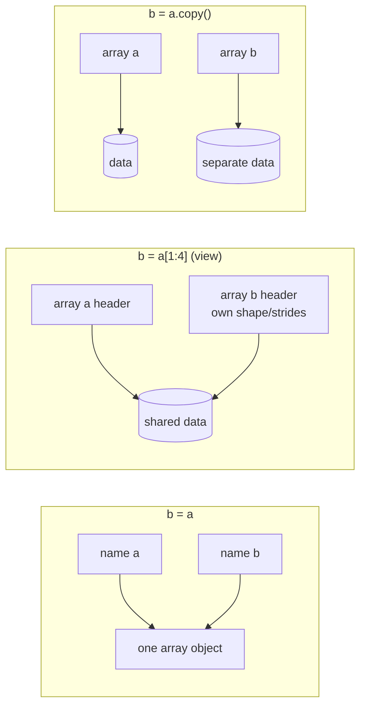

# The Matrix Library, Copies and Views: The Complete Guide

> 📚 **Before you start**
>
> - [Creating, Indexing and Slicing Arrays](creating-indexing-and-slicing-arrays.md), for views from slicing and copies from fancy indexing
> - [Data Types and Array Attributes](data-types-and-array-attributes.md), for `strides`, `flags` and `base`
> - [Array Manipulation and Arithmetic](array-manipulation-and-arithmetic.md), for reshaping, transposing and element-wise `*`
> - [Python Programming › Core Language Concepts](../../python-programming/course.md#m3), for how Python names refer to objects and what mutability means

## Introduction

On Monday you buy 2 cups of chai and 1 samosa and pay ₹50. On Tuesday you buy 1 cup of chai and 3 samosas and pay ₹75. What does each item cost? You probably solved systems like that in school by elimination. NumPy solves them, and systems with thousands of unknowns, with one function call, using its **linear algebra** tools. Linear algebra (the maths of matrices and vectors) sits underneath regression, recommendation systems, image transforms, physics simulations and every neural network.

The second half of this lesson tackles a question that causes more real bugs than any formula: **when does NumPy copy your data, and when does it share it?** You change a "small piece" of an array and the original changes too. Or you carefully modify a result and the original stays the same when you expected it to change. Both come from not knowing whether you were holding a **view** or a **copy**.

By the end of this article you will be able to multiply matrices correctly (and know why `*` is not matrix multiplication), solve linear systems, compute inverses, determinants, norms and eigenvalues, explain why the old `np.matrix` class should not be used, and predict exactly when NumPy shares memory.

> 💡 **Key Insight**
>
> Use ordinary 2-D arrays and the **`@` operator** for matrix maths; the `np.matrix` class is a legacy leftover. And for memory: **basic slicing, reshaping and transposing give views; fancy indexing, boolean masks, `astype` and arithmetic give copies**. When in doubt, check with `np.shares_memory`.

---

## Core Explanation

### 1. Element-wise product vs matrix product

You have used `*` on arrays: it multiplies **matching elements**. A **matrix product** is something else. For `A` of shape `(m, n)` and `B` of shape `(n, p)`, the product `A @ B` has shape `(m, p)`, and each entry is the sum of a row of `A` times a column of `B`. The inner sizes (`n`) must match.

```python
import numpy as np

A = np.array([[1, 2],
              [3, 4]])
B = np.array([[5, 6],
              [7, 8]])
print(A * B)          # element-wise
print(A @ B)          # matrix product
print(np.matmul(A, B), np.dot(A, B), sep="\n")
```

Output:

```
[[ 5 12]
 [21 32]]
[[19 22]
 [43 50]]
[[19 22]
 [43 50]]
[[19 22]
 [43 50]]
```

Entry `(0, 0)` of `A @ B` is `1×5 + 2×7 = 19`: row 0 of `A` with column 0 of `B`.

A practical example: a shop's **order quantities** (3 customers × 4 items) times a **price list** (4 items × 1) gives each customer's bill:

```python
orders = np.array([
    [2, 1, 0, 3],      # chai, samosa, vada pav, biscuit packs
    [1, 0, 2, 0],
    [0, 4, 1, 1],
])
price = np.array([15, 20, 25, 10])     # shape (4,)
print(orders @ price)                  # (3, 4) @ (4,) -> (3,)

try:
    price @ orders
except ValueError as err:
    print("ValueError:", str(err).split(" (")[0])
```

Output:

```
[ 80  65 115]
ValueError: matmul: Input operand 1 has a mismatch in its core dimension 0, with gufunc signature
```

The rules for `@` (`np.matmul`):

- Two 2-D arrays: ordinary matrix product, inner dimensions must match.
- A 1-D array on the right is treated as a column; on the left, as a row. The extra dimension is removed from the result.
- Arrays with more than 2 dimensions are treated as **stacks of matrices**, and the stack dimensions broadcast. This is called a **batched** matrix multiplication and is everywhere in deep learning.
- Scalars are not allowed with `@`; use `*`.

`np.dot` agrees with `@` for 1-D and 2-D inputs but has different (older) rules for higher dimensions; prefer `@` in new code.

```python
batch = np.arange(2 * 2 * 3).reshape(2, 2, 3)   # two 2x3 matrices
W = np.ones((3, 4))
print((batch @ W).shape)                        # each of the 2 matrices times W
```

Output:

```
(2, 2, 4)
```

### 2. Vector products

| Function | Result | Example use |
|---|---|---|
| `a @ b` or `np.dot(a, b)` (1-D) | dot product: sum of element-wise products | total bill from quantities and prices |
| `np.vecdot(a, b)` | dot product along the last axis, batched (NumPy 2) | many dot products at once |
| `np.inner(a, b)` | inner product over the last axes | same as dot for 1-D |
| `np.outer(a, b)` | every element of `a` times every element of `b` | multiplication tables |
| `np.cross(a, b)` | cross product of 3-D vectors | physics, geometry |
| `np.vdot(a, b)` | flattens both, conjugates `a` (complex) | |

```python
qty = np.array([2, 1, 3])
cost = np.array([15, 20, 10])
print(qty @ cost, np.dot(qty, cost), np.inner(qty, cost))
print(np.vecdot(orders[:, :3], np.array([15, 20, 25])))   # one dot product per row
print(np.outer(np.array([1, 2, 3]), np.array([10, 100])))
```

Output:

```
80 80 80
[ 50  65 105]
[[ 10 100]
 [ 20 200]
 [ 30 300]]
```

### 3. The `np.linalg` toolbox

`np.linalg` holds the standard linear algebra routines. Back to the chai and samosa puzzle: 2c + 1s = 50 and 1c + 3s = 75. In matrix form that is `A @ x = b`:

```python
A = np.array([[2.0, 1.0],
              [1.0, 3.0]])
b = np.array([50.0, 75.0])

x = np.linalg.solve(A, b)
print(x)                         # chai, samosa
print(A @ x)                     # check: gives b back
print(np.allclose(A @ x, b))
```

Output:

```
[15. 20.]
[50. 75.]
True
```

Chai costs ₹15 and a samosa ₹20. Always prefer `np.linalg.solve(A, b)` over computing the inverse and multiplying (`inv(A) @ b`): it is faster and more accurate.

The other everyday routines:

```python
print("det     :", round(np.linalg.det(A), 6))
print("inverse :\n", np.linalg.inv(A))
print("check   :", np.allclose(A @ np.linalg.inv(A), np.eye(2)))
print("rank    :", np.linalg.matrix_rank(A))
print("trace   :", np.trace(A))
print("norm    :", np.linalg.norm(np.array([3.0, 4.0])))
print("A^3     :\n", np.linalg.matrix_power(A, 3))
```

Output:

```
det     : 5.0
inverse :
 [[ 0.6 -0.2]
 [-0.2  0.4]]
check   : True
rank    : 2
trace   : 5.0
norm    : 5.0
A^3     :
 [[15. 20.]
 [20. 35.]]
```

- The **determinant** tells you whether a square matrix can be inverted: zero means no inverse (the equations are not independent).
- The **inverse** `A⁻¹` satisfies `A @ A⁻¹ = I`, the identity matrix.
- The **rank** is the number of independent rows (or columns).
- The **trace** is the sum of the diagonal.
- The **norm** is a vector's length (here the 3-4-5 triangle); `np.linalg.norm` also computes matrix norms.

When a matrix has no inverse, `inv` and `solve` raise `LinAlgError`:

```python
singular = np.array([[1.0, 2.0], [2.0, 4.0]])     # row 2 = 2 x row 1
try:
    np.linalg.inv(singular)
except np.linalg.LinAlgError as err:
    print("LinAlgError:", err)
print(np.linalg.matrix_rank(singular))
print(np.linalg.pinv(singular).round(3))          # pseudo-inverse always exists
```

Output:

```
LinAlgError: Singular matrix
1
[[0.04 0.08]
 [0.08 0.16]]
```

The **pseudo-inverse** `pinv` gives the best possible answer in a least-squares sense even when no exact inverse exists. `np.linalg.lstsq(A, b)` fits the best line through noisy data, the core of linear regression:

```python
hours = np.array([1.0, 2.0, 3.0, 4.0, 5.0])         # hours studied
marks = np.array([52.0, 58.0, 65.0, 71.0, 78.0])
X = np.column_stack([hours, np.ones_like(hours)])   # columns: slope term, intercept term
(slope, intercept), *_ = np.linalg.lstsq(X, marks)
print(round(slope, 2), round(intercept, 2))
```

Output:

```
6.5 45.3
```

Each extra hour adds about 6.5 marks. You will build on this in [Machine Learning Foundations: Data, EDA and Features](../../machine-learning-foundations-data-eda-and-features/course.md).

**Eigenvalues and eigenvectors** describe the directions a matrix stretches. For a symmetric matrix (such as a covariance matrix) use `np.linalg.eigh`, which is faster, more stable and returns real numbers in ascending order:

```python
cov = np.array([[4.0, 2.0],
                [2.0, 3.0]])
values, vectors = np.linalg.eigh(cov)
print(values.round(4))
print(vectors.round(4))
print(np.allclose(cov @ vectors[:, 1], values[1] * vectors[:, 1]))
```

Output:

```
[1.4384 5.5616]
[[ 0.6154 -0.7882]
 [-0.7882 -0.6154]]
True
```

This is the heart of **principal component analysis (PCA)**, covered in [Machine Learning Foundations: Data, EDA and Features](../../machine-learning-foundations-data-eda-and-features/course.md). `np.linalg.eig` handles general (non-symmetric) matrices, and `np.linalg.svd` computes the singular value decomposition.

NumPy 2 also added array-API names: `np.matrix_transpose(a)` (or the `a.mT` attribute) transposes only the **last two axes**, which is what you want for a stack of matrices, whereas `.T` reverses all axes:

```python
stack = np.zeros((10, 2, 3))
print(stack.T.shape, stack.mT.shape, np.matrix_transpose(stack).shape)
```

Output:

```
(3, 2, 10) (10, 3, 2) (10, 3, 2)
```

### 4. The legacy `np.matrix` class and `numpy.matlib`

Older code and tutorials use `np.matrix`, a subclass of `ndarray` that is **always 2-D** and where `*` means matrix multiplication. The `numpy.matlib` module provides functions such as `matlib.zeros` and `matlib.identity` that return matrix objects.

```python
import warnings

with warnings.catch_warnings():
    warnings.simplefilter("ignore", PendingDeprecationWarning)
    M = np.matrix([[1, 2], [3, 4]])
    print(M * M)                 # matrix product, NOT element-wise
    print(M[0].shape)            # a row of a matrix is still 2-D
    print(M.I)                   # inverse as an attribute
    print(type(M.A), M.A.shape)  # .A converts back to a plain array
```

Output:

```
[[ 7 10]
 [15 22]]
(1, 2)
[[-2.   1. ]
 [ 1.5 -0.5]]
<class 'numpy.ndarray'> (2, 2)
```

Creating a matrix emits a `PendingDeprecationWarning`, and the NumPy documentation says plainly that the class is no longer recommended, even for linear algebra. The reasons:

- `*` means different things for matrices and arrays, so code silently changes meaning depending on which one a function receives.
- Matrices cannot be 1-D or 3-D, so they do not fit with the rest of the ecosystem (scikit-learn, pandas and PyTorch all use arrays).
- Since Python 3.5 the `@` operator gives arrays a clean matrix product, which removed the original reason for the class.

If you inherit code that uses `np.matrix`, convert with `np.asarray(M)` and replace `*` between matrices with `@`.

### 5. Assignment, views and copies

Now to memory. There are three different situations, and they look similar in code:



**1. Plain assignment copies nothing.** `b = a` gives the same array a second name.

```python
a = np.array([10, 20, 30, 40, 50])
b = a
b[0] = 99
print(a, b is a)
```

Output:

```
[99 20 30 40 50] True
```

**2. A view** is a **new array object** with its own shape and strides that looks at **the same data**. Changing values through a view changes the original, but changing the view's shape does not affect the original's shape.

```python
a = np.array([10, 20, 30, 40, 50])
v = a[1:4]
print(v is a, v.base is a, np.shares_memory(a, v))
v[0] = -1
print(a)
```

Output:

```
False True True
[10 -1 30 40 50]
```

The `base` attribute points to the array that actually owns the memory; for an array that owns its data, `base` is `None`.

**3. A copy** has its own data. Changes never travel between them.

```python
a = np.array([10, 20, 30, 40, 50])
c = a.copy()
c[0] = 99
print(a, c.base is None, np.shares_memory(a, c))
```

Output:

```
[10 20 30 40 50] True False
```

### 6. Which operations give views and which give copies

| Usually a **view** (shares data) | Always a **copy** (new data) |
|---|---|
| basic slicing: `a[1:4]`, `a[:, 0]`, `a[::2]` | fancy indexing: `a[[0, 2]]` |
| `reshape` (when the memory layout allows) | boolean indexing: `a[a > 0]` |
| `.T`, `transpose`, `swapaxes`, `moveaxis` | `flatten()` |
| `ravel()` (when possible) | `astype(...)` (by default) |
| `squeeze`, `expand_dims`, `np.newaxis` | arithmetic results: `a + 1`, `a * b` |
| `a.view()`, `a.view(new_dtype)` | `np.array(a)` (by default), `a.copy()`, `np.copy(a)` |
| `np.broadcast_to` (read-only) | `np.concatenate`, `np.stack`, `np.append` |

```python
a = np.arange(12).reshape(3, 4)
checks = {
    "a[1:, :2]": a[1:, :2],
    "a.T": a.T,
    "a.reshape(4, 3)": a.reshape(4, 3),
    "a.ravel()": a.ravel(),
    "a[[0, 2]]": a[[0, 2]],
    "a[a > 5]": a[a > 5],
    "a.flatten()": a.flatten(),
    "a.astype(float)": a.astype(float),
    "a + 0": a + 0,
}
for name, result in checks.items():
    print(f"{name:16} shares memory: {np.shares_memory(a, result)}")
```

Output:

```
a[1:, :2]        shares memory: True
a.T              shares memory: True
a.reshape(4, 3)  shares memory: True
a.ravel()        shares memory: True
a[[0, 2]]        shares memory: False
a[a > 5]         shares memory: False
a.flatten()      shares memory: False
a.astype(float)  shares memory: False
a + 0            shares memory: False
```

`np.shares_memory` gives an exact answer but can be slow on complicated cases; `np.may_share_memory` is a fast check that may report `True` when the memory ranges merely overlap.

### 7. "When possible": when reshape and ravel must copy

A view can only describe data that can be reached with fixed strides. After transposing, the elements are no longer in row order in memory, so flattening them in row order needs a copy:

```python
t = np.arange(6).reshape(2, 3).T          # a non-contiguous view
print(t.flags["C_CONTIGUOUS"])
print(np.shares_memory(t, t.ravel()))     # ravel had to copy

try:
    np.reshape(t, 6, copy=False)          # NumPy 2.1+: refuse to copy
except ValueError as err:
    print("ValueError:", str(err).split(".")[0])
```

Output:

```
False
False
ValueError: Unable to avoid creating a copy while reshaping
```

`reshape` silently copies when it must. If your code depends on writing through the result, pass `copy=False` (available on `np.reshape` since NumPy 2.1) so you get an error instead of a silent copy.

### 8. The `copy` keyword in NumPy 2

`np.array` and `astype` take a `copy` argument, and NumPy 2 changed what `copy=False` means:

| Call | NumPy 2 behaviour |
|---|---|
| `np.array(x)` or `copy=True` | always copies |
| `np.array(x, copy=None)` / `np.asarray(x)` | copies only if needed |
| `np.array(x, copy=False)` | **never** copies; raises `ValueError` if a copy is unavoidable |
| `a.astype(t, copy=False)` | returns `a` itself if it already has dtype `t` |

```python
existing = np.arange(4)
print(np.asarray(existing) is existing)
print(existing.astype(np.int64, copy=False) is existing)
try:
    np.array([1, 2, 3], copy=False)       # a list must be copied into an array
except ValueError as err:
    print("ValueError:", str(err).splitlines()[0])
```

Output:

```
True
True
ValueError: Unable to avoid copy while creating an array as requested.
```

In NumPy 1.x, `copy=False` meant "copy only if needed". Code written that way should switch to `np.asarray(x)`, as the error message itself suggests.

### 9. Two practical consequences

**A small view keeps a big array alive.** A view holds a reference to its `base`, so the whole original stays in memory as long as the view exists. If you keep 10 rows of a 2 GB array, keep a **copy**:

```python
big = np.zeros((1_000_000, 10))
first_rows = big[:10]              # view: the 80 MB array cannot be freed
first_rows_safe = big[:10].copy()  # independent: 800 bytes
print(first_rows.base is big, first_rows_safe.base is None)
print(first_rows_safe.nbytes, "bytes")
```

Output:

```
True True
800 bytes
```

**Functions can change your arrays.** Arrays are passed to functions by reference (like lists), and in-place operations (`+=`, slice assignment, `a.sort()`) change the caller's data. Write functions that return new arrays, or copy defensively:

```python
def add_bonus(marks):
    marks += 5                      # in place: changes the caller's array!
    return marks

def add_bonus_safe(marks):
    return marks + 5                # new array; the input is untouched

class_marks = np.array([60, 70, 80])
add_bonus_safe(class_marks)
print(class_marks)
add_bonus(class_marks)
print(class_marks)
```

Output:

```
[60 70 80]
[65 75 85]
```

For `dtype=object` arrays, `.copy()` copies the pointers, not the Python objects they point to. Use `copy.deepcopy` if the elements are mutable (lists, dictionaries) and must be independent.

You can also protect an array from accidental changes by making it read-only:

```python
rates = np.array([0.05, 0.12, 0.18, 0.28])     # GST slabs
rates.flags.writeable = False
try:
    rates[0] = 0
except ValueError as err:
    print("ValueError:", err)
```

Output:

```
ValueError: assignment destination is read-only
```

The next module shows that **pandas 3** takes a different approach called Copy-on-Write: every selection behaves like a copy, and data is only duplicated when one side is modified. Keep the NumPy rules in mind; the contrast will make the pandas rules easy to remember.

---

## Try It Yourself

1. Three friends buy fruit. Friend 1: 2 kg apples, 1 kg bananas, 3 kg oranges, pays ₹630. Friend 2: 1, 2, 1 kg, pays ₹330. Friend 3: 3, 1, 2 kg, pays ₹620. Find the price per kg of each fruit.
2. Explain the shapes: what are `(np.ones((5, 3)) @ np.ones(3)).shape`, `(np.ones(3) @ np.ones((3, 4))).shape` and `(np.ones((8, 5, 3)) @ np.ones((3, 2))).shape`?
3. For `a = np.arange(10)`, predict which of these changes `a`: (i) `a[2:5][0] = 100`, (ii) `a[[2, 3]][0] = 100`, (iii) `a[a > 7][0] = 100`, (iv) `a.reshape(2, 5)[0, 0] = 100`. Then check.
4. Rewrite `M = np.matrix([[1, 2], [3, 4]]); result = M * M.T` with plain arrays.

<details>
<summary>Show answers</summary>

```python
qty = np.array([[2.0, 1.0, 3.0], [1.0, 2.0, 1.0], [3.0, 1.0, 2.0]])
paid = np.array([630.0, 330.0, 620.0])
print(np.linalg.solve(qty, paid))

print((np.ones((5, 3)) @ np.ones(3)).shape,
      (np.ones(3) @ np.ones((3, 4))).shape,
      (np.ones((8, 5, 3)) @ np.ones((3, 2))).shape)

a = np.arange(10); a[2:5][0] = 100; print("i  ", a[:5])
a = np.arange(10); a[[2, 3]][0] = 100; print("ii ", a[:5])
a = np.arange(10); a[a > 7][0] = 100; print("iii", a[-2:])
a = np.arange(10); a.reshape(2, 5)[0, 0] = 100; print("iv ", a[:5])

M = np.array([[1, 2], [3, 4]])
print(M @ M.T)
```

Output:

```
[110.  50. 120.]
(5,) (4,) (8, 5, 2)
i   [  0   1 100   3   4]
ii  [0 1 2 3 4]
iii [8 9]
iv  [100   1   2   3   4]
[[ 5 11]
 [11 25]]
```

**1.** Apples ₹110, bananas ₹50, oranges ₹120 per kg. **3.** (i) and (iv) change `a` because slicing and reshaping return views. (ii) and (iii) write into a temporary copy made by fancy and boolean indexing, so `a` is untouched.

</details>

---

## Real-World Examples

### Example 1: Neural network layers

A dense layer computes `outputs = inputs @ weights + bias`. With a batch of 64 inputs of 784 features and a weight matrix of shape `(784, 128)`, one `@` produces all 64 × 128 outputs. Attention in transformers is batched `@` on 4-D arrays.

### Example 2: Linear regression

Ordinary least squares, the classic regression method, is a linear algebra problem. Libraries solve it with routines like `np.linalg.lstsq` rather than an explicit inverse, for numerical stability.

### Example 3: Memory leaks from views

A common production bug: a service loads a huge array, keeps a tiny slice in a cache, and memory never goes down, because the slice is a view holding the whole array alive. The fix is one `.copy()`.

---

## Common Misconceptions

### Misconception 1: "`*` multiplies matrices"

For arrays, `*` is element-wise. Use `@` (or `np.matmul`) for the matrix product.

### Misconception 2: "Use `np.matrix` for linear algebra"

It is a legacy class with a pending deprecation. Plain 2-D arrays with `@` and `np.linalg` do everything better.

### Misconception 3: "To solve `Ax = b`, compute `inv(A) @ b`"

`np.linalg.solve(A, b)` is faster and more accurate. Reserve `inv` for when you genuinely need the inverse matrix itself.

### Misconception 4: "`b = a` makes a copy"

It makes a second name for the same array. Use `a.copy()` for an independent copy.

### Misconception 5: "`reshape` always returns a view"

Only when the memory layout allows. Otherwise it silently copies; use `np.reshape(..., copy=False)` to insist on a view.

---

## Interview Relevance

- *"Difference between `np.dot`, `np.matmul`/`@` and `*`?"* Element-wise vs matrix product; `matmul` broadcasts stacks of matrices, `dot` has older rules for N-D inputs and allows scalars.
- *"How do you solve a system of linear equations in NumPy?"* `np.linalg.solve`; mention singular matrices and `lstsq`/`pinv` for least squares.
- *"Why is `np.matrix` discouraged?"* Inconsistent `*` semantics, always 2-D, superseded by `@`.
- *"What is the difference between a view and a copy? Give examples of each."* Shared vs separate data; slicing/transposes vs fancy indexing/astype/arithmetic.
- *"How can you tell if two arrays share memory?"* `np.shares_memory`, or check `.base`.
- *"What did NumPy 2 change about `copy=False`?"* It now means "never copy" and raises if a copy is required; use `np.asarray` for the old meaning.

---

## Key Takeaways

- **`@` is matrix multiplication**; `*` is element-wise. `@` broadcasts over stacks of matrices.
- **`np.linalg`** provides `solve`, `inv`, `det`, `matrix_rank`, `norm`, `lstsq`, `pinv`, `eig`/`eigh` and `svd`; prefer `solve` over `inv`.
- **`np.matrix` and `numpy.matlib` are legacy**; use plain arrays.
- **Assignment shares the object, views share the data, copies share nothing.** Check with `np.shares_memory` or `.base`.
- **Slicing, reshape, transpose and ravel give views when possible; fancy and boolean indexing, astype, flatten and arithmetic give copies.**
- **NumPy 2's `copy=False` means "never copy"**; use `np.asarray` for "copy if needed".

---

**Up next:** [Lab: Image as a NumPy array](lab-image-as-a-numpy-array.md)
