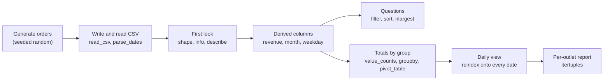

# Lab: Explore a Sales Dataset

> 📚 **Before you start**
>
> - [Series, DataFrames (and the Retired Panel)](series-dataframes-and-the-retired-panel.md), for creating and reading DataFrames
> - [Selecting, Sorting and Indexing Data](selecting-sorting-and-indexing-data.md), for `.loc`, `query`, sorting and MultiIndex
> - [Reindexing and Iteration](reindexing-and-iteration.md), for `reindex`, `date_range` and `itertuples`

## What You'll Build

You are the new analyst at **Chai Junction**, a small chain of tea cafés with four outlets. The owner hands you three months of order data (July to September 2026) and asks:

1. How big is the data, and is anything wrong with it?
2. Which outlets, products and payment methods bring in the most money?
3. What do the biggest orders look like, and who is discounting too much?
4. How did each outlet do month by month, and were there days with no sales?
5. Can you send a one-line summary per outlet?

You will answer every question with the pandas tools from this module, plus a first taste of `groupby` and `pivot_table`, which module 5 covers in depth.



> 💡 **Key Insight**
>
> Exploring a dataset is a loop of **ask a question, select or sort, look at the answer, ask the next question**. Keep each step small, print the result, and check that it makes sense before building on it.

Run the blocks in order in one file or notebook.

---

## Step 1: Generate the Orders

Real data would arrive as a file. To keep the lab self-contained, we generate 600 orders with a seeded random generator, so you get exactly the same data as this page.

```python
import io

import numpy as np
import pandas as pd

rng = np.random.default_rng(2026)
n = 600

outlets = ["Koramangala", "Indiranagar", "Jayanagar", "Whitefield"]
menu = pd.DataFrame({
    "product": ["Masala Chai", "Ginger Chai", "Filter Coffee", "Cold Coffee",
                "Samosa", "Vada Pav", "Bun Maska", "Veg Puff"],
    "category": ["Tea", "Tea", "Coffee", "Coffee", "Snack", "Snack", "Snack", "Snack"],
    "price": [30, 35, 40, 90, 25, 30, 45, 35],
})

dates = pd.Timestamp("2026-07-01") + pd.to_timedelta(rng.integers(0, 92, n), unit="D")
pick = rng.integers(0, len(menu), n)
orders = pd.DataFrame({
    "order_id": np.arange(10001, 10001 + n),
    "date": dates,
    "outlet": rng.choice(outlets, n, p=[0.35, 0.3, 0.2, 0.15]),
    "product": menu["product"].to_numpy()[pick],
    "qty": rng.integers(1, 7, n),
    "discount": rng.choice([0.0, 0.05, 0.10, 0.20], n, p=[0.6, 0.2, 0.15, 0.05]),
    "payment": rng.choice(["UPI", "Cash", "Card"], n, p=[0.65, 0.2, 0.15]),
})

# Whitefield was closed for renovation from 1 to 10 September
closed = (orders["outlet"] == "Whitefield") & orders["date"].between("2026-09-01", "2026-09-10")
orders = orders[~closed]

# Save as CSV text and read it back, exactly as you would with a real file
csv_text = orders.sort_values(["date", "order_id"]).to_csv(index=False)
print(csv_text.splitlines()[0])
print(csv_text.splitlines()[1])
```

Output:

```
order_id,date,outlet,product,qty,discount,payment
10079,2026-07-01,Koramangala,Veg Puff,1,0.0,UPI
```

Now load it the normal way:

```python
sales = pd.read_csv(io.StringIO(csv_text), parse_dates=["date"])
print(sales.head())
```

Output:

```
   order_id       date       outlet        product  qty  discount payment
0     10079 2026-07-01  Koramangala       Veg Puff    1      0.00     UPI
1     10118 2026-07-01    Jayanagar  Filter Coffee    4      0.05    Cash
2     10287 2026-07-01  Indiranagar    Masala Chai    4      0.00     UPI
3     10385 2026-07-01  Koramangala    Ginger Chai    1      0.00     UPI
4     10483 2026-07-01  Indiranagar  Filter Coffee    3      0.00     UPI
```

---

## Step 2: First Look

Always start with size, types and missing values.

```python
print(sales.shape)
sales.info()
```

Output:

```
(591, 7)
<class 'pandas.DataFrame'>
RangeIndex: 591 entries, 0 to 590
Data columns (total 7 columns):
 #   Column    Non-Null Count  Dtype         
---  ------    --------------  -----         
 0   order_id  591 non-null    int64         
 1   date      591 non-null    datetime64[us]
 2   outlet    591 non-null    str           
 3   product   591 non-null    str           
 4   qty       591 non-null    int64         
 5   discount  591 non-null    float64       
 6   payment   591 non-null    str           
dtypes: datetime64[us](1), float64(1), int64(2), str(3)
memory usage: 32.4 KB
```

No missing values, dates parsed as `datetime64[us]`, and the three text columns are the pandas 3 `str` dtype. A few sanity checks on the values:

```python
print(sales["date"].min().date(), "to", sales["date"].max().date())
print("unique order ids:", sales["order_id"].is_unique)
print(sales[["qty", "discount"]].describe().round(3))
print(sorted(sales["outlet"].unique()))
```

Output:

```
2026-07-01 to 2026-09-30
unique order ids: True
           qty  discount
count  591.000   591.000
mean     3.467     0.033
std      1.752     0.052
min      1.000     0.000
25%      2.000     0.000
50%      3.000     0.000
75%      5.000     0.050
max      6.000     0.200
['Indiranagar', 'Jayanagar', 'Koramangala', 'Whitefield']
```

The dates cover the quarter, every order id is unique, quantities run from 1 to 6, discounts from 0 to 20%, and there are exactly four outlets. The data looks clean.

---

## Step 3: Add Derived Columns

The orders hold quantities, but not prices or revenue. Bring the price in from the menu with `map` (a lookup by product name), then compute revenue after discount. The `.dt` accessor pulls parts out of dates (covered fully in module 4).

```python
price_of = menu.set_index("product")["price"]
category_of = menu.set_index("product")["category"]

sales["price"] = sales["product"].map(price_of)
sales["category"] = sales["product"].map(category_of)
sales["revenue"] = (sales["qty"] * sales["price"] * (1 - sales["discount"])).round(2)
sales["month"] = sales["date"].dt.month_name()
sales["weekday"] = sales["date"].dt.day_name()

print(sales[["product", "qty", "price", "discount", "revenue", "month", "weekday"]].head(4))
print("missing prices:", sales["price"].isna().sum())
print("total revenue: Rs", round(sales["revenue"].sum(), 2))
```

Output:

```
         product  qty  price  discount  revenue month    weekday
0       Veg Puff    1     35      0.00     35.0  July  Wednesday
1  Filter Coffee    4     40      0.05    152.0  July  Wednesday
2    Masala Chai    4     30      0.00    120.0  July  Wednesday
3    Ginger Chai    1     35      0.00     35.0  July  Wednesday
missing prices: 0
total revenue: Rs 81399.75
```

Every product matched a price, and the quarter brought in about ₹81,400.

---

## Step 4: Answer Questions by Filtering and Sorting

**What are the five biggest orders?**

```python
print(sales.nlargest(5, "revenue")[["date", "outlet", "product", "qty", "revenue"]])
```

Output:

```
          date       outlet      product  qty  revenue
65  2026-07-10  Koramangala  Cold Coffee    6    540.0
129 2026-07-20   Whitefield  Cold Coffee    6    540.0
202 2026-07-31   Whitefield  Cold Coffee    6    540.0
340 2026-08-20  Indiranagar  Cold Coffee    6    540.0
372 2026-08-25  Koramangala  Cold Coffee    6    540.0
```

Six Cold Coffees at ₹90 with no discount: the biggest single order possible. `nlargest` keeps the first rows it finds among ties.

**Which large orders got the biggest discount?** Orders of 5 or more items with 20% off:

```python
big_disc = sales.query("qty >= 5 and discount == 0.20")
print(len(big_disc))
print(big_disc["outlet"].value_counts().sort_index())
```

Output:

```
8
outlet
Indiranagar    3
Koramangala    2
Whitefield     3
Name: count, dtype: int64
```

`value_counts` counts how often each value appears, sorted from most to least common.

**How much of the revenue comes from weekends?**

```python
weekend = sales["weekday"].isin(["Saturday", "Sunday"])
share = sales.loc[weekend, "revenue"].sum() / sales["revenue"].sum()
print(f"weekend share of revenue: {share:.1%}  (weekends are {2 / 7:.1%} of days)")
```

Output:

```
weekend share of revenue: 30.6%  (weekends are 28.6% of days)
```

Weekends bring in slightly more than their share of the calendar (30.6% of revenue from 28.6% of the days). A small weekend bump like this is exactly the kind of pattern the check is meant to reveal; whether it is meaningful or just noise is a question for [Statistics for Data Science](../../statistics-for-data-science/course.md).

---

## Step 5: Totals by Group

`value_counts` answers "how many". For "how much", **`groupby`** splits the rows by a column, applies a calculation to each group and combines the results. Module 5 covers it in depth; here is the essential pattern.

```python
by_outlet = sales.groupby("outlet")["revenue"].sum().sort_values(ascending=False)
print(by_outlet.round(0))

by_product = (sales.groupby(["category", "product"])["revenue"]
                   .sum().sort_values(ascending=False).round(0))
print(by_product.head(4))
```

Output:

```
outlet
Indiranagar    26070.0
Koramangala    24845.0
Jayanagar      18967.0
Whitefield     11517.0
Name: revenue, dtype: float64
category  product      
Coffee    Cold Coffee      21231.0
Snack     Bun Maska        11529.0
Coffee    Filter Coffee    10754.0
Tea       Ginger Chai       9114.0
Name: revenue, dtype: float64
```

Grouping by two columns produced a **MultiIndex** (category, product), just like in the selecting lesson. Cold Coffee is the star product thanks to its ₹90 price.

How do customers pay? `value_counts(normalize=True)` gives shares instead of counts:

```python
print(sales["payment"].value_counts(normalize=True).round(3))
```

Output:

```
payment
UPI     0.680
Cash    0.184
Card    0.135
Name: proportion, dtype: float64
```

Roughly two out of three orders are paid by UPI.

**Outlet by month.** A **pivot table** puts one variable down the rows, another across the columns and aggregates a third in each cell:

```python
month_order = ["July", "August", "September"]
pivot = sales.pivot_table(index="outlet", columns="month", values="revenue",
                          aggfunc="sum").reindex(columns=month_order).round(0)
print(pivot)
```

Output:

```
month          July   August  September
outlet                                 
Indiranagar  6995.0  11354.0     7722.0
Jayanagar    6776.0   6686.0     5505.0
Koramangala  8938.0   7946.0     7961.0
Whitefield   5475.0   3626.0     2416.0
```

Notice the `reindex(columns=...)`: by default the month names would be sorted alphabetically (August, July, September), so we conform the columns to calendar order. Whitefield's September is its weakest month, consistent with the ten days it was closed. The next step confirms the gap.

---

## Step 6: Find the Days with No Sales

The pivot hints at a gap. Count Whitefield's orders per day, then **reindex onto every date of the quarter** so missing days appear with zero:

```python
wf = sales[sales["outlet"] == "Whitefield"]
wf_daily = wf.groupby("date")["revenue"].sum()
print("days with orders:", len(wf_daily))

quarter = pd.date_range("2026-07-01", "2026-09-30", freq="D")
wf_full = wf_daily.reindex(quarter, fill_value=0)
print("days in quarter :", len(wf_full))

zero_days = wf_full[wf_full == 0].index
print("zero-sales days :", len(zero_days))
print("in September    :", [d.day for d in zero_days if d.month == 9])
```

Output:

```
days with orders: 50
days in quarter : 92
zero-sales days : 42
in September    : [1, 2, 3, 4, 5, 6, 7, 8, 9, 10, 12, 14, 16, 18, 22, 24, 25, 26, 28, 30]
```

Days 1 to 10 of September are the renovation closure. The other zero days are ordinary quiet days: Whitefield is the smallest outlet, with fewer than one order a day on average in this data. Without the reindex, those days would simply be missing, and a "daily average" would be calculated over 50 days instead of 92 and come out far too high:

```python
print("average over days with orders:", round(wf_daily.mean(), 1))
print("true daily average           :", round(wf_full.mean(), 1))
```

Output:

```
average over days with orders: 230.3
true daily average           : 125.2
```

---

## Step 7: Send a Summary per Outlet

Build one summary row per outlet with vectorised group calculations, then loop with `itertuples` only to format the messages.

```python
summary = pd.DataFrame({
    "orders": sales.groupby("outlet")["order_id"].count(),
    "revenue": sales.groupby("outlet")["revenue"].sum().round(0),
    "avg_order": sales.groupby("outlet")["revenue"].mean().round(1),
    "top_product": sales.groupby("outlet")["product"].agg(
        lambda s: s.value_counts().sort_index().idxmax()),     # ties -> alphabetical
}).sort_values("revenue", ascending=False)
print(summary)

for row in summary.itertuples():
    print(f"{row.Index}: {row.orders} orders, Rs {row.revenue:,.0f} revenue, "
          f"avg Rs {row.avg_order} per order, best seller {row.top_product}")
```

Output:

```
             orders  revenue  avg_order  top_product
outlet                                              
Indiranagar     181  26070.0      144.0     Veg Puff
Koramangala     183  24845.0      135.8  Masala Chai
Jayanagar       142  18967.0      133.6       Samosa
Whitefield       85  11517.0      135.5  Cold Coffee
Indiranagar: 181 orders, Rs 26,070 revenue, avg Rs 144.0 per order, best seller Veg Puff
Koramangala: 183 orders, Rs 24,845 revenue, avg Rs 135.8 per order, best seller Masala Chai
Jayanagar: 142 orders, Rs 18,967 revenue, avg Rs 133.6 per order, best seller Samosa
Whitefield: 85 orders, Rs 11,517 revenue, avg Rs 135.5 per order, best seller Cold Coffee
```

("Best seller" here means the product ordered most often, not the one that earned the most.)

Finally, save the summary so the owner can open it in a spreadsheet. With a real file you would pass a path; here we show the text:

```python
print(summary.to_csv())
```

Output:

```
outlet,orders,revenue,avg_order,top_product
Indiranagar,181,26070.0,144.0,Veg Puff
Koramangala,183,24845.0,135.8,Masala Chai
Jayanagar,142,18967.0,133.6,Samosa
Whitefield,85,11517.0,135.5,Cold Coffee
```

---

## Try It Yourself

1. Which **weekday** has the highest total revenue across all outlets? Use `groupby` and `idxmax`.
2. For each **category**, what share of revenue comes from UPI payments? (Hint: filter to UPI, group by category, divide by the all-payments total per category.)
3. Make a pivot table of **quantity sold** with products as rows and outlets as columns, filling missing combinations with 0.
4. Koramangala's owner wants a full daily revenue series for **September** only, with 0 on days without orders. How many such days are there?

<details>
<summary>Show answers</summary>

```python
by_day = sales.groupby("weekday")["revenue"].sum()
print(by_day.idxmax(), round(by_day.max(), 2))

upi = sales[sales["payment"] == "UPI"].groupby("category")["revenue"].sum()
total = sales.groupby("category")["revenue"].sum()
print((upi / total).round(3))

qty_pivot = sales.pivot_table(index="product", columns="outlet", values="qty",
                              aggfunc="sum", fill_value=0)
print(qty_pivot.loc[["Cold Coffee", "Samosa"]])

kor = sales[(sales["outlet"] == "Koramangala") & (sales["date"].dt.month == 9)]
kor_daily = kor.groupby("date")["revenue"].sum().reindex(
    pd.date_range("2026-09-01", "2026-09-30"), fill_value=0)
print("zero days:", (kor_daily == 0).sum())
```

Output:

```
Saturday 12898.75
category
Coffee    0.676
Snack     0.707
Tea       0.625
Name: revenue, dtype: float64
outlet       Indiranagar  Jayanagar  Koramangala  Whitefield
product                                                     
Cold Coffee           95         33           70          46
Samosa                79         67           84          37
zero days: 5
```

</details>

---

## What You've Learned

- **Load and check** data with `read_csv(parse_dates=...)`, `shape`, `info()`, `describe()` and uniqueness checks before analysing it.
- **Derive columns** with vectorised arithmetic, `map` lookups and the `.dt` accessor.
- **Answer questions** with `nlargest`, `query`, `isin` and boolean masks.
- **Summarise** with `value_counts`, `groupby(...).sum()` and `pivot_table`, and fix the column order with `reindex`.
- **Reveal missing days** by reindexing onto a full `date_range`, which also gives correct daily averages.
- **Report** by computing everything vectorised and looping with `itertuples` only for formatting.

---

**Up next:** [Working with Text Data](../04-text-dates-and-categories-in-pandas/working-with-text-data.md)
