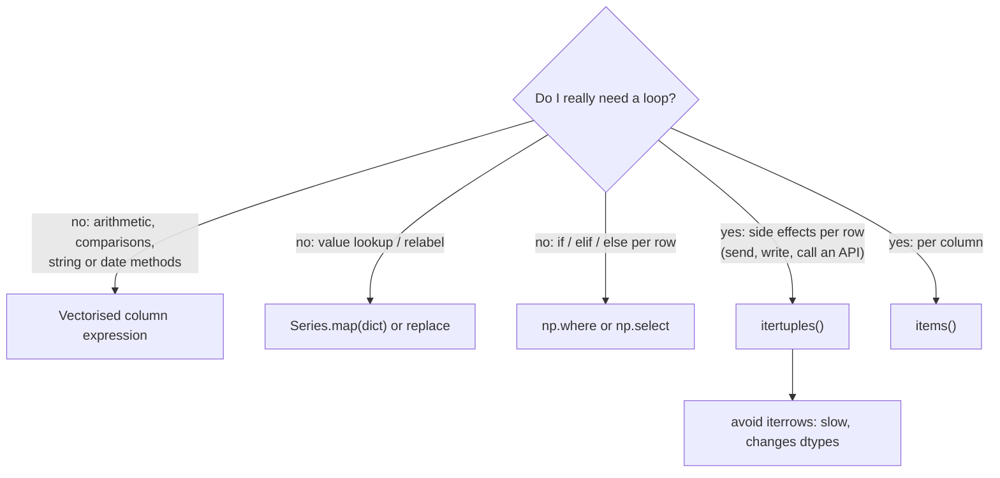

# Reindexing and Iteration: The Complete Guide

> 📚 **Before you start**
>
> - [Series, DataFrames (and the Retired Panel)](series-dataframes-and-the-retired-panel.md), for the index and label alignment
> - [Selecting, Sorting and Indexing Data](selecting-sorting-and-indexing-data.md), for `set_index`, `reset_index` and `.loc`
> - [Broadcasting and Iterating over Arrays](../02-numpy-essentials/broadcasting-and-iterating-over-arrays.md), for why vectorised code beats loops
> - [Python Programming › Functions and Iterators](../../python-programming/course.md#m6), for iterators, lambdas and `map`

## Introduction

A milk delivery business in Bengaluru logs deliveries only on days when something was delivered. The owner wants a report for **every** day of the month, with zero on days without deliveries, in a fixed customer order that matches the billing sheet, and with columns in the order the accountant expects. Nothing new needs to be calculated; the data simply has to be **conformed** to a given set of labels. In pandas that operation is called **reindexing**.

Then the owner asks for a personalised SMS for each customer. Now you really do need to go through the rows one at a time. pandas offers several ways to **iterate**, and they differ a lot in speed and in subtle behaviour (one of them quietly converts your integers to floats).

This lesson covers both. You will learn how `reindex` works and how it differs from `set_index`, `rename` and `reset_index`; how to fill the gaps it creates; how to line up two objects with `align`; how to loop over columns and rows correctly with `items`, `iterrows` and `itertuples`; and, most importantly, how to avoid loops by using vectorised operations, `map`, `np.where`, `np.select` and `apply`.

> 💡 **Key Insight**
>
> **`reindex` never changes which value belongs to which label; it changes which labels exist.** Labels you ask for that are not present get a fill value (`NaN` by default), and labels you leave out are dropped. And for iteration: if you can describe the work as an operation on whole columns, do that instead of looping.

---

## Core Explanation

### 1. A few basic attributes first

Every DataFrame exposes some basic properties you can rely on in reindexing and iteration code:

```python
import numpy as np
import pandas as pd

deliveries = pd.DataFrame(
    {"litres": [2.0, 1.5, 3.0, 1.0], "customer": ["Iyer", "Khan", "Iyer", "Das"]},
    index=pd.to_datetime(["2026-10-01", "2026-10-02", "2026-10-04", "2026-10-05"]),
)
print(deliveries)
print(deliveries.axes)                 # [row index, column index]
print(deliveries.ndim, deliveries.size, deliveries.empty)
```

Output:

```
            litres customer
2026-10-01     2.0     Iyer
2026-10-02     1.5     Khan
2026-10-04     3.0     Iyer
2026-10-05     1.0      Das
[DatetimeIndex(['2026-10-01', '2026-10-02', '2026-10-04', '2026-10-05'], dtype='datetime64[us]', freq=None), Index(['litres', 'customer'], dtype='str')]
2 8 False
```

`axes` lists the row index and the column index, `size` is rows × columns, and `empty` is `True` only when there are no elements at all (useful to guard code that would fail on an empty filter result).

### 2. `reindex`: conform data to new labels

`reindex` takes a list of labels and returns an object with exactly those labels, in that order. Existing labels keep their values; new labels get `NaN`.

```python
stock = pd.Series({"milk": 40, "curd": 12, "paneer": 5})
print(stock.reindex(["paneer", "milk", "butter"]))
```

Output:

```
paneer     5.0
milk      40.0
butter     NaN
dtype: float64
```

`paneer` and `milk` were **moved**, not recalculated. `butter` did not exist, so it got `NaN` (which made the dtype `float64`). `curd` was not requested, so it was dropped. Use `fill_value` to choose what new labels get:

```python
print(stock.reindex(["paneer", "milk", "butter"], fill_value=0))
```

Output:

```
paneer     5
milk      40
butter     0
dtype: int64
```

On a DataFrame, reindex rows, columns or both. The `columns=` form is a clean way to enforce a column order (and add any missing columns):

```python
prices = pd.DataFrame({"price": [56, 30, 90], "unit": ["L", "kg", "kg"]},
                      index=["milk", "curd", "paneer"])
print(prices.reindex(index=["curd", "milk", "ghee"], columns=["unit", "price", "gst"]))
```

Output:

```
     unit  price  gst
curd   kg   30.0  NaN
milk    L   56.0  NaN
ghee  NaN    NaN  NaN
```

### 3. Filling every day of a period

The most common real use of `reindex` is filling in missing dates. Build the complete range with `pd.date_range` and reindex onto it:

```python
daily = deliveries["litres"]
all_days = pd.date_range("2026-10-01", "2026-10-06", freq="D")
full = daily.reindex(all_days, fill_value=0)
print(full)
```

Output:

```
2026-10-01    2.0
2026-10-02    1.5
2026-10-03    0.0
2026-10-04    3.0
2026-10-05    1.0
2026-10-06    0.0
Freq: D, Name: litres, dtype: float64
```

Now the 3rd and 6th appear with 0, so a daily chart or a 7-day average will be correct. The [Dates, Times and Timedeltas](../04-text-dates-and-categories-in-pandas/dates-times-and-timedeltas.md) lesson covers `date_range` and frequencies in depth.

Sometimes the right fill is not a constant but the **nearest known value**, for example a price that stays the same until it changes. The `method` argument fills new labels from neighbours, and it requires the index to be sorted:

```python
milk_price = pd.Series([54, 56], index=pd.to_datetime(["2026-10-01", "2026-10-04"]))
print(milk_price.reindex(all_days, method="ffill"))           # carry the last price forward
print(milk_price.reindex(all_days, method="bfill").tolist())  # take the next price
print(milk_price.reindex(all_days, method="ffill", limit=1).tolist())   # at most one step
```

Output:

```
2026-10-01    54
2026-10-02    54
2026-10-03    54
2026-10-04    56
2026-10-05    56
2026-10-06    56
Freq: D, dtype: int64
[54.0, 56.0, 56.0, 56.0, nan, nan]
[54.0, 54.0, nan, 56.0, 56.0, nan]
```

The methods are `"ffill"` (forward fill, also called "pad"), `"bfill"` (backward fill) and `"nearest"`. `limit` caps how many consecutive new labels are filled, and `tolerance` caps how far away the source label may be. Note that these fill **only the labels reindex created**; existing `NaN` values in the data stay. To fill those, use `ffill()`, `bfill()` or `fillna()` on the result, covered with missing data in module 5.

### 4. `reindex_like` and `align`

`reindex_like(other)` reindexes an object to match **another object's** labels:

```python
target = pd.DataFrame(index=["paneer", "milk"], columns=["price"])
print(prices.reindex_like(target))
```

Output:

```
        price
paneer     90
milk       56
```

`align` reindexes **two** objects to a shared set of labels in one call and returns both. The `join` argument chooses which labels survive: `"outer"` (union, the default), `"inner"` (intersection), `"left"` or `"right"`.

```python
week1 = pd.Series({"Iyer": 14, "Khan": 7, "Das": 3})
week2 = pd.Series({"Khan": 9, "Das": 4, "Rao": 5})

a, b = week1.align(week2, join="outer", fill_value=0)
print(pd.DataFrame({"week1": a, "week2": b}))
a, b = week1.align(week2, join="inner")
print(a.index.tolist())
```

Output:

```
      week1  week2
Das     3.0    4.0
Iyer   14.0    0.0
Khan    7.0    9.0
Rao     0.0    5.0
['Khan', 'Das']
```

This is what pandas does internally every time you add two Series; `align` just lets you do it explicitly and keep both results.

### 5. Reindex, rename, set_index and reset_index: which is which?

These four are easy to confuse because they all touch the index. They do very different things:

| Method | What it changes | Values move with their labels? |
|---|---|---|
| `reindex(new_labels)` | **which labels exist** and their order | yes; new labels get a fill value, missing ones are dropped |
| `rename(mapper)` | **the names of labels** (rows or columns) | yes; same rows, new names |
| `set_axis(new_labels)` | **replaces all labels** by position | no; position 0 gets the first new label |
| `set_index("col")` | makes a **column** the index | yes |
| `reset_index()` | moves the index back to a **column** | yes |

```python
s = pd.Series([40, 12, 5], index=["milk", "curd", "paneer"])
print(s.reindex(["curd", "milk"]).to_dict())                 # keeps values with labels
print(s.rename({"curd": "dahi"}).to_dict())                  # renames one label
print(s.set_axis(["a", "b", "c"]).to_dict())                 # relabels by position
print(s.rename(str.upper).index.tolist())                    # rename with a function
print(prices.add_prefix("item_").columns.tolist())           # rename all columns
```

Output:

```
{'curd': 12, 'milk': 40}
{'milk': 40, 'dahi': 12, 'paneer': 5}
{'a': 40, 'b': 12, 'c': 5}
['MILK', 'CURD', 'PANEER']
['item_price', 'item_unit']
```

`rename` on a DataFrame takes `index=` and/or `columns=` (a dict or a function). `add_prefix` and `add_suffix` rename every column at once.

### 6. Iterating over a DataFrame

Sometimes a loop is genuinely the right tool: sending one message per customer, calling an external API per row, or writing a custom report. pandas gives you four ways to loop.

**Looping over a DataFrame directly gives column names**, not rows. This trips up almost every beginner:

```python
orders = pd.DataFrame({
    "customer": ["Iyer", "Khan", "Das", "Rao"],
    "litres": [14, 9, 4, 5],
    "rate": [56.0, 56.0, 58.5, 56.0],
})
for thing in orders:
    print(thing)
```

Output:

```
customer
litres
rate
```

**`items()`** yields `(column_name, column_Series)` pairs, which is useful for column-by-column work such as reporting each column's type and missing count:

```python
for name, col in orders.items():
    print(f"{name:9} {str(col.dtype):8} missing={col.isna().sum()}")
```

Output:

```
customer  str      missing=0
litres    int64    missing=0
rate      float64  missing=0
```

**`iterrows()`** yields `(index_label, row_Series)` pairs. It looks natural but has two problems. It is slow, because it builds a new Series for every row. And because a Series has a single dtype, each row is **converted to a common type**, so integers can silently become floats:

```python
for idx, row in orders.iterrows():
    print(idx, row["customer"], row["litres"], type(row["litres"]).__name__)
    break

numeric = orders[["litres", "rate"]]
for idx, row in numeric.iterrows():
    print(row["litres"], row.dtype)        # the int 14 has become a float
    break
```

Output:

```
0 Iyer 14 int
14.0 float64
```

In the first loop the row mixed text and numbers, so the row Series had dtype `object` and kept `14` as an integer. In the second, all columns were numeric, so the row became `float64` and `14` became `14.0`. Code that relies on integer types inside `iterrows` can break this way.

**`itertuples()`** yields one **named tuple** per row. It keeps each column's own type, lets you use attribute names, and is many times faster than `iterrows`:

```python
for row in orders.itertuples():
    print(row.Index, row.customer, row.litres, round(row.litres * row.rate, 2))
```

Output:

```
0 Iyer 14 784.0
1 Khan 9 504.0
2 Das 4 234.0
3 Rao 5 280.0
```

Options: `index=False` drops the index from each tuple, and `name=None` returns plain tuples (slightly faster still). Column names that are not valid Python identifiers (such as `"unit price"`) are renamed to positional names like `_2`, so tidy column names first.

```python
print(list(orders.itertuples(index=False, name=None))[:2])
```

Output:

```
[('Iyer', 14, 56.0), ('Khan', 9, 56.0)]
```

**Never modify the DataFrame you are iterating over** through the row objects. Under Copy-on-Write each row you receive behaves as a separate copy, so assigning to `row["litres"]` changes nothing in `orders`. If you must compute values in a loop, collect them in a list and assign the whole column afterwards.



### 7. Instead of looping: the vectorised alternatives

Here is the same calculation (each customer's bill with 5% off orders above ₹500) done four ways. All give the same numbers; the speed differs enormously on large data.

```python
# 1. Loop with itertuples (fine for 4 rows, slow for 4 million)
bills = []
for row in orders.itertuples(index=False):
    amount = row.litres * row.rate
    bills.append(amount * 0.95 if amount > 500 else amount)
print([round(b, 2) for b in bills])

# 2. Vectorised with np.where: one expression over whole columns
amount = orders["litres"] * orders["rate"]
print(np.where(amount > 500, amount * 0.95, amount).round(2).tolist())

# 3. Series.where: keep values where the condition holds, replace the rest
print(amount.where(amount <= 500, amount * 0.95).round(2).tolist())

# 4. apply along rows: readable, but still a Python-level loop underneath
print(orders.apply(lambda r: r["litres"] * r["rate"] * (0.95 if r["litres"] * r["rate"] > 500 else 1),
                   axis=1).round(2).tolist())
```

Output:

```
[744.8, 478.8, 234.0, 280.0]
[744.8, 478.8, 234.0, 280.0]
[744.8, 478.8, 234.0, 280.0]
[744.8, 478.8, 234.0, 280.0]
```

All four agree: Iyer (₹784) and Khan (₹504) are over ₹500 and get 5% off; Das and Rao do not. Version 1 runs a line of Python per row; versions 2 and 3 each run a handful of compiled operations over whole columns, which on a million rows is typically hundreds of times faster; version 4 reads nicely but still calls the lambda once per row.

For **many conditions**, `np.select` takes a list of conditions and a matching list of choices, checked in order, with a default:

```python
litres = orders["litres"]
tier = np.select([litres >= 12, litres >= 6], ["gold", "silver"], default="regular")
print(dict(zip(orders["customer"], tier.tolist())))
```

Output:

```
{'Iyer': 'gold', 'Khan': 'silver', 'Das': 'regular', 'Rao': 'regular'}
```

For **lookups**, `Series.map` replaces each value using a dictionary (or a function or another Series):

```python
area = {"Iyer": "Jayanagar", "Khan": "Frazer Town", "Das": "Indiranagar"}
print(orders["customer"].map(area).tolist())          # unmatched -> NaN
print(orders["customer"].map(len).tolist())           # apply a function to each value
```

Output:

```
['Jayanagar', 'Frazer Town', 'Indiranagar', nan]
[4, 4, 3, 3]
```

### 8. `apply`, `map` and `pipe` on DataFrames

When there is no vectorised method, these run your own function at the right granularity:

| Method | Calls your function on | Typical use |
|---|---|---|
| `Series.map(f)` | each value of one column | lookups, simple per-value functions |
| `DataFrame.map(f)` | each cell of the table (replaces the removed `applymap`) | formatting every cell |
| `DataFrame.apply(f)` | each **column** (default, `axis=0`) | per-column summaries |
| `DataFrame.apply(f, axis=1)` | each **row** | logic needing several columns, when no vectorised form exists |
| `DataFrame.pipe(f)` | the whole DataFrame | chaining your own functions |

```python
nums = orders[["litres", "rate"]]
print(nums.apply(lambda col: col.max() - col.min()))          # per column
print(nums.map(lambda v: f"{v:,.1f}").iloc[0].tolist())        # per cell

def add_amount(df, discount_over=500):
    amount = df["litres"] * df["rate"]
    return df.assign(amount=amount.where(amount <= discount_over, amount * 0.95))

print(orders.pipe(add_amount).round(2))
```

Output:

```
litres    10.0
rate       2.5
dtype: float64
['14.0', '56.0']
  customer  litres  rate  amount
0     Iyer      14  56.0   744.8
1     Khan       9  56.0   478.8
2      Das       4  58.5   234.0
3      Rao       5  56.0   280.0
```

`apply(axis=1)` is convenient but, like `np.vectorize` in NumPy, it is a loop in disguise. Reach for it after vectorised expressions, `np.where`, `np.select` and `map`.

### 9. Iterating over groups

One loop pandas makes easy is "for each group": `groupby` yields `(key, sub-DataFrame)` pairs. The grouping itself, and aggregations that make the loop unnecessary, are covered in module 5.

```python
visits = pd.DataFrame({"area": ["North", "South", "North", "South", "East"],
                       "litres": [3, 5, 2, 4, 6]})
for area, group in visits.groupby("area"):
    print(area, len(group), group["litres"].sum())
```

Output:

```
East 1 6
North 2 5
South 2 9
```

Groups come out sorted by key. The one-line equivalent of this whole loop is `visits.groupby("area")["litres"].agg(["count", "sum"])`.

---

## Try It Yourself

1. A Series of exam scores is indexed by roll number: `pd.Series({3: 78, 1: 91, 4: 66})`. Reindex it to roll numbers 1 to 5 with missing students scored 0, in order.
2. Daily temperatures were recorded only on some days: `{"2026-10-01": 31, "2026-10-03": 29, "2026-10-06": 33}`. Produce a series for every day from the 1st to the 7th where a missing day takes the most recent known temperature.
3. Using the `orders` DataFrame, loop with `itertuples` and print a message like `Iyer: 14 L, pay Rs 744.80` for each customer (use the discounted amount).
4. Replace this loop with one vectorised line: `labels = []; for v in orders["litres"]: labels.append("bulk" if v >= 9 else "small")`.

<details>
<summary>Show answers</summary>

```python
scores = pd.Series({3: 78, 1: 91, 4: 66})
print(scores.reindex(range(1, 6), fill_value=0).to_dict())

temps = pd.Series({"2026-10-01": 31, "2026-10-03": 29, "2026-10-06": 33})
temps.index = pd.to_datetime(temps.index)
week = pd.date_range("2026-10-01", "2026-10-07")
print(temps.reindex(week, method="ffill").tolist())

billed = orders.pipe(add_amount)
for row in billed.itertuples(index=False):
    print(f"{row.customer}: {row.litres} L, pay Rs {row.amount:.2f}")

print(np.where(orders["litres"] >= 9, "bulk", "small").tolist())
```

Output:

```
{1: 91, 2: 0, 3: 78, 4: 66, 5: 0}
[31, 31, 29, 29, 29, 33, 33]
Iyer: 14 L, pay Rs 744.80
Khan: 9 L, pay Rs 478.80
Das: 4 L, pay Rs 234.00
Rao: 5 L, pay Rs 280.00
['bulk', 'bulk', 'small', 'small']
```

</details>

---

## Real-World Examples

### Example 1: Complete time series for dashboards

Payment apps record transactions only when they happen. Before charting daily volume, analysts reindex onto a full `date_range` with `fill_value=0`; otherwise quiet days vanish from the chart and moving averages are wrong.

### Example 2: Enforcing a schema

Data pipelines that send tables to a database or a machine learning model call `df.reindex(columns=expected_columns)` so the columns are always present and in the expected order, with missing ones visible as `NaN` instead of causing a crash downstream.

### Example 3: Row-by-row side effects

Sending an SMS or email per customer, or calling a geocoding API per address, is a legitimate loop. Teams use `itertuples` for it, and keep all the calculations (amounts, segments, messages) vectorised beforehand.

---

## Common Misconceptions

### Misconception 1: "`reindex` renames labels"

It selects and reorders labels, keeping each value with its label. To change label names use `rename`; to relabel by position use `set_axis`.

### Misconception 2: "`reindex(method='ffill')` fills all missing values"

It fills only the labels created by the reindex. Existing `NaN` values need `ffill()` or `fillna()`.

### Misconception 3: "`for x in df` loops over rows"

It loops over column names. Use `itertuples()` for rows and `items()` for columns.

### Misconception 4: "`iterrows` is the normal way to loop"

It is the slowest option and can change dtypes. `itertuples` is faster and keeps types, and a vectorised expression is faster still.

### Misconception 5: "`apply(axis=1)` is vectorised"

It calls a Python function once per row. It is convenient, not fast.

---

## Interview Relevance

- *"What does `reindex` do, and what happens to labels that don't exist?"* Conforms to new labels; missing ones get `NaN` or `fill_value`; unlisted ones are dropped; `method` fills from neighbours on a sorted index.
- *"How do you fill in missing dates in a time series?"* `reindex(pd.date_range(...), fill_value=0)` or forward-fill, or `asfreq`/`resample`.
- *"`iterrows` vs `itertuples`?"* Series per row (slow, dtype coercion) vs named tuples (faster, keeps types).
- *"How would you speed up a slow `apply`?"* Vectorise with column arithmetic, `np.where`/`np.select`, `map`, or built-in `.str`/`.dt` methods.
- *"Difference between `map`, `apply` and `applymap`?"* Per value (Series) / per column or row / per cell, where `applymap` is now `DataFrame.map`.

---

## Key Takeaways

- **`reindex`** conforms data to a list of labels: values stay with their labels, new labels get `NaN` or `fill_value`, unlisted labels are dropped.
- **Fill new labels** with `fill_value` or `method="ffill"/"bfill"/"nearest"` (with `limit`/`tolerance`); a full `date_range` plus `reindex` fills missing days.
- **`align`, `reindex_like`, `rename`, `set_axis`, `add_prefix`** cover the other ways to line up and relabel data.
- **Loop over columns with `items()` and rows with `itertuples()`**; avoid `iterrows`, and never modify a DataFrame through its row objects.
- **Prefer vectorised alternatives**: column arithmetic, `np.where`, `np.select`, `Series.map`, then `apply`/`pipe` for custom logic.

---

**Up next:** [Lab: Explore a sales dataset](lab-explore-a-sales-dataset.md)
