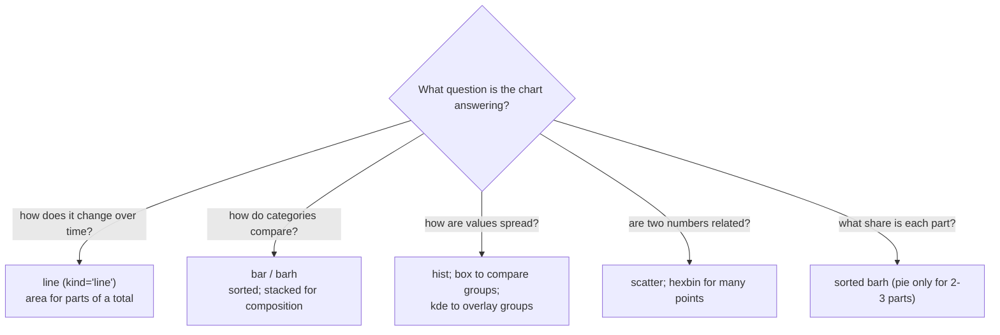

# Quick Visualisation with pandas: The Complete Guide

> 📚 **Before you start**
>
> - [Descriptive Statistics in pandas](descriptive-statistics-in-pandas.md), for `describe`, `groupby` and `value_counts`, which produce most of the data you plot
> - [Dates, Times and Timedeltas](../04-text-dates-and-categories-in-pandas/dates-times-and-timedeltas.md), for time series with a DatetimeIndex and `resample`
> - [Categorical Data](../04-text-dates-and-categories-in-pandas/categorical-data.md), for ordered categories that keep bars in a sensible order

## Introduction

A table of 365 daily temperatures tells you almost nothing at a glance. The same numbers drawn as a line instantly show the summer peak, the monsoon dip and the one broken sensor reading in January. A list of salaries hides its shape; a histogram shows whether most people earn about the same or whether a few earn far more. Pictures are often the fastest way to *understand* data, and the fastest way to find mistakes in it.

You do not need a separate charting tool for this. Every pandas Series and DataFrame has a **`.plot`** method that draws the most common chart types in one line, using **Matplotlib** underneath. The index becomes the x-axis, each column becomes a series, and the column names become the legend. These are **exploratory** charts: quick, rough and meant for you. Polished charts for reports are the subject of [modules 6 and 7](../course.md#m6) of this course.

In this lesson you will learn every `kind` of plot pandas offers, how to pick the right one for your question, how to customise and combine plots through the Matplotlib `Axes` object that `.plot` returns, how to save them to files, and the extra tools in `pandas.plotting` such as the scatter matrix.

> 💡 **Key Insight**
>
> `df.plot(kind=...)` plots **the index on the x-axis and every column as a series**. So most of the work happens *before* plotting: use `groupby`, `resample`, `pivot_table` or `set_index` to shape the data so that the index and columns are exactly what you want on the chart.

---

## Core Explanation

### 1. Setup: Matplotlib, backends and saving files

pandas draws with Matplotlib. On your own machine, charts appear inline in Jupyter notebooks or in a window when you call `plt.show()`. In this lesson every chart is saved to a temporary folder instead, using Matplotlib's **Agg** backend, which draws to image files without needing a screen. That is also how you would make charts on a server.

```python
import os
import tempfile

import matplotlib
matplotlib.use("Agg")                     # draw to files, no window needed
import matplotlib.pyplot as plt
import numpy as np
import pandas as pd

out_dir = tempfile.mkdtemp()

def save(ax, name):
    """Save the figure that owns this Axes, then close it to free memory."""
    fig = ax.get_figure()
    path = os.path.join(out_dir, name)
    fig.savefig(path, dpi=100, bbox_inches="tight")
    plt.close(fig)
    print("saved", name, "| exists:", os.path.exists(path))
```

Every `.plot` call returns a Matplotlib **`Axes`**: the plotting area with its axes, ticks, title and legend. The `Axes` belongs to a **`Figure`**, the whole image. Keep hold of the `Axes` to customise or save the chart. We print only the file name, because the temporary folder's path differs on every computer; print `out_dir` on your machine to find the images.

### 2. The data for this lesson

```python
rng = np.random.default_rng(5)

# a year of daily data for a Pune juice stall
days = pd.date_range("2026-01-01", "2026-12-31", freq="D")
season = 29 + 7 * np.sin((days.dayofyear - 34) / 365 * 2 * np.pi)        # hottest in early May
temp = pd.Series(season + rng.normal(0, 2, len(days)), index=days).round(1)
juice = (45 + 4 * (temp - 29) + rng.normal(0, 7, len(days))).clip(lower=5).round()
stall = pd.DataFrame({"temp_c": temp, "juices": juice})

# monthly sales of three products
monthly = stall["juices"].resample("ME").sum().to_frame("mango")
monthly["lime"] = (monthly["mango"] * 0.6 + rng.normal(0, 120, 12)).round()
monthly["sugarcane"] = (monthly["mango"] * 0.4 + rng.normal(0, 90, 12)).round()
monthly.index = monthly.index.strftime("%b")

print(stall.describe().round(1))
print(monthly.head(3))
```

Output:

```
       temp_c  juices
count   365.0   365.0
mean     28.9    44.9
std       5.4    22.3
min      16.9     5.0
25%      24.2    27.0
50%      28.7    45.0
75%      33.6    63.0
max      39.7    96.0
      mango    lime  sugarcane
Jan  1081.0   535.0      448.0
Feb  1406.0   883.0      572.0
Mar  1938.0  1357.0      746.0
```

### 3. Line plots: change over time

`kind="line"` is the default. With a DatetimeIndex, pandas formats the date axis for you.

```python
ax = stall["temp_c"].plot(figsize=(9, 3), title="Daily temperature, Pune 2026")
ax.set_ylabel("°C")
print(type(ax).__name__, "| lines drawn:", len(ax.lines))
save(ax, "temperature_line.png")
```

Output:

```
Axes | lines drawn: 1
saved temperature_line.png | exists: True
```

Daily data is noisy. Plot a rolling average on the **same Axes** by passing `ax=` to the second call:

```python
ax = stall["temp_c"].plot(figsize=(9, 3), alpha=0.4, label="daily")
stall["temp_c"].rolling("30D").mean().plot(ax=ax, linewidth=2, label="30-day average")
ax.set_title("Temperature: daily vs 30-day average")
ax.legend()
print("lines drawn:", len(ax.lines), "| legend:", [t.get_text() for t in ax.get_legend().get_texts()])
save(ax, "temperature_smoothed.png")
```

Output:

```
lines drawn: 2 | legend: ['daily', '30-day average']
saved temperature_smoothed.png | exists: True
```

A DataFrame draws one line per column. `subplots=True` puts each column in its own panel, which is the right choice when columns have **different units** (here °C and juice counts):

```python
axes = stall.resample("W").mean().plot(subplots=True, figsize=(9, 5), title="Weekly averages")
print(type(axes).__name__, axes.shape)
save(axes[0], "weekly_subplots.png")
```

Output:

```
ndarray (2,)
saved weekly_subplots.png | exists: True
```

pandas also offers `secondary_y=` to draw a second y-scale on the right of the same panel. Avoid it: two scales on one chart let the reader's eye compare lines that are not comparable, and the apparent relationship depends entirely on how each axis happens to be scaled. Separate panels (as above) or a scatter plot (section 6) show the relationship honestly.

### 4. Bar charts: comparing categories

`kind="bar"` (vertical) and `kind="barh"` (horizontal) compare one number per category. The index labels the bars.

```python
ax = monthly["mango"].plot(kind="bar", figsize=(8, 3), color="tab:orange",
                           title="Mango juices sold per month", rot=0)
ax.set_ylabel("juices")
print("bars:", len(ax.patches))
save(ax, "mango_bar.png")
```

Output:

```
bars: 12
saved mango_bar.png | exists: True
```

`rot=0` keeps the month labels horizontal. For a DataFrame, bars are **grouped** side by side per index value; `stacked=True` stacks them to show totals and composition:

```python
quarterly = monthly.groupby(np.repeat(["Q1", "Q2", "Q3", "Q4"], 3)).sum()
print(quarterly)
ax = quarterly.plot(kind="bar", stacked=True, rot=0, figsize=(6, 4),
                    title="Juice sales by quarter")
save(ax, "quarterly_stacked.png")
```

Output:

```
     mango    lime  sugarcane
Q1  4425.0  2775.0     1766.0
Q2  6325.0  3685.0     2451.0
Q3  3802.0  2390.0     1475.0
Q4  1819.0  1335.0      911.0
saved quarterly_stacked.png | exists: True
```

Horizontal bars suit long category names and rankings. Sort first so the chart reads as a ranking:

```python
totals = monthly.sum().sort_values()
ax = totals.plot(kind="barh", figsize=(6, 2.5), title="Total sales by product")
for value, patch in zip(totals, ax.patches):
    ax.annotate(f"{value:,.0f}", (patch.get_width(), patch.get_y() + patch.get_height() / 2),
                xytext=(4, 0), textcoords="offset points", va="center")
print(totals.astype(int).to_dict())
save(ax, "product_ranking.png")
```

Output:

```
{'sugarcane': 6603, 'lime': 10185, 'mango': 16371}
saved product_ranking.png | exists: True
```

Direct labels at the end of each bar save the reader from estimating against the axis.

### 5. Distributions: histogram, box plot and density

To see **how values are spread**, use a histogram (`kind="hist"`): it splits the range into bins and draws how many values fall in each.

```python
ax = stall["juices"].plot(kind="hist", bins=20, figsize=(6, 3), edgecolor="white",
                          title="How many juices per day?")
ax.set_xlabel("juices sold in a day")
counts = [int(p.get_height()) for p in ax.patches]
print("bins:", len(counts), "| days counted:", sum(counts))
save(ax, "juices_hist.png")
```

Output:

```
bins: 20 | days counted: 365
saved juices_hist.png | exists: True
```

The number of bins changes the picture: too few hides the shape, too many makes it jagged. Try 10, 20 and 40.

A **box plot** (`kind="box"`) summarises a distribution in five numbers: the box spans the quartiles (Q1 to Q3), the line inside is the median, the whiskers reach the furthest points within 1.5 × IQR of the box, and points beyond are drawn individually as possible outliers. Box plots are compact, so they are ideal for comparing groups. `DataFrame.boxplot(column=..., by=...)` draws one box per group:

```python
stall["season"] = pd.cut(stall.index.month, bins=[0, 2, 5, 9, 12],
                         labels=["winter", "summer", "monsoon", "post-monsoon"])
ax = stall.boxplot(column="juices", by="season", figsize=(7, 4), grid=False)
ax.set_title("Juices per day by season")
ax.get_figure().suptitle("")            # remove pandas' automatic super-title
print(stall.groupby("season", observed=True)["juices"].median())
save(ax, "season_box.png")
```

Output:

```
season
winter          42.0
summer          69.0
monsoon         46.0
post-monsoon    19.5
Name: juices, dtype: float64
saved season_box.png | exists: True
```

Because `season` is an ordered categorical, the boxes appear in calendar order rather than alphabetical order.

A **density** plot (`kind="kde"` or `kind="density"`) draws a smooth curve estimating the distribution, using SciPy's kernel density estimation. It is useful for overlaying several distributions, where stacked histograms would be cluttered:

```python
ax = stall.groupby("season", observed=True)["temp_c"].plot(kind="kde", legend=True, figsize=(6, 3))
print(type(ax).__name__)
```

Output:

```
Series
```

`groupby(...).plot` draws one curve per group and returns a Series of Axes (one per group, all the same here). Save it through any of them:

```python
first_ax = ax.iloc[0]
first_ax.set_title("Temperature distribution by season")
first_ax.set_xlabel("°C")
save(first_ax, "season_kde.png")
```

Output:

```
saved season_kde.png | exists: True
```

### 6. Relationships: scatter and hexbin

To see whether two numeric columns move together, plot one against the other with `kind="scatter"`, giving the column names for `x` and `y`:

```python
ax = stall.plot(kind="scatter", x="temp_c", y="juices", alpha=0.5, figsize=(5, 4),
                title="Hotter days sell more juice")
print("points:", len(ax.collections[0].get_offsets()),
      "| correlation:", round(stall["temp_c"].corr(stall["juices"]), 2))
save(ax, "temp_vs_juices.png")
```

Output:

```
points: 365 | correlation: 0.95
saved temp_vs_juices.png | exists: True
```

The strong upward cloud matches the correlation. With thousands of points, scatter plots turn into a solid blob; `kind="hexbin"` instead counts points in hexagonal cells and colours each cell by count:

```python
ax = stall.plot(kind="hexbin", x="temp_c", y="juices", gridsize=15, figsize=(5, 4),
                cmap="Blues", title="Density of days")
save(ax, "temp_vs_juices_hexbin.png")
```

Output:

```
saved temp_vs_juices_hexbin.png | exists: True
```

Scatter plots can also encode a third variable through point size (`s=`) or colour (`c=` with a column name and a `colormap`), but use that sparingly: one clear relationship per chart is easier to read.

### 7. Area and pie charts

`kind="area"` is a line chart filled down to zero; stacked areas (the default for DataFrames) show how a total is made up over time. `kind="pie"` shows parts of a whole for **one** Series.

```python
ax = monthly.plot(kind="area", figsize=(8, 3), alpha=0.8, title="Monthly sales, stacked")
save(ax, "monthly_area.png")

ax = monthly.sum().plot(kind="pie", autopct="%1.0f%%", figsize=(4, 4),
                        title="Share of annual sales", ylabel="")
save(ax, "share_pie.png")
```

Output:

```
saved monthly_area.png | exists: True
saved share_pie.png | exists: True
```

Pie charts are popular but hard to read precisely: people judge lengths far better than angles. A sorted horizontal bar chart of the same shares is almost always clearer. Use a pie only for two or three parts where the message is "roughly half" or "about a quarter".

### 8. Choosing the right kind



| `kind` | Method shortcut | Data shape it expects |
|---|---|---|
| `"line"` | `.plot.line()` | index on x, one line per column |
| `"bar"`, `"barh"` | `.plot.bar()`, `.plot.barh()` | one bar (group) per index value |
| `"hist"` | `.plot.hist()` | raw values of a column |
| `"box"` | `.plot.box()` | raw values; one box per column |
| `"kde"`, `"density"` | `.plot.kde()` | raw values (needs SciPy) |
| `"area"` | `.plot.area()` | index on x, stacked columns |
| `"scatter"`, `"hexbin"` | `.plot.scatter(x, y)`, `.plot.hexbin(x, y)` | two numeric columns (DataFrame only) |
| `"pie"` | `.plot.pie()` | one Series of non-negative parts |

`df.plot.bar()` and `df.plot(kind="bar")` are identical; the method form lets your editor suggest the parameters for each kind.

### 9. Customising: common arguments and the Axes

The arguments shared by most kinds:

| Argument | Effect |
|---|---|
| `figsize=(w, h)` | figure size in inches |
| `title=`, `xlabel=`, `ylabel=` | text labels |
| `color=` / `colormap=` | one colour, a list of colours, or a Matplotlib colormap name |
| `legend=` | show or hide the legend |
| `grid=` | background grid lines |
| `xlim=`, `ylim=`, `logx=`, `logy=` | axis ranges and log scales |
| `rot=` | rotation of tick labels |
| `subplots=`, `layout=`, `sharex=`, `sharey=` | one panel per column and their arrangement |
| `ax=` | draw onto an existing Axes |
| `style=`, `linewidth=`, `alpha=`, `marker=` | passed through to Matplotlib |

Anything else you change through the returned `Axes`, using Matplotlib methods such as `set_title`, `set_xlabel`, `axhline` (a reference line), `annotate` and `legend`. To lay out several pandas plots in one figure, create the grid with `plt.subplots` and pass each `Axes` in:

```python
fig, (left, right) = plt.subplots(1, 2, figsize=(10, 3.5))
stall["juices"].plot(kind="hist", bins=20, ax=left, title="Distribution", edgecolor="white")
left.axvline(stall["juices"].median(), color="black", linestyle="--", label="median")
left.legend()
stall.groupby(stall.index.dayofweek)["juices"].mean().plot(kind="bar", ax=right, rot=0,
                                                           title="Average by weekday (Mon = 0)")
fig.suptitle("Juice stall, 2026")
fig.tight_layout()
print([a.get_title() for a in fig.axes])
save(left, "dashboard.png")
```

Output:

```
['Distribution', 'Average by weekday (Mon = 0)']
saved dashboard.png | exists: True
```

### 10. `pandas.plotting`: extra exploratory tools

The `pandas.plotting` module holds a few special charts:

- **`scatter_matrix(df)`**: a grid of scatter plots for every pair of numeric columns, with histograms on the diagonal. A fast first look at all relationships at once.
- **`lag_plot(series)`** and **`autocorrelation_plot(series)`**: for time series, show whether today's value is related to yesterday's.
- **`parallel_coordinates`**, **`andrews_curves`**, **`radviz`**: for comparing many columns across groups.
- **`bootstrap_plot`**: the uncertainty of the mean, median and mid-range.

```python
from pandas.plotting import scatter_matrix, autocorrelation_plot

numeric = stall[["temp_c", "juices"]].assign(day_of_year=stall.index.dayofyear)
axes = scatter_matrix(numeric, figsize=(6, 6), alpha=0.4, diagonal="hist")
print(axes.shape)
save(axes[0, 0], "scatter_matrix.png")

ax = autocorrelation_plot(stall["temp_c"])
save(ax, "temp_autocorrelation.png")
```

Output:

```
(3, 3)
saved scatter_matrix.png | exists: True
saved temp_autocorrelation.png | exists: True
```

The autocorrelation plot of temperature starts near 1 and fades slowly: a warm day is usually followed by another warm day, a property any forecasting model has to respect.

You can also switch the drawing library with `pd.options.plotting.backend` (for example to `"plotly"` for interactive charts, if that package is installed). The `.plot` calls stay the same.

```python
# not-run: needs the plotly package (pip install plotly)
pd.options.plotting.backend = "plotly"
fig = stall["temp_c"].plot(title="Interactive temperature chart")   # a Plotly figure
fig.show()
```

### 11. Common pitfalls when plotting with pandas

- **Unsorted index.** A line plot connects points in index order. Sort the index (`sort_index()`) first, or you get a scribble.
- **Too many categories.** Fifty bars or fifty lines are unreadable. Keep the top 10 (`nlargest`) and group the rest into "Other".
- **Text columns.** `df.plot()` plots only numeric columns; a number stored as text is silently left out. Check `dtypes` and convert.
- **Alphabetical months or sizes.** Bars follow the index order. Use an ordered categorical or `reindex` to put categories in their natural order.
- **Forgetting to close figures.** In loops that make many charts, call `plt.close(fig)` after saving, or memory grows with every chart.

---

## Try It Yourself

1. Plot the **monthly average temperature** as a line with markers (`marker="o"`), and draw a dashed horizontal line at the yearly average.
2. Make a horizontal bar chart of the **average juices per season**, sorted from highest to lowest.
3. Draw a histogram of `temp_c` with 15 bins and print how many days fall in the tallest bin.
4. Plot `lime` against `mango` from `monthly` as a scatter plot and print their correlation. Why is a scatter plot better than two lines on one chart for this question?

<details>
<summary>Show answers</summary>

```python
monthly_temp = stall["temp_c"].resample("ME").mean()
ax = monthly_temp.plot(marker="o", figsize=(7, 3), title="Monthly average temperature")
ax.axhline(stall["temp_c"].mean(), linestyle="--", color="gray")
print(monthly_temp.round(1).max(), "| lines:", len(ax.lines))
save(ax, "ex1.png")

season_avg = stall.groupby("season", observed=True)["juices"].mean().sort_values()
ax = season_avg.plot(kind="barh", figsize=(5, 2.5), title="Average juices per day")
print(season_avg.round(1).to_dict())
save(ax, "ex2.png")

ax = stall["temp_c"].plot(kind="hist", bins=15)
print("tallest bin:", int(max(p.get_height() for p in ax.patches)), "days")
save(ax, "ex3.png")

ax = monthly.plot(kind="scatter", x="mango", y="lime")
print(round(monthly["mango"].corr(monthly["lime"]), 2))
save(ax, "ex4.png")
```

Output:

```
36.3 | lines: 2
saved ex1.png | exists: True
{'post-monsoon': 19.8, 'winter': 42.2, 'monsoon': 46.6, 'summer': 69.4}
saved ex2.png | exists: True
tallest bin: 38 days
saved ex3.png | exists: True
0.95
saved ex4.png | exists: True
```

**1.** `axhline` adds a second line object, so `ax.lines` holds two. **4.** The question is "are they related?", and a scatter plot shows that directly; two lines on one chart compare their *levels* over time instead, and with different magnitudes would push you toward a misleading second axis.

</details>

---

## Real-World Examples

### Example 1: Sanity-checking data

Before modelling, analysts plot every numeric column's histogram (`df.hist(figsize=...)`) and every time series as a line. A spike of zeros, a negative price or a flat stretch where a sensor died is obvious in a chart and invisible in a table of a million rows.

### Example 2: Notebook reports

Data teams share Jupyter notebooks where each finding is one `groupby` and one `.plot(kind="bar")`. The charts are not polished, but they are honest and quick, and they make the reasoning easy to follow.

### Example 3: Scheduled chart images

Small companies often generate daily sales charts on a server with the Agg backend, save them as PNGs, and attach them to an email or a chat message, exactly as this lesson saves to files.

---

## Common Misconceptions

### Misconception 1: "pandas has its own plotting engine"

It calls Matplotlib (or another backend you choose). Every pandas chart is a Matplotlib `Axes` you can customise with Matplotlib methods.

### Misconception 2: "I have to reshape data inside the plot call"

Shape the data first with `groupby`, `resample`, `pivot_table` or `set_index`. `.plot` simply draws the index against the columns.

### Misconception 3: "A second y-axis is a good way to compare two measures"

It invites false comparisons, because the visual crossing points depend on arbitrary axis ranges. Use separate panels or a scatter plot.

### Misconception 4: "Pie charts are the natural choice for shares"

People compare lengths more accurately than angles. A sorted bar chart shows the same shares more clearly.

### Misconception 5: "More bins always show more detail"

Beyond a point, extra bins add noise. Try a few bin counts and pick the one that shows the shape without jaggedness.

---

## Interview Relevance

- *"How do you quickly visualise a DataFrame?"* `df.plot(kind=...)`, `df.hist()`, `df.boxplot(by=...)`, `scatter_matrix`; shape the data with `groupby`/`resample` first.
- *"Which chart would you use to show X?"* Change over time: line; comparison: bar; distribution: histogram/box; relationship: scatter; composition: stacked bar/area.
- *"How do you customise a pandas plot?"* Use the returned Matplotlib Axes (`set_title`, `axhline`, `annotate`), or pass `ax=` to draw several plots in one figure.
- *"How do you generate charts on a server?"* Use the Agg backend and `fig.savefig`, closing figures after saving.
- *"What does a box plot show?"* Median, quartiles, whiskers at 1.5 × IQR, and outlier points.

---

## Key Takeaways

- **`.plot(kind=...)`** draws line, bar, barh, hist, box, kde, area, scatter, hexbin and pie charts with Matplotlib, plotting the **index on x and columns as series**.
- **Shape first, plot second**: `groupby`, `resample`, `pivot_table`, `sort_values` and ordered categoricals decide what the chart shows.
- **Pick the chart by the question**: time → line, compare → sorted bar, spread → hist/box/kde, relationship → scatter/hexbin.
- **`.plot` returns an `Axes`**; customise it, combine plots with `ax=`, and save with `fig.savefig` (Agg backend on servers), closing figures afterwards.
- **`pandas.plotting`** adds `scatter_matrix`, `autocorrelation_plot` and other exploratory views.
- **Avoid dual y-axes and pies with many slices**; use panels and sorted bars instead.

---

**Up next:** [Lab: Clean and summarise a messy CSV](lab-clean-and-summarise-a-messy-csv.md)
