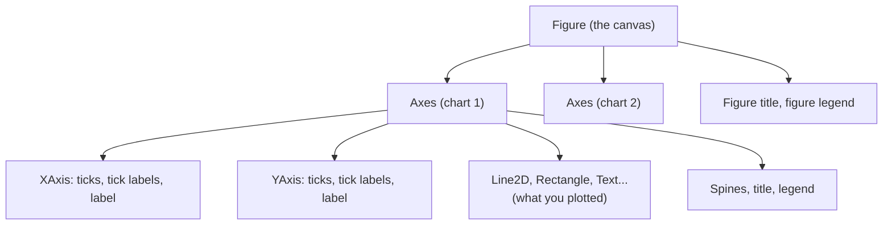

# How Matplotlib Thinks: Figures and Axes: The Complete Guide

> 📚 **Before you start**
>
> - [pandas Core](../course.md#m3) (Data Analysis and Visualisation with Python), for building the small DataFrames used here
> - [Quick Visualisation with pandas](../course.md#m5), if you have used `df.plot()` before: it is Matplotlib underneath

## Introduction

Most people learn Matplotlib by copying a snippet from the internet. It works. Then they copy a second snippet to add a second chart beside the first, and suddenly the title lands on the wrong chart, the legend vanishes, and `plt.xlabel` labels something they didn't expect. They conclude Matplotlib is confusing.

It isn't. It has a clear model, but the snippets online mix two different styles of using it, and the mix is what confuses. Once you see the model (a **Figure** that holds one or more **Axes**, each holding the things you draw), every Matplotlib error message, every Stack Overflow answer and every Seaborn chart becomes readable.

By the end of this article you will be able to name every part of a chart, explain the two interfaces and why to prefer one, lay out several charts on one figure in a grid or an arbitrary mosaic, control the size and resolution of the saved image, and change any part of a chart after it has been drawn.

> 💡 **Key Insight**
>
> A **Figure** is the sheet of paper. An **Axes** is one chart drawn on that paper. You almost never talk to the paper about the data; you talk to the Axes. Write `fig, ax = plt.subplots()` and then call methods on `ax`, and most Matplotlib confusion disappears.

---

## Core Explanation

### Setup: how the examples in these lessons run

Install the libraries in a virtual environment with `python -m pip install matplotlib seaborn pandas numpy scipy` (SciPy is only needed for the clustered heatmap later on). The examples were checked with Matplotlib 3.11.2, Seaborn 0.13.2 and pandas 3.0.5; anything newer works the same way.

Every example saves its chart into a throwaway folder made by `tempfile.mkdtemp()`, stored in `out_dir`, and then closes the figure:

```python
# not-run: the pattern every example below uses
fig.savefig(os.path.join(out_dir, "some-name.png"), bbox_inches="tight")
plt.close(fig)
```

Print `out_dir` to find the files, or set `out_dir = "."` to save next to your script. In Jupyter a figure also appears under the cell automatically; in a plain script, call `plt.show()` to open a window. The image under each example is exactly what its code saves. Section 8 explains what happens behind the scenes in each case.

### 1. The anatomy of a chart

Here is a chart with every part labelled. The code that draws it comes in section 4; for now, just learn the names.


| Part | What it is | How you reach it |
|---|---|---|
| **Figure** | The whole image: the canvas everything sits on. It has a size and a background. | `fig` |
| **Axes** | One plotting area with its own coordinate system, title and axes. A Figure can hold many. | `ax` |
| **Axis** | One number line of an Axes (x or y), with its ticks and labels. Note: *Axis* (one line) is not *Axes* (one chart). | `ax.xaxis`, `ax.yaxis` |
| **Ticks and tick labels** | The marks along an axis and the numbers or words printed beside them. | `ax.set_xticks(...)` |
| **Spines** | The four lines around the plotting area. | `ax.spines["top"]` |
| **Artist** | Anything that gets drawn: lines, text, rectangles, the Axes itself, even the Figure. | returned by drawing methods |

The word **Axes** trips everyone up. It is singular: one Axes is one chart. Matplotlib took the name from the maths idea of "a pair of axes" that together make a coordinate system.

### 2. The containment tree

Everything in Matplotlib lives inside something else:



*A Figure contains Axes; each Axes contains its two Axis objects and everything you drew in it.*

You can walk this tree in code. Start every chart with `plt.subplots()`, which makes a Figure and an Axes in one call and hands you both:

```python
import os
import tempfile

import matplotlib.pyplot as plt
import numpy as np
import pandas as pd

out_dir = tempfile.mkdtemp()

fig, ax = plt.subplots()
print(type(fig).__name__, type(ax).__name__)
print("axes in this figure:", len(fig.axes))
print(fig.axes[0] is ax)
print(type(ax.xaxis).__name__, type(ax.yaxis).__name__)
plt.close(fig)
```

Output:

```
Figure Axes
axes in this figure: 1
True
XAxis YAxis
```

### 3. Two ways to talk to Matplotlib

Matplotlib offers two interfaces. You will see both online, so you need to recognise both.

**The pyplot (implicit) interface.** You call functions on the `plt` module. Matplotlib remembers a "current figure" and a "current Axes" behind the scenes and sends each call there.

**The object-oriented (explicit) interface.** You keep references to the Figure and Axes and call their methods.

Here is the same chart in both styles. A made-up chai stall sold these cups each morning:

```python
days = ["Mon", "Tue", "Wed", "Thu", "Fri", "Sat", "Sun"]
cups = [120, 135, 128, 150, 190, 240, 210]

# Style 1: pyplot. Every call goes to "whatever is current".
plt.figure(figsize=(6, 3))
plt.plot(days, cups, marker="o")
plt.title("Chai sold per morning")
plt.ylabel("Cups")
plt.savefig(os.path.join(out_dir, "pyplot-style.png"), bbox_inches="tight")
plt.close()

# Style 2: object-oriented. Every call names its target.
fig, ax = plt.subplots(figsize=(6, 3))
ax.plot(days, cups, marker="o")
ax.set_title("Chai sold per morning")
ax.set_ylabel("Cups")
fig.savefig(os.path.join(out_dir, "oo-style.png"), bbox_inches="tight")
plt.close(fig)
```


Both files look identical. Notice the naming pattern: `plt.title(...)` becomes `ax.set_title(...)`, `plt.ylabel` becomes `ax.set_ylabel`, `plt.xlim` becomes `ax.set_xlim`. Most setters on an Axes start with `set_`.

| pyplot function | Axes method |
|---|---|
| `plt.plot`, `plt.bar`, `plt.scatter` | `ax.plot`, `ax.bar`, `ax.scatter` |
| `plt.title` | `ax.set_title` |
| `plt.xlabel`, `plt.ylabel` | `ax.set_xlabel`, `ax.set_ylabel` |
| `plt.xlim`, `plt.ylim` | `ax.set_xlim`, `ax.set_ylim` |
| `plt.xticks` | `ax.set_xticks` (and `ax.set_xticklabels`) |
| `plt.legend` | `ax.legend` |
| `plt.savefig` | `fig.savefig` |

**Which should you use?** The explicit style, almost always. The pyplot style is fine for a one-line chart in a notebook, but as soon as there are two Axes, "current" becomes a guessing game. The Matplotlib documentation itself recommends the explicit interface for anything beyond quick interactive work. Seaborn and pandas both accept an `ax=` argument, which only makes sense in the explicit style. This course uses `fig, ax` everywhere.

You can always get the hidden objects from pyplot if you need them: `plt.gcf()` returns the current Figure and `plt.gca()` the current Axes ("get current figure", "get current axes").

### 4. Drawing returns Artists you can change later

Every drawing method returns the Artist it created. Keep it and you can change it later:

```python
coffee = [60, 58, 64, 70, 85, 95, 90]

fig, ax = plt.subplots(figsize=(7, 4))
lines = ax.plot(days, cups, marker="o", label="Chai")
print(type(lines).__name__, len(lines), type(lines[0]).__name__)

coffee_line, = ax.plot(days, coffee, marker="s", label="Coffee")  # note the comma
coffee_line.set_linestyle("--")
print(coffee_line.get_label(), coffee_line.get_linestyle())
print("lines on this Axes:", len(ax.lines))
```

Output:

```
list 1 Line2D
Coffee --
lines on this Axes: 2
```

`ax.plot` returns a *list* of lines, because one call can draw several. The trailing comma in `coffee_line, = ...` unpacks the one-item list. Other methods return other Artists: `ax.bar` returns a container of `Rectangle` patches, `ax.scatter` returns a `PathCollection`, `ax.text` returns a `Text`.

Now finish the chart with labels, a legend, a grid, and the annotations you saw in section 1:

```python
ax.set_title("Morning sales at the station stall")
ax.set_xlabel("Day")
ax.set_ylabel("Cups sold")
ax.set_xlim(-0.5, 6.5)
ax.set_ylim(0, 270)
ax.legend(loc="upper left")
ax.grid(axis="y", alpha=0.3)

callouts = {
    "Title": ((3, 278), (4.6, 300)),
    "Legend": ((0.9, 240), (2.2, 255)),
    "Line (Line2D)": ((5, 240), (5.3, 175)),
    "Grid": ((2, 200), (2.5, 215)),
    "Y axis + tick labels": ((-0.75, 150), (0.4, 178)),
    "X axis + tick labels": ((1.6, -18), (0.9, 25)),
    "Spine": ((6.5, 55), (4.8, 30)),
}
for name, (target, text_pos) in callouts.items():
    ax.annotate(name, xy=target, xytext=text_pos, color="#C44E52", fontsize=9,
                fontweight="bold", annotation_clip=False,
                arrowprops={"arrowstyle": "->", "color": "#C44E52"})
fig.text(0.01, 0.01, "Figure: the whole canvas", color="#C44E52", fontsize=9, fontweight="bold")
ax.text(0.98, 0.45, "Axes: this plotting area", transform=ax.transAxes, ha="right",
        color="#C44E52", fontsize=9, fontweight="bold")

fig.savefig(os.path.join(out_dir, "anatomy.png"), bbox_inches="tight")
plt.close(fig)
```

Two new ideas appear here. `ax.annotate` draws text with an arrow pointing at a data position, and `transform=ax.transAxes` tells `ax.text` to read its position as a fraction of the Axes (0 is the left or bottom edge, 1 the right or top) instead of data coordinates. You will use both a lot in the next lesson.

### 5. Several charts on one Figure

`plt.subplots(nrows, ncols)` builds a grid. With more than one Axes, `ax` becomes a NumPy array of Axes, so name it `axes`:

```python
rng = np.random.default_rng(7)
stalls = pd.DataFrame({
    "day": np.tile(days, 4),
    "stall": np.repeat(["Dadar", "Andheri", "Thane", "Borivali"], 7),
    "cups": rng.integers(80, 260, size=28),
})

fig, axes = plt.subplots(2, 2, figsize=(9, 5), sharex=True, sharey=True,
                         layout="constrained")
print(type(axes).__name__, axes.shape)

for ax, (stall, rows) in zip(axes.flat, stalls.groupby("stall", sort=False)):
    ax.bar(rows["day"], rows["cups"], color="#4C72B0")
    ax.set_title(stall)

for ax in axes[:, 0]:          # left column only
    ax.set_ylabel("Cups")
fig.suptitle("Cups sold per day, by stall")
fig.savefig(os.path.join(out_dir, "grid.png"), bbox_inches="tight")
plt.close(fig)
```

Output:

```
ndarray (2, 2)
```


Read the arguments:

- **`axes.flat`** walks the 2×2 array as one flat sequence, which pairs nicely with `zip`. `axes[0, 1]` picks the top-right chart; `axes[:, 0]` picks the left column.
- **`sharex=True, sharey=True`** gives every chart the same scales. That matters: without it, each chart picks its own y range, and a reader comparing bar heights across stalls would be misled. Shared axes also remove the repeated tick labels in the inner charts.
- **`layout="constrained"`** asks Matplotlib to make room for titles and labels so they don't overlap. Use it on every multi-Axes figure.
- **`fig.suptitle`** is a title for the whole Figure, above all the Axes.

`plt.subplots(1, 1)` (the default) returns a single Axes, not an array. If you need an array every time, pass `squeeze=False`.

### 6. Uneven layouts with `subplot_mosaic`

Real reports rarely use equal boxes. `fig.subplot_mosaic` lets you draw the layout as a picture made of letters, where repeating a letter makes that Axes span more cells:

```python
fig, axd = plt.subplot_mosaic(
    [["trend", "trend"],
     ["stall", "share"]],
    figsize=(9, 5), layout="constrained",
)
print(sorted(axd))

axd["trend"].plot(days, cups, marker="o")
axd["trend"].set_title("Total cups per day")

totals = stalls.groupby("stall", sort=False)["cups"].sum()
axd["stall"].barh(totals.index, totals.values, color="#55A868")
axd["stall"].set_title("Cups per stall this week")

axd["share"].bar(["Chai", "Coffee"], [sum(cups), sum(coffee)], color=["#4C72B0", "#DD8452"])
axd["share"].set_title("Chai vs coffee")
fig.savefig(os.path.join(out_dir, "mosaic.png"), bbox_inches="tight")
plt.close(fig)
```

Output:

```
['share', 'stall', 'trend']
```


`subplot_mosaic` returns a dictionary of Axes keyed by your labels, which is far easier to read than `axes[1, 0]`. You can also pass a string such as `"AAB;CCB"` where `;` separates rows. Use `"."` for an empty cell.

### 7. Size, resolution and saving

A Figure's size is set in **inches**, and its resolution in **dots per inch (dpi)**. The pixel size of a saved PNG is simply the two multiplied:

```python
fig, ax = plt.subplots(figsize=(8, 4))
width_in, height_in = fig.get_size_inches()
print("inches:", width_in, "x", height_in, "| dpi:", fig.dpi)
print("pixels at dpi=100:", int(width_in * 100), "x", int(height_in * 100))
print("pixels at dpi=200:", int(width_in * 200), "x", int(height_in * 200))
plt.close(fig)
```

Output:

```
inches: 8.0 x 4.0 | dpi: 100.0
pixels at dpi=100: 800 x 400
pixels at dpi=200: 1600 x 800
```

Practical rules:

- **Choose `figsize` for layout, `dpi` for sharpness.** A bigger `figsize` makes text *smaller relative to the chart*, because font sizes are in points (1/72 inch). Doubling dpi keeps the layout identical but doubles the pixels.
- **`fig.savefig(path, dpi=200)`** overrides the figure's dpi only for that file. Use 150 to 200 for slides and screens with high pixel density, 300 for print.
- **The file extension picks the format.** `.png` for the web, `.svg` or `.pdf` for vector output that stays sharp at any zoom (good for print and for editing in other tools).
- **`bbox_inches="tight"`** trims empty margins around the saved image.
- **`transparent=True`** saves without a background, for placing a chart on a coloured slide.

### 8. Backends: where the pixels go

A **backend** is the part of Matplotlib that turns your Figure into something visible. There are two kinds:

- **Non-interactive backends** write files. `Agg` writes PNGs, and is the default on servers with no screen. The examples in these lessons work on any backend because they call `savefig`.
- **Interactive backends** open a window you can zoom and pan (`TkAgg`, `QtAgg`, `MacOSX`). In a script, `plt.show()` opens that window and waits until you close it.

Jupyter uses an inline backend that renders the Figure as an image under the cell when the cell finishes. That is why notebook users rarely call `plt.show()`, and why a Figure "appears twice" if you both return it and let the cell finish: you displayed it explicitly and Jupyter displayed it again.

You can choose a backend with the `MPLBACKEND` environment variable, for example `MPLBACKEND=Agg python report.py` on a server, so a script never tries to open a window.

### 9. Global defaults with `rcParams`

Every default (font size, line width, colours, figure size) lives in a dictionary called `matplotlib.rcParams`. Change it to restyle every chart that follows:

```python
import matplotlib as mpl

print(mpl.rcParams["lines.linewidth"], mpl.rcParams["axes.titlesize"])
with mpl.rc_context({"lines.linewidth": 3, "axes.titlesize": "x-large"}):
    print(mpl.rcParams["lines.linewidth"], mpl.rcParams["axes.titlesize"])
print(mpl.rcParams["lines.linewidth"])
```

Output:

```
1.5 large
3.0 x-large
1.5
```

`mpl.rc_context` changes defaults only inside the `with` block, which is the safe way to experiment. Seaborn's themes, which you'll meet in [Styling Charts for Communication](../07-seaborn-and-storytelling/styling-charts-for-communication.md), work by setting many `rcParams` at once.

### 10. Putting it together: the habits

```python
def weekly_chart(day_labels, values, title, path):
    """Draw one tidy weekly chart and save it. Returns the path."""
    fig, ax = plt.subplots(figsize=(6, 3), layout="constrained")
    ax.plot(day_labels, values, marker="o")
    ax.set_title(title)
    ax.set_ylim(bottom=0)
    fig.savefig(path, bbox_inches="tight")
    plt.close(fig)
    return path

saved = [weekly_chart(days, rng.integers(50, 200, 7), f"Stall {n}",
                      os.path.join(out_dir, f"stall-{n}.png")) for n in range(1, 4)]
print([os.path.basename(p) for p in saved])
print("figures still open:", len(plt.get_fignums()))
```

Output:

```
['stall-1.png', 'stall-2.png', 'stall-3.png']
figures still open: 0
```

That function shows the four habits that keep Matplotlib code clean: **create with `plt.subplots`, draw on `ax`, save with `fig.savefig`, close with `plt.close(fig)`**. `plt.get_fignums()` lists open figures; it is a quick leak check.

---

## Try It Yourself

1. **Spot the Axes.** Make a figure with `plt.subplots(1, 3)`. How many entries does `fig.axes` have, and what is `axes.shape`?
2. **Translate.** Rewrite this pyplot code in the explicit style: `plt.plot(x, y); plt.title("Runs"); plt.xlim(0, 20); plt.savefig("runs.png")`.
3. **Mosaic.** Build a layout with one tall chart on the left spanning two rows and two small charts stacked on the right. Print the sorted keys.
4. **Pixels.** You need a PNG exactly 1200 × 600 pixels at dpi 150. What `figsize` do you use?

<details>
<summary>Show answers</summary>

```python
fig, axes = plt.subplots(1, 3)
print(len(fig.axes), axes.shape)
plt.close(fig)

x = list(range(1, 21))
y = [i * 3 for i in x]
fig, ax = plt.subplots()
ax.plot(x, y)
ax.set_title("Runs")
ax.set_xlim(0, 20)
fig.savefig(os.path.join(out_dir, "runs.png"))
plt.close(fig)

fig, axd = plt.subplot_mosaic("AB;AC", layout="constrained")
print(sorted(axd))
plt.close(fig)

print(1200 / 150, 600 / 150)
```

Output:

```
3 (3,)
['A', 'B', 'C']
8.0 4.0
```

1. Three Axes, and `axes` is a one-dimensional array of shape `(3,)`. A single row or column gives a 1-D array; only a true grid gives 2-D.
2. See the code: every `plt.` call becomes an `ax.set_...` or `fig.savefig` call.
3. `"AB;AC"` repeats `A` in both rows, so it spans the left column.
4. `figsize=(8, 4)` with `dpi=150`.

</details>

---

## Real-World Examples

### Example 1: A finance team's monthly pack

An analyst produces 40 charts for a monthly review. Written in pyplot style inside a loop, charts occasionally inherit the previous chart's title or legend. Rewritten as a function that creates its own `fig, ax`, draws, saves and closes, every chart is independent and the script's memory stays flat.

### Example 2: Seaborn plus Matplotlib on one page

A data scientist draws a Seaborn box plot and a Seaborn histogram side by side. They create `fig, (left, right) = plt.subplots(1, 2)` and pass `ax=left` and `ax=right` to the two Seaborn calls. Seaborn draws into the Axes it is given, so the layout stays under Matplotlib's control.

### Example 3: Charts on a server

A nightly job on a Linux server emails a sales chart. There is no screen, so the job sets `MPLBACKEND=Agg` and only calls `savefig`. A script that called `plt.show()` with an interactive backend would fail or hang there.

---

## Common Misconceptions

### Misconception 1: "Axes is the plural of Axis"

In Matplotlib they are different objects. An **Axes** is a whole chart area. An **Axis** is one number line inside it. `ax.xaxis` is an Axis that belongs to the Axes `ax`.

### Misconception 2: "`plt.subplots()` is only for multiple charts"

It is the best way to start *any* chart, including a single one, because it hands you the `fig` and `ax` references you need for the explicit style.

### Misconception 3: "A bigger figsize gives a sharper image"

A bigger `figsize` gives more room, which makes the text look smaller. Sharpness comes from `dpi`. To make the same chart crisper, raise `dpi` and leave `figsize` alone.

### Misconception 4: "Closing figures doesn't matter"

pyplot keeps every figure it created alive until you close it. In a loop that makes hundreds of charts, that leaks memory, and after 20 open figures Matplotlib warns you. Always `plt.close(fig)` after saving.

---

## Interview Relevance

Matplotlib questions in data analyst and data scientist interviews usually check whether you understand the object model, not whether you remember argument names:

- *"What is the difference between a Figure and an Axes?"* The Figure is the canvas; an Axes is one plotting area with its own coordinates. One Figure can contain many Axes.
- *"pyplot vs object-oriented interface?"* pyplot tracks a hidden current figure and Axes; the explicit style passes references around. Prefer explicit for anything with more than one chart, for functions, and for library code.
- *"How would you put four charts in a grid with the same y scale?"* `plt.subplots(2, 2, sharey=True, layout="constrained")`, then loop over `axes.flat`.
- *"How do you make a chart look sharp in a slide deck?"* Save at a higher dpi (or as SVG), keep `figsize` matched to the slide area so fonts stay readable.
- *"Your script generating charts runs out of memory. Why?"* Figures are not being closed.

---

## Key Takeaways

- **A Figure holds Axes; an Axes holds everything you draw.** Axis (one number line) is not Axes (one chart).
- **Use the explicit style**: `fig, ax = plt.subplots()`, then `ax.plot`, `ax.set_title`, `fig.savefig`.
- **Drawing methods return Artists** that you can keep and change later.
- **Lay out several charts** with `plt.subplots(rows, cols, sharex/sharey, layout="constrained")` or with `subplot_mosaic` for uneven layouts.
- **Pixels = inches × dpi.** `figsize` controls layout, `dpi` controls sharpness, the file extension controls format.
- **Always close figures** you have saved.

---

**Up next:** [Creating and Customising Plots](creating-and-customising-plots.md)
