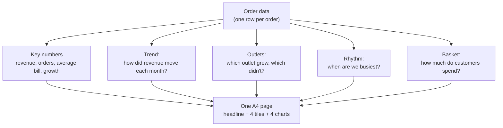

# Lab: Build a One-Page Visual Report

> 📚 **Before you start**
>
> - [How Matplotlib Thinks: Figures and Axes](../06-matplotlib/how-matplotlib-thinks-figures-and-axes.md), for `subplot_mosaic`
> - [Statistical Plots with Seaborn](statistical-plots-with-seaborn.md) and [Histograms, Pair Plots and Heatmaps](histograms-pair-plots-and-heatmaps.md)
> - [Styling Charts for Communication](styling-charts-for-communication.md), for titles, highlighting and direct labels
> - [Selecting, Sorting and Indexing Data](../course.md#m3) and [Dates, Times and Timedeltas](../course.md#m4), for `groupby`, `pivot_table` and `.dt`

## What You'll Build

The owner of **Chai Junction**, a made-up chain of four chai outlets, asks for "something I can print and read in two minutes" about last financial year. You will build a single A4 page with a headline, four key numbers, and four charts that each answer one question, then export it as PNG and PDF.



This is the finished page:


> 💡 **Key Insight**
>
> A report page is not a pile of charts. It's an argument: one headline, a few numbers that support it, and charts arranged so the eye moves from the big picture to the details. **Write the headline and the question for each panel before you draw anything.**

Run the blocks in order in one file or notebook.

---

## Step 1: Plan the Page on Paper

Decide the story and the layout first. For each panel, write the question it answers and the chart that answers it:

| Panel | Question | Chart |
|---|---|---|
| Headline | What's the one thing to know? | Text |
| Tiles | How big was the year? | Four big numbers |
| Trend | How did revenue move month by month? | Line, festive months marked |
| Outlets | Which outlet is growing, which is stuck? | Sorted horizontal bars of growth, one highlighted |
| Rhythm | When are customers coming in? | Weekday × hour heatmap |
| Basket | How much does a typical customer spend, by outlet? | Box plots of bill value |

Then sketch the grid. Using letters as in `subplot_mosaic`:

```
K K K K      <- key-number tiles across the top
T T T T      <- trend, full width (time needs width)
O O H H      <- outlets | rhythm heatmap
B B H H      <- basket  | (heatmap continues)
```

---

## Step 2: Generate the Data

In real life you'd load a CSV with `pd.read_csv`. Here we generate a year of orders with realistic patterns: morning and evening peaks, busier weekends, a festive bump in October and November, and one outlet (Kothrud) that stops growing halfway through the year.

```python
import os
import tempfile

import matplotlib.pyplot as plt
import matplotlib.ticker as mticker
import numpy as np
import pandas as pd
import seaborn as sns

out_dir = tempfile.mkdtemp()
rng = np.random.default_rng(31)

OUTLETS = ["Baner", "Kothrud", "Viman Nagar", "Hinjewadi"]
days = pd.date_range("2025-04-01", "2026-03-31", freq="D")

rows = []
for outlet_i, outlet in enumerate(OUTLETS):
    base = [70, 85, 60, 75][outlet_i]
    for day_i, day in enumerate(days):
        growth = 1 + 0.45 * day_i / len(days)
        if outlet == "Kothrud":
            growth = 1 + 0.25 * min(day_i, 150) / len(days)    # stalls after ~5 months
        festive = 1.3 if day.month in (10, 11) else 1.0
        weekend = 1.25 if day.dayofweek >= 5 else 1.0
        n_orders = rng.poisson(base * growth * festive * weekend)
        hours = rng.choice(np.arange(7, 23), size=n_orders,
                           p=np.array([5, 9, 8, 5, 4, 5, 5, 4, 4, 5, 7, 9, 10, 9, 6, 5]) / 100)
        bills = (rng.gamma(2.2, 45, n_orders) + 30).round()
        rows.append(pd.DataFrame({"date": day, "outlet": outlet, "hour": hours, "bill": bills}))

orders = pd.concat(rows, ignore_index=True)
print(f"{len(orders):,} orders, {orders['date'].min():%d %b %Y} to {orders['date'].max():%d %b %Y}")
print(orders.head(3).to_string(index=False))
```

Output:

```
140,822 orders, 01 Apr 2025 to 31 Mar 2026
      date outlet  hour  bill
2025-04-01  Baner    18 116.0
2025-04-01  Baner    15  89.0
2025-04-01  Baner    18 141.0
```

The probabilities in `hours` describe the shape of a day: a morning rush around 8 and 9, a quieter afternoon, and an evening peak around 7 pm.

---

## Step 3: Compute the Numbers First

Charts should never contain numbers you haven't checked. Compute everything the page will show, and print it:

```python
orders["month"] = orders["date"].dt.to_period("M")
orders["half"] = np.where(orders["date"] < "2025-10-01", "H1", "H2")

revenue = orders["bill"].sum()
n_orders = len(orders)
avg_bill = orders["bill"].mean()
by_half = orders.groupby("half")["bill"].sum()
h2_growth = by_half["H2"] / by_half["H1"] - 1

monthly = orders.groupby("month")["bill"].sum() / 1e5          # in lakh
outlet_half = orders.pivot_table(index="outlet", columns="half", values="bill", aggfunc="sum")
outlet_growth = (outlet_half["H2"] / outlet_half["H1"] - 1).sort_values()

print(f"revenue ₹{revenue / 1e5:.1f} L | orders {n_orders:,} | avg bill ₹{avg_bill:.0f} | H2 vs H1 {h2_growth:+.1%}")
print("best month:", monthly.idxmax(), f"₹{monthly.max():.1f} L")
print((outlet_growth * 100).round(1).to_string())
```

Output:

```
revenue ₹181.5 L | orders 140,822 | avg bill ₹129 | H2 vs H1 +26.3%
best month: 2025-11 ₹19.4 L
outlet
Kothrud        16.3
Hinjewadi      28.3
Baner          30.2
Viman Nagar    32.6
```

The story is now clear in numbers, so write the headline: revenue grew strongly in the second half, but Kothrud grew at only about half the rate of the other outlets. (Try It Yourself question 4 shows why: its sales flattened after August.)

---

## Step 4: One Function per Panel

Write each panel as a function that takes an `ax` and draws into it. Each can be tested on its own figure, and the final page just calls them all. Set the theme once:

```python
sns.set_theme(style="white", context="paper", font_scale=1.1)
FOCUS, MUTED, ACCENT = "#1F4E8C", "#B8B8B8", "#C44E52"

def panel_title(ax, text):
    ax.set_title(text, loc="left", fontsize=11, fontweight="bold")


def draw_tiles(ax):
    tiles = [
        (f"₹{revenue / 1e5:.0f} L", "revenue this year"),
        (f"{n_orders / 1e5:.2f} L", "orders served"),
        (f"₹{avg_bill:.0f}", "average bill"),
        (f"{h2_growth:+.0%}", "Oct–Mar vs Apr–Sep"),
    ]
    ax.set_axis_off()
    for i, (big, small) in enumerate(tiles):
        x = 0.02 + i * 0.25
        ax.text(x, 0.62, big, fontsize=22, fontweight="bold", color=FOCUS, transform=ax.transAxes)
        ax.text(x, 0.22, small, fontsize=10, color="#555555", transform=ax.transAxes)


def draw_trend(ax):
    x = monthly.index.to_timestamp()
    ax.plot(x, monthly.values, color=FOCUS, linewidth=2.5, marker="o", markersize=4)
    ax.axvspan(pd.Timestamp("2025-09-20"), pd.Timestamp("2025-11-25"), color="#F2C14E", alpha=0.25)
    ax.text(pd.Timestamp("2025-09-24"), monthly.min() * 0.92, "Festive season", fontsize=9, color="#8A6D00")
    ax.set_ylim(0, monthly.max() * 1.15)
    ax.yaxis.set_major_locator(mticker.MultipleLocator(5))
    ax.yaxis.set_major_formatter(mticker.FuncFormatter(lambda v, _: f"₹{v:.0f} L"))
    ax.set_xticks(x, labels=[d.strftime("%b") for d in x])
    peak = monthly.values.argmax()
    ax.annotate(f"Best month ₹{monthly.max():.1f} L", xy=(x[peak], monthly.max()),
                xytext=(x[peak] + pd.Timedelta(days=40), monthly.max() * 1.07),
                fontsize=9, arrowprops={"arrowstyle": "->"})
    ax.grid(axis="y", color="#EEEEEE")
    sns.despine(ax=ax)
    panel_title(ax, "Revenue climbed all year and peaked with the festive season")


def draw_outlets(ax):
    pct = outlet_growth * 100
    colours = [ACCENT if name == "Kothrud" else MUTED for name in pct.index]
    bars = ax.barh(pct.index, pct.values, color=colours)
    ax.bar_label(bars, labels=[f"{v:+.0f}%" for v in pct.values], padding=3, fontsize=9)
    ax.set_xlim(0, pct.max() * 1.25)
    ax.xaxis.set_visible(False)
    ax.tick_params(axis="y", length=0)
    sns.despine(ax=ax, bottom=True)
    panel_title(ax, "Kothrud grew half as fast")


def draw_rhythm(ax):
    weekday_order = ["Mon", "Tue", "Wed", "Thu", "Fri", "Sat", "Sun"]
    grid = (orders.assign(weekday=orders["date"].dt.day_name().str[:3])
                  .pivot_table(index="weekday", columns="hour", values="bill",
                               aggfunc="size")
                  .loc[weekday_order] / 52)                       # average per week
    sns.heatmap(grid, cmap="mako_r", cbar_kws={"label": "Orders per hour (average)", "shrink": 0.6},
                linewidths=0.3, xticklabels=2, ax=ax)
    ax.set(xlabel="Hour of day", ylabel="")
    ax.tick_params(axis="y", rotation=0)
    panel_title(ax, "Rush: evenings and weekends")
    return grid


def draw_basket(ax):
    order_by_median = orders.groupby("outlet")["bill"].median().sort_values().index
    sns.boxplot(data=orders, x="bill", y="outlet", order=order_by_median, color="#9DB4D3",
                showfliers=False, width=0.55, ax=ax)
    ax.xaxis.set_major_formatter(mticker.FuncFormatter(lambda v, _: f"₹{v:.0f}"))
    ax.set(xlabel="Bill value (middle 50% in the box)", ylabel="")
    sns.despine(ax=ax)
    panel_title(ax, "Typical bill: ₹80 to ₹160")
```

Test one panel on its own before building the page:

```python
fig, ax = plt.subplots(figsize=(6, 3), layout="constrained")
draw_outlets(ax)
fig.savefig(os.path.join(out_dir, "report-outlets-test.png"), bbox_inches="tight")
plt.close(fig)
print(ax.get_title(loc="left"))
print(orders["bill"].quantile([0.25, 0.75]).round().tolist())
```

Output:

```
Kothrud grew half as fast
[80.0, 162.0]
```

The interquartile range printed above is what the basket panel's title claims, so the title is backed by data. Always check a title's claim this way.

---

## Step 5: Assemble the Page

Turn the sketch from Step 1 into a mosaic. A4 is 8.27 × 11.69 inches; `height_ratios` gives the tiles a short row:

```python
mosaic = [
    ["K", "K"],
    ["T", "T"],
    ["O", "H"],
    ["B", "H"],
]
fig, axd = plt.subplot_mosaic(mosaic, figsize=(8.27, 11.69), layout="constrained",
                              height_ratios=[0.55, 1.9, 1.6, 1.6])

draw_tiles(axd["K"])
draw_trend(axd["T"])
draw_outlets(axd["O"])
rhythm = draw_rhythm(axd["H"])
draw_basket(axd["B"])

fig.suptitle("Chai Junction FY 2025-26: revenue up strongly, but Kothrud has stalled",
             x=0.02, ha="left", fontsize=15, fontweight="bold")
fig.text(0.02, -0.01, "Source: Chai Junction point-of-sale data (illustrative), Apr 2025 to Mar 2026.",
         fontsize=8, color="grey")

png_path = os.path.join(out_dir, "report-final.png")
pdf_path = os.path.join(out_dir, "report-final.pdf")
fig.savefig(png_path, dpi=80, bbox_inches="tight")
fig.savefig(pdf_path, bbox_inches="tight")
plt.close(fig)

slot_day, slot_hour = rhythm.stack().idxmax()
print(f"busiest slot: {slot_day} {slot_hour}:00, {rhythm.stack().max():.1f} orders per hour")
print(os.path.exists(png_path), os.path.exists(pdf_path))
```

Output:

```
busiest slot: Sun 19:00, 46.6 orders per hour
True True
```

Details worth noticing:

- **`height_ratios`** gives each row of the mosaic a relative height. The tiles row is short; the trend gets the most room because time series need width and height.
- **`fig.suptitle(..., x=0.02, ha="left")`** left-aligns the page headline like a newspaper.
- **Two exports**: PNG at 80 dpi for email and the web, PDF (vector) for printing. Text in the PDF stays sharp at any zoom.
- **The source line** says the data is illustrative. Every published page should say where its numbers come from.

---

## Step 6: Review Like an Editor

Before sending, check the page against this list. Fix anything that fails and re-run Step 5.

| Check | How |
|---|---|
| The headline states the finding | Read only the suptitle. Would the owner know what happened? |
| Every panel title is a finding, and true | Compare each title with the numbers printed in Step 3 and 4 |
| One highlight colour, used for one meaning | Red only for Kothrud; blue for the main series |
| Bars start at zero | Outlet growth bars start at 0 |
| No legend needed | Direct labels and titles carry the meaning |
| Readable when printed | Open the PDF at 100%; nothing should need a magnifier |
| Units everywhere | ₹, L (lakh), %, hour of day |
| Source and date range | Footer present |

---

## Try It Yourself

1. **Swap a panel.** Replace the basket box plots with a `sns.kdeplot` of bill value by outlet (`common_norm=False`). Is the "₹80 to ₹160" title still the right finding?
2. **Monthly orders.** Add a fifth tile with the busiest month by *number of orders* (not revenue). Print it.
3. **Landscape version.** Rebuild the page for a slide: `figsize=(13.33, 7.5)` and a mosaic of `[["K","K","K"],["T","T","H"],["O","B","H"]]`. Which panel titles become too long?
4. **Kothrud deep dive.** Draw Kothrud's monthly revenue (highlighted) against the other three (grey) on one chart. When does it flatten?

<details>
<summary>Show answers</summary>

```python
fig, ax = plt.subplots(figsize=(6, 3))
sns.kdeplot(data=orders, x="bill", hue="outlet", common_norm=False, ax=ax)
fig.savefig(os.path.join(out_dir, "ex-basket-kde.png"))
plt.close(fig)

busiest = orders.groupby("month").size()
print("busiest month by orders:", busiest.idxmax(), f"{busiest.max():,}")

by_outlet_month = orders.pivot_table(index="month", columns="outlet", values="bill", aggfunc="sum") / 1e5
fig, ax = plt.subplots(figsize=(8, 3.5))
for name in OUTLETS:
    ax.plot(by_outlet_month.index.to_timestamp(), by_outlet_month[name],
            color=ACCENT if name == "Kothrud" else MUTED, linewidth=2.5 if name == "Kothrud" else 1.2)
fig.savefig(os.path.join(out_dir, "ex-kothrud.png"))
plt.close(fig)
kothrud = by_outlet_month["Kothrud"].round(1).iloc[[0, 4, 8, 11]]
print({str(month): value for month, value in kothrud.items()})
```

Output:

```
busiest month by orders: 2025-10 15,072
{'2025-04': 3.5, '2025-08': 4.0, '2025-12': 4.0, '2026-03': 4.1}
```

1. The density curves overlap almost completely across outlets, so the same finding holds: spending per order is similar everywhere, and differences between outlets come from the number of orders.
2. See the printed month; it's a festive month, as with revenue.
3. The trend title and the page headline are the risky ones: in a wide layout the trend panel shares its row with the heatmap, so "Revenue climbed all year and peaked with the festive season" no longer fits. Shorten it ("Revenue peaked in the festive season") or break it over two lines with `\n`.
4. Kothrud's revenue rises until about August and then stays flat (apart from the festive bump), while the other outlets keep climbing.

</details>

---

## What You've Learned

- **Plan before plotting**: a headline, one question per panel, and a sketched grid.
- **Compute and print every number** before it appears on the page, and check that titles are backed by data.
- **One function per panel** that draws into a given `ax`, so panels can be tested alone and reused.
- **`subplot_mosaic` with `height_ratios`** for a real report layout, plus a left-aligned headline and source line.
- **Export for the medium**: PNG for screens, PDF for print.
- **Review like an editor** with a checklist before you send anything.

That completes the Matplotlib and Seaborn lessons, and this course. Later, [Machine Learning Foundations: Data, EDA and Features](../../machine-learning-foundations-data-eda-and-features/course.md) puts these charts to work exploring datasets before modelling, and [APIs and Apps: FastAPI, Streamlit and Docker](../../apis-and-apps-fastapi-streamlit-and-docker/course.md) shows how to turn a page like this into an interactive dashboard.

---

**Up next:** [Databases: SQL and NoSQL](../../databases-sql-and-nosql/course.md#m1)
