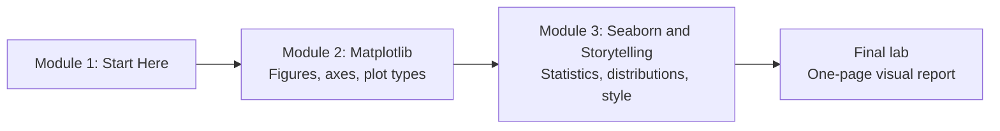

# How This Course Works

## Introduction

Open any finance app and look at your monthly spending. You don't read a table of 300 UPI transactions. You glance at a bar chart, see that "Food delivery" is twice as tall as everything else, and feel slightly guilty. That glance took two seconds. The table would have taken ten minutes and you would still have missed the pattern.

That is what a good chart does: it moves the work of finding a pattern from your brain to your eyes. This course teaches you to make those charts in Python with **Matplotlib**, the library almost every Python chart is built on, and **Seaborn**, the library that sits on top of it and makes statistical charts quick to draw.

This first article is short. It tells you what you will learn, how the lessons are built, what you need installed, and how the code examples save their charts.

> 💡 **Key Insight**
>
> A chart is an argument made with shapes. The code is the easy part; you can learn every function you need in a week. The skill this course really builds is choosing **which** chart answers the question, and then removing everything that doesn't help the reader see the answer.

---

## What You Will Learn

By the end of this course you will be able to:

- **Explain how Matplotlib is organised**: what a Figure, an Axes and an Artist are, and why the `fig, ax = plt.subplots()` style beats calling `plt.plot()` everywhere.
- **Draw and customise the core chart types**: line, scatter, bar, area, error bars and annotations, with readable ticks, labels and legends.
- **Recreate a published chart** from scratch, matching its layout and style.
- **Use Seaborn's statistical plots** to compare groups, show uncertainty and draw regression lines straight from a pandas DataFrame.
- **Show distributions and relationships** with histograms, density plots, pair plots and heatmaps.
- **Style charts so they communicate**: themes, colour palettes that colour-blind readers can use, decluttering, highlighting and direct labels.
- **Assemble a one-page visual report** that tells a story with several charts.

### The course at a glance



Module 2 teaches the engine. Everything Seaborn draws is a Matplotlib object, so once you understand Figures and Axes you can fix or fine-tune any Seaborn chart. Module 3 adds the statistical shortcuts and the design judgment that turns a correct chart into a convincing one.

---

## How Every Lesson Is Built

Every article follows the same shape, so you always know where to look:

| Section | What it gives you |
|---|---|
| **Before you start** | Links to the earlier lessons this one depends on. |
| **Introduction** | Why the topic matters, with an everyday example. |
| **Key Insight** | The one idea to remember if you remember nothing else. |
| **Core Explanation** | The topic step by step, with runnable code and the chart that code draws. |
| **Try It Yourself** | Small exercises, with answers hidden in a fold. |
| **Real-World Examples** | Where the technique shows up in real work. |
| **Common Misconceptions** | Mistakes almost everyone makes, corrected. |
| **Interview Relevance** | What interviewers ask and what a strong answer covers. |
| **Key Takeaways** | A one-minute summary to review later. |

**Labs** are guided builds. You start from an empty file and finish with a finished chart or report. The two labs in this course are where the ideas come together, so don't skip them.

---

## What You Need Before Starting

- **Python basics**: functions, lists, dictionaries and loops. [Python Fundamentals](../../python-fundamentals/course.md) covers them.
- **NumPy and pandas**: creating arrays, building a DataFrame, selecting columns, `groupby`. Every chart in this course starts from a DataFrame. If those feel shaky, work through [pandas Core](../../numerical-computing-and-data-analysis/course.md#m3) and [Statistics and Plots in pandas](../../numerical-computing-and-data-analysis/course.md#m5) first. The second one also introduces `df.plot()`, which is Matplotlib underneath.
- **Python 3.10 or newer** and a code editor, or Jupyter.

Install the libraries in a virtual environment:

```bash
python -m pip install matplotlib seaborn pandas numpy scipy
```

SciPy is optional. Seaborn uses it for a few features, such as the clustered heatmap in module 3.

### Check your setup

Run this. It prints the versions and draws your first chart:

```python
import os
import tempfile

import matplotlib
import matplotlib.pyplot as plt
import pandas as pd
import seaborn as sns

print("matplotlib", matplotlib.__version__)
print("seaborn", sns.__version__)
print("pandas", pd.__version__)

out_dir = tempfile.mkdtemp()           # a throwaway folder for the chart files

cups = pd.DataFrame({
    "day": ["Mon", "Tue", "Wed", "Thu", "Fri", "Sat", "Sun"],
    "cups": [120, 135, 128, 150, 190, 240, 210],
})

fig, ax = plt.subplots(figsize=(7, 3.5))
ax.bar(cups["day"], cups["cups"], color="#4C72B0")
ax.set_title("Cups of chai sold this week")
ax.set_ylabel("Cups")
fig.savefig(os.path.join(out_dir, "setup-check.png"), bbox_inches="tight")
plt.close(fig)
print("saved", os.path.exists(os.path.join(out_dir, "setup-check.png")))
```

Output:

```
matplotlib 3.11.2
seaborn 0.13.2
pandas 3.0.5
saved True
```


Your version numbers may be newer. The lessons were checked with the versions above, and everything they use has been stable in Matplotlib and Seaborn for several releases.

### Where do the charts go?

Every example in this course ends the same way:

```python
# not-run: the pattern only, every example below uses it
fig.savefig(os.path.join(out_dir, "some-name.png"), bbox_inches="tight")
plt.close(fig)
```

- `out_dir` is a temporary folder made by `tempfile.mkdtemp()`, so the examples never litter your project. Print `out_dir` to see where it is, or change it to `"."` to save next to your script.
- `plt.close(fig)` frees the figure's memory. When you draw dozens of charts in a loop, forgetting this slowly fills your RAM.
- The image shown under each example is exactly what that code saves.

**In Jupyter**, a figure shows up under the cell automatically, so you can skip `savefig`. **In a plain script**, call `plt.show()` to open a window instead of (or as well as) saving. You'll learn what is going on behind both in the first Matplotlib lesson.

---

## How to Get the Most Out of It

1. **Type the code, don't paste it.** Typing makes you read every argument.
2. **Change one thing and re-run.** Swap a colour, a figure size, a bin count. Charts give instant visual feedback, so experiments are cheap.
3. **Look at the picture before you read the explanation.** Ask yourself what the chart says. Then check whether the text agrees.
4. **Collect charts you like.** When you see a chart in a newspaper or a report that explains something well, save it. Lab 1 shows you how to take one apart and rebuild it.
5. **Mark lessons complete.** The button at the bottom saves your progress in your browser.

---

## Common Misconceptions

### Misconception 1: "Matplotlib is old, I should skip straight to Seaborn"

Seaborn draws on Matplotlib. Every Seaborn chart is a Matplotlib Figure with Axes, and the moment you want to move a legend, change a tick label or combine two charts on one page, you are writing Matplotlib. Learning the engine first makes Seaborn easier, not slower.

### Misconception 2: "Visualization is about making charts pretty"

Pretty is a side effect. The goal is that the reader understands the point quickly and correctly. A plain chart with a clear title and the right comparison beats a beautiful one that hides the answer.

### Misconception 3: "I'll learn the design rules later"

A misleading chart is worse than no chart, because people trust pictures. The design rules (start bars at zero, don't use two y-axes, label directly) are part of making the chart correct, so they appear from the first lesson.

---

## Key Takeaways

- **Matplotlib is the engine** and **Seaborn is the statistical layer on top**. You'll learn both, engine first.
- **Every lesson shows the code and the exact chart it draws**, and every code block runs.
- **Examples save to a temporary folder** with `fig.savefig(...)` and then `plt.close(fig)`. In Jupyter the chart also appears inline.
- You need **Python, pandas and NumPy** basics before starting.
- The real skill is **choosing the chart and removing clutter**, not memorising function names.

---

**Up next:** [How Matplotlib Thinks: Figures and Axes](../02-matplotlib/how-matplotlib-thinks-figures-and-axes.md)
