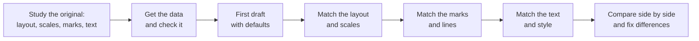

# Lab: Recreate a Published Chart

> 📚 **Before you start**
>
> - [How Matplotlib Thinks: Figures and Axes](how-matplotlib-thinks-figures-and-axes.md)
> - [Creating and Customising Plots](creating-and-customising-plots.md)
> - [Descriptive Statistics in pandas](../../numerical-computing-and-data-analysis/course.md#m5) (Numerical Computing and Data Analysis), for mean, variance and correlation

## What You'll Build

One of the most famous charts in statistics: **Anscombe's quartet**. In 1973 the statistician Francis Anscombe published four small datasets in the journal *The American Statistician*, in a paper called "Graphs in Statistical Analysis". The four datasets have almost the same mean, variance, correlation and best-fit line, yet look completely different when drawn. He used them to argue that you must plot your data, not just summarise it.

You will rebuild his four-panel figure in Matplotlib, step by step, the way you would recreate any chart you see in a report or newspaper:



This is the finished result:


> 💡 **Key Insight**
>
> Recreating a chart is a list of small, checkable decisions: how many panels, what scale, what marks, what text. Write the list first by studying the original, then tick items off one at a time. You will be surprised how much of a "designed" look comes from three or four of those decisions.

Run the blocks in order in one file or notebook.

---

## Step 1: Study the Original

Before writing code, describe the target chart in words. For Anscombe's figure:

| Question | Answer |
|---|---|
| How many panels, in what arrangement? | Four, in a 2 × 2 grid, numbered I to IV |
| Do panels share scales? | Yes. All four use the same x and y ranges, so they can be compared |
| What marks? | Plain dots, one per observation (11 per dataset) |
| Any lines? | The same least-squares line in each panel: y = 3 + 0.5x |
| What text? | A panel label (I, II, III, IV), axis labels x and y |
| What style? | Plain print style: black ink, a full box around each panel, few ticks |

Do this for any chart you recreate. Write the answers as comments at the top of your script; they become your checklist in Step 7.

---

## Step 2: Get the Data and Check It

The 44 numbers are printed in the paper and widely reproduced. Datasets I, II and III share the same x values:

```python
import os
import tempfile

import matplotlib.pyplot as plt
import numpy as np
import pandas as pd

out_dir = tempfile.mkdtemp()

x_shared = [10, 8, 13, 9, 11, 14, 6, 4, 12, 7, 5]
quartet = {
    "I":   (x_shared, [8.04, 6.95, 7.58, 8.81, 8.33, 9.96, 7.24, 4.26, 10.84, 4.82, 5.68]),
    "II":  (x_shared, [9.14, 8.14, 8.74, 8.77, 9.26, 8.10, 6.13, 3.10, 9.13, 7.26, 4.74]),
    "III": (x_shared, [7.46, 6.77, 12.74, 7.11, 7.81, 8.84, 6.08, 5.39, 8.15, 6.42, 5.73]),
    "IV":  ([8, 8, 8, 8, 8, 8, 8, 19, 8, 8, 8],
            [6.58, 5.76, 7.71, 8.84, 8.47, 7.04, 5.25, 12.50, 5.56, 7.91, 6.89]),
}
df = pd.concat(
    [pd.DataFrame({"dataset": name, "x": xs, "y": ys}) for name, (xs, ys) in quartet.items()],
    ignore_index=True,
)
print(df.shape)
print(df.groupby("dataset", sort=False).size().to_dict())
```

Output:

```
(44, 3)
{'I': 11, 'II': 11, 'III': 11, 'IV': 11}
```

Typing numbers by hand is error-prone, so **check the data against something the original states**. Anscombe's point was that the summary statistics match. If one number is mistyped, they won't:

```python
def summarise(group):
    slope, intercept = np.polyfit(group["x"], group["y"], deg=1)
    return pd.Series({
        "mean_x": group["x"].mean(),
        "var_x": group["x"].var(),
        "mean_y": group["y"].mean(),
        "var_y": group["y"].var(),
        "corr": group["x"].corr(group["y"]),
        "intercept": intercept,
        "slope": slope,
    })

stats = df.groupby("dataset", sort=False)[["x", "y"]].apply(summarise)
print(stats.round(2).to_string())
```

Output:

```
         mean_x  var_x  mean_y  var_y  corr  intercept  slope
dataset                                                      
I           9.0   11.0     7.5   4.13  0.82        3.0    0.5
II          9.0   11.0     7.5   4.13  0.82        3.0    0.5
III         9.0   11.0     7.5   4.12  0.82        3.0    0.5
IV          9.0   11.0     7.5   4.12  0.82        3.0    0.5
```

Every row agrees to two decimal places: mean of x is 9, variance of x is 11, mean of y is 7.50, correlation is 0.82, and the best-fit line is y = 3.00 + 0.50x. The data is right.

`np.polyfit(x, y, deg=1)` fits a straight line by least squares and returns the coefficients highest power first, so slope then intercept. `.var()` in pandas is the sample variance (divides by n − 1), which is what Anscombe reported.

---

## Step 3: First Draft with Defaults

Get something on screen fast. Don't style anything yet:

```python
fig, axes = plt.subplots(2, 2)
for ax, (name, group) in zip(axes.flat, df.groupby("dataset", sort=False)):
    ax.scatter(group["x"], group["y"])
    ax.set_title(name)
fig.savefig(os.path.join(out_dir, "lab-anscombe-draft.png"), bbox_inches="tight")
plt.close(fig)
```


Compare it with the checklist from Step 1. Problems:

1. **Each panel has its own scale.** Panel IV's x axis runs from about 8 to 19, panel I's from 4 to 14. The whole point of the figure is comparison, and different scales make that impossible.
2. Titles and tick labels crowd each other.
3. No fitted line, no axis labels.
4. Default blue dots instead of plain print style.

The first one matters most. Fix it first.

---

## Step 4: Match the Layout and Scales

Share both axes, set limits that fit every dataset with some breathing room, and use the same few ticks everywhere:

```python
print("x range:", df["x"].min(), "to", df["x"].max())
print("y range:", df["y"].min(), "to", df["y"].max())

X_LIMITS, Y_LIMITS = (2, 20), (2, 14)
X_TICKS, Y_TICKS = [5, 10, 15, 20], [4, 8, 12]

fig, axes = plt.subplots(2, 2, figsize=(8, 6), sharex=True, sharey=True,
                         layout="constrained")
for ax, (name, group) in zip(axes.flat, df.groupby("dataset", sort=False)):
    ax.scatter(group["x"], group["y"])
    ax.set_xlim(X_LIMITS)
    ax.set_ylim(Y_LIMITS)
    ax.set_xticks(X_TICKS)
    ax.set_yticks(Y_TICKS)
fig.savefig(os.path.join(out_dir, "lab-anscombe-layout.png"), bbox_inches="tight")
plt.close(fig)
```

Output:

```
x range: 4 to 19
y range: 3.1 to 12.74
```

Print the data range before choosing limits, so you know the limits contain every point. Because `sharex` and `sharey` are on, Matplotlib now hides the inner tick labels, which removes most of the clutter.

---

## Step 5: Match the Marks and the Fitted Line

Anscombe's dots are plain and the line is identical in every panel. Draw the line from the fitted coefficients, across the full x range, so it reaches the edges of each panel:

```python
def draw_panel(ax, name, group, fit):
    ax.scatter(group["x"], group["y"], s=36, color="black", zorder=3)
    line_x = np.array(X_LIMITS)
    ax.plot(line_x, fit["intercept"] + fit["slope"] * line_x,
            color="#C44E52", linewidth=1.5, zorder=2)

fig, axes = plt.subplots(2, 2, figsize=(8, 6), sharex=True, sharey=True,
                         layout="constrained")
for ax, (name, group) in zip(axes.flat, df.groupby("dataset", sort=False)):
    draw_panel(ax, name, group, stats.loc[name])
    ax.set_xlim(X_LIMITS)
    ax.set_ylim(Y_LIMITS)
fig.savefig(os.path.join(out_dir, "lab-anscombe-marks.png"), bbox_inches="tight")
plt.close(fig)
print(stats.loc["III", ["intercept", "slope"]].round(3).to_dict())
```

Output:

```
{'intercept': 3.002, 'slope': 0.5}
```

Two details:

- **A line needs only two points.** `line_x` is just the two x limits; computing y at both ends is enough for a straight line.
- **`zorder`** decides what is drawn on top. Higher numbers are drawn later. Dots at 3 sit on top of the line at 2, so the line never hides a data point.

The red line is a deliberate change from the black-ink original. When you recreate a chart for your own use, keep its structure but feel free to improve its readability. Note the change in your checklist so it's a choice, not an accident.

---

## Step 6: Match the Text and Style

Now the finishing touches: panel labels in the corner instead of titles, axis labels only on the outer edges, and a full box around each panel as in the print original. Add a short summary of the statistics in each panel, which is the punchline of the figure:

```python
fig, axes = plt.subplots(2, 2, figsize=(8, 6.2), sharex=True, sharey=True,
                         layout="constrained")
for ax, (name, group) in zip(axes.flat, df.groupby("dataset", sort=False)):
    fit = stats.loc[name]
    draw_panel(ax, name, group, fit)
    ax.set_xlim(X_LIMITS)
    ax.set_ylim(Y_LIMITS)
    ax.set_xticks(X_TICKS)
    ax.set_yticks(Y_TICKS)
    ax.text(0.04, 0.94, name, transform=ax.transAxes, fontsize=14,
            fontweight="bold", va="top", family="serif")
    ax.text(0.96, 0.05,
            f"mean y = {fit['mean_y']:.2f}\nr = {fit['corr']:.2f}\n"
            f"y = {fit['intercept']:.2f} + {fit['slope']:.2f}x",
            transform=ax.transAxes, ha="right", va="bottom", fontsize=8.5, color="dimgray")
    ax.tick_params(direction="in", top=True, right=True)

for ax in axes[1, :]:
    ax.set_xlabel("x")
for ax in axes[:, 0]:
    ax.set_ylabel("y")

fig.suptitle("Anscombe's quartet: same statistics, different stories", fontsize=13)
fig.text(0.99, -0.02, "Data: F. J. Anscombe, The American Statistician, 1973",
         ha="right", fontsize=8, color="gray")
fig.savefig(os.path.join(out_dir, "lab-anscombe-final.png"), bbox_inches="tight")
plt.close(fig)
print("saved:", sorted(f for f in os.listdir(out_dir) if f.startswith("lab-anscombe")))
```

Output:

```
saved: ['lab-anscombe-draft.png', 'lab-anscombe-final.png', 'lab-anscombe-layout.png', 'lab-anscombe-marks.png']
```

The new pieces:

- **`ax.text(..., transform=ax.transAxes)`** places text by fraction of the Axes, so the label sits in the same corner of every panel whatever the data.
- **`va` and `ha`** (vertical and horizontal alignment) say which corner of the text box sits at the given point. `va="top"` hangs the label down from 0.94; `ha="right"` makes the stats block end at 0.96.
- **`ax.tick_params(direction="in", top=True, right=True)`** puts ticks inside the box on all four sides, a common look in printed scientific figures.
- **A source line** with `fig.text` credits the data. Always credit the source when you reproduce a published chart.

---

## Step 7: Compare and Fix

Put your version next to the original and walk the checklist from Step 1:

| Checklist item | Status |
|---|---|
| 2 × 2 grid, panels I to IV | Done (labels in the corner) |
| Same scales in every panel | Done (`sharex`, `sharey`, fixed limits) |
| Plain dots, 11 per panel | Done |
| Same fitted line in every panel | Done, in red as a deliberate change |
| Axis labels x and y | Done, outer edges only |
| Print style, box and few ticks | Done |
| Extra: stats in each panel, title, source | Added |

Now read the finished figure the way Anscombe intended. **I** is what you imagine when someone says "correlation 0.82": a noisy straight line. **II** is a smooth curve, so a straight line is the wrong model. **III** is a perfect line ruined by one outlier, which drags the fit. **IV** has no relationship at all; one extreme point creates the whole correlation. Identical summaries, four different truths.

---

## Try It Yourself

1. **Without the lines.** Remove the fitted line and look again. Which datasets would you have mis-described from the statistics alone?
2. **Fix dataset III.** Drop the outlier (the point with y = 12.74) and refit. What are the new slope and correlation?
3. **One row.** Rebuild the figure as a 1 × 4 row with `figsize=(12, 3.2)`. Which checklist items need changing?
4. **Recreate another chart.** Find a simple bar or line chart in a newspaper or annual report, write the Step 1 checklist for it, and rebuild it with made-up numbers.

<details>
<summary>Show answers</summary>

```python
iii = df[(df["dataset"] == "III") & (df["y"] != 12.74)]
slope, intercept = np.polyfit(iii["x"], iii["y"], deg=1)
print(f"slope={slope:.3f} intercept={intercept:.3f} r={iii['x'].corr(iii['y']):.4f}")

fig, axes = plt.subplots(1, 4, figsize=(12, 3.2), sharex=True, sharey=True,
                         layout="constrained")
for ax, (name, group) in zip(axes, df.groupby("dataset", sort=False)):
    draw_panel(ax, name, group, stats.loc[name])
    ax.set_xlim(X_LIMITS)
    ax.set_ylim(Y_LIMITS)
    ax.set_title(name)
fig.savefig(os.path.join(out_dir, "lab-anscombe-row.png"), bbox_inches="tight")
plt.close(fig)
print(axes.shape)
```

Output:

```
slope=0.345 intercept=4.006 r=1.0000
(4,)
```

1. Probably all of II, III and IV. The numbers suggest a moderate linear relationship in every case.
2. Without the outlier, the remaining ten points sit on an almost perfect line (correlation very close to 1) with a smaller slope. One point was hiding a near-exact relationship.
3. The axis-label loops change: every panel is now in the bottom row, and only `axes[0]` is in the first column. `axes` is one-dimensional, so loop over `axes` instead of `axes.flat`.
4. There's no single answer. Compare your checklist with a friend's for the same chart; you'll each have noticed details the other missed.

</details>

---

## What You've Learned

- **A repeatable process** for recreating any chart: study it, write a checklist, draft with defaults, then fix layout, marks, text and style in that order.
- **Check transcribed data** against a fact the source states, such as a summary statistic.
- **Shared scales** (`sharex`, `sharey`, fixed limits) are what make small multiples comparable.
- **Placement tools**: `transform=ax.transAxes`, `ha` and `va`, `zorder`, `tick_params`.
- **Why plotting matters**: identical summary statistics can hide completely different data.

---

**Up next:** [Statistical Plots with Seaborn](../03-seaborn-and-storytelling/statistical-plots-with-seaborn.md)
