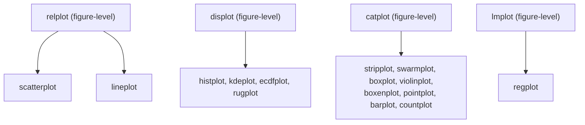
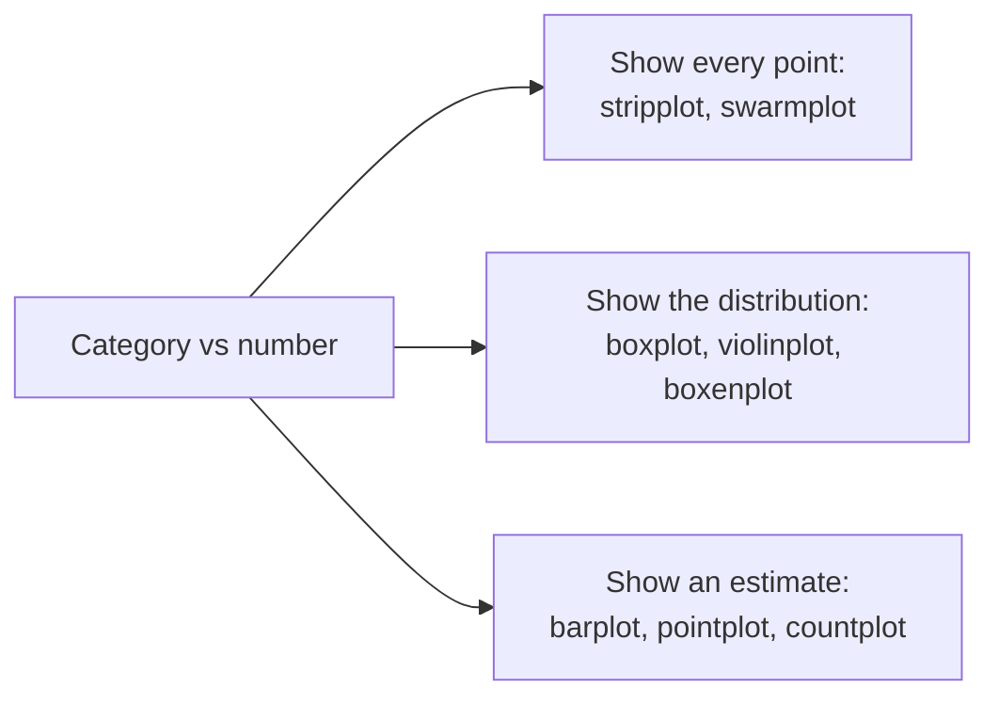

# Statistical Plots with Seaborn: The Complete Guide

> 📚 **Before you start**
>
> - [How Matplotlib Thinks: Figures and Axes](../02-matplotlib/how-matplotlib-thinks-figures-and-axes.md), because every Seaborn chart is a Matplotlib Figure and Axes
> - [Creating and Customising Plots](../02-matplotlib/creating-and-customising-plots.md), for titles, labels and formatters
> - [Descriptive Statistics in pandas](../../numerical-computing-and-data-analysis/course.md#m5) and [Categorical Data](../../numerical-computing-and-data-analysis/course.md#m4) (Numerical Computing and Data Analysis), for means, `groupby` and category columns

## Introduction

A cloud kitchen in Bengaluru wants to know: do dinner orders take longer to deliver than lunch orders, and is it because of distance or something else? In Matplotlib you would group the data, compute means, compute confidence intervals, pick colours for each group, draw each group in a loop and build a legend by hand. That's 30 lines before you see anything.

In Seaborn it is one line: `sns.scatterplot(data=orders, x="distance_km", y="minutes", hue="meal")`. Seaborn reads the DataFrame, splits it by the `meal` column, picks colours, draws, and adds the legend. When you ask for averages, it computes them *and* their uncertainty for you.

By the end of this article you will understand Seaborn's model (column names in, statistics and styling out), the difference between its two kinds of function, and how to use its main plots: scatter and line plots with grouping, faceted small multiples, the categorical family (strip, swarm, box, violin, bar, point, count) and regression plots. You will also know how to hand any Seaborn chart back to Matplotlib for finishing.

> 💡 **Key Insight**
>
> Seaborn's superpower is **mapping columns to visual properties**. You say which column goes on x, which on y, and which decides colour (`hue`), marker (`style`), size (`size`) or panel (`col`, `row`). Seaborn does the grouping, the statistics and the legend. Your data just has to be in **long form**: one row per observation, one column per variable.

---

## Core Explanation

### 1. Setup and a dataset

Seaborn is imported as `sns` by convention. `sns.set_theme()` switches on Seaborn's default look (grey grid background is the default; `"whitegrid"` is quieter). The styling lesson covers themes in depth.

We'll build a made-up dataset of 400 orders from the kitchen, seeded so you get the same numbers:

```python
import os
import tempfile

import matplotlib.pyplot as plt
import numpy as np
import pandas as pd
import seaborn as sns

sns.set_theme(style="whitegrid")
out_dir = tempfile.mkdtemp()
rng = np.random.default_rng(2026)

n = 400
meal = rng.choice(["Lunch", "Dinner"], size=n, p=[0.45, 0.55])
day = rng.choice(["Mon", "Tue", "Wed", "Thu", "Fri", "Sat", "Sun"], size=n)
distance = rng.gamma(shape=3, scale=1.3, size=n).round(1) + 0.5
weekend = np.isin(day, ["Sat", "Sun"])
minutes = (12 + 3.2 * distance + np.where(meal == "Dinner", 6, 0)
           + np.where(weekend, 4, 0) + rng.normal(0, 4, n)).round(1)
order_value = (180 + np.where(meal == "Dinner", 140, 0) + np.where(weekend, 60, 0)
               + rng.gamma(2, 60, n)).round(-1)
hour = np.where(meal == "Lunch", rng.integers(11, 16, n), rng.integers(18, 24, n))

orders = pd.DataFrame({
    "day": pd.Categorical(day, categories=["Mon", "Tue", "Wed", "Thu", "Fri", "Sat", "Sun"]),
    "meal": meal, "hour": hour, "distance_km": distance,
    "minutes": minutes, "order_value": order_value,
    "payment": rng.choice(["UPI", "Card", "Cash"], size=n, p=[0.7, 0.2, 0.1]),
})
print(orders.head(4).to_string(index=False))
print(orders.groupby("meal")["minutes"].mean().round(1).to_dict())
```

Output:

```
day   meal  hour  distance_km  minutes  order_value payment
Sun  Lunch    14          3.4     23.0        400.0    Cash
Tue Dinner    23          4.2     37.1        380.0    Card
Fri Dinner    20          6.0     38.3        330.0     UPI
Tue  Lunch    14          3.2     18.5        270.0    Card
{'Dinner': 34.0, 'Lunch': 25.7}
```

Making `day` a pandas **Categorical** with an explicit order matters: Seaborn uses that order on the axis, so you get Mon to Sun instead of alphabetical Fri, Mon, Sat...

### 2. Long form vs wide form

Seaborn works best with **long-form** (also called *tidy*) data: every row is one observation and every column is one variable. `orders` is long form. A **wide-form** table, such as a pivot with one column per day, has to be melted first:

```python
wide = orders.pivot_table(index="hour", columns="meal", values="minutes", aggfunc="mean").round(1)
print(wide.head(3).to_string())

long = wide.reset_index().melt(id_vars="hour", var_name="meal", value_name="avg_minutes").dropna()
print(long.head(3).to_string(index=False))
```

Output:

```
meal  Dinner  Lunch
hour               
11       NaN   26.3
12       NaN   25.6
13       NaN   25.5
 hour   meal  avg_minutes
   18 Dinner         34.4
   19 Dinner         34.3
   20 Dinner         32.4
```

`melt` turns column names into values of a new column (`meal`), which is exactly what `hue="meal"` needs. If a Seaborn call isn't doing what you expect, check the shape of your data first.

### 3. Two kinds of function: Axes-level and figure-level

Seaborn has two layers, and knowing which one you are calling saves a lot of confusion:



*Each figure-level function (top) can draw any of the Axes-level functions under it, in one panel or in a grid of panels.*

| | Axes-level | Figure-level |
|---|---|---|
| Examples | `scatterplot`, `boxplot`, `histplot`, `regplot` | `relplot`, `catplot`, `displot`, `lmplot` |
| Draws into | One Axes, which you can pass with `ax=` | A new Figure it creates itself |
| Returns | The Matplotlib `Axes` | A Seaborn `FacetGrid` (has `.figure` and `.axes`) |
| Small multiples | No | Yes, with `col=`, `row=`, `col_wrap=` |
| Size set by | Your `plt.subplots(figsize=...)` | `height=` (inches per panel) and `aspect=` (width ÷ height) |
| Use when | Combining with other charts on your own layout | Quick exploration, faceted grids |

```python
fig, ax = plt.subplots()
returned = sns.scatterplot(data=orders, x="distance_km", y="minutes", ax=ax)
print(type(returned).__name__, returned is ax)
plt.close(fig)

g = sns.relplot(data=orders, x="distance_km", y="minutes")
print(type(g).__name__, type(g.figure).__name__, g.axes.shape)
plt.close(g.figure)
```

Output:

```
Axes True
FacetGrid Figure (1, 1)
```

### 4. Relationships: scatter plots with `hue`, `style` and `size`

```python
fig, ax = plt.subplots(figsize=(7.5, 4.5), layout="constrained")
sns.scatterplot(data=orders, x="distance_km", y="minutes", hue="meal",
                style="meal", alpha=0.7, ax=ax)
ax.set(xlabel="Distance (km)", ylabel="Delivery time (minutes)",
       title="Dinner deliveries take longer at every distance")
ax.legend(title=None, frameon=False)
fig.savefig(os.path.join(out_dir, "sns-scatter-hue.png"), bbox_inches="tight")
plt.close(fig)
```


- **`hue="meal"`** colours points by meal and builds the legend.
- **`style="meal"`** also changes the marker shape. Encoding the same column twice (colour and shape) helps colour-blind readers and black-and-white printouts.
- **`size="order_value"`** would scale points by a number. Use it sparingly.
- **`ax.set(...)`** is a Matplotlib shortcut that sets several properties at once.

The chart answers the question: at the same distance, dinner points sit higher, so distance alone doesn't explain the gap.

### 5. Small multiples with `relplot`

When one chart gets crowded, split it into a grid of small charts with shared axes. Figure-level functions do this with `col` and `row`:

```python
g = sns.relplot(data=orders, x="distance_km", y="minutes", hue="meal",
                col="payment", col_order=["UPI", "Card", "Cash"],
                height=3.2, aspect=0.95, alpha=0.6)
g.set_axis_labels("Distance (km)", "Minutes")
g.set_titles(col_template="Paid by {col_name}")
g.figure.suptitle("Payment method doesn't change the pattern", y=1.04)
g.savefig(os.path.join(out_dir, "sns-relplot-facets.png"))
plt.close(g.figure)
print(g.axes.shape)
```

Output:

```
(1, 3)
```


- **`col="payment"`** makes one panel per payment method. `col_order` fixes their order.
- **`col_wrap=3`** would wrap many panels onto several rows.
- **`g.set_titles(col_template=...)`** writes panel titles; `{col_name}` is filled in for each panel.
- **`g.savefig`** saves the whole grid (it applies a tight bounding box for you).

### 6. Lines with automatic averages and confidence bands

`lineplot` with several y values per x value **aggregates** them: it draws the mean and a shaded band showing uncertainty in that mean.

```python
fig, ax = plt.subplots(figsize=(8, 4), layout="constrained")
sns.lineplot(data=orders, x="hour", y="minutes", hue="meal", marker="o",
             errorbar=("ci", 95), n_boot=1000, seed=0, ax=ax)
ax.set(xlabel="Hour of order", ylabel="Average delivery time (minutes)",
       title="Delivery time by hour, with 95% confidence bands")
ax.set_xticks(range(11, 24))
ax.legend(title=None, frameon=False)
fig.savefig(os.path.join(out_dir, "sns-lineplot-ci.png"), bbox_inches="tight")
plt.close(fig)

print(orders.groupby("hour")["minutes"].agg(["count", "mean"]).round(1).head(3).to_string())
```

Output:

```
      count  mean
hour             
11       38  26.3
12       40  25.6
13       34  25.5
```


The **`errorbar`** argument controls the band. It's worth knowing all four options, because they answer different questions:

| `errorbar=` | Shows | Answers |
|---|---|---|
| `("ci", 95)` (default) | 95% confidence interval of the mean, by bootstrapping | "How sure are we about the average?" |
| `"se"` | Mean ± one standard error | Same idea, parametric and faster |
| `"sd"` | Mean ± one standard deviation | "How spread out are individual orders?" |
| `("pi", 50)` | The middle 50% of the data (percentile interval) | "What's a typical range?" |
| `None` | No band | Just the line |

A **confidence interval** shrinks as you collect more data; a **standard deviation** doesn't. Always say in the title or caption which one you're showing. Bootstrapping is random, so pass `seed=` for repeatable output. `n_boot` is the number of resamples.

### 7. Comparing groups: the categorical family

When one axis is a category (day, meal, payment) and the other a number, Seaborn offers three kinds of plot:



Here are one of each style, side by side, for order value by day:

```python
fig, axes = plt.subplots(1, 3, figsize=(13, 4), sharey=True, layout="constrained")
sns.stripplot(data=orders, x="day", y="order_value", alpha=0.5, jitter=0.25, ax=axes[0])
axes[0].set_title("stripplot: every order")
sns.boxplot(data=orders, x="day", y="order_value", ax=axes[1])
axes[1].set_title("boxplot: median, quartiles, outliers")
sns.violinplot(data=orders, x="day", y="order_value", inner="quart", ax=axes[2])
axes[2].set_title("violinplot: the full shape")
for ax in axes:
    ax.set(xlabel="", ylabel="Order value (₹)")
fig.savefig(os.path.join(out_dir, "sns-categorical-trio.png"), bbox_inches="tight")
plt.close(fig)

print(orders.groupby("day", observed=True)["order_value"].median().to_dict())
```

Output:

```
{'Mon': 350.0, 'Tue': 340.0, 'Wed': 400.0, 'Thu': 380.0, 'Fri': 370.0, 'Sat': 435.0, 'Sun': 445.0}
```


> With Matplotlib 3.11 and Seaborn 0.13.2, `sns.boxplot` prints a `MatplotlibDeprecationWarning` about a `vert` parameter. Seaborn passes that argument internally, the chart is correct, and you can ignore the warning until a newer Seaborn release removes it.

How to read a **box plot**: the box spans the 25th to 75th percentile (the *interquartile range*, IQR), the line inside is the median, the whiskers reach the furthest points within 1.5 × IQR of the box, and dots beyond the whiskers are drawn individually as possible outliers.

A **violin plot** draws a smoothed outline of the distribution (a kernel density estimate, covered next lesson) mirrored on both sides. `inner="quart"` adds dashed lines for the quartiles. Violins show things boxes hide, such as two peaks.

A **strip plot** shows every point, with random sideways `jitter` so they don't sit on top of each other. A **swarm plot** (`sns.swarmplot`) arranges points so none overlap, which looks neat but gets slow and crowded past a few hundred points.

### 8. Estimates: bar, point and count plots

`barplot` and `pointplot` compute a statistic (the mean by default) per category and show its uncertainty. `countplot` just counts rows.

```python
fig, axes = plt.subplots(1, 3, figsize=(13, 3.8), layout="constrained")

sns.barplot(data=orders, x="meal", y="order_value", hue="meal", legend=False,
            errorbar=("ci", 95), seed=0, ax=axes[0])
axes[0].set(title="barplot: mean order value", xlabel="", ylabel="₹")

sns.pointplot(data=orders, x="day", y="minutes", hue="meal",
              errorbar=("ci", 95), seed=0, dodge=0.3, ax=axes[1])
axes[1].set(title="pointplot: mean minutes by day", xlabel="", ylabel="Minutes")
axes[1].legend(title=None, frameon=False)

sns.countplot(data=orders, x="payment", order=["UPI", "Card", "Cash"],
              hue="payment", legend=False, ax=axes[2])
axes[2].set(title="countplot: orders per payment method", xlabel="", ylabel="Orders")

fig.savefig(os.path.join(out_dir, "sns-estimates.png"), bbox_inches="tight")
plt.close(fig)
print(orders["payment"].value_counts().to_dict())
```

Output:

```
{'UPI': 291, 'Card': 65, 'Cash': 44}
```


- **The black line on each bar is the confidence interval of the mean.** A bar chart of means without it hides how sure you are.
- **`estimator=`** changes the statistic: `estimator="median"` or any function such as `np.sum`.
- **`pointplot`** joins the means with lines, which makes it easy to compare *changes across categories between groups*. `dodge` shifts the groups apart so their error bars don't overlap.
- **`hue="meal", legend=False`** on the bar and count plots gives each bar its own colour. In Seaborn 0.13, setting `palette=` without `hue=` is deprecated, so this is the way to colour bars by their own category.

### 9. Regression plots

`regplot` (Axes-level) and `lmplot` (figure-level, supports `hue` and `col`) draw a scatter plot, fit a straight line by least squares, and shade a confidence band around the line:

```python
g = sns.lmplot(data=orders, x="distance_km", y="minutes", hue="meal",
               height=4.2, aspect=1.4, scatter_kws={"alpha": 0.4, "s": 18},
               seed=0, legend=False)
g.set_axis_labels("Distance (km)", "Delivery time (minutes)")
g.ax.legend(title=None, frameon=False, loc="upper left")
g.ax.set_title("Each extra km adds about 3 minutes, for lunch and dinner alike")
g.savefig(os.path.join(out_dir, "sns-lmplot.png"))
plt.close(g.figure)

for name, group in orders.groupby("meal"):
    slope, intercept = np.polyfit(group["distance_km"], group["minutes"], 1)
    print(f"{name}: minutes = {intercept:.1f} + {slope:.2f} x km")
```

Output:

```
Dinner: minutes = 19.6 + 3.15 x km
Lunch: minutes = 12.2 + 3.21 x km
```


The two lines are nearly parallel (same slope) but dinner sits about 7 minutes higher: dinner orders aren't further away, they're slower at every distance. That's the answer to the kitchen's question.

Useful options: `order=2` fits a curve (a second-degree polynomial), `logistic=True` fits a logistic curve for a 0/1 outcome, `lowess=True` draws a smooth local trend without assuming a shape, and `ci=None` hides the band. A regression line on a chart is a description, not proof of cause.

### 10. Finishing a Seaborn chart with Matplotlib

Because Axes-level functions return a normal Axes, you can keep going with everything from [Creating and Customising Plots](../02-matplotlib/creating-and-customising-plots.md):

```python
import matplotlib.ticker as mticker

fig, ax = plt.subplots(figsize=(7, 3.6), layout="constrained")
sns.boxplot(data=orders, x="order_value", y="meal", hue="meal", legend=False,
            width=0.5, ax=ax)
ax.xaxis.set_major_formatter(mticker.StrMethodFormatter("₹{x:,.0f}"))
ax.axvline(orders["order_value"].median(), color="grey", linestyle="--", linewidth=1)
ax.set(xlabel="", ylabel="", title="Dinner baskets are bigger")
sns.despine(ax=ax, left=True)
fig.savefig(os.path.join(out_dir, "sns-finish-with-mpl.png"), bbox_inches="tight")
plt.close(fig)
print(f"overall median: ₹{orders['order_value'].median():,.0f}")
```

Output:

```
overall median: ₹390
```


Swapping x and y made the box plot horizontal: Seaborn decides orientation from which axis has the categories. `sns.despine` removes spines (top and right by default; `left=True` removes the left one too).

For a figure-level `FacetGrid`, reach the Matplotlib objects through `g.figure`, `g.axes` (array of Axes) or `g.ax` (when there is only one).

Seaborn also has a newer, more composable interface, `seaborn.objects` (imported as `so`), where you build a plot with `so.Plot(data, x=..., y=...).add(so.Dot())`. It's useful, but the function interface in this lesson is what most code you'll read uses.

---

## Try It Yourself

1. **Which day is slowest?** Draw a `barplot` of mean `minutes` by `day` with `errorbar="se"`. Print the day with the highest mean.
2. **Medians instead of means.** Redraw the order-value bar chart with `estimator="median"`. Print the median order value for each meal.
3. **Facet by meal.** Use `catplot` with `kind="box"`, `x="day"`, `y="minutes"` and `col="meal"`. Print the shape of `g.axes`.
4. **Spread vs certainty.** Draw the hourly `lineplot` twice, once with `errorbar="sd"` and once with `("ci", 95)`. Which band is wider, and why?

<details>
<summary>Show answers</summary>

```python
fig, ax = plt.subplots()
sns.barplot(data=orders, x="day", y="minutes", errorbar="se", ax=ax)
fig.savefig(os.path.join(out_dir, "ex-slowest-day.png"))
plt.close(fig)
print("slowest:", orders.groupby("day", observed=True)["minutes"].mean().idxmax())

fig, ax = plt.subplots()
sns.barplot(data=orders, x="meal", y="order_value", estimator="median", errorbar=None, ax=ax)
fig.savefig(os.path.join(out_dir, "ex-median.png"))
plt.close(fig)
print(orders.groupby("meal")["order_value"].median().to_dict())

g = sns.catplot(data=orders, x="day", y="minutes", col="meal", kind="box", height=3)
g.savefig(os.path.join(out_dir, "ex-catplot.png"))
plt.close(g.figure)
print(g.axes.shape)

fig, (a, b) = plt.subplots(1, 2, figsize=(10, 3.5), sharey=True)
sns.lineplot(data=orders, x="hour", y="minutes", errorbar="sd", ax=a)
sns.lineplot(data=orders, x="hour", y="minutes", errorbar=("ci", 95), seed=0, ax=b)
fig.savefig(os.path.join(out_dir, "ex-sd-vs-ci.png"))
plt.close(fig)
```

Output:

```
slowest: Sun
{'Dinner': 440.0, 'Lunch': 290.0}
(1, 2)
```

1. A weekend day, because the data adds four minutes on Saturday and Sunday.
2. See the printed medians: dinner is much higher.
3. `(1, 2)`: one row, one column per meal.
4. The `sd` band is much wider. It describes how spread out individual orders are. The confidence interval describes how precisely we know the *average*, which is much tighter with dozens of orders per hour.

</details>

---

## Real-World Examples

### Example 1: A/B test readouts

A product team compares checkout conversion for two app designs across five cities. A `pointplot` with `hue="variant"` and confidence intervals shows at a glance in which cities the new design clearly wins and where the intervals overlap.

### Example 2: Hospital waiting times

An analyst plots emergency-room waiting times by weekday with violin plots. Monday's violin has two bulges: most patients are seen quickly, but a second group waits hours. A bar chart of the mean would have shown only "Monday is a bit slower".

### Example 3: Exploring a new dataset

A data scientist starts on an unfamiliar sales table with `relplot` and `catplot` faceted by region. In ten minutes of one-liners she spots one region whose data looks shifted, which turns out to be a currency conversion bug.

---

## Common Misconceptions

### Misconception 1: "Seaborn is a separate charting system"

It's a layer on Matplotlib. Every Seaborn chart is made of Matplotlib Artists on Matplotlib Axes, and you finish it with Matplotlib methods.

### Misconception 2: "The bar height is the data"

In `barplot`, the bar height is an **estimate** (the mean, by default) and the line on top is its uncertainty. If you want to show counts, use `countplot`; if you want to show raw values, use `stripplot` or a plain Matplotlib bar.

### Misconception 3: "The shaded band shows where most data points are"

By default, it is the 95% confidence interval of the **mean**, which can be very narrow even when individual values vary a lot. Use `errorbar="sd"` or `("pi", 50)` to show spread.

### Misconception 4: "`height` in `relplot` is the figure height"

`height` is the height of **each panel** in inches, and `aspect` sets each panel's width relative to its height. A 2 × 3 grid with `height=3` is about 6 inches tall.

---

## Interview Relevance

Seaborn questions test whether you can choose and read statistical graphics:

- *"Axes-level vs figure-level functions?"* Axes-level draw into one Axes and return it; figure-level create their own figure, support faceting with `col`/`row`, and return a `FacetGrid`.
- *"What does the error bar on a Seaborn bar plot mean?"* By default, a bootstrapped 95% confidence interval of the mean. Explain the difference from a standard deviation.
- *"Box plot or violin plot?"* Box plots summarise with five numbers and flag outliers; violins show the full shape, including multiple peaks. With few points, show the points themselves.
- *"What is long-form data and why does Seaborn want it?"* One observation per row, one variable per column, so any column can be mapped to `hue`, `col` or an axis. Convert with `melt`.
- *"How would you show the relationship between two numbers for several groups?"* `lmplot` with `hue` (or `col` for separate panels), and caution that a fitted line isn't causation.

---

## Key Takeaways

- **Seaborn maps DataFrame columns to visuals**: `x`, `y`, `hue`, `style`, `size`, `col`, `row`. Feed it **long-form** data.
- **Axes-level** functions (`scatterplot`, `boxplot`) draw into an `ax` you give them; **figure-level** ones (`relplot`, `catplot`, `displot`, `lmplot`) build their own grid of panels.
- **Aggregating plots** (`lineplot`, `barplot`, `pointplot`) show a mean plus an uncertainty band; choose `errorbar` deliberately and say which one you used.
- **For category vs number**, show points (strip, swarm), distributions (box, violin) or estimates (bar, point, count) depending on the question.
- **`regplot`/`lmplot`** add fitted lines with confidence bands.
- **Finish with Matplotlib**: the returned Axes takes every method you already know.

---

**Up next:** [Histograms, Pair Plots and Heatmaps](histograms-pair-plots-and-heatmaps.md)
