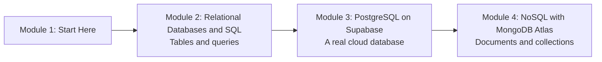

# How This Course Works

## Introduction

Open any app on your phone and there is a database behind it. A UPI app keeps every payment you have ever made. IRCTC knows which berth on which train is still free. A food delivery app remembers your address, your last ten orders and the restaurant's menu at this exact minute. None of that lives in a Python list or a CSV file. It lives in a **database**: software built to store data safely, find it fast, and let thousands of people change it at the same time without corrupting it.

This course teaches you to work with the two kinds of database you will meet most often as a data or AI engineer. **Relational databases**, which store data in tables and speak **SQL**, and **document databases**, which store JSON-like documents and are often grouped under the name **NoSQL**. You will learn the theory, write every common kind of query, and then use two real cloud services: **PostgreSQL on Supabase** and **MongoDB Atlas**.

This first article is short. It tells you what you will learn, how the lessons are built, what you need before starting, and how to get the most out of the course.

> 💡 **Key Insight**
>
> SQL is one of the most long-lived skills in software. The language you learn in module 2 has been the standard way to ask a database questions for over 40 years, and it works (with small dialect differences) in SQLite, PostgreSQL, MySQL, SQL Server, Snowflake, BigQuery and Spark. Learn it properly once and it pays you back for your whole career.

---

## What You Will Learn

By the end of this course you will be able to:

- **Explain what a relational database is**: tables, rows, columns, schemas, data types and why a database beats a pile of files.
- **Write SQL with confidence**: `SELECT`, `WHERE`, `ORDER BY`, `LIMIT`, `GROUP BY`, `HAVING`, `CASE`, `INSERT`, `UPDATE`, `DELETE`, every kind of join, `UNION`, `INTERSECT`, `EXCEPT` and subqueries.
- **Design tables that stay correct**: primary keys, foreign keys, constraints, the basics of normalisation, indexes and transactions.
- **Run PostgreSQL in the cloud on Supabase**, create tables in the dashboard, and query them from Python with both the `supabase` client and `psycopg`.
- **Explain what a document database is**, when it is a better fit than tables, and how to model data as documents.
- **Use MongoDB Atlas from Python** with `pymongo`: create databases and collections, insert, find, filter with query operators, sort, aggregate, index, update, delete and drop.

### The course at a glance



Module 2 is the foundation and the longest module. Every SQL example in it runs on your own laptop with **SQLite**, a small database engine that ships inside Python, so you need no account and no installation. Module 3 takes the same SQL to **PostgreSQL**, the most popular open-source database for real applications, hosted on Supabase. Module 4 switches to a different way of thinking: documents instead of rows, using MongoDB.

---

## How Every Lesson Is Built

Every article on this platform follows the same shape, so you always know where to look:

| Section | What it gives you |
|---|---|
| **Before you start** | Links to the earlier lessons this one depends on. If a term is unfamiliar, follow the link. |
| **Introduction** | Why the topic matters, using situations you already know. |
| **Key Insight** | The one idea to remember if you remember nothing else. |
| **Core Explanation** | The topic, step by step, with diagrams, tables and runnable code. |
| **Try It Yourself** | Exercises to do yourself, with answers hidden in a fold. |
| **Real-World Examples** | How real products use the idea. |
| **Common Misconceptions** | The mistakes almost everyone makes, corrected. |
| **Interview Relevance** | What interviewers ask about this topic and what a strong answer covers. |
| **Key Takeaways** | A one-minute summary to review later. |

**Labs** are different. A lab is a guided build: you start from an empty file and finish with something that works, such as a notes database on Supabase or a chat-history store in MongoDB. Labs are where the ideas stick, so please don't skip them.

### About the code

- Code marked with an **Output:** block was actually run, and the output shown is exactly what it printed. You should see the same thing.
- Code that needs a cloud account (Supabase or MongoDB Atlas) starts with a comment like `# not-run: needs a Supabase project`, and what follows it is labelled **Example output:**. Your ids and timestamps will differ.
- SQL shown on its own in a ```sql block is not executed by Python. When it matters, the lesson also runs the same SQL through Python's `sqlite3` module so you can see real results.

---

## What You Need Before Starting

You do **not** need any previous database experience. You do need:

- **Basic Python.** Variables, lists, dictionaries, loops, functions and `with` blocks. If any of those feel shaky, work through [Python Fundamentals](../../python-fundamentals/course.md) first, especially [Functions and Iterators](../../python-fundamentals/course.md#m6).
- **Python 3.10 or newer** and a code editor such as VS Code. Python's built-in `sqlite3` module is all you need for module 2.
- **Two free accounts, later.** Module 3 uses a free [Supabase](https://supabase.com) project and module 4 uses a free MongoDB Atlas cluster. You can sign up with an email address or a GitHub account when you reach those modules. Neither needs a credit card for the free tier.

### Do I need to install a database server?

No. SQLite runs inside your Python process and stores a database in a single file (or in memory). PostgreSQL and MongoDB run in the cloud, so the only things you install are two Python packages, `supabase`/`psycopg` and `pymongo`, when the lessons ask for them.

---

## How to Get the Most Out of It

1. **Type the queries, don't paste them.** SQL looks simple, but the order of clauses and the placement of commas trip everyone up at first. Typing builds the muscle memory.
2. **Predict before you run.** Before running a query, guess how many rows it will return. When you're wrong, you've found something worth understanding.
3. **Break things on purpose.** Insert a duplicate primary key. Delete a parent row that has children. Read the error. Errors from a database are precise and worth learning to read.
4. **Do the Try It Yourself exercises.** Writing a query from a plain-English question is the actual skill interviews test.
5. **Mark lessons complete.** The button at the bottom of each lesson saves your progress in your browser.

---

## Common Misconceptions

### Misconception 1: "NoSQL replaced SQL"

It didn't. Relational databases like PostgreSQL are still the default choice for most applications, and document databases like MongoDB are a strong choice for some. Many companies use both. That is exactly why this course teaches both, and module 4 spends time on when to pick which.

### Misconception 2: "I'll just use pandas, I don't need SQL"

pandas is excellent for analysing data that fits in memory on one machine. Databases hold the data that the whole company shares, that changes every second, and that is too big to load at once. Data engineers, analysts and ML engineers all write SQL every week, and most data tools (Spark, dbt, warehouses) use it too.

### Misconception 3: "Learning SQLite is a waste because real apps use PostgreSQL"

The SQL you learn on SQLite works on PostgreSQL almost unchanged. Each lesson points out where the two differ. SQLite is also a real production database: it ships inside every Android and iOS phone and in every major web browser.

---

## Key Takeaways

- This course covers **relational databases and SQL**, then **PostgreSQL on Supabase**, then **document databases with MongoDB Atlas**.
- Module 2 runs entirely offline using Python's built-in **`sqlite3`**. No account or server is needed.
- Code with an **Output:** block was really run; cloud code is marked **not-run** and shows **Example output:**.
- You need basic Python. Free Supabase and MongoDB Atlas accounts come later.
- Type the queries, predict the results, and do the exercises.

---

**Up next:** [What is a Relational Database?](../02-relational-databases-and-sql/what-is-a-relational-database.md)
