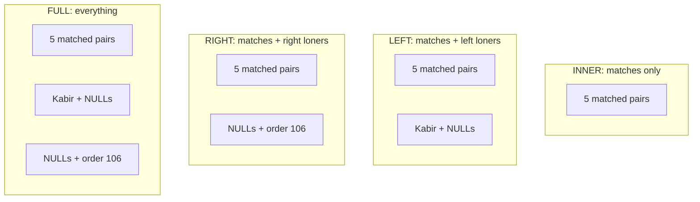

# Joins and Unions: The Complete Guide

> 📚 **Before you start**
>
> - [Writing SQL Queries](writing-sql-queries.md), for `SELECT`, `WHERE`, `GROUP BY`, `HAVING` and the `show()` helper idea
> - [Primary and Foreign Keys](primary-and-foreign-keys.md), because joins follow foreign keys from one table to another

## Introduction

In the last lesson you split one messy table into tidy ones: customers in one table, orders in another, restaurants in a third. That fixed the anomalies, but it created a new question. The founder asks, "Show me each order with the customer's name and the restaurant's name." The names aren't in `orders`; only the ids are.

A **join** puts tables back together, row by row, on matching key values, *at query time*. You store each fact once and combine them whenever you need to. Joins are the single most important idea in SQL after `SELECT` itself, and the most asked-about topic in SQL interviews.

By the end of this article you will be able to write every kind of join (inner, left, right, full outer, cross and self), join three or more tables, find rows that have *no* match, stack results with `UNION`, `UNION ALL`, `INTERSECT` and `EXCEPT`, and nest one query inside another with **subqueries**. You'll know exactly which rows each one keeps and why.

> 💡 **Key Insight**
>
> Every join answers one question: **what happens to rows that have no partner?** An `INNER JOIN` drops them. A `LEFT JOIN` keeps the unmatched rows from the left table and fills the missing side with NULLs. A `RIGHT JOIN` does the same for the right table, and a `FULL JOIN` keeps unmatched rows from both. Learn to predict the unmatched rows and you've learned joins.

---

## Core Explanation

### 1. The sample data

A food delivery app with customers, restaurants and orders. Look at the data carefully: Kabir has never ordered, Dosa Corner has never received an order, and order 106 was a guest checkout with no customer. Those three "loners" are what make joins interesting.

```python
import sqlite3

conn = sqlite3.connect(":memory:")
conn.executescript("""
    CREATE TABLE customers (
        customer_id INTEGER PRIMARY KEY,
        name        TEXT NOT NULL,
        city        TEXT NOT NULL
    );
    CREATE TABLE restaurants (
        restaurant_id INTEGER PRIMARY KEY,
        name          TEXT NOT NULL,
        city          TEXT NOT NULL
    );
    CREATE TABLE orders (
        order_id      INTEGER PRIMARY KEY,
        customer_id   INTEGER REFERENCES customers (customer_id),   -- NULL = guest order
        restaurant_id INTEGER NOT NULL REFERENCES restaurants (restaurant_id),
        amount        INTEGER NOT NULL
    );
    INSERT INTO customers VALUES (1, 'Asha', 'Mumbai'), (2, 'Ravi', 'Delhi'),
                                 (3, 'Meera', 'Bengaluru'), (4, 'Kabir', 'Delhi');
    INSERT INTO restaurants VALUES (10, 'Chai Point', 'Mumbai'), (11, 'Paratha House', 'Delhi'),
                                   (12, 'Idli Express', 'Bengaluru'), (13, 'Dosa Corner', 'Chennai');
    INSERT INTO orders VALUES (101, 1, 10, 120), (102, 1, 11, 340), (103, 2, 11, 250),
                              (104, 3, 12, 180), (105, 3, 12, 90),  (106, NULL, 10, 60);
""")

def show(sql, params=()):
    """Run a query and print the result as a small text table."""
    cur = conn.execute(sql, params)
    cols = [d[0] for d in cur.description]
    rows = [["NULL" if v is None else str(v) for v in r] for r in cur.fetchall()]
    widths = [max([len(c)] + [len(r[i]) for r in rows]) for i, c in enumerate(cols)]
    print(" | ".join(c.ljust(w) for c, w in zip(cols, widths)).rstrip())
    print("-+-".join("-" * w for w in widths))
    for r in rows:
        print(" | ".join(v.ljust(w) for v, w in zip(r, widths)).rstrip())
    print(f"({len(rows)} row{'' if len(rows) == 1 else 's'})")

show("SELECT * FROM orders")
```

Output:

```
order_id | customer_id | restaurant_id | amount
---------+-------------+---------------+-------
101      | 1           | 10            | 120
102      | 1           | 11            | 340
103      | 2           | 11            | 250
104      | 3           | 12            | 180
105      | 3           | 12            | 90
106      | NULL        | 10            | 60
(6 rows)
```

`executescript` runs several SQL statements separated by semicolons in one go, which is handy for setup scripts.

### 2. INNER JOIN: only the matches

An **inner join** pairs each row of one table with each row of the other **where the join condition is true**, and keeps only those pairs.

```python
show("""
    SELECT o.order_id, c.name AS customer, o.amount
    FROM orders AS o
    INNER JOIN customers AS c ON o.customer_id = c.customer_id
    ORDER BY o.order_id
""")
```

Output:

```
order_id | customer | amount
---------+----------+-------
101      | Asha     | 120
102      | Asha     | 340
103      | Ravi     | 250
104      | Meera    | 180
105      | Meera    | 90
(5 rows)
```

Read it as: "for each order, find the customer whose `customer_id` equals the order's `customer_id`."

- **`ON`** gives the join condition. It's almost always "foreign key = primary key".
- **`o` and `c` are table aliases.** They save typing and make it clear which table each column comes from. When both tables have a column with the same name (here `customer_id` and `name` exist in more than one table), you **must** say which one you mean, or the database raises an *ambiguous column name* error.
- **`INNER` is optional**: plain `JOIN` means inner join.

What disappeared? **Order 106** (no customer, because `NULL = 1` is never true) and **Kabir** (no orders). An inner join keeps only rows that found a partner.

When the column has the same name in both tables, `USING (customer_id)` is a shorter way to write `ON o.customer_id = c.customer_id`. It works in both SQLite and PostgreSQL. You may also see an older style, `FROM orders o, customers c WHERE o.customer_id = c.customer_id`. It gives the same result, but the explicit `JOIN … ON` form is clearer and harder to get wrong.

### 3. LEFT JOIN: keep everything on the left

A **left join** (or **left outer join**) keeps **every row from the left table** (the one before `JOIN`). Where there's a match, you get the matched columns; where there isn't, the right side's columns are filled with `NULL`.

"List every customer and their orders, including customers who never ordered":

```python
show("""
    SELECT c.name, o.order_id, o.amount
    FROM customers AS c
    LEFT JOIN orders AS o ON o.customer_id = c.customer_id
    ORDER BY c.customer_id, o.order_id
""")
```

Output:

```
name  | order_id | amount
------+----------+-------
Asha  | 101      | 120
Asha  | 102      | 340
Ravi  | 103      | 250
Meera | 104      | 180
Meera | 105      | 90
Kabir | NULL     | NULL
(6 rows)
```

Kabir is now there, with NULLs where his order would be. Asha appears twice because she has two orders: a join produces **one output row per matching pair**, so a parent with three children appears three times.

**Finding rows with no match (the anti-join).** Because unmatched rows get NULLs, adding `WHERE right_side.key IS NULL` keeps *only* the loners. "Which customers have never ordered?" is one of the most common SQL questions there is:

```python
show("""
    SELECT c.customer_id, c.name
    FROM customers AS c
    LEFT JOIN orders AS o ON o.customer_id = c.customer_id
    WHERE o.order_id IS NULL
""")
```

Output:

```
customer_id | name
------------+------
4           | Kabir
(1 row)
```

**`ON` versus `WHERE` in a left join.** A condition on the right table means something different in each place. In `ON`, it limits *which rows count as matches*, and every left row is still kept. In `WHERE`, it runs *after* the join and throws away the NULL-filled rows, silently turning your left join into an inner join:

```python
print("Condition in ON: every customer kept, only big orders matched")
show("""
    SELECT c.name, o.amount
    FROM customers AS c
    LEFT JOIN orders AS o ON o.customer_id = c.customer_id AND o.amount > 150
    ORDER BY c.customer_id, o.amount
""")
print("Condition in WHERE: customers without a big order vanish")
show("""
    SELECT c.name, o.amount
    FROM customers AS c
    LEFT JOIN orders AS o ON o.customer_id = c.customer_id
    WHERE o.amount > 150
    ORDER BY c.customer_id, o.amount
""")
```

Output:

```
Condition in ON: every customer kept, only big orders matched
name  | amount
------+-------
Asha  | 340
Ravi  | 250
Meera | 180
Kabir | NULL
(4 rows)
Condition in WHERE: customers without a big order vanish
name  | amount
------+-------
Asha  | 340
Ravi  | 250
Meera | 180
(3 rows)
```

### 4. RIGHT JOIN and FULL OUTER JOIN

A **right join** is the mirror image: it keeps every row from the **right** table. `A RIGHT JOIN B` gives the same rows as `B LEFT JOIN A`, so most people just swap the tables and use `LEFT JOIN`, which reads more naturally.

A **full outer join** keeps unmatched rows from **both** sides. It's the tool for comparing two lists: what's only in A, only in B, and in both.

SQLite added `RIGHT JOIN` and `FULL OUTER JOIN` in version 3.39 (2022), so they work in any recent Python. Check yours with `print(sqlite3.sqlite_version)`. PostgreSQL has always had them. (MySQL still has no `FULL OUTER JOIN`; there you combine a left join and a right join with `UNION`.)

```python
show("""
    SELECT o.order_id, c.name
    FROM customers AS c
    RIGHT JOIN orders AS o ON o.customer_id = c.customer_id
    ORDER BY o.order_id
""")
show("""
    SELECT o.order_id, c.name
    FROM customers AS c
    FULL OUTER JOIN orders AS o ON o.customer_id = c.customer_id
    ORDER BY o.order_id NULLS LAST, c.name
""")
```

Output:

```
order_id | name
---------+------
101      | Asha
102      | Asha
103      | Ravi
104      | Meera
105      | Meera
106      | NULL
(6 rows)
order_id | name
---------+------
101      | Asha
102      | Asha
103      | Ravi
104      | Meera
105      | Meera
106      | NULL
NULL     | Kabir
(7 rows)
```

The right join kept guest order 106 (no customer). The full join kept both order 106 *and* Kabir. If your SQLite is older than 3.39, the last two queries fail with a syntax error; upgrade Python or swap tables and use `LEFT JOIN`.

Here's a summary of what each join keeps, using our customers (left) and orders (right):

| Join | Matched pairs | Kabir (customer, no order) | Order 106 (order, no customer) | Rows |
|---|---|---|---|---|
| `INNER JOIN` | kept | dropped | dropped | 5 |
| `LEFT JOIN` | kept | kept, order columns NULL | dropped | 6 |
| `RIGHT JOIN` | kept | dropped | kept, customer columns NULL | 6 |
| `FULL OUTER JOIN` | kept | kept | kept | 7 |



### 5. CROSS JOIN: every combination

A **cross join** pairs every row of one table with every row of the other, with no condition. 4 rows × 3 rows = 12 rows. This is called the **Cartesian product**. It's rarely what you want by accident (forgetting the `ON` in some databases produces it, and on big tables the result explodes), but it's exactly right for generating combinations:

```python
show("""
    WITH sizes(size, extra) AS (VALUES ('Small', 0), ('Regular', 20), ('Large', 40))
    SELECT r.name, s.size, s.extra
    FROM restaurants AS r
    CROSS JOIN sizes AS s
    WHERE r.city IN ('Mumbai', 'Delhi')
    ORDER BY r.name, s.extra
""")
```

Output:

```
name          | size    | extra
--------------+---------+------
Chai Point    | Small   | 0
Chai Point    | Regular | 20
Chai Point    | Large   | 40
Paratha House | Small   | 0
Paratha House | Regular | 20
Paratha House | Large   | 40
(6 rows)
```

(`WITH … AS (VALUES …)` makes a tiny temporary table inside the query. That's a CTE, covered in section 10.)

### 6. SELF JOIN: a table joined to itself

A **self join** joins a table to *itself*, using two different aliases. You need it when rows in a table point to other rows in the same table, such as employees and their managers, or delivery partners and the senior partner who trained them:

```python
conn.executescript("""
    CREATE TABLE riders (rider_id INTEGER PRIMARY KEY, name TEXT, mentor_id INTEGER REFERENCES riders (rider_id));
    INSERT INTO riders VALUES (1, 'Suresh', NULL), (2, 'Anil', 1), (3, 'Farah', 1), (4, 'Jaspreet', 2);
""")
show("""
    SELECT r.name AS rider, m.name AS mentor
    FROM riders AS r
    LEFT JOIN riders AS m ON r.mentor_id = m.rider_id
    ORDER BY r.rider_id
""")
```

Output:

```
rider    | mentor
---------+-------
Suresh   | NULL
Anil     | Suresh
Farah    | Suresh
Jaspreet | Anil
(4 rows)
```

`r` is "the rider" copy of the table and `m` is "the mentor" copy. A `LEFT JOIN` keeps Suresh, who has no mentor. Self joins also find pairs within one table, for example two customers in the same city: `ON a.city = b.city AND a.customer_id < b.customer_id` (the `<` stops each pair appearing twice and a customer pairing with themselves).

### 7. Joining three or more tables, and grouping the result

Joins chain: each `JOIN` adds one more table to the rows built so far. "Each order with customer and restaurant names":

```python
show("""
    SELECT o.order_id, c.name AS customer, r.name AS restaurant, o.amount
    FROM orders AS o
    JOIN customers   AS c ON c.customer_id   = o.customer_id
    JOIN restaurants AS r ON r.restaurant_id = o.restaurant_id
    ORDER BY o.order_id
""")
```

Output:

```
order_id | customer | restaurant    | amount
---------+----------+---------------+-------
101      | Asha     | Chai Point    | 120
102      | Asha     | Paratha House | 340
103      | Ravi     | Paratha House | 250
104      | Meera    | Idli Express  | 180
105      | Meera    | Idli Express  | 90
(5 rows)
```

Joins combine naturally with `GROUP BY`. "Revenue per restaurant, including restaurants with no orders" needs a `LEFT JOIN` from restaurants and `COALESCE` to turn the empty sum into 0:

```python
show("""
    SELECT r.name,
           COUNT(o.order_id)          AS orders,
           COALESCE(SUM(o.amount), 0) AS revenue
    FROM restaurants AS r
    LEFT JOIN orders AS o ON o.restaurant_id = r.restaurant_id
    GROUP BY r.restaurant_id, r.name
    ORDER BY revenue DESC
""")
```

Output:

```
name          | orders | revenue
--------------+--------+--------
Paratha House | 2      | 590
Idli Express  | 2      | 270
Chai Point    | 2      | 180
Dosa Corner   | 0      | 0
(4 rows)
```

Notice `COUNT(o.order_id)`, not `COUNT(*)`. For Dosa Corner there's one row (the restaurant with NULL order columns), so `COUNT(*)` would say 1 order. `COUNT(o.order_id)` skips the NULL and correctly says 0.

**Watch out for fan-out.** If you join two different "many" tables to the same parent (say, a customer's orders *and* their addresses), every order pairs with every address, and sums come out multiplied. Aggregate each child table separately first (with a subquery, next section) and then join the totals.

### 8. UNION, UNION ALL, INTERSECT and EXCEPT

Joins put tables **side by side** (more columns). **Set operations** stack query results **on top of each other** (more rows). The rules: both queries must return the **same number of columns**, with compatible types, and the column names come from the first query.

| Operator | Returns | Duplicates |
|---|---|---|
| `UNION` | rows in either result | removed |
| `UNION ALL` | rows in either result | kept (and faster: no de-duplication step) |
| `INTERSECT` | rows in both results | removed |
| `EXCEPT` | rows in the first but not the second | removed |

Oracle spells `EXCEPT` as `MINUS`. All four work in SQLite and PostgreSQL.

"Which cities does the app operate in, counting both customers and restaurants?"

```python
print("UNION:")
show("SELECT city FROM customers UNION SELECT city FROM restaurants ORDER BY city")
print("UNION ALL:")
show("SELECT city FROM customers UNION ALL SELECT city FROM restaurants ORDER BY city")
print("INTERSECT (cities with both):")
show("SELECT city FROM customers INTERSECT SELECT city FROM restaurants ORDER BY city")
print("EXCEPT (restaurant cities with no customers):")
show("SELECT city FROM restaurants EXCEPT SELECT city FROM customers")
```

Output:

```
UNION:
city
---------
Bengaluru
Chennai
Delhi
Mumbai
(4 rows)
UNION ALL:
city
---------
Bengaluru
Bengaluru
Chennai
Delhi
Delhi
Delhi
Mumbai
Mumbai
(8 rows)
INTERSECT (cities with both):
city
---------
Bengaluru
Delhi
Mumbai
(3 rows)
EXCEPT (restaurant cities with no customers):
city
-------
Chennai
(1 row)
```

The `ORDER BY` goes once, at the very end, and sorts the combined result. A common real use of `UNION ALL` is combining tables with the same shape, such as `orders_2025` and `orders_2026`, often with a label column: `SELECT 'web' AS channel, … FROM web_orders UNION ALL SELECT 'app', … FROM app_orders`. Prefer `UNION ALL` unless you really need duplicates removed.

### 9. Subqueries: a query inside a query

A **subquery** is a `SELECT` written inside another statement, in brackets. The inner query runs to produce a value, a list or a table that the outer query uses.

**A scalar subquery returns one value.** "Orders bigger than the average order":

```python
show("""
    SELECT order_id, amount
    FROM orders
    WHERE amount > (SELECT AVG(amount) FROM orders)
    ORDER BY amount DESC
""")
```

Output:

```
order_id | amount
---------+-------
102      | 340
103      | 250
104      | 180
(3 rows)
```

**`IN (subquery)` checks membership in a list.** "Customers who ordered from a Delhi restaurant":

```python
show("""
    SELECT name FROM customers
    WHERE customer_id IN (
        SELECT o.customer_id
        FROM orders AS o JOIN restaurants AS r ON r.restaurant_id = o.restaurant_id
        WHERE r.city = 'Delhi'
    )
    ORDER BY name
""")
```

Output:

```
name
----
Asha
Ravi
(2 rows)
```

**The `NOT IN` trap.** "Customers who never ordered" looks like `customer_id NOT IN (SELECT customer_id FROM orders)`. But the orders table contains a `NULL` customer (order 106). `x NOT IN (1, 2, NULL)` can never be *true*, because the database can't rule out that `x` equals the unknown value. So the query returns nothing:

```python
show("SELECT name FROM customers WHERE customer_id NOT IN (SELECT customer_id FROM orders)")
show("""
    SELECT name FROM customers AS c
    WHERE NOT EXISTS (SELECT 1 FROM orders AS o WHERE o.customer_id = c.customer_id)
""")
```

Output:

```
name
----
(0 rows)
name
-----
Kabir
(1 row)
```

**`EXISTS (subquery)`** is true if the subquery returns at least one row, and `NOT EXISTS` if it returns none. It doesn't care about NULLs or about what is selected (`SELECT 1` is the convention). Use `NOT EXISTS` or the `LEFT JOIN … IS NULL` pattern for "has no match", never `NOT IN` on a column that can be NULL.

**A correlated subquery** refers to the outer query's row (above, `c.customer_id`), so it is logically re-run for each outer row. Another example: "each customer's biggest order":

```python
show("""
    SELECT c.name,
           (SELECT MAX(o.amount) FROM orders AS o WHERE o.customer_id = c.customer_id) AS biggest
    FROM customers AS c
    ORDER BY c.customer_id
""")
```

Output:

```
name  | biggest
------+--------
Asha  | 340
Ravi  | 250
Meera | 180
Kabir | NULL
(4 rows)
```

**A subquery in `FROM`** (a *derived table*) is used like a temporary table. It must have an alias in PostgreSQL. This solves the fan-out problem: aggregate first, then join:

```python
show("""
    SELECT c.name, t.orders, t.spent
    FROM customers AS c
    JOIN (SELECT customer_id, COUNT(*) AS orders, SUM(amount) AS spent
          FROM orders
          GROUP BY customer_id) AS t
      ON t.customer_id = c.customer_id
    ORDER BY t.spent DESC
""")
```

Output:

```
name  | orders | spent
------+--------+------
Asha  | 2      | 460
Meera | 2      | 270
Ravi  | 1      | 250
(3 rows)
```

| Subquery kind | Returns | Used with |
|---|---|---|
| Scalar | one value | `=`, `>`, in `SELECT` |
| List | one column, many rows | `IN`, `NOT IN` (careful with NULLs) |
| Existence | true/false | `EXISTS`, `NOT EXISTS` |
| Table (derived) | many rows and columns | `FROM`, `JOIN` |

### 10. CTEs: naming a subquery with WITH

When subqueries nest, they get hard to read. A **common table expression (CTE)** lets you name a subquery up front with `WITH` and then use it like a table. This is the same query as above, rewritten:

```python
show("""
    WITH spend AS (
        SELECT customer_id, COUNT(*) AS orders, SUM(amount) AS spent
        FROM orders
        GROUP BY customer_id
    )
    SELECT c.name, s.orders, s.spent
    FROM customers AS c
    JOIN spend AS s ON s.customer_id = c.customer_id
    ORDER BY s.spent DESC
""")
```

Output:

```
name  | orders | spent
------+--------+------
Asha  | 2      | 460
Meera | 2      | 270
Ravi  | 1      | 250
(3 rows)
```

CTEs read top to bottom, like steps in a recipe, and you can define several separated by commas. CTEs, recursive CTEs and window functions are the heart of the [Advanced SQL](../../data-engineering-foundations/course.md#m4) module in Data Engineering Foundations, your next step after this course.

**Join or subquery?** Many questions can be written either way, and modern databases often run them equally fast. Use a **join** when you need columns from both tables in the output. Use **`EXISTS`/`NOT EXISTS`** for "has a match / has no match" questions. Use a **CTE** when a query has several logical steps.

---

## Try It Yourself

Use `conn` and `show()` from above.

1. List every restaurant with the names of the customers who ordered from it, including restaurants with no orders. Show restaurant and customer, sorted by restaurant.
2. Find restaurants that have received no orders, in two different ways: `LEFT JOIN … IS NULL` and `NOT EXISTS`.
3. Find customers who live in a city where there is at least one restaurant, using `INTERSECT` or a subquery.
4. For each city, show total revenue from orders placed *at restaurants in that city*, and the number of distinct customers who ordered there.

<details>
<summary>Show answers</summary>

**1.** A restaurant may have orders from a guest (no customer), so the customer join must also be a `LEFT JOIN`:

```python
show("""
    SELECT r.name AS restaurant, c.name AS customer
    FROM restaurants AS r
    LEFT JOIN orders    AS o ON o.restaurant_id = r.restaurant_id
    LEFT JOIN customers AS c ON c.customer_id   = o.customer_id
    ORDER BY r.name, c.name
""")
```

Output:

```
restaurant    | customer
--------------+---------
Chai Point    | NULL
Chai Point    | Asha
Dosa Corner   | NULL
Idli Express  | Meera
Idli Express  | Meera
Paratha House | Asha
Paratha House | Ravi
(7 rows)
```

**2.**

```python
show("""
    SELECT r.name FROM restaurants AS r
    LEFT JOIN orders AS o ON o.restaurant_id = r.restaurant_id
    WHERE o.order_id IS NULL
""")
show("""
    SELECT r.name FROM restaurants AS r
    WHERE NOT EXISTS (SELECT 1 FROM orders AS o WHERE o.restaurant_id = r.restaurant_id)
""")
```

Output:

```
name
-----------
Dosa Corner
(1 row)
name
-----------
Dosa Corner
(1 row)
```

**3.** A subquery on `city` works because `restaurants.city` has no NULLs:

```python
show("""
    SELECT name, city FROM customers
    WHERE city IN (SELECT city FROM restaurants)
    ORDER BY name
""")
```

Output:

```
name  | city
------+----------
Asha  | Mumbai
Kabir | Delhi
Meera | Bengaluru
Ravi  | Delhi
(4 rows)
```

**4.**

```python
show("""
    SELECT r.city,
           SUM(o.amount)                 AS revenue,
           COUNT(DISTINCT o.customer_id) AS customers
    FROM orders AS o
    JOIN restaurants AS r ON r.restaurant_id = o.restaurant_id
    GROUP BY r.city
    ORDER BY revenue DESC
""")
```

Output:

```
city      | revenue | customers
----------+---------+----------
Delhi     | 590     | 2
Bengaluru | 270     | 1
Mumbai    | 180     | 1
(3 rows)
```

Mumbai shows 1 customer even though Chai Point had two orders: one was Asha's and one was a guest's, and `COUNT(DISTINCT …)` ignores the NULL.

</details>

---

## Real-World Examples

### Example 1: An order details page

When you open an order in a food app, one query joins `orders`, `customers`, `restaurants`, `order_items` and `menu_items` to show who, where and what. Behind the scenes, ORMs such as SQLAlchemy and Django generate these joins from your Python code, so understanding joins is how you read and debug what they produce.

### Example 2: Finding inactive users

Growth teams run "users who signed up but never ordered" every week to send a discount coupon. That's the `LEFT JOIN … WHERE o.id IS NULL` (or `NOT EXISTS`) anti-join from this lesson.

### Example 3: Reconciling two systems

A finance team compares the payment gateway's settlement report with the app's orders table. A `FULL OUTER JOIN` on the payment reference shows payments with no order, orders with no payment, and amounts that differ, all in one result.

---

## Common Misconceptions

### Misconception 1: "A join returns one row per row of the first table"

It returns one row per **matching pair**. A customer with five orders appears five times. This is the cause of most "my totals are too big" bugs.

### Misconception 2: "Filtering the right table in WHERE keeps my left join a left join"

A `WHERE` condition on the right table removes the NULL-filled rows, so the result behaves like an inner join. Put such conditions in `ON` if you want to keep every left row.

### Misconception 3: "NOT IN and NOT EXISTS are the same"

They differ when the subquery returns a NULL: `NOT IN` returns no rows at all, `NOT EXISTS` behaves as you'd expect. Prefer `NOT EXISTS`.

### Misconception 4: "UNION and UNION ALL are the same"

`UNION` removes duplicates, which costs a sort or hash step and can hide real repeated rows. `UNION ALL` keeps everything and is faster. Choose deliberately.

---

## Interview Relevance

Joins are the most heavily tested SQL topic. Expect:

- *"Explain the types of joins"*, ideally with a tiny example that shows which unmatched rows each keeps.
- *"Find customers who never placed an order"*: `LEFT JOIN … IS NULL` or `NOT EXISTS`, plus why `NOT IN` is risky with NULLs.
- *"Find each employee's manager's name"*: a self join.
- *"UNION vs UNION ALL?"* and *"JOIN vs UNION?"* Side by side versus stacked; de-duplicated versus not.
- *"If table A has 3 rows and B has 4, how many rows can an inner join return?"* From 0 up to 12; a cross join always returns 12.
- *"Correlated vs non-correlated subquery?"* Whether the inner query references the outer row.

A strong candidate states the grain of the result ("one row per order") before writing the query, and checks for fan-out and NULLs.

---

## Key Takeaways

- **Joins** combine tables side by side on matching keys. **INNER** keeps matches only; **LEFT/RIGHT** also keep unmatched rows from one side; **FULL** keeps unmatched rows from both; **CROSS** pairs everything; a **self join** joins a table to itself.
- **Unmatched rows get NULLs**, which powers the **anti-join** (`LEFT JOIN … WHERE right.key IS NULL`). Conditions in `ON` and in `WHERE` behave differently for outer joins.
- **Set operations** (`UNION`, `UNION ALL`, `INTERSECT`, `EXCEPT`) stack results with the same columns; prefer `UNION ALL` unless you need de-duplication.
- **Subqueries** return a value, a list, an existence test or a table. Use `NOT EXISTS` instead of `NOT IN` when NULLs are possible.
- **CTEs** (`WITH`) name subqueries for readability, and lead straight into the Advanced SQL module.

---

**Up next:** [Setting Up Supabase](../03-postgresql-on-supabase/setting-up-supabase.md)
