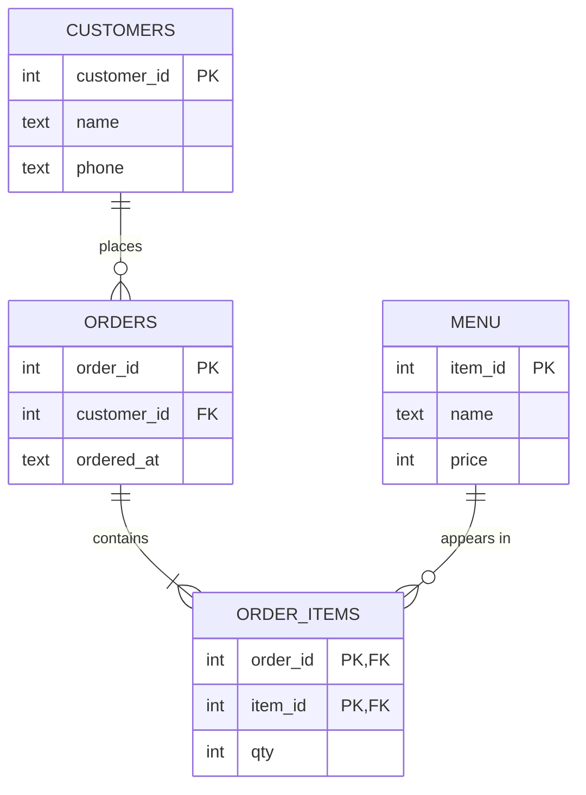
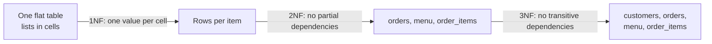

# Primary and Foreign Keys: The Complete Guide

> 📚 **Before you start**
>
> - [What is a Relational Database?](what-is-a-relational-database.md), for tables, data types, `NULL` and ACID
> - [Writing SQL Queries](writing-sql-queries.md), for `SELECT`, `WHERE`, `INSERT`, `UPDATE` and `DELETE`
> - [Functions and Iterators](../../python-programming/course.md#m6) (Python Programming), plus `try`/`except`, which the code uses to catch database errors

## Introduction

Two passengers on the same train are both called Rahul Sharma. Both are 34. Both board at Pune. If the railway identified bookings by name and age, one Rahul would get the other's seat, refund and cancellation. That's why every booking has a **PNR number**: a value that belongs to exactly one booking, forever. In database language, the PNR is a **primary key**.

Now think about the coach chart. It doesn't copy each passenger's name, phone and address onto the seat list; it just writes the PNR next to the seat. To find the passenger, you look the PNR up. A column that points to another table's primary key like that is a **foreign key**.

Keys are how a relational database keeps data **correct**: no duplicates, no orphans, no seat pointing to a booking that doesn't exist. In this article you will learn primary keys (natural, surrogate and composite), the other constraints (`NOT NULL`, `UNIQUE`, `CHECK`, `DEFAULT`), foreign keys and what happens on delete, the three kinds of relationships between tables, the basics of **normalisation** (1NF, 2NF, 3NF), and two topics that keep data correct and fast: **indexes** and **transactions**. You will watch the database reject bad data in every example.

> 💡 **Key Insight**
>
> Constraints move your data rules **out of your application code and into the database**, where they can't be skipped. Python code can have bugs, and a second app or a hurried manual fix can bypass it. A `PRIMARY KEY`, `FOREIGN KEY` or `CHECK` is enforced on every single write, by every program, every time.

---

## Core Explanation

### 1. Primary keys: one row, one identity

A **primary key** is a column (or set of columns) whose value identifies exactly one row. The database enforces two rules on it:

1. **Unique**: no two rows can have the same key.
2. **Not NULL**: every row must have a key.

A table has at most one primary key, and in practice every table should have one.

```python
import sqlite3

conn = sqlite3.connect(":memory:")

def try_sql(sql, params=()):
    """Run one statement and report success or the database's error."""
    try:
        conn.execute(sql, params)
        print("ok")
    except sqlite3.Error as e:
        print(f"{type(e).__name__}: {e}")

conn.execute("""
    CREATE TABLE customers (
        customer_id INTEGER PRIMARY KEY,
        name        TEXT NOT NULL,
        phone       TEXT
    )
""")
try_sql("INSERT INTO customers VALUES (1, 'Rahul Sharma', '98200 11111')")
try_sql("INSERT INTO customers VALUES (2, 'Rahul Sharma', '98200 22222')")  # same name: fine
try_sql("INSERT INTO customers VALUES (1, 'Priya Iyer',   '98450 33333')")  # same key: rejected
```

Output:

```
ok
ok
IntegrityError: UNIQUE constraint failed: customers.customer_id
```

Two Rahul Sharmas are allowed; two rows with `customer_id = 1` are not. The error type, `IntegrityError`, is what Python's database drivers raise whenever a constraint is broken. `psycopg` for PostgreSQL raises a subclass of it too (`UniqueViolation`).

**Natural keys and surrogate keys.** A **natural key** is a real-world value that is already unique, such as a PAN number, an email address or a vehicle registration. A **surrogate key** is a meaningless number or code the database generates just to be an id, such as `customer_id = 1, 2, 3, …`.

| | Natural key | Surrogate key |
|---|---|---|
| Example | email, PAN, ISBN | auto-increment integer, UUID |
| Has meaning | yes | no |
| Can change? | often (people change emails and phone numbers) | never |
| Size | can be long text | small, fast to compare |
| Common use | lookup tables like country codes | almost every other table |

Most tables use a **surrogate primary key** and add a `UNIQUE` constraint on the natural key. You get a stable id *and* protection against duplicate emails.

**Letting the database generate ids.** In SQLite, a column declared exactly `INTEGER PRIMARY KEY` is filled in automatically if you leave it out:

```python
conn.execute("INSERT INTO customers (name, phone) VALUES ('Priya Iyer', '98450 33333')")
print(conn.execute("SELECT customer_id, name FROM customers ORDER BY customer_id").fetchall())
```

Output:

```
[(1, 'Rahul Sharma'), (2, 'Rahul Sharma'), (3, 'Priya Iyer')]
```

In PostgreSQL you write it like this (you'll do this on Supabase in module 3):

```sql
CREATE TABLE customers (
    customer_id bigint GENERATED ALWAYS AS IDENTITY PRIMARY KEY,
    name        text NOT NULL,
    phone       text
);
```

Older PostgreSQL code uses `serial` or `bigserial` for the same job; `GENERATED … AS IDENTITY` is the modern, standard form. A third option is a **UUID** key (`uuid PRIMARY KEY DEFAULT gen_random_uuid()` in PostgreSQL), which is random and safe to generate on many machines at once. Supabase uses UUIDs for user ids.

**Composite primary keys.** Sometimes no single column is unique, but a combination is. In a train, seat numbers repeat across coaches, but (coach, seat) does not:

```python
conn.execute("""
    CREATE TABLE seats (
        coach   TEXT    NOT NULL,
        seat_no INTEGER NOT NULL,
        berth   TEXT    NOT NULL,
        PRIMARY KEY (coach, seat_no)
    )
""")
try_sql("INSERT INTO seats VALUES ('S1', 1, 'Lower')")
try_sql("INSERT INTO seats VALUES ('S2', 1, 'Lower')")   # seat 1 again, different coach: fine
try_sql("INSERT INTO seats VALUES ('S1', 1, 'Upper')")   # same coach and seat: rejected
```

Output:

```
ok
ok
IntegrityError: UNIQUE constraint failed: seats.coach, seats.seat_no
```

### 2. The other constraints: NOT NULL, UNIQUE, CHECK, DEFAULT

A **constraint** is a rule the database checks on every insert and update.

| Constraint | Rule | Example |
|---|---|---|
| `PRIMARY KEY` | unique and not null, identifies the row | `customer_id INTEGER PRIMARY KEY` |
| `NOT NULL` | a value is required | `name TEXT NOT NULL` |
| `UNIQUE` | no two rows share this value (NULLs allowed) | `email TEXT UNIQUE` |
| `CHECK (condition)` | the condition must not be false | `CHECK (price > 0)` |
| `DEFAULT value` | used when the insert leaves the column out | `DEFAULT 'active'` |
| `FOREIGN KEY` / `REFERENCES` | value must exist in another table | next section |

```python
conn.execute("""
    CREATE TABLE menu (
        item_id   INTEGER PRIMARY KEY,
        name      TEXT    NOT NULL UNIQUE,
        price     INTEGER NOT NULL CHECK (price > 0),
        category  TEXT    NOT NULL CHECK (category IN ('Beverage', 'Snack', 'Meal')),
        available INTEGER NOT NULL DEFAULT 1
    )
""")
try_sql("INSERT INTO menu (name, price, category) VALUES ('Masala Chai', 15, 'Beverage')")
try_sql("INSERT INTO menu (name, price, category) VALUES ('Samosa', 12, 'Snack')")
try_sql("INSERT INTO menu (name, price, category) VALUES ('Masala Chai', 18, 'Beverage')")
try_sql("INSERT INTO menu (name, price, category) VALUES ('Free Water', 0, 'Beverage')")
try_sql("INSERT INTO menu (name, price, category) VALUES ('Pizza', 199, 'Dessert')")
try_sql("INSERT INTO menu (price, category) VALUES (50, 'Meal')")
print(conn.execute("SELECT * FROM menu").fetchall())
```

Output:

```
ok
ok
IntegrityError: UNIQUE constraint failed: menu.name
IntegrityError: CHECK constraint failed: price > 0
IntegrityError: CHECK constraint failed: category IN ('Beverage', 'Snack', 'Meal')
IntegrityError: NOT NULL constraint failed: menu.name
[(1, 'Masala Chai', 15, 'Beverage', 1), (2, 'Samosa', 12, 'Snack', 1)]
```

Every bad row was stopped before it reached the table, and `available` was filled in by its `DEFAULT`. Giving a constraint a name, like `CONSTRAINT price_positive CHECK (price > 0)`, makes error messages easier to read; PostgreSQL then reports *"violates check constraint "price_positive""*.

### 3. Foreign keys: links that can't break

A **foreign key** is a column whose value must match a primary key (or unique column) in another table. The table with the foreign key is the **child**; the table it points to is the **parent**.

> ⚠️ **SQLite switches foreign key checks off by default** for backward compatibility. Run `PRAGMA foreign_keys = ON` on every new connection, right after connecting and before any transaction starts (inside a transaction it silently does nothing, which is why the code below commits first). PostgreSQL always enforces foreign keys.

```python
conn.commit()                              # the pragma is ignored inside an open transaction
conn.execute("PRAGMA foreign_keys = ON")
conn.execute("""
    CREATE TABLE orders (
        order_id    INTEGER PRIMARY KEY,
        customer_id INTEGER NOT NULL REFERENCES customers (customer_id),
        ordered_at  TEXT    NOT NULL DEFAULT CURRENT_TIMESTAMP
    )
""")
try_sql("INSERT INTO orders (order_id, customer_id) VALUES (101, 1)")    # customer 1 exists
try_sql("INSERT INTO orders (order_id, customer_id) VALUES (102, 99)")   # no customer 99
try_sql("DELETE FROM customers WHERE customer_id = 1")                   # still has an order
```

Output:

```
ok
IntegrityError: FOREIGN KEY constraint failed
IntegrityError: FOREIGN KEY constraint failed
```

The foreign key blocks both kinds of breakage: you can't create an **orphan** (an order for a customer who doesn't exist), and you can't delete a parent that still has children.

**What should happen when a parent is deleted?** You choose with `ON DELETE`:

| Option | When the parent row is deleted… | Typical use |
|---|---|---|
| `NO ACTION` / `RESTRICT` (default) | the delete fails if children exist | orders that must be kept for accounting |
| `CASCADE` | the children are deleted too | items inside an order, comments on a deleted post |
| `SET NULL` | the child's foreign key becomes NULL | an employee whose manager left |
| `SET DEFAULT` | the child's foreign key becomes its default | rare |

There's a matching `ON UPDATE`, used much less because primary keys shouldn't change.

```python
conn.execute("""
    CREATE TABLE order_items (
        order_id INTEGER NOT NULL REFERENCES orders (order_id) ON DELETE CASCADE,
        item_id  INTEGER NOT NULL REFERENCES menu (item_id),
        qty      INTEGER NOT NULL CHECK (qty > 0),
        PRIMARY KEY (order_id, item_id)
    )
""")
conn.executemany("INSERT INTO order_items VALUES (?, ?, ?)", [(101, 1, 2), (101, 2, 3)])
print("items before:", conn.execute("SELECT COUNT(*) FROM order_items").fetchone()[0])
conn.execute("DELETE FROM orders WHERE order_id = 101")
print("items after: ", conn.execute("SELECT COUNT(*) FROM order_items").fetchone()[0])
```

Output:

```
items before: 2
items after:  0
```

Deleting order 101 cascaded to its two items. Notice `order_items` also uses a **composite primary key**, `(order_id, item_id)`, so the same item can't appear twice in one order (you'd raise `qty` instead).

### 4. Relationships: one-to-one, one-to-many, many-to-many

Keys let you model the three kinds of relationship between things:

| Relationship | Example | How to build it |
|---|---|---|
| **One-to-many** (1:N) | one customer places many orders | foreign key on the "many" side (`orders.customer_id`) |
| **One-to-one** (1:1) | one employee has one locker | foreign key with `UNIQUE` (or share the primary key) |
| **Many-to-many** (M:N) | an order has many items; an item is in many orders | a **junction table** with two foreign keys (`order_items`) |

You can never put a list of items into one column of `orders` (that breaks the "one value per cell" rule), and you can't add an `order_id` column to `menu` either (an item belongs to many orders). The junction table is the only clean answer, and it often carries its own data, such as `qty`.

This is the schema we've built, drawn as an **entity-relationship (ER) diagram**. The crow's-foot ends mean "many":



### 5. Normalisation: one fact in one place

**Normalisation** is the process of organising columns into tables so that each fact is stored exactly once. Here's what goes wrong without it. Imagine one flat table for everything:

| order_id | customer | customer_phone | items | item_prices |
|---|---|---|---|---|
| 101 | Rahul | 98200 11111 | Masala Chai, Samosa | 15, 12 |
| 102 | Rahul | 98200 11111 | Masala Chai | 15 |
| 103 | Priya | 98450 33333 | Samosa | 12 |

This design suffers from three **anomalies**:

- **Update anomaly**: Rahul changes his phone number. You must update every one of his rows; miss one and the data contradicts itself.
- **Insert anomaly**: you can't add a new menu item, or a new customer, until someone orders it.
- **Delete anomaly**: delete order 103 and you lose the only record that Priya exists.

The **normal forms** are a checklist for removing these problems. The first three cover almost everything you'll meet:

**First Normal Form (1NF): one value per cell, no repeating groups.** The `items` column holds a list, so split it so each row has one item:

| order_id | customer | customer_phone | item | price | qty |
|---|---|---|---|---|---|
| 101 | Rahul | 98200 11111 | Masala Chai | 15 | 2 |
| 101 | Rahul | 98200 11111 | Samosa | 12 | 3 |

**Second Normal Form (2NF): 1NF, and every non-key column depends on the *whole* key.** The key of the table above is `(order_id, item)`. But `customer` depends only on `order_id`, and `price` depends only on `item`. Those are *partial dependencies*. Move them out: order facts into `orders`, item facts into `menu`, and keep only `qty` (which needs both) in `order_items`.

**Third Normal Form (3NF): 2NF, and no non-key column depends on another non-key column.** In `orders(order_id, customer, customer_phone)`, the phone depends on the customer, not on the order. That's a *transitive dependency*. Move customer facts into `customers` and keep just `customer_id` in `orders`.

A memorable summary: every non-key column must depend on **the key, the whole key, and nothing but the key**. The result is exactly the four-table schema in the ER diagram above.



**Denormalisation** is deliberately breaking these rules for speed, for example copying the customer's city into `orders` so a report doesn't need a join. Analytics warehouses do this a lot (you'll meet "star schemas" in the Data Modelling course). For an application's main database, start normalised and denormalise only when you have measured a real need.

### 6. Indexes: finding rows fast

Without help, finding all orders for customer 42 means reading every row of `orders`. That's called a **full table scan**. An **index** is a separate, sorted structure (usually a *B-tree*) that maps a column's values to the rows that have them, like the index at the back of a textbook that sends you straight to page 312.

- The database **automatically creates an index** for every `PRIMARY KEY` and `UNIQUE` constraint, which is how it checks uniqueness quickly.
- You add others with `CREATE INDEX`, typically on columns you filter, join or sort by often.
- Indexes are not free: each one takes disk space and must be updated on every insert, update and delete. Don't index every column.
- In PostgreSQL, a foreign key column does **not** get an index automatically. Index it yourself if you join or filter on it.

You can ask the database how it plans to run a query. SQLite uses `EXPLAIN QUERY PLAN`; PostgreSQL uses `EXPLAIN` (and `EXPLAIN ANALYZE` to actually run it and time it).

```python
conn.executemany("INSERT INTO orders (order_id, customer_id) VALUES (?, ?)",
                 [(200 + i, 1 + i % 2) for i in range(1000)])

def plan(sql):
    for row in conn.execute("EXPLAIN QUERY PLAN " + sql):
        print("  ", row[-1])

query = "SELECT order_id FROM orders WHERE customer_id = 2"
print("before index:")
plan(query)
conn.execute("CREATE INDEX idx_orders_customer ON orders (customer_id)")
print("after index:")
plan(query)
print("by primary key:")
plan("SELECT * FROM orders WHERE order_id = 500")
```

Output:

```
before index:
   SCAN orders
after index:
   SEARCH orders USING COVERING INDEX idx_orders_customer (customer_id=?)
by primary key:
   SEARCH orders USING INTEGER PRIMARY KEY (rowid=?)
```

`SCAN` means "read every row"; `SEARCH … USING INDEX` means "jump straight to the matching rows". `COVERING` means the index alone holds every column the query needs (here `customer_id`, plus the row id, which is `order_id`), so the table itself isn't touched at all. The exact wording varies between SQLite versions. With 1,000 rows you won't feel the difference; with 100 million you will. Reading query plans properly is covered in [Query Plans and Indexes](../../data-engineering-foundations/course.md#m4) in the Advanced SQL module.

### 7. Transactions: all or nothing

A **transaction** groups several statements so they succeed or fail **as one unit**. That's the "A" (atomicity) in ACID. The SQL is:

```sql
BEGIN;
UPDATE wallets SET balance = balance - 500 WHERE owner = 'Rahul';
UPDATE wallets SET balance = balance + 500 WHERE owner = 'Chaiwala';
COMMIT;      -- make both permanent
-- or ROLLBACK; to undo everything since BEGIN
```

In Python's `sqlite3`, using the connection in a `with` block does this for you: it **commits** if the block finishes normally and **rolls back** if an exception escapes. Here a `CHECK` constraint stops a wallet from going negative, and the transaction makes sure the money never half-moves:

```python
conn.execute("CREATE TABLE wallets (owner TEXT PRIMARY KEY, balance INTEGER NOT NULL CHECK (balance >= 0))")
conn.executemany("INSERT INTO wallets VALUES (?, ?)", [("Rahul", 800), ("Chaiwala", 100)])
conn.commit()

def pay(sender, receiver, amount):
    try:
        with conn:   # one transaction: commit on success, rollback on error
            conn.execute("UPDATE wallets SET balance = balance + ? WHERE owner = ?", (amount, receiver))
            conn.execute("UPDATE wallets SET balance = balance - ? WHERE owner = ?", (amount, sender))
        print(f"paid ₹{amount}")
    except sqlite3.IntegrityError as e:
        print(f"payment of ₹{amount} failed: {e}")
    print("  balances:", conn.execute("SELECT owner, balance FROM wallets ORDER BY owner").fetchall())

pay("Rahul", "Chaiwala", 500)
pay("Rahul", "Chaiwala", 500)   # Rahul only has 300 left
```

Output:

```
paid ₹500
  balances: [('Chaiwala', 600), ('Rahul', 300)]
payment of ₹500 failed: CHECK constraint failed: balance >= 0
  balances: [('Chaiwala', 600), ('Rahul', 300)]
```

Look closely at the failed payment: the code credited the chaiwala *first*, then the debit failed. Without a transaction, the chaiwala would have kept ₹500 that Rahul never paid. The rollback undid the credit too, so the balances are exactly as they were.

PostgreSQL drivers work the same way: `psycopg` opens a transaction on your first statement, and `with psycopg.connect(...) as conn:` commits at the end or rolls back on error. Isolation (what concurrent transactions can see of each other) is covered in [Transactions and Isolation Levels](../../data-engineering-foundations/course.md#m4).

---

## Try It Yourself

Keep using `conn` from above (foreign keys are on).

1. Create a `stalls` table with an `INTEGER PRIMARY KEY`, a `name` that must be unique and present, and a `city` that must be one of `'Mumbai'`, `'Delhi'`, `'Pune'`. Prove that a duplicate name and an unknown city are rejected.
2. Create `staff(staff_id, name, stall_id)` where `stall_id` references `stalls` and becomes NULL if the stall is deleted. Delete a stall and show the staff row afterwards.
3. A table `students(roll_no, name, course_code, course_name, teacher)` stores one row per student per course. Which normal form does it break and how would you split it?
4. Write a `with conn:` transaction that inserts two menu items, where the second one breaks a constraint. How many of the two are in the table afterwards?

<details>
<summary>Show answers</summary>

**1.**

```python
conn.execute("""
    CREATE TABLE stalls (
        stall_id INTEGER PRIMARY KEY,
        name     TEXT NOT NULL UNIQUE,
        city     TEXT NOT NULL CHECK (city IN ('Mumbai', 'Delhi', 'Pune'))
    )
""")
try_sql("INSERT INTO stalls (name, city) VALUES ('Station Chai', 'Pune')")
try_sql("INSERT INTO stalls (name, city) VALUES ('Station Chai', 'Delhi')")
try_sql("INSERT INTO stalls (name, city) VALUES ('Beach Chai', 'Goa')")
```

Output:

```
ok
IntegrityError: UNIQUE constraint failed: stalls.name
IntegrityError: CHECK constraint failed: city IN ('Mumbai', 'Delhi', 'Pune')
```

**2.**

```python
conn.execute("""
    CREATE TABLE staff (
        staff_id INTEGER PRIMARY KEY,
        name     TEXT NOT NULL,
        stall_id INTEGER REFERENCES stalls (stall_id) ON DELETE SET NULL
    )
""")
conn.execute("INSERT INTO staff (name, stall_id) VALUES ('Ganesh', 1)")
conn.execute("DELETE FROM stalls WHERE stall_id = 1")
print(conn.execute("SELECT * FROM staff").fetchall())
conn.commit()
```

Output:

```
[(1, 'Ganesh', None)]
```

**3.** The key is `(roll_no, course_code)`. `name` depends only on `roll_no`, and `course_name` and `teacher` depend only on `course_code`, so it breaks **2NF** (partial dependencies). Split it into `students(roll_no PK, name)`, `courses(course_code PK, course_name, teacher)` and the junction table `enrolments(roll_no FK, course_code FK, PRIMARY KEY (roll_no, course_code))`.

**4.** Zero. The first insert is rolled back along with the failing one:

```python
try:
    with conn:
        conn.execute("INSERT INTO menu (name, price, category) VALUES ('Vada Pav', 20, 'Snack')")
        conn.execute("INSERT INTO menu (name, price, category) VALUES ('Bad Item', -5, 'Snack')")
except sqlite3.IntegrityError as e:
    print("rolled back:", e)
print(conn.execute("SELECT name FROM menu ORDER BY item_id").fetchall())
```

Output:

```
rolled back: CHECK constraint failed: price > 0
[('Masala Chai',), ('Samosa',)]
```

</details>

---

## Real-World Examples

### Example 1: E-commerce orders

Every online shop has the same core: `customers`, `products`, `orders` and an `order_items` junction table with `quantity` and the price *at the time of purchase* (copied deliberately, because the product's price will change later; that's a sensible, intentional denormalisation). Foreign keys with `ON DELETE RESTRICT` stop anyone from deleting a product that appears in past orders.

### Example 2: Supabase user profiles

In a Supabase app, the built-in `auth.users` table holds login details with a UUID primary key. Apps create a `profiles` table whose primary key is *also* a foreign key to `auth.users(id)` with `ON DELETE CASCADE`: a one-to-one relationship, and deleting a user removes their profile. You'll meet this pattern in module 3.

### Example 3: Banking ledgers

Banks rely on `CHECK` constraints and transactions so that a transfer is either fully applied or not at all, and on unique keys for transaction reference numbers so a retried request can't charge you twice. That last idea, a unique "idempotency key", is used by payment APIs everywhere.

---

## Common Misconceptions

### Misconception 1: "My Python code already validates the data, so constraints are redundant"

Other programs, scripts, admins and future versions of your own code will write to the same database. Constraints are the last line of defence that none of them can skip. Validate in both places: in code for friendly error messages, in the database for guarantees.

### Misconception 2: "Foreign keys are enforced in SQLite"

Only after `PRAGMA foreign_keys = ON`, on each connection. Many bugs in SQLite apps come from forgetting this. PostgreSQL always enforces them.

### Misconception 3: "More normalisation is always better"

Normalisation removes anomalies, but every split adds a join. 3NF is the usual target for applications. Analytics systems often denormalise on purpose because they mostly read.

### Misconception 4: "Adding an index on every column makes everything fast"

Each index slows down every write and uses space. Index the columns your real queries filter, join and sort on, and check with `EXPLAIN`.

---

## Interview Relevance

Keys and design questions come up in backend, data engineering and analyst interviews:

- *"Primary key vs unique key?"* Both unique; a primary key also forbids NULL and there is only one per table, while a table can have many unique constraints.
- *"What is a foreign key and what does ON DELETE CASCADE do?"* A column that must match a parent's key; cascade deletes children with the parent.
- *"Natural vs surrogate keys?"* Meaningful real-world value versus generated id, with the trade-off on stability.
- *"How do you model a many-to-many relationship?"* A junction table with two foreign keys and a composite primary key.
- *"Explain 1NF, 2NF and 3NF with an example"* and *"what are update, insert and delete anomalies?"*
- *"What is an index and what does it cost?"* Faster reads, slower writes, more storage; automatic on primary and unique keys.
- *"What is a transaction?"* An all-or-nothing group of statements, the bank transfer example, `COMMIT` and `ROLLBACK`.

A strong answer draws a quick schema for a familiar domain (orders, bookings, a library) and explains each key choice.

---

## Key Takeaways

- **A primary key** uniquely identifies each row and can't be NULL. Prefer a **surrogate key** plus a `UNIQUE` constraint on the natural key.
- **Constraints** (`NOT NULL`, `UNIQUE`, `CHECK`, `DEFAULT`, `FOREIGN KEY`) put data rules inside the database, where every write obeys them.
- **Foreign keys** prevent orphans; `ON DELETE` decides between blocking, cascading and setting NULL. In SQLite, turn them on with `PRAGMA foreign_keys = ON`.
- **Many-to-many** relationships need a **junction table**. Normalise to **3NF**: each column depends on the key, the whole key and nothing but the key.
- **Indexes** speed up lookups at a cost to writes; **transactions** make groups of changes all-or-nothing.

---

**Up next:** [Joins and Unions](joins-and-unions.md)
