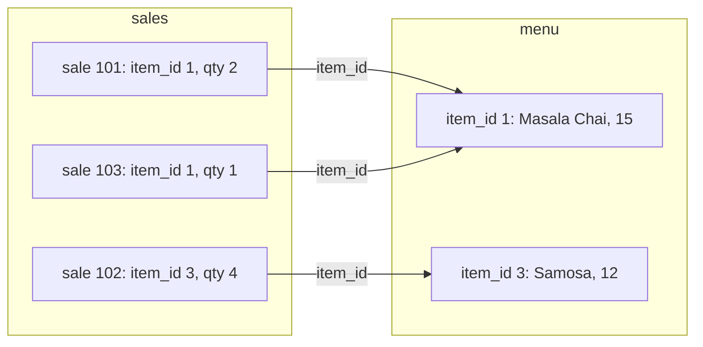
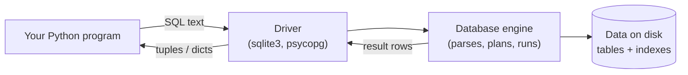

# What is a Relational Database? The Complete Guide

> 📚 **Before you start**
>
> No database knowledge is needed. You should be comfortable with basic Python:
> - [Lists, Tuples and Dictionaries](../../python-programming/course.md#m5) (Python Programming), because query results come back as lists of tuples
> - [Functions and Iterators](../../python-programming/course.md#m6) (Python Programming), for the small helper functions in the code
> - [How This Course Works](../01-start-here/how-this-course-works.md), for how the code and outputs in this course are laid out

## Introduction

Imagine you run a small chai stall near a railway station and you decide to track your sales. You start with a notebook. Then you move to a spreadsheet: one row per sale, with the date, the item, the quantity and the price. It works well for a month.

Then things get harder. Your cousin opens a second stall and wants to add sales from her phone at the same moment you are adding yours, and one of your edits overwrites hers. You change the price of masala chai from ₹15 to ₹20 and have to fix it in 400 rows. Somebody types "Masala chai", someone else types "masala chaii", and your totals are wrong. The file grows to a few million rows and opening it takes a minute. You want "total sales per stall per day for last month" and you have to write a script every time.

Every one of those problems has been solved, decades ago, by the **relational database**. By the end of this article you will know exactly what one is, how it organises data into tables, what a schema and data types are, what the words *relation*, *tuple* and *attribute* mean, what SQL is, and what the guarantees called ACID promise you. You will also create your first database and table with Python's built-in `sqlite3` module and query it.

> 💡 **Key Insight**
>
> A relational database stores data as **tables with a fixed structure**, and you get data out by **describing the result you want** in SQL, not by writing the loop that finds it. The database works out how to find it, keeps the data consistent, and lets many people use it at once.

---

## Core Explanation

### 1. What is a database, and what is a DBMS?

A **database** is an organised collection of data that is stored so it can be found, changed and shared easily. A **database management system (DBMS)** is the software that does the storing, finding and protecting. When people say "a PostgreSQL database" they usually mean both: the data and the PostgreSQL software that manages it.

Why not just use files? A DBMS gives you things a CSV file or a Python list cannot:

| Problem with plain files | What a DBMS gives you |
|---|---|
| Two people edit at once and one loses their changes | **Concurrency control**: many users read and write safely at the same time |
| Power cut halfway through a save leaves a broken file | **Durability**: once a change is confirmed, it survives crashes |
| "₹15" in one row, "fifteen" in another | **Data types and constraints**: the database rejects data that breaks the rules |
| Finding one row means reading the whole file | **Indexes**: jump straight to the rows you need |
| Every question needs a new script | **A query language (SQL)**: ask any question in one statement |
| Anyone who can open the file can read everything | **Access control**: users and permissions |

### 2. What makes a database *relational*?

In 1970 a researcher at IBM named Edgar F. Codd proposed the **relational model**: store all data as **relations**, which are what we now call **tables**. Every popular SQL database today (PostgreSQL, MySQL, SQLite, Oracle, SQL Server) is built on that idea.

A table has:

- **Columns**: each has a name and a **data type**, such as `item` (text) or `price` (integer). Every row has a value for every column, even if that value is "unknown".
- **Rows**: each row is one record, one "thing": one sale, one customer, one train.
- **A key**: one or more columns whose values are different for every row, so each row can be identified. You will study keys properly in [Primary and Foreign Keys](primary-and-foreign-keys.md).

Here is a `menu` table for the chai stall:

| item_id | name | price | is_hot |
|---|---|---|---|
| 1 | Masala Chai | 15 | 1 |
| 2 | Filter Coffee | 20 | 1 |
| 3 | Samosa | 12 | 0 |
| 4 | Lassi | 30 | 0 |

The word *relational* comes from the maths behind the model, but the practical meaning is this: **tables are linked to each other by shared values**. A `sales` table does not repeat "Masala Chai, ₹15" in every row. It stores `item_id = 1`, and the database can look up the name and price in `menu` whenever you ask. Change the price once in `menu` and every question you ask afterwards uses the new price.



*Sales rows point to menu rows by `item_id`. The name and price live in one place only.*

### 3. The vocabulary: formal names and everyday names

You will see both sets of words in books, documentation and interviews. They mean the same thing:

| Relational theory | SQL / everyday | Spreadsheet |
|---|---|---|
| Relation | Table | Sheet |
| Tuple | Row (record) | Row |
| Attribute | Column (field) | Column |
| Domain | Data type plus allowed values | Cell format |
| Cardinality | Number of rows | Number of rows |
| Degree | Number of columns | Number of columns |

Two rules from the theory are worth knowing because they explain how SQL behaves:

1. **Rows have no built-in order.** A table is a *set* of rows. If you want them sorted, you must ask with `ORDER BY`. A database is free to return unsorted rows in any order, and the order can change between runs.
2. **Every value in a cell is a single, atomic value.** A cell holds one phone number, not a list of three. (When you need a list, you create a second table. That idea is called normalisation, covered in [Primary and Foreign Keys](primary-and-foreign-keys.md).)

### 4. Schemas and data types

A **schema** is the description of the structure: which tables exist, which columns each has, their types and their rules. You design the schema *before* you insert data, and the database enforces it. This is called **schema-on-write**: data is checked as it goes in. (Document databases in module 4 are more relaxed about this, and you will see the trade-off there.)

The word "schema" has a second meaning in PostgreSQL: a named folder of tables inside a database, such as `public`. Context makes it clear which one is meant.

Each column has a **data type**. The common ones:

| Kind of data | PostgreSQL type | SQLite storage class | Example |
|---|---|---|---|
| Whole numbers | `integer`, `bigint` | `INTEGER` | `42` |
| Exact decimals (money) | `numeric(10, 2)` | `REAL` or store paise as `INTEGER` | `199.99` |
| Approximate decimals | `double precision` | `REAL` | `3.14159` |
| Text | `text`, `varchar(n)` | `TEXT` | `'Masala Chai'` |
| True/false | `boolean` | `INTEGER` 0 or 1 | `true` |
| Date and time | `date`, `timestamptz` | `TEXT` in ISO format | `'2026-10-11'` |
| JSON | `jsonb` | `TEXT` | `'{"spicy": true}'` |
| Unknown / missing | `NULL` (any type) | `NULL` | `NULL` |

PostgreSQL is **strict**: putting the text `'abc'` into an `integer` column is an error. SQLite is **flexible**: it uses *type affinity*, meaning a column's type is a preference, not a rule, unless you create the table with the `STRICT` keyword. That is one of the main differences you will notice when you move to PostgreSQL in module 3.

**`NULL`** deserves a special mention. It means "unknown" or "not applicable", and it is *not* zero or an empty string. Any comparison with `NULL` using `=` gives "unknown", not true, which is why SQL has a separate `IS NULL` test. The next lesson shows this in action.

### 5. SQL: the language of relational databases

**SQL** (Structured Query Language, said "S-Q-L" or "sequel") is how you talk to a relational database. It is **declarative**: you describe *what* you want, and the database decides *how* to get it.

Compare finding the hot drinks under ₹20 in plain Python with doing it in SQL:

```python
menu = [
    {"item_id": 1, "name": "Masala Chai", "price": 15, "is_hot": 1},
    {"item_id": 2, "name": "Filter Coffee", "price": 20, "is_hot": 1},
    {"item_id": 3, "name": "Samosa", "price": 12, "is_hot": 0},
    {"item_id": 4, "name": "Lassi", "price": 30, "is_hot": 0},
]

# Imperative: you write HOW to find the answer, step by step
result = []
for row in menu:
    if row["is_hot"] == 1 and row["price"] < 20:
        result.append(row["name"])
print(result)
```

Output:

```
['Masala Chai']
```

The same question in SQL is one sentence:

```sql
SELECT name FROM menu WHERE is_hot = 1 AND price < 20;
```

There is no loop. If the table has ten million rows and an index on `price`, the database may skip straight to the cheap items. If it has four rows, it simply reads them all. You don't change your query either way.

SQL statements fall into a few families. You will use all of them in this course:

| Family | Stands for | Statements | Purpose |
|---|---|---|---|
| DDL | Data Definition Language | `CREATE`, `ALTER`, `DROP` | Define and change the schema |
| DML | Data Manipulation Language | `INSERT`, `UPDATE`, `DELETE` | Change the data |
| DQL | Data Query Language | `SELECT` | Read the data |
| TCL | Transaction Control Language | `BEGIN`, `COMMIT`, `ROLLBACK` | Group changes into all-or-nothing units |
| DCL | Data Control Language | `GRANT`, `REVOKE` | Permissions (you'll use these on Supabase) |

SQL keywords are not case-sensitive. `SELECT`, `select` and `Select` are the same. This course writes keywords in capitals so they stand out, which is the most common style.

### 6. Your first database with Python's sqlite3

**SQLite** is a complete SQL database engine that runs *inside* your program and stores the whole database in one file. Python includes it in the standard library as the `sqlite3` module, so there is nothing to install.

The pattern is always the same: **connect**, **execute** SQL, **fetch** results, **commit** changes, **close**.

```python
import sqlite3

# ":memory:" creates a temporary database in RAM. Use a file name like
# "chai.db" instead and the data is saved to disk.
conn = sqlite3.connect(":memory:")

conn.execute("""
    CREATE TABLE menu (
        item_id INTEGER PRIMARY KEY,
        name    TEXT    NOT NULL,
        price   INTEGER NOT NULL,
        is_hot  INTEGER NOT NULL
    )
""")

conn.executemany(
    "INSERT INTO menu (item_id, name, price, is_hot) VALUES (?, ?, ?, ?)",
    [(1, "Masala Chai", 15, 1),
     (2, "Filter Coffee", 20, 1),
     (3, "Samosa", 12, 0),
     (4, "Lassi", 30, 0)],
)
conn.commit()

rows = conn.execute("SELECT name FROM menu WHERE is_hot = 1 AND price < 20").fetchall()
print(rows)
```

Output:

```
[('Masala Chai',)]
```

A few things to notice:

- `conn.execute(sql)` sends one SQL statement and returns a **cursor**, an object you read results from. `fetchall()` returns every result row as a list of **tuples**. Each tuple here has one value because we selected one column.
- The `?` marks are **placeholders**. You pass the actual values separately and the driver inserts them safely. **Never** build SQL by gluing strings together with f-strings; the [Querying Supabase from Python](../03-postgresql-on-supabase/querying-supabase-from-python.md) lesson shows the security hole that creates (SQL injection). PostgreSQL drivers such as `psycopg` use `%s` instead of `?`, but the idea is identical.
- `executemany` runs one statement once per tuple in the list.
- `conn.commit()` makes the changes permanent. Until you commit, other connections can't see them, and they are thrown away if the program crashes.

Rows come back as tuples, which means you access columns by position. Setting `row_factory` to `sqlite3.Row` lets you use column names instead:

```python
conn.row_factory = sqlite3.Row
for row in conn.execute("SELECT item_id, name, price FROM menu ORDER BY price"):
    print(row["item_id"], row["name"], "₹" + str(row["price"]))
```

Output:

```
3 Samosa ₹12
1 Masala Chai ₹15
2 Filter Coffee ₹20
4 Lassi ₹30
```

You can ask a database to describe its own schema. In SQLite the table list lives in a built-in table called `sqlite_schema`, and `PRAGMA table_info` describes the columns:

```python
for row in conn.execute("PRAGMA table_info(menu)"):
    print(row["name"], row["type"], "NOT NULL" if row["notnull"] else "", "PK" if row["pk"] else "")
```

Output:

```
item_id INTEGER  PK
name TEXT NOT NULL 
price INTEGER NOT NULL 
is_hot INTEGER NOT NULL
```

In PostgreSQL you would query the standard `information_schema.columns` view instead, which you will do on Supabase in module 3.

### 7. ACID: the promises a relational database makes

When money moves from your account to a shop's account through UPI, two changes must happen: your balance goes down and theirs goes up. If only one happens, money is created or destroyed. Relational databases group changes like these into a **transaction** and promise four properties, known by the acronym **ACID**:

| Property | Promise | UPI example |
|---|---|---|
| **Atomicity** | All changes in a transaction happen, or none do | Never debited without being credited |
| **Consistency** | Every transaction moves the database from one valid state to another; rules (constraints) are never broken | A balance can't go below zero if a rule forbids it |
| **Isolation** | Transactions running at the same time don't see each other's half-done work | Two payments from the same account don't both spend the same ₹100 |
| **Durability** | Once committed, a change survives crashes and power cuts | The payment is still there after the server restarts |

You will try transactions yourself in [Primary and Foreign Keys](primary-and-foreign-keys.md), and the [Advanced SQL](../../data-engineering-foundations/course.md#m4) module of Data Engineering Foundations covers isolation levels in depth.

### 8. The popular relational databases

| Database | Runs as | Typical use | Where you'll meet it |
|---|---|---|---|
| **SQLite** | A library inside your app, one file | Phones, browsers, desktop apps, tests, small sites | Module 2 of this course |
| **PostgreSQL** | A server | Web apps, analytics, the default open-source choice | Module 3, on Supabase |
| **MySQL / MariaDB** | A server | Web apps, especially older PHP stacks | Many companies |
| **SQL Server, Oracle** | A server | Large enterprises, banks | Corporate jobs |
| **Snowflake, BigQuery, Redshift** | Cloud data warehouses | Analytics over huge data | Data engineering courses |

They all speak SQL. The core you learn in this module (`SELECT`, `WHERE`, `JOIN`, `GROUP BY` and friends) is the same in all of them. Differences show up in data types, functions such as date handling, and extras, and this course points them out as they appear.



*Every SQL database works this way: your code sends SQL text through a driver; the engine plans and runs it, then returns rows.*

---

## Try It Yourself

Use the `conn` from the code above (it still has the `menu` table).

1. **Add a column of data.** Insert a fifth item, `(5, "Bun Maska", 25, 0)`, then print all items that are *not* hot.
2. **Count the menu.** Write a query that returns the number of rows in `menu`. (Hint: `SELECT COUNT(*) FROM menu`.)
3. **Type affinity.** Run `conn.execute("INSERT INTO menu VALUES (6, 'Mystery', 'free', 0)")` and then select that row. What happened, and what would PostgreSQL have done?
4. **Spot the relation.** Write down, in words, what a `stalls` table and a `sales` table would need so you could ask "how many samosas did each stall sell?".

<details>
<summary>Show answers</summary>

**1.**

```python
conn.execute("INSERT INTO menu VALUES (5, 'Bun Maska', 25, 0)")
print([row["name"] for row in conn.execute("SELECT name FROM menu WHERE is_hot = 0")])
```

Output:

```
['Samosa', 'Lassi', 'Bun Maska']
```

**2.**

```python
print(conn.execute("SELECT COUNT(*) FROM menu").fetchone()[0])
```

Output:

```
5
```

**3.** SQLite accepts it because `INTEGER` is only a type preference without `STRICT`:

```python
conn.execute("INSERT INTO menu VALUES (6, 'Mystery', 'free', 0)")
row = conn.execute("SELECT name, price, typeof(price) FROM menu WHERE item_id = 6").fetchone()
print(tuple(row))
conn.execute("DELETE FROM menu WHERE item_id = 6")
```

Output:

```
('Mystery', 'free', 'text')
```

PostgreSQL would reject the insert with an error like `invalid input syntax for type integer: "free"`. This is why you'll appreciate PostgreSQL's strictness in production.

**4.** A `stalls` table with a `stall_id` and a name. A `sales` table where each row has its own `sale_id`, the `stall_id` it happened at, the `item_id` sold, the quantity and the time. The question is then answered by linking `sales` to `menu` (to find samosas) and grouping by `stall_id`. You'll write exactly this query in [Joins and Unions](joins-and-unions.md).

</details>

---

## Real-World Examples

### Example 1: Railway reservations

A reservation system has tables for `trains`, `stations`, `coaches`, `seats`, `passengers` and `bookings`. A booking row stores a passenger id, a seat id and a journey date. Because booking a seat is a transaction, two people clicking "Book" for the last lower berth at the same instant can't both get it: isolation makes one of them wait and then see that it's taken.

### Example 2: Your phone's apps

Your phone's contacts, messages and many apps store their data in SQLite files. WhatsApp, for instance, has long used SQLite on the device for chat storage. You are almost certainly carrying dozens of relational databases in your pocket right now.

### Example 3: A payments ledger

Payment companies keep a ledger table where every row is a debit or credit, and they never update a past row, only add new ones. Totals come from SQL like `SELECT SUM(amount) FROM ledger WHERE account_id = ...`. Atomicity and durability are the reason they trust a relational database with money.

---

## Common Misconceptions

### Misconception 1: "A database is just a big spreadsheet"

A spreadsheet stores cells; a database stores *typed, constrained, related* data and enforces rules on every change. It also lets many users write at once, recovers after crashes and answers questions with a query language. The table *looks* similar; the guarantees are completely different.

### Misconception 2: "Rows are stored and returned in the order I inserted them"

Tables have no built-in order. Small SQLite tables often *happen* to come back in insert order, which fools beginners, but nothing guarantees it. If order matters, write `ORDER BY`.

### Misconception 3: "NULL is the same as 0 or an empty string"

`NULL` means unknown. A product with price `NULL` doesn't cost nothing; nobody knows what it costs. `NULL = NULL` is not true in SQL, which is why you must test with `IS NULL`.

### Misconception 4: "SQL is only for database administrators"

Backend developers, data analysts, data engineers, data scientists and ML engineers all write SQL every week. It is one of the most requested skills in data job listings.

---

## Interview Relevance

Expect these in almost any data or backend interview:

- *"What is a relational database?"* Data stored as tables of rows and typed columns, related through keys, queried with SQL, with ACID transactions.
- *"What does ACID stand for?"* Atomicity, Consistency, Isolation, Durability, with a one-line example of each (the bank transfer is the classic).
- *"What's the difference between a database and a DBMS?"* The data versus the software that manages it.
- *"DDL vs DML?"* `CREATE/ALTER/DROP` change structure; `INSERT/UPDATE/DELETE` change data.
- *"What is NULL?"* An unknown value, not zero or empty; tested with `IS NULL`.
- *"Why is SQL called declarative?"* You state the result you want and the query planner chooses how to compute it.

A strong answer adds a trade-off: relational databases give you strong consistency and flexible querying, at the cost of designing a schema up front.

---

## Key Takeaways

- **A relational database** stores data in **tables** (relations) of **rows** (tuples) and typed **columns** (attributes), linked by shared key values.
- **The schema** defines tables, columns, types and rules up front, and the database enforces it on every write.
- **SQL is declarative**: describe the result, and the engine plans how to get it.
- **Python's `sqlite3`** gives you a real SQL database with no setup: connect, execute with `?` placeholders, fetch, commit.
- **ACID** transactions keep data correct even with crashes and many simultaneous users.
- **Rows have no order** and **NULL means unknown**: two rules that explain many SQL surprises.

---

**Up next:** [Writing SQL Queries](writing-sql-queries.md)
