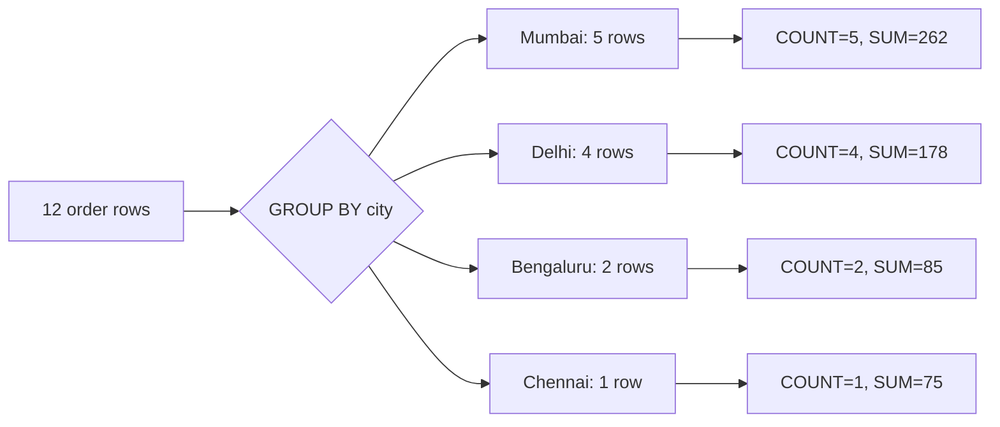
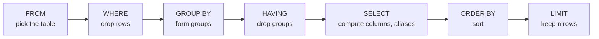

# Writing SQL Queries: The Complete Guide

> 📚 **Before you start**
>
> - [What is a Relational Database?](what-is-a-relational-database.md), for tables, rows, columns, data types, `NULL` and how `sqlite3` runs SQL from Python
> - [Functions and Iterators](../../python-programming/course.md#m6) (Python Programming), for the small `show()` helper used to print results

## Introduction

You run the data side of a small food delivery app that serves four cities. On Monday morning the founder sends you five questions: Which orders came from Mumbai? What are our three biggest orders? How much did each city spend? Which food category earns more than ₹150? Which orders have no rating yet?

Each one is a single SQL query. Not a script, not a spreadsheet formula, one sentence each. By the end of this article you will be able to write all five, and much more: picking columns with `SELECT`, filtering rows with `WHERE`, sorting with `ORDER BY`, taking the top few with `LIMIT`, summarising with aggregate functions, `GROUP BY` and `HAVING`, labelling with `CASE`, and changing data with `INSERT`, `UPDATE` and `DELETE`. You will also learn the order in which a database actually runs the parts of a query, which explains almost every confusing error beginners hit.

> 💡 **Key Insight**
>
> You *write* a query in the order `SELECT … FROM … WHERE … GROUP BY … HAVING … ORDER BY … LIMIT`, but the database *runs* it as **FROM → WHERE → GROUP BY → HAVING → SELECT → ORDER BY → LIMIT**. Once you think in that second order, rules like "you can't use an aggregate in WHERE" stop being rules to memorise and become obvious.

---

## Core Explanation

### 1. The sample data

Every example in this article uses one table of food orders. Run this block first. It also defines `show()`, a small helper that runs a query and prints the result as a neat table with column names, so the outputs are easy to read.

```python
import sqlite3

conn = sqlite3.connect(":memory:")
conn.execute("""
    CREATE TABLE orders (
        order_id   INTEGER PRIMARY KEY,
        customer   TEXT    NOT NULL,
        city       TEXT    NOT NULL,
        item       TEXT    NOT NULL,
        category   TEXT    NOT NULL,
        qty        INTEGER NOT NULL,
        price      INTEGER NOT NULL,   -- rupees per unit
        order_date TEXT    NOT NULL,   -- ISO format: YYYY-MM-DD
        rating     INTEGER             -- 1 to 5, NULL if not rated yet
    )
""")
conn.executemany("INSERT INTO orders VALUES (?, ?, ?, ?, ?, ?, ?, ?, ?)", [
    (1,  "Asha",  "Mumbai",    "Masala Chai",   "Beverage",  2, 15, "2026-09-01", 5),
    (2,  "Ravi",  "Delhi",     "Samosa",        "Snack",     4, 12, "2026-09-01", 4),
    (3,  "Asha",  "Mumbai",    "Vada Pav",      "Snack",     3, 20, "2026-09-02", None),
    (4,  "Meera", "Bengaluru", "Filter Coffee", "Beverage",  1, 25, "2026-09-02", 5),
    (5,  "Kabir", "Delhi",     "Lassi",         "Beverage",  2, 40, "2026-09-03", 3),
    (6,  "Ravi",  "Delhi",     "Masala Chai",   "Beverage",  1, 15, "2026-09-03", None),
    (7,  "Meera", "Bengaluru", "Idli",          "Breakfast", 2, 30, "2026-09-04", 4),
    (8,  "Zoya",  "Mumbai",    "Samosa",        "Snack",     6, 12, "2026-09-04", 2),
    (9,  "Kabir", "Delhi",     "Poha",          "Breakfast", 1, 35, "2026-09-05", 5),
    (10, "Asha",  "Mumbai",    "Lassi",         "Beverage",  1, 40, "2026-09-05", 4),
    (11, "Dev",   "Chennai",   "Filter Coffee", "Beverage",  3, 25, "2026-09-06", None),
    (12, "Zoya",  "Mumbai",    "Idli",          "Breakfast", 2, 30, "2026-09-06", 5),
])
conn.commit()

def show(sql, params=()):
    """Run a query and print the result as a small text table."""
    cur = conn.execute(sql, params)
    cols = [d[0] for d in cur.description]
    rows = [["NULL" if v is None else str(v) for v in r] for r in cur.fetchall()]
    widths = [max([len(c)] + [len(r[i]) for r in rows]) for i, c in enumerate(cols)]
    print(" | ".join(c.ljust(w) for c, w in zip(cols, widths)).rstrip())
    print("-+-".join("-" * w for w in widths))
    for r in rows:
        print(" | ".join(v.ljust(w) for v, w in zip(r, widths)).rstrip())
    print(f"({len(rows)} row{'' if len(rows) == 1 else 's'})")

show("SELECT * FROM orders LIMIT 3")
```

Output:

```
order_id | customer | city   | item        | category | qty | price | order_date | rating
---------+----------+--------+-------------+----------+-----+-------+------------+-------
1        | Asha     | Mumbai | Masala Chai | Beverage | 2   | 15    | 2026-09-01 | 5
2        | Ravi     | Delhi  | Samosa      | Snack    | 4   | 12    | 2026-09-01 | 4
3        | Asha     | Mumbai | Vada Pav    | Snack    | 3   | 20    | 2026-09-02 | NULL
(3 rows)
```

`--` starts a comment in SQL, just like `#` in Python. `cur.description` is the standard way any Python database driver tells you the names of the result's columns.

### 2. SELECT: choosing columns

`SELECT` lists the columns you want; `FROM` names the table. `*` means "every column".

```sql
SELECT customer, item, qty FROM orders;
```

You can also compute new columns with **expressions** and give them names with **`AS`** (an **alias**):

```python
show("""
    SELECT order_id,
           item,
           qty * price          AS amount,
           UPPER(city)          AS city_caps,
           customer || ' (' || city || ')' AS who
    FROM orders
    WHERE order_id <= 4
""")
```

Output:

```
order_id | item          | amount | city_caps | who
---------+---------------+--------+-----------+------------------
1        | Masala Chai   | 30     | MUMBAI    | Asha (Mumbai)
2        | Samosa        | 48     | DELHI     | Ravi (Delhi)
3        | Vada Pav      | 60     | MUMBAI    | Asha (Mumbai)
4        | Filter Coffee | 25     | BENGALURU | Meera (Bengaluru)
(4 rows)
```

- Arithmetic works as you'd expect: `+ - * /` and `%` for remainder. Careful: dividing two integers gives an integer in both SQLite and PostgreSQL (`7 / 2` is `3`). Write `7 * 1.0 / 2` or cast to get `3.5`.
- `||` joins strings in both SQLite and PostgreSQL. PostgreSQL and MySQL also have `CONCAT(a, b)`.
- Common text functions: `UPPER`, `LOWER`, `LENGTH`, `TRIM`, `SUBSTR` (PostgreSQL: `SUBSTRING` or `SUBSTR`), `REPLACE`.

**`DISTINCT`** removes duplicate rows from the result:

```python
show("SELECT DISTINCT city FROM orders ORDER BY city")
```

Output:

```
city
---------
Bengaluru
Chennai
Delhi
Mumbai
(4 rows)
```

`SELECT DISTINCT city, category` would return each *combination* of city and category once.

### 3. WHERE: choosing rows

`WHERE` keeps only the rows for which a condition is true.

| Operator | Meaning | Example |
|---|---|---|
| `=` | equal (one `=`, not two) | `city = 'Delhi'` |
| `<>` or `!=` | not equal | `category <> 'Snack'` |
| `<`, `<=`, `>`, `>=` | comparisons | `price >= 30` |
| `AND`, `OR`, `NOT` | combine conditions | `qty > 1 AND price < 20` |
| `IN (...)` | equals any value in a list | `city IN ('Delhi', 'Chennai')` |
| `BETWEEN a AND b` | in a range, **both ends included** | `price BETWEEN 20 AND 30` |
| `LIKE` | text pattern | `item LIKE '%Chai%'` |
| `IS NULL`, `IS NOT NULL` | missing / present | `rating IS NULL` |

Text values go in **single quotes**: `'Delhi'`. Double quotes are for column or table *names* in standard SQL (PostgreSQL is strict about this; SQLite sometimes forgives it).

```python
show("""
    SELECT order_id, customer, city, item, price
    FROM orders
    WHERE city IN ('Delhi', 'Chennai') AND price BETWEEN 20 AND 40
""")
```

Output:

```
order_id | customer | city    | item          | price
---------+----------+---------+---------------+------
5        | Kabir    | Delhi   | Lassi         | 40
9        | Kabir    | Delhi   | Poha          | 35
11       | Dev      | Chennai | Filter Coffee | 25
(3 rows)
```

**`AND` binds tighter than `OR`**, just like `*` binds tighter than `+`. This trips everyone up once. Compare:

```python
# Intended: Mumbai orders that are snacks OR beverages
show("SELECT order_id, city, category FROM orders WHERE city = 'Mumbai' AND category = 'Snack' OR category = 'Beverage'")
show("SELECT order_id, city, category FROM orders WHERE city = 'Mumbai' AND (category = 'Snack' OR category = 'Beverage')")
```

Output:

```
order_id | city      | category
---------+-----------+---------
1        | Mumbai    | Beverage
3        | Mumbai    | Snack
4        | Bengaluru | Beverage
5        | Delhi     | Beverage
6        | Delhi     | Beverage
8        | Mumbai    | Snack
10       | Mumbai    | Beverage
11       | Chennai   | Beverage
(8 rows)
order_id | city   | category
---------+--------+---------
1        | Mumbai | Beverage
3        | Mumbai | Snack
8        | Mumbai | Snack
10       | Mumbai | Beverage
(4 rows)
```

The first query is read as `(Mumbai AND Snack) OR Beverage`, so it pulls in beverages from every city. **Use brackets whenever you mix `AND` and `OR`.**

**`LIKE` patterns** use two wildcards: `%` matches any run of characters (including none) and `_` matches exactly one character.

```python
show("SELECT DISTINCT item FROM orders WHERE item LIKE '%a' OR item LIKE '_dli' ORDER BY item")
```

Output:

```
item
------
Idli
Poha
Samosa
(3 rows)
```

`'%a'` means "ends with a", and `'_dli'` means "one character then dli". In SQLite, `LIKE` ignores upper/lower case for English letters. **PostgreSQL's `LIKE` is case-sensitive**; use `ILIKE` there for a case-insensitive match.

**NULL needs `IS NULL`.** Because `NULL` means "unknown", `rating = NULL` is never true (unknown compared with anything is unknown), so it returns nothing:

```python
show("SELECT order_id, item, rating FROM orders WHERE rating = NULL")
show("SELECT order_id, item, rating FROM orders WHERE rating IS NULL")
```

Output:

```
order_id | item | rating
---------+------+-------
(0 rows)
order_id | item          | rating
---------+---------------+-------
3        | Vada Pav      | NULL
6        | Masala Chai   | NULL
11       | Filter Coffee | NULL
(3 rows)
```

The same trap catches `NOT IN` and `<>`: `rating <> 5` skips rows where `rating` is `NULL`, because "unknown is not 5" is also unknown. If you want those rows too, say so: `rating <> 5 OR rating IS NULL`.

### 4. ORDER BY: sorting

Rows have no order until you ask for one. `ORDER BY` sorts ascending (`ASC`, the default) or descending (`DESC`). With several columns, the second breaks ties in the first:

```python
show("""
    SELECT customer, item, qty * price AS amount
    FROM orders
    ORDER BY customer ASC, amount DESC
""")
```

Output:

```
customer | item          | amount
---------+---------------+-------
Asha     | Vada Pav      | 60
Asha     | Lassi         | 40
Asha     | Masala Chai   | 30
Dev      | Filter Coffee | 75
Kabir    | Lassi         | 80
Kabir    | Poha          | 35
Meera    | Idli          | 60
Meera    | Filter Coffee | 25
Ravi     | Samosa        | 48
Ravi     | Masala Chai   | 15
Zoya     | Samosa        | 72
Zoya     | Idli          | 60
(12 rows)
```

You can sort by an alias (`amount`), an expression or a column you didn't select.

**Where do NULLs go?** SQLite treats `NULL` as smaller than everything, so NULLs come **first** in ascending order. PostgreSQL treats it as larger, so NULLs come **last** in ascending order. To get the same result everywhere, say what you want with `NULLS FIRST` or `NULLS LAST` (supported by both):

```python
show("SELECT order_id, rating FROM orders WHERE customer IN ('Asha', 'Dev') ORDER BY rating DESC NULLS LAST")
```

Output:

```
order_id | rating
---------+-------
1        | 5
10       | 4
3        | NULL
11       | NULL
(4 rows)
```

### 5. LIMIT and OFFSET: taking a slice

`LIMIT n` returns at most `n` rows. Combined with `ORDER BY`, it answers every "top N" question:

```python
show("SELECT order_id, customer, qty * price AS amount FROM orders ORDER BY amount DESC LIMIT 3")
```

Output:

```
order_id | customer | amount
---------+----------+-------
5        | Kabir    | 80
11       | Dev      | 75
8        | Zoya     | 72
(3 rows)
```

`OFFSET k` skips the first `k` rows, which is how simple page-by-page browsing works ("page 2, 5 per page" is `LIMIT 5 OFFSET 5`):

```python
show("SELECT order_id, item FROM orders ORDER BY order_id LIMIT 5 OFFSET 5")
```

Output:

```
order_id | item
---------+------------
6        | Masala Chai
7        | Idli
8        | Samosa
9        | Poha
10       | Lassi
(5 rows)
```

`LIMIT … OFFSET` works the same in PostgreSQL and MySQL. The SQL standard spelling, which PostgreSQL also accepts, is `OFFSET 5 ROWS FETCH FIRST 5 ROWS ONLY`. SQL Server uses `SELECT TOP 5 …`. **`LIMIT` without `ORDER BY` gives you some arbitrary rows**, not "the first ones".

### 6. Aggregate functions: one answer from many rows

An **aggregate function** squeezes many rows into a single value:

| Function | Returns | Ignores NULLs? |
|---|---|---|
| `COUNT(*)` | number of rows | counts every row |
| `COUNT(column)` | number of non-NULL values | yes |
| `COUNT(DISTINCT column)` | number of different non-NULL values | yes |
| `SUM(column)` | total | yes |
| `AVG(column)` | average | yes |
| `MIN(column)`, `MAX(column)` | smallest, largest | yes |

```python
show("""
    SELECT COUNT(*)                     AS orders,
           COUNT(rating)                AS rated,
           COUNT(DISTINCT customer)     AS customers,
           SUM(qty * price)             AS revenue,
           ROUND(AVG(rating), 2)        AS avg_rating,
           MIN(order_date)              AS first_day,
           MAX(order_date)              AS last_day
    FROM orders
""")
```

Output:

```
orders | rated | customers | revenue | avg_rating | first_day  | last_day
-------+-------+-----------+---------+------------+------------+-----------
12     | 9     | 6         | 600     | 4.11       | 2026-09-01 | 2026-09-06
(1 row)
```

Notice that `COUNT(rating)` is 9, not 12, and the average rating is over 9 rated orders, not 12. Aggregates skip NULLs. That is usually what you want, but be aware of it.

In PostgreSQL, `AVG` of an integer column returns the exact `numeric` type, and `ROUND(value, 2)` works on `numeric`. If you average a `double precision` column, cast first: `ROUND(AVG(x)::numeric, 2)`.

### 7. GROUP BY: one answer per group

`GROUP BY` splits the rows into groups that share a value, then runs the aggregates once per group. "How much did each city spend?" is:

```python
show("""
    SELECT city,
           COUNT(*)         AS orders,
           SUM(qty * price) AS revenue
    FROM orders
    GROUP BY city
    ORDER BY revenue DESC
""")
```

Output:

```
city      | orders | revenue
----------+--------+--------
Mumbai    | 5      | 262
Delhi     | 4      | 178
Bengaluru | 2      | 85
Chennai   | 1      | 75
(4 rows)
```



*Each group collapses into one output row.*

You can group by more than one column. Each distinct combination becomes a group:

```python
show("""
    SELECT city, category, SUM(qty) AS units
    FROM orders
    WHERE city IN ('Mumbai', 'Delhi')
    GROUP BY city, category
    ORDER BY city, category
""")
```

Output:

```
city   | category  | units
-------+-----------+------
Delhi  | Beverage  | 3
Delhi  | Breakfast | 1
Delhi  | Snack     | 4
Mumbai | Beverage  | 3
Mumbai | Breakfast | 2
Mumbai | Snack     | 9
(6 rows)
```

**The golden rule of `GROUP BY`:** every column in `SELECT` must either be in the `GROUP BY` list or be inside an aggregate function. If you write `SELECT city, customer, SUM(qty) … GROUP BY city`, which customer should the database show for Mumbai, which has three? PostgreSQL refuses with *"column "orders.customer" must appear in the GROUP BY clause or be used in an aggregate function"*. SQLite quietly picks one customer from the group, which hides bugs. Write it correctly and your query works in both.

### 8. HAVING: filtering groups

`WHERE` filters **rows before** grouping. `HAVING` filters **groups after** grouping, so it can use aggregates. "Which categories earned more than ₹150?":

```python
show("""
    SELECT category, SUM(qty * price) AS revenue
    FROM orders
    GROUP BY category
    HAVING SUM(qty * price) > 150
    ORDER BY revenue DESC
""")
```

Output:

```
category  | revenue
----------+--------
Beverage  | 265
Snack     | 180
Breakfast | 155
(3 rows)
```

You can use both in one query. "Among orders of 2 or more units, which customers placed at least two of them?":

```python
show("""
    SELECT customer, COUNT(*) AS big_orders
    FROM orders
    WHERE qty >= 2              -- row filter, before grouping
    GROUP BY customer
    HAVING COUNT(*) >= 2        -- group filter, after grouping
    ORDER BY customer
""")
```

Output:

```
customer | big_orders
---------+-----------
Asha     | 2
Zoya     | 2
(2 rows)
```

| | `WHERE` | `HAVING` |
|---|---|---|
| Filters | individual rows | whole groups |
| Runs | before `GROUP BY` | after `GROUP BY` |
| Can use aggregates like `SUM()` | no | yes |
| Use it for | "only Delhi orders" | "only cities with revenue > 200" |

If a condition doesn't need an aggregate, put it in `WHERE`: fewer rows reach the grouping step, so the query does less work.

### 9. The order a query actually runs in

Here is the full shape of a `SELECT`, in the order you **write** it:

```sql
SELECT   columns and expressions      -- 5
FROM     table                        -- 1
WHERE    row condition                -- 2
GROUP BY grouping columns             -- 3
HAVING   group condition              -- 4
ORDER BY sort columns                 -- 6
LIMIT    n OFFSET k;                  -- 7
```

And the order the database logically **runs** it (the numbers in the comments):



This one picture explains several rules:

- **You can't use an aggregate in `WHERE`**: groups don't exist yet when `WHERE` runs. Use `HAVING`.
- **You can't use a `SELECT` alias in `WHERE`** in PostgreSQL (and the SQL standard): aliases are created later, in step 5. SQLite is lenient and allows it, but don't rely on that. Repeat the expression instead.
- **You *can* use a `SELECT` alias in `ORDER BY`**: sorting happens after `SELECT`.
- **`LIMIT` applies last**, after sorting, which is why `ORDER BY … LIMIT 3` gives the true top three.

(The real engine may reorder work internally to go faster, but the result is always as if it followed this order.)

### 10. CASE and COALESCE: labels and defaults

**`CASE`** is SQL's `if/elif/else`. It returns a value, so you can use it anywhere an expression is allowed:

```python
show("""
    SELECT order_id,
           qty * price AS amount,
           CASE
               WHEN qty * price >= 60 THEN 'large'
               WHEN qty * price >= 30 THEN 'medium'
               ELSE 'small'
           END AS size,
           COALESCE(rating, 0) AS rating_or_zero
    FROM orders
    WHERE order_id BETWEEN 1 AND 6
""")
```

Output:

```
order_id | amount | size   | rating_or_zero
---------+--------+--------+---------------
1        | 30     | medium | 5
2        | 48     | medium | 4
3        | 60     | large  | 0
4        | 25     | small  | 5
5        | 80     | large  | 3
6        | 15     | small  | 0
(6 rows)
```

**`COALESCE(a, b, …)`** returns the first value that isn't NULL. It's the standard way to replace missing values with a default.

`CASE` inside an aggregate lets you count several things in one pass, a trick used constantly in reports:

```python
show("""
    SELECT city,
           SUM(CASE WHEN category = 'Beverage' THEN 1 ELSE 0 END) AS beverage_orders,
           SUM(CASE WHEN rating IS NULL THEN 1 ELSE 0 END)        AS unrated
    FROM orders
    GROUP BY city
    ORDER BY city
""")
```

Output:

```
city      | beverage_orders | unrated
----------+-----------------+--------
Bengaluru | 1               | 0
Chennai   | 1               | 1
Delhi     | 2               | 1
Mumbai    | 2               | 1
(4 rows)
```

**Dates** are where databases differ most. SQLite stores them as ISO text and uses `strftime`; PostgreSQL has real `date` and `timestamptz` types with their own functions:

| Task | SQLite | PostgreSQL |
|---|---|---|
| Today's date | `date('now')` | `current_date` |
| Year as text | `strftime('%Y', order_date)` | `to_char(order_date, 'YYYY')` or `extract(year from order_date)` |
| Start of month | `date(order_date, 'start of month')` | `date_trunc('month', order_date)` |
| Add 7 days | `date(order_date, '+7 days')` | `order_date + interval '7 days'` |

```python
show("SELECT order_date, strftime('%d', order_date) AS day, date(order_date, '+7 days') AS next_week FROM orders WHERE order_id IN (1, 4)")
```

Output:

```
order_date | day | next_week
-----------+-----+-----------
2026-09-01 | 01  | 2026-09-08
2026-09-02 | 02  | 2026-09-09
(2 rows)
```

### 11. Changing data: INSERT, UPDATE, DELETE

**`INSERT`** adds rows. Always name the columns; then your code keeps working if someone adds a column to the table later. One statement can insert several rows:

```python
cur = conn.execute("""
    INSERT INTO orders (order_id, customer, city, item, category, qty, price, order_date)
    VALUES (13, 'Dev',   'Chennai', 'Dosa',     'Breakfast', 2, 45, '2026-09-07'),
           (14, 'Meera', 'Bengaluru', 'Kesari', 'Snack',     1, 30, '2026-09-07')
""")
print("inserted:", cur.rowcount)
show("SELECT order_id, customer, item, rating FROM orders WHERE order_id >= 13")
```

Output:

```
inserted: 2
order_id | customer | item   | rating
---------+----------+--------+-------
13       | Dev      | Dosa   | NULL
14       | Meera    | Kesari | NULL
(2 rows)
```

The columns left out (`rating`) got their default, which is `NULL` unless the table says otherwise.

**`UPDATE`** changes existing rows. The `WHERE` decides *which* rows. `cur.rowcount` tells you how many changed:

```python
cur = conn.execute("UPDATE orders SET rating = 4 WHERE order_id = 13")
print("updated:", cur.rowcount)
cur = conn.execute("UPDATE orders SET price = price + 5 WHERE item = 'Masala Chai'")
print("price rise on:", cur.rowcount, "orders")
```

Output:

```
updated: 1
price rise on: 2 orders
```

**`DELETE`** removes rows:

```python
cur = conn.execute("DELETE FROM orders WHERE order_id = 14")
print("deleted:", cur.rowcount)
print("rows left:", conn.execute("SELECT COUNT(*) FROM orders").fetchone()[0])
conn.commit()
```

Output:

```
deleted: 1
rows left: 13
```

> ⚠️ **An `UPDATE` or `DELETE` without `WHERE` changes every row in the table.** `DELETE FROM orders;` empties it. Professionals run the matching `SELECT … WHERE …` first to see which rows will be touched, and work inside a transaction so a mistake can be rolled back. You'll learn transactions in the next lesson.

**`RETURNING`** hands back the rows that an `INSERT`, `UPDATE` or `DELETE` touched, so you don't need a second query. PostgreSQL has had it for years; SQLite added it in version 3.35:

```python
row = conn.execute(
    "UPDATE orders SET qty = qty + 1 WHERE order_id = ? RETURNING order_id, qty", (13,)
).fetchone()
print(row)
conn.commit()
```

Output:

```
(13, 3)
```

**Upserts** ("insert, or update if it already exists") use `INSERT … ON CONFLICT (key) DO UPDATE SET …` in both SQLite and PostgreSQL. You'll use this in the Supabase lab.

### 12. Changing structure: CREATE, ALTER, DROP

```python
conn.execute("CREATE TABLE IF NOT EXISTS cities (name TEXT PRIMARY KEY, state TEXT)")
conn.execute("ALTER TABLE cities ADD COLUMN pincode_prefix TEXT")
conn.execute("ALTER TABLE cities RENAME TO serviced_cities")
print([r[0] for r in conn.execute("SELECT name FROM sqlite_schema WHERE type = 'table' ORDER BY name")])
conn.execute("DROP TABLE IF EXISTS serviced_cities")
print([r[0] for r in conn.execute("SELECT name FROM sqlite_schema WHERE type = 'table' ORDER BY name")])
```

Output:

```
['orders', 'serviced_cities']
['orders']
```

- `IF NOT EXISTS` / `IF EXISTS` make the statement safe to run twice. Both SQLite and PostgreSQL support them.
- `ALTER TABLE` in SQLite can add, rename and drop columns, but it can't change a column's type. PostgreSQL's `ALTER TABLE` can do much more, such as `ALTER COLUMN price TYPE numeric(10, 2)`.
- `DROP TABLE` deletes the table *and all its data*. There is no undo outside a transaction.

---

## Try It Yourself

Use the `orders` table and `show()` from above, including the changes made in sections 11 and 12 (Masala Chai now costs ₹20 and order 13 is a Dosa). Write each query yourself before opening the answers.

1. Customers in Mumbai who ordered a beverage, showing customer, item and amount, biggest amount first.
2. The average price per category, rounded to 1 decimal place, only for categories with at least 3 orders.
3. The second and third most expensive single-unit items (no duplicates), using `LIMIT` and `OFFSET`.
4. For each customer: their number of orders and whether they are a `'regular'` (3 or more orders) or `'new'`.

<details>
<summary>Show answers</summary>

**1.**

```python
show("""
    SELECT customer, item, qty * price AS amount
    FROM orders
    WHERE city = 'Mumbai' AND category = 'Beverage'
    ORDER BY amount DESC
""")
```

Output:

```
customer | item        | amount
---------+-------------+-------
Asha     | Masala Chai | 40
Asha     | Lassi       | 40
(2 rows)
```

**2.** `WHERE` can't see the count, so the "at least 3 orders" rule goes in `HAVING`:

```python
show("""
    SELECT category, ROUND(AVG(price), 1) AS avg_price, COUNT(*) AS n
    FROM orders
    GROUP BY category
    HAVING COUNT(*) >= 3
    ORDER BY category
""")
```

Output:

```
category  | avg_price | n
----------+-----------+--
Beverage  | 28.3      | 6
Breakfast | 35.0      | 4
Snack     | 14.7      | 3
(3 rows)
```

**3.** `DISTINCT` first, then sort, then skip one and take two:

```python
show("SELECT DISTINCT item, price FROM orders ORDER BY price DESC LIMIT 2 OFFSET 1")
```

Output:

```
item  | price
------+------
Lassi | 40
Poha  | 35
(2 rows)
```

**4.** `CASE` can wrap an aggregate:

```python
show("""
    SELECT customer,
           COUNT(*) AS n_orders,
           CASE WHEN COUNT(*) >= 3 THEN 'regular' ELSE 'new' END AS segment
    FROM orders
    GROUP BY customer
    ORDER BY n_orders DESC, customer
""")
```

Output:

```
customer | n_orders | segment
---------+----------+--------
Asha     | 3        | regular
Dev      | 2        | new
Kabir    | 2        | new
Meera    | 2        | new
Ravi     | 2        | new
Zoya     | 2        | new
(6 rows)
```

</details>

---

## Real-World Examples

### Example 1: A daily sales dashboard

Behind every "Today's revenue by city" chart is a query like `SELECT city, SUM(amount) FROM orders WHERE order_date = current_date GROUP BY city`. Business intelligence tools such as Metabase, Looker Studio and Power BI let you click to build charts, but under the hood they generate exactly this SQL.

### Example 2: Paging through search results

When an e-commerce site shows "page 3 of 40" for a search, the simplest implementation is `ORDER BY relevance DESC LIMIT 20 OFFSET 40`. (Very large sites switch to "keyset pagination", `WHERE id > last_seen_id ORDER BY id LIMIT 20`, because a big `OFFSET` makes the database read and throw away many rows. The Advanced SQL course covers why.)

### Example 3: Data cleaning before analysis

Data scientists use `CASE`, `COALESCE` and `WHERE … IS NOT NULL` to fix and filter data inside the database before loading it into pandas. Pulling 10,000 cleaned, grouped rows is much faster than pulling 10 million raw ones and grouping in Python.

---

## Common Misconceptions

### Misconception 1: "WHERE and HAVING are interchangeable"

`WHERE` runs before grouping and can't see aggregates. `HAVING` runs after grouping and filters groups. Putting a plain row condition in `HAVING` sometimes works in SQLite, but it's slower and confusing; put row conditions in `WHERE`.

### Misconception 2: "`= NULL` finds missing values"

It never matches anything, because any comparison with an unknown value is unknown. Use `IS NULL` and `IS NOT NULL`.

### Misconception 3: "LIMIT gives me the first rows"

Without `ORDER BY`, there are no "first" rows. `LIMIT 10` returns some 10 rows, and which ones may change as the table changes. Always pair `LIMIT` with `ORDER BY`.

### Misconception 4: "COUNT(column) counts all rows"

`COUNT(column)` skips NULLs. `COUNT(*)` counts rows. In our table, `COUNT(rating)` is 9 while `COUNT(*)` is 12.

---

## Interview Relevance

SQL is tested in nearly every data analyst, data engineer, data scientist and backend interview, often with a live coding round on a sample table. Expect:

- *"What's the difference between WHERE and HAVING?"* Row filter before grouping versus group filter after; only `HAVING` can use aggregates.
- *"What is the logical order of execution of a SELECT?"* FROM, WHERE, GROUP BY, HAVING, SELECT, ORDER BY, LIMIT, and how that explains alias and aggregate rules.
- *"COUNT(*) vs COUNT(col) vs COUNT(DISTINCT col)?"* Rows, non-null values, different non-null values.
- *"Find the top 3 X by Y"* and *"find X with more than N Y"*: `ORDER BY … LIMIT` and `GROUP BY … HAVING`.
- *"How do NULLs behave in comparisons, aggregates and sorting?"* Unknown comparisons, skipped by aggregates, sorted first or last depending on the database.
- *"DELETE vs DROP vs TRUNCATE?"* `DELETE` removes chosen rows (can have `WHERE`), `TRUNCATE` (PostgreSQL, MySQL) quickly empties a table, `DROP` removes the table itself.

A strong candidate talks through the query clause by clause and checks edge cases out loud: "what if there are ties, what if rating is NULL?"

---

## Key Takeaways

- **`SELECT … FROM … WHERE … ORDER BY … LIMIT`** picks columns, filters rows, sorts and slices. Use brackets when mixing `AND` and `OR`.
- **Aggregates** (`COUNT`, `SUM`, `AVG`, `MIN`, `MAX`) collapse rows; with **`GROUP BY`** they work per group, and **`HAVING`** filters those groups.
- **Logical order: FROM → WHERE → GROUP BY → HAVING → SELECT → ORDER BY → LIMIT.** It explains where aliases and aggregates are allowed.
- **NULL is unknown**: test it with `IS NULL`, replace it with `COALESCE`, and remember aggregates skip it.
- **`INSERT`, `UPDATE`, `DELETE`** change data; always check the `WHERE` clause first, and use `RETURNING` to see what changed.
- SQLite and PostgreSQL share this core; watch for **`ILIKE`, NULL sort order, date functions and strict `GROUP BY`** when you switch.

---

**Up next:** [Primary and Foreign Keys](primary-and-foreign-keys.md)
