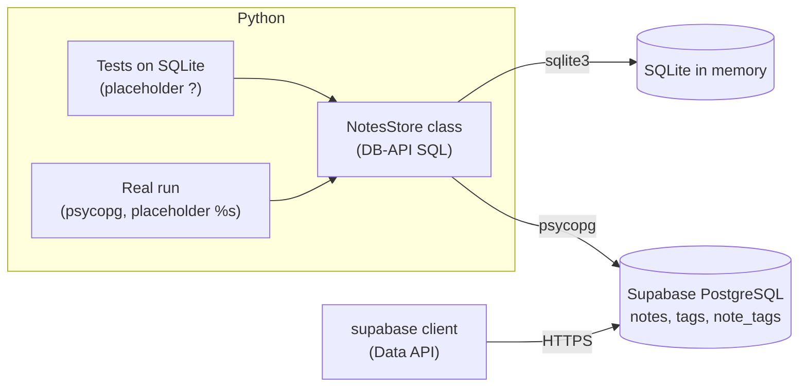
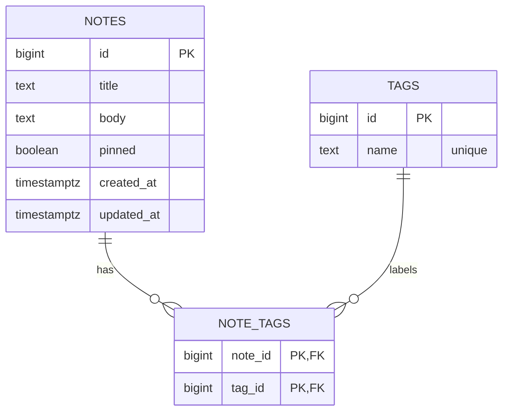

# Lab: Build a Supabase-backed Notes Database

> 📚 **Before you start**
>
> - [Setting Up Supabase](setting-up-supabase.md), for your project, the SQL Editor, grants and RLS
> - [Querying Supabase from Python](querying-supabase-from-python.md), for psycopg, the supabase client, placeholders and the "write once, run on both" pattern
> - [Primary and Foreign Keys](../02-relational-databases-and-sql/primary-and-foreign-keys.md), for junction tables, `ON DELETE CASCADE` and transactions
> - [Functions and Iterators](../../python-programming/course.md#m6) (Python Programming), plus basic classes, for the `NotesStore` class

## What You'll Build

A small **notes database** with tags, like a stripped-down Google Keep, stored in PostgreSQL on Supabase and used from Python. It will:

1. Store notes with a title, a body, a pinned flag and timestamps.
2. Attach any number of **tags** to a note through a **many-to-many** junction table.
3. List notes (pinned first, newest next), search them, filter by tag, update and delete them.
4. Run against **SQLite on your laptop** for testing, and against **Supabase** for real, with the **same Python class**.
5. Read the notes back through the **Data API** with the `supabase` client, tags included.



> 💡 **Key Insight**
>
> Keep your SQL **portable** and your connection **swappable**. When the data-access class only depends on the DB-API (`cursor`, `execute`, `fetchall`, `commit`), you can test every method in milliseconds on SQLite and trust it on PostgreSQL. Only the schema script and the placeholder symbol differ.

All the Python in steps 3 to 6 runs offline. Steps 2, 7 and 8 need your Supabase project.

---

## Step 1: Design the Schema

Three tables. A note can have many tags and a tag can be on many notes, so we need a junction table:

| Table | Columns | Notes |
|---|---|---|
| `notes` | `id`, `title`, `body`, `pinned`, `created_at`, `updated_at` | one row per note |
| `tags` | `id`, `name` (unique) | one row per distinct tag |
| `note_tags` | `note_id`, `tag_id` | one row per (note, tag) pair; both are foreign keys with `ON DELETE CASCADE`; together they are the primary key |



Why not a `tags text[]` array column on `notes`? Arrays are fine for display, but a separate `tags` table lets you rename a tag in one place, list all tags with counts, and keep tag names unique. That's 3NF from the keys lesson.

---

## Step 2: Create the Tables on Supabase

Open your project's **SQL Editor**, paste this and click **Run**. This script is PostgreSQL; the SQLite version for local tests comes in step 3.

```sql
create table public.notes (
    id         bigint generated always as identity primary key,
    title      text        not null check (length(title) between 1 and 200),
    body       text        not null default '',
    pinned     boolean     not null default false,
    created_at timestamptz not null default now(),
    updated_at timestamptz not null default now()
);

create table public.tags (
    id   bigint generated always as identity primary key,
    name text not null unique check (name = lower(name))
);

create table public.note_tags (
    note_id bigint not null references public.notes (id) on delete cascade,
    tag_id  bigint not null references public.tags (id)  on delete cascade,
    primary key (note_id, tag_id)
);

-- PostgreSQL doesn't index foreign key columns automatically.
-- note_id is covered by the primary key; tag_id needs its own index for "notes with tag X".
create index note_tags_tag_id_idx on public.note_tags (tag_id);

-- Security: only trusted server code (secret key) may use these tables through the Data API.
grant select, insert, update, delete on public.notes, public.tags, public.note_tags to service_role;
alter table public.notes     enable row level security;
alter table public.tags      enable row level security;
alter table public.note_tags enable row level security;
```

Notice what's **not** there: no grants to `anon` or `authenticated` and no policies. With RLS on and no policies, the publishable key can't read a single note. Your notes are private to code holding the secret key or the database password. (A multi-user version would add a `user_id` column and policies like `using (auth.uid() = user_id)`.)

The `check (name = lower(name))` constraint forces tag names to be lowercase, so "Work" and "work" can't both exist. Our Python will lowercase them before inserting.

Run `select * from public.notes;` to confirm the table exists and is empty.

---

## Step 3: The SQLite Test Schema and the NotesStore Skeleton

For local tests, here's the same schema in SQLite dialect, plus the start of the class. The class takes **any DB-API connection** and the **placeholder** that driver uses. A small `_query` helper turns results into dictionaries using `cursor.description`, which works the same with both drivers.

```python
import sqlite3

SQLITE_SCHEMA = """
CREATE TABLE notes (
    id         INTEGER PRIMARY KEY,
    title      TEXT    NOT NULL CHECK (length(title) BETWEEN 1 AND 200),
    body       TEXT    NOT NULL DEFAULT '',
    pinned     INTEGER NOT NULL DEFAULT 0,
    created_at TEXT    NOT NULL DEFAULT CURRENT_TIMESTAMP,
    updated_at TEXT    NOT NULL DEFAULT CURRENT_TIMESTAMP
);
CREATE TABLE tags (
    id   INTEGER PRIMARY KEY,
    name TEXT NOT NULL UNIQUE CHECK (name = lower(name))
);
CREATE TABLE note_tags (
    note_id INTEGER NOT NULL REFERENCES notes (id) ON DELETE CASCADE,
    tag_id  INTEGER NOT NULL REFERENCES tags (id)  ON DELETE CASCADE,
    PRIMARY KEY (note_id, tag_id)
);
CREATE INDEX note_tags_tag_id_idx ON note_tags (tag_id);
"""

def sqlite_test_connection():
    conn = sqlite3.connect(":memory:")
    conn.execute("PRAGMA foreign_keys = ON")   # needed for ON DELETE CASCADE in SQLite
    conn.executescript(SQLITE_SCHEMA)
    return conn


class NotesStore:
    """Notes with tags, on any DB-API connection (sqlite3 with '?', psycopg with '%s')."""

    def __init__(self, conn, placeholder="?"):
        self.conn = conn
        self.ph = placeholder

    def _sql(self, sql):
        # Write every query with ? and swap in the driver's placeholder here.
        return sql.replace("?", self.ph)

    def _query(self, sql, params=()):
        cur = self.conn.cursor()
        cur.execute(self._sql(sql), params)
        cols = [d[0] for d in cur.description]
        return [dict(zip(cols, row)) for row in cur.fetchall()]

    def add_note(self, title, body="", pinned=False, tags=()):
        """Insert a note and its tags in ONE transaction. Returns the new note id."""
        try:
            cur = self.conn.cursor()
            cur.execute(
                self._sql("INSERT INTO notes (title, body, pinned) VALUES (?, ?, ?) RETURNING id"),
                (title, body, pinned),
            )
            note_id = cur.fetchone()[0]
            self._attach_tags(cur, note_id, tags)
            self.conn.commit()
            return note_id
        except Exception:
            self.conn.rollback()
            raise

    def _attach_tags(self, cur, note_id, tags):
        for name in sorted({t.strip().lower() for t in tags if t.strip()}):
            cur.execute(self._sql("INSERT INTO tags (name) VALUES (?) ON CONFLICT (name) DO NOTHING"), (name,))
            cur.execute(self._sql("SELECT id FROM tags WHERE name = ?"), (name,))
            tag_id = cur.fetchone()[0]
            cur.execute(
                self._sql("INSERT INTO note_tags (note_id, tag_id) VALUES (?, ?) ON CONFLICT DO NOTHING"),
                (note_id, tag_id),
            )
```

Three design decisions are worth reading slowly:

- **One transaction per operation.** `add_note` inserts into up to three tables. If the third insert fails, `rollback()` undoes the first two, so you never get a half-saved note.
- **`INSERT … ON CONFLICT … DO NOTHING`** is an upsert that ignores duplicates. Both SQLite and PostgreSQL support this exact syntax, which is what keeps the class portable.
- **Tags are cleaned once** (`strip`, `lower`, de-duplicated with a set, sorted so the order is predictable) before touching the database.

Why `_sql()` replaces `?` with the real placeholder: psycopg uses `%s`, and writing every query twice would invite mistakes. It's safe because our SQL never contains a literal `?` character.

Try it:

```python
store = NotesStore(sqlite_test_connection())
first = store.add_note("Buy train tickets", "Pune to Goa, 14 Dec, sleeper", tags=["Travel", "todo"])
second = store.add_note("Chai recipe", "Ginger, cardamom, 2 min boil", pinned=True, tags=["food"])
third = store.add_note("Standup notes", "Ship the notes lab", tags=["work", "TODO", " work "])
print(first, second, third)
print(store._query("SELECT * FROM tags ORDER BY id"))
```

Output:

```
1 2 3
[{'id': 1, 'name': 'todo'}, {'id': 2, 'name': 'travel'}, {'id': 3, 'name': 'food'}, {'id': 4, 'name': 'work'}]
```

`"TODO"` and `" work "` were cleaned and de-duplicated, so there's still only one `todo` tag and one `work` tag.

---

## Step 4: Reading Notes with Their Tags

To show each note with its tags, we fetch the notes, then fetch all their (note, tag) pairs in **one** extra query and group them in Python. That avoids `string_agg` (PostgreSQL) versus `group_concat` (SQLite), which differ between the two databases, and it avoids running one query per note.

```python
def _with_tags(self, notes):
    if not notes:
        return []
    ids = [n["id"] for n in notes]
    marks = ", ".join("?" for _ in ids)
    pairs = self._query(
        f"""SELECT nt.note_id, t.name
            FROM note_tags nt JOIN tags t ON t.id = nt.tag_id
            WHERE nt.note_id IN ({marks})
            ORDER BY t.name""",
        ids,
    )
    by_note = {i: [] for i in ids}
    for p in pairs:
        by_note[p["note_id"]].append(p["name"])
    return [{**n, "tags": by_note[n["id"]]} for n in notes]

def list_notes(self, limit=20):
    notes = self._query(
        """SELECT id, title, pinned FROM notes
           ORDER BY pinned DESC, created_at DESC, id DESC
           LIMIT ?""",
        (limit,),
    )
    return self._with_tags(notes)

NotesStore._with_tags = _with_tags
NotesStore.list_notes = list_notes

for note in store.list_notes():
    print(note)
```

Output:

```
{'id': 2, 'title': 'Chai recipe', 'pinned': 1, 'tags': ['food']}
{'id': 3, 'title': 'Standup notes', 'pinned': 0, 'tags': ['todo', 'work']}
{'id': 1, 'title': 'Buy train tickets', 'pinned': 0, 'tags': ['todo', 'travel']}
```

- `", ".join("?" for _ in ids)` builds one placeholder per id, so the ids are still passed as parameters. This is the safe way to do `IN (...)` with a variable-length list.
- **Pinned first** comes from `ORDER BY pinned DESC` (`true`/`1` sorts above `false`/`0` in both databases). The `id DESC` tie-breaker matters in the test because all three notes were created in the same second.
- Attaching methods with `NotesStore.list_notes = list_notes` lets this lab add methods step by step. In your own file, just write them inside the class.

---

## Step 5: Search and Filter by Tag

**Search** looks in the title and body, ignoring case. `LIKE` is case-insensitive in SQLite but case-sensitive in PostgreSQL, so we lowercase both sides, which behaves the same everywhere. (On PostgreSQL alone you'd use `ILIKE`, or full-text search for big tables.)

```python
def search(self, text):
    pattern = f"%{text.lower()}%"
    notes = self._query(
        """SELECT id, title, pinned FROM notes
           WHERE lower(title) LIKE ? OR lower(body) LIKE ?
           ORDER BY id""",
        (pattern, pattern),
    )
    return self._with_tags(notes)

def notes_tagged(self, tag):
    notes = self._query(
        """SELECT n.id, n.title, n.pinned
           FROM notes n
           JOIN note_tags nt ON nt.note_id = n.id
           JOIN tags t       ON t.id = nt.tag_id
           WHERE t.name = ?
           ORDER BY n.id""",
        (tag.strip().lower(),),
    )
    return self._with_tags(notes)

def tag_counts(self):
    return self._query(
        """SELECT t.name, COUNT(nt.note_id) AS notes
           FROM tags t LEFT JOIN note_tags nt ON nt.tag_id = t.id
           GROUP BY t.id, t.name
           ORDER BY notes DESC, t.name"""
    )

NotesStore.search = search
NotesStore.notes_tagged = notes_tagged
NotesStore.tag_counts = tag_counts

print([n["title"] for n in store.search("GOA")])
print([n["title"] for n in store.search("ship")])
print([n["title"] for n in store.notes_tagged("Todo")])
print(store.tag_counts())
```

Output:

```
['Buy train tickets']
['Standup notes']
['Buy train tickets', 'Standup notes']
[{'name': 'todo', 'notes': 2}, {'name': 'food', 'notes': 1}, {'name': 'travel', 'notes': 1}, {'name': 'work', 'notes': 1}]
```

The `%` wildcards are added **to the value** in Python, never written into the SQL. That matters for psycopg: a literal `%` inside SQL text would clash with its `%s` placeholders.

`tag_counts` uses a `LEFT JOIN` so a tag with no notes would still appear with `0`, and `COUNT(nt.note_id)` rather than `COUNT(*)` so that zero really is zero. That's the pattern from the joins lesson.

---

## Step 6: Update and Delete

Updating a note changes only the fields you pass, bumps `updated_at`, and optionally replaces its tags, all in one transaction:

```python
def update_note(self, note_id, title=None, body=None, pinned=None, tags=None):
    changes = {k: v for k, v in {"title": title, "body": body, "pinned": pinned}.items() if v is not None}
    try:
        cur = self.conn.cursor()
        if changes:
            assignments = ", ".join(f"{col} = ?" for col in changes)   # names come from our own dict
            cur.execute(
                self._sql(f"UPDATE notes SET {assignments}, updated_at = CURRENT_TIMESTAMP WHERE id = ?"),
                (*changes.values(), note_id),
            )
            if cur.rowcount == 0:
                raise KeyError(f"no note with id {note_id}")
        if tags is not None:
            cur.execute(self._sql("DELETE FROM note_tags WHERE note_id = ?"), (note_id,))
            self._attach_tags(cur, note_id, tags)
        self.conn.commit()
    except Exception:
        self.conn.rollback()
        raise

def delete_note(self, note_id):
    cur = self.conn.cursor()
    cur.execute(self._sql("DELETE FROM notes WHERE id = ?"), (note_id,))
    self.conn.commit()
    return cur.rowcount == 1

NotesStore.update_note = update_note
NotesStore.delete_note = delete_note

store.update_note(first, pinned=True, tags=["travel", "booked"])
print(store.list_notes())
print("deleted:", store.delete_note(third), "| again:", store.delete_note(third))
print("note_tags rows:", store._query("SELECT COUNT(*) AS n FROM note_tags"))
print(store.tag_counts())
```

Output:

```
[{'id': 2, 'title': 'Chai recipe', 'pinned': 1, 'tags': ['food']}, {'id': 1, 'title': 'Buy train tickets', 'pinned': 1, 'tags': ['booked', 'travel']}, {'id': 3, 'title': 'Standup notes', 'pinned': 0, 'tags': ['todo', 'work']}]
deleted: True | again: False
note_tags rows: [{'n': 3}]
[{'name': 'booked', 'notes': 1}, {'name': 'food', 'notes': 1}, {'name': 'travel', 'notes': 1}, {'name': 'todo', 'notes': 0}, {'name': 'work', 'notes': 0}]
```

- The column names in `assignments` come from our own fixed dictionary keys, never from user input, so building that part with an f-string is safe; the **values** are still parameters.
- Deleting note 3 **cascaded** to its rows in `note_tags`. The `work` and `todo` tags still exist with 0 notes; whether to clean up unused tags is a product decision.
- The constraints protect you even if the Python has a bug:

```python
for bad in [lambda: store.add_note(""), lambda: store.update_note(999, title="Ghost")]:
    try:
        bad()
    except (sqlite3.IntegrityError, KeyError) as e:
        print(type(e).__name__, "->", e)
print("notes still:", [n["id"] for n in store.list_notes()])
```

Output:

```
IntegrityError -> CHECK constraint failed: length(title) BETWEEN 1 AND 200
KeyError -> 'no note with id 999'
notes still: [2, 1]
```

The empty title broke the `CHECK (length(title) BETWEEN 1 AND 200)` constraint, and the transaction rolled back cleanly.

---

## Step 7: Run It on Supabase with psycopg

Now point the **same class** at your Supabase database. Put the session pooler (or direct) connection string from the **Connect** dialog into `.env` as `DATABASE_URL`, then:

```python
# not-run: needs a Supabase project with the step 2 tables and DATABASE_URL in .env
import os
import psycopg
from dotenv import load_dotenv

load_dotenv()
pg = psycopg.connect(os.environ["DATABASE_URL"])
cloud = NotesStore(pg, placeholder="%s")

trip = cloud.add_note("Buy train tickets", "Pune to Goa, 14 Dec, sleeper", tags=["travel", "todo"])
cloud.add_note("Chai recipe", "Ginger, cardamom, 2 min boil", pinned=True, tags=["food"])
for note in cloud.list_notes():
    print(note)
print(cloud.tag_counts())
pg.close()
```

Example output:

```
{'id': 2, 'title': 'Chai recipe', 'pinned': True, 'tags': ['food']}
{'id': 1, 'title': 'Buy train tickets', 'pinned': False, 'tags': ['todo', 'travel']}
[{'name': 'food', 'notes': 1}, {'name': 'todo', 'notes': 1}, {'name': 'travel', 'notes': 1}]
```

Not one line of `NotesStore` changed. Two small differences show up in the output: `pinned` is a real Python `bool` (PostgreSQL `boolean`) instead of `0`/`1`, and the timestamps (if you select them) come back as timezone-aware `datetime` objects. Open the **Table Editor** in the dashboard and you'll see your notes, tags and junction rows.

If `psycopg.connect` hangs or fails with a network error on the **direct** connection string, your network is probably IPv4-only; use the **session pooler** string instead.

---

## Step 8: Read Notes Through the Data API

Finally, read the same data with the `supabase` client. The Data API can **embed** related rows: because `note_tags` has foreign keys to both `notes` and `tags`, asking for `tags(name)` inside a `notes` select follows the junction table for you:

```python
# not-run: needs a Supabase project; SUPABASE_KEY must be the SECRET key (RLS has no policies)
import os
from dotenv import load_dotenv
from supabase import create_client

load_dotenv()
supabase = create_client(os.environ["SUPABASE_URL"], os.environ["SUPABASE_KEY"])

response = (
    supabase.table("notes")
    .select("id, title, pinned, tags(name)")
    .order("pinned", desc=True)
    .order("created_at", desc=True)
    .execute()
)
for note in response.data:
    print(note["title"], "->", [t["name"] for t in note["tags"]])
```

Example output:

```
Chai recipe -> ['food']
Buy train tickets -> ['travel', 'todo']
```

Try the same code with your **publishable** key: you'll get an empty list (or a permission error), because step 2 granted nothing to `anon` and wrote no policies. That's the security model working as designed.

---

## Try It Yourself

1. **Archive instead of delete.** Add an `archived` boolean column (default false) to both schemas, an `archive_note(note_id)` method, and make `list_notes` hide archived notes.
2. **Remove unused tags.** Write `prune_tags()` that deletes tags attached to no note and returns how many it removed. Use `NOT EXISTS`.
3. **Notes with all given tags.** Write `notes_with_all(tags)` returning notes that have *every* tag in the list. (Hint: `GROUP BY` the note and use `HAVING COUNT(DISTINCT t.name) = <number of tags>`.)
4. **Prove portability.** Which single line would you change to run your tests against a local PostgreSQL instead of Supabase?

<details>
<summary>Show answers</summary>

**1.** In PostgreSQL: `alter table public.notes add column archived boolean not null default false;`. In the test schema add `archived INTEGER NOT NULL DEFAULT 0`. Then:

```python
def archive_note(self, note_id):
    cur = self.conn.cursor()
    cur.execute(self._sql("UPDATE notes SET archived = ? WHERE id = ?"), (True, note_id))
    self.conn.commit()
    return cur.rowcount == 1
```

and add `WHERE archived = ?` with the parameter `False` to the `list_notes` query. Passing Python booleans as parameters works with both drivers (sqlite3 stores them as 1 and 0).

**2.**

```python
def prune_tags(self):
    cur = self.conn.cursor()
    cur.execute(self._sql(
        "DELETE FROM tags WHERE NOT EXISTS (SELECT 1 FROM note_tags nt WHERE nt.tag_id = tags.id)"
    ))
    self.conn.commit()
    return cur.rowcount

NotesStore.prune_tags = prune_tags
print("pruned:", store.prune_tags())
print(store.tag_counts())
```

Output:

```
pruned: 2
[{'name': 'booked', 'notes': 1}, {'name': 'food', 'notes': 1}, {'name': 'travel', 'notes': 1}]
```

**3.**

```python
def notes_with_all(self, tags):
    names = sorted({t.strip().lower() for t in tags})
    marks = ", ".join("?" for _ in names)
    notes = self._query(
        f"""SELECT n.id, n.title, n.pinned
            FROM notes n
            JOIN note_tags nt ON nt.note_id = n.id
            JOIN tags t ON t.id = nt.tag_id
            WHERE t.name IN ({marks})
            GROUP BY n.id, n.title, n.pinned
            HAVING COUNT(DISTINCT t.name) = ?
            ORDER BY n.id""",
        (*names, len(names)),
    )
    return self._with_tags(notes)

NotesStore.notes_with_all = notes_with_all
print([n["title"] for n in store.notes_with_all(["travel", "booked"])])
print([n["title"] for n in store.notes_with_all(["travel", "food"])])
```

Output:

```
['Buy train tickets']
[]
```

PostgreSQL requires every selected column to be in `GROUP BY` (or aggregated), which is why `n.title` and `n.pinned` are listed there too.

**4.** Only the connection string in `DATABASE_URL`. The class, the SQL and the placeholder all stay the same, because Supabase is plain PostgreSQL.

</details>

---

## What You've Learned

- **Designing a many-to-many schema** with a junction table, cascading foreign keys and an index on the second foreign key.
- **Securing tables** on Supabase with explicit grants and RLS so only trusted code can reach them.
- **Writing portable DB-API code**: one class, tested on SQLite with `?`, run on PostgreSQL with `%s`.
- **Using transactions** so multi-table writes are all-or-nothing, and letting constraints catch bugs.
- **Safe dynamic SQL**: placeholders for every value, including variable-length `IN (...)` lists.
- **Reading related data** through the Data API with embedded `tags(name)`.

---

**Up next:** [What is a Document Database?](../04-nosql-with-mongodb-atlas/what-is-a-document-database.md)
