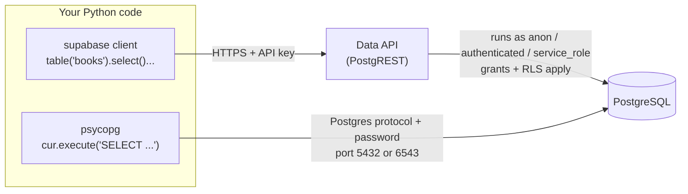

# Querying Supabase from Python: The Complete Guide

> 📚 **Before you start**
>
> - [Setting Up Supabase](setting-up-supabase.md), for your project, the `books` table, grants, RLS, API keys, connection strings and the `require_env()` helper
> - [Writing SQL Queries](../02-relational-databases-and-sql/writing-sql-queries.md), for the SQL that both Python routes send
> - [Primary and Foreign Keys](../02-relational-databases-and-sql/primary-and-foreign-keys.md), for transactions and `IntegrityError`
> - [Functions and Iterators](../../python-fundamentals/course.md#m6) (Python Fundamentals), for method chaining, `with` blocks and generators

## Introduction

You have a PostgreSQL database in the cloud with a `books` table in it. Now you want a Python script to use it: a nightly job that imports new books from a CSV, a Streamlit dashboard showing reading stats, or a FastAPI backend for a reading-club app.

There are two doors into a Supabase database from Python, and choosing the right one matters. The **`supabase` package** talks to the **Data API** over HTTPS, using API keys and Row Level Security, with a chainable Python syntax instead of SQL text. **`psycopg`** opens a real **PostgreSQL connection** with your database password and sends SQL, exactly like `sqlite3` did in module 2.

By the end of this article you'll be able to use both: select with filters, ordering and limits, insert, update, upsert and delete with the `supabase` client; run parameterised SQL, fetch rows as dictionaries and use transactions with `psycopg`. You'll also understand **SQL injection**, the most famous database security bug, and why placeholders prevent it. All the logic runs offline here first, then the real cloud versions are shown for you to run against your own project.

> 💡 **Key Insight**
>
> Use the **`supabase` client** when your code should behave like an app user: it goes through the Data API, so grants and RLS policies apply. Use **`psycopg`** when your code is trusted backend or data work that needs full SQL: joins, transactions, bulk loads and schema changes. Both reach the same PostgreSQL tables.

---

## Core Explanation

### 1. Two routes to the same database



| | `supabase` (Data API) | `psycopg` (direct) |
|---|---|---|
| Install | `pip install supabase` | `pip install "psycopg[binary]"` |
| Credentials | project URL + publishable or secret key | connection string with the database password |
| You write | Python method chains | SQL text |
| Security | grants + RLS, per role | whatever the `postgres` user can do (everything) |
| Joins | through foreign-key "embedding" syntax | any SQL join |
| Transactions across statements | no (each call is its own request) | yes |
| Network | HTTPS, works anywhere | Postgres port; IPv6 for direct, or use the pooler |
| Best for | app back ends, scripts acting as a user, serverless | data pipelines, migrations, analytics, bulk loads |

Install both into your virtual environment when you're ready to run the cloud examples:

```bash
pip install supabase "psycopg[binary]" python-dotenv
```

The `[binary]` extra installs a ready-built version of psycopg, so you don't need PostgreSQL's C libraries on your machine.

### 2. The supabase client: connect

The client needs your project URL and a key. For a script on your own machine that reads and writes freely, use the **secret key** (it runs as `service_role`, which bypasses RLS but still needs the grants from the last lesson). For code that should be limited like a public visitor, use the **publishable key**.

```python
# not-run: needs a Supabase project and keys in .env
import os
from dotenv import load_dotenv
from supabase import create_client, Client

load_dotenv()                                   # reads .env into os.environ
url = os.environ["SUPABASE_URL"]                # https://<project-ref>.supabase.co
key = os.environ["SUPABASE_KEY"]                # sb_secret_... for a trusted script
supabase: Client = create_client(url, key)
```

Creating the client doesn't contact the server yet; the first request does.

### 3. Reading rows: select, filters, order, limit

Every Data API call is a **chain**: pick the table, describe the operation, add filters and modifiers, then call **`.execute()`** to send it. The result object has a **`.data`** attribute holding a **list of dictionaries**, one per row.

```python
# not-run: needs a Supabase project
response = (
    supabase.table("books")
    .select("id, title, author, pages")
    .eq("author", "R. K. Narayan")
    .order("pages", desc=True)
    .limit(5)
    .execute()
)
for book in response.data:
    print(book)
```

Example output:

```
{'id': 3, 'title': 'Malgudi Days', 'author': 'R. K. Narayan', 'pages': 256}
{'id': 1, 'title': 'The Guide', 'author': 'R. K. Narayan', 'pages': 220}
```

That chain is translated into this SQL inside the database:

```sql
SELECT id, title, author, pages FROM books
WHERE author = 'R. K. Narayan'
ORDER BY pages DESC
LIMIT 5;
```

The filter methods map directly to SQL operators:

| supabase method | SQL | Example |
|---|---|---|
| `.eq(col, v)` / `.neq(col, v)` | `=` / `<>` | `.eq("is_read", True)` |
| `.gt`, `.gte`, `.lt`, `.lte` | `>`, `>=`, `<`, `<=` | `.gte("pages", 200)` |
| `.like(col, pattern)` | `LIKE` (case-sensitive) | `.like("title", "%Days%")` |
| `.ilike(col, pattern)` | `ILIKE` (case-insensitive) | `.ilike("title", "%guide%")` |
| `.in_(col, [values])` | `IN (...)` | `.in_("id", [1, 3])` |
| `.is_(col, None)` | `IS NULL` | `.is_("pages", None)` |
| `.contains(col, [values])` | array contains (`@>`) | `.contains("tags", ["fiction"])` |

`in_` and `is_` end in an underscore because `in` and `is` are Python keywords. Several filters in one chain are combined with `AND`. Modifiers: `.order(col, desc=True)`, `.limit(n)`, and `.range(start, end)` for paging (both ends included, counted from 0, so `.range(0, 9)` is the first ten rows).

Two more things to know about select:

- `.select("*", count="exact")` also fills **`response.count`** with the total number of matching rows, useful for "page 1 of 7".
- By default the Data API returns at most **1,000 rows** per request. Page through bigger tables with `.range()`.

### 4. Practising offline with a pretend client

So you can run and experiment with the chaining style right now, here is a **pretend client**: about 40 lines that accept the same method chain, turn it into SQL, run it on SQLite and return an object with `.data`. It only supports a few methods, and it's for practice only; the real client sends HTTP requests to your project instead.

```python
import sqlite3

db = sqlite3.connect(":memory:")
db.row_factory = sqlite3.Row
db.executescript("""
    CREATE TABLE books (id INTEGER PRIMARY KEY, title TEXT NOT NULL, author TEXT NOT NULL,
                        pages INTEGER, is_read INTEGER NOT NULL DEFAULT 0);
    INSERT INTO books (title, author, pages) VALUES
        ('The Guide', 'R. K. Narayan', 220), ('Wings of Fire', 'A. P. J. Abdul Kalam', 180),
        ('Malgudi Days', 'R. K. Narayan', 256);
""")

class Response:
    def __init__(self, data):
        self.data = data

class PretendQuery:
    """Collects a supabase-style chain, then runs it as SQL on SQLite."""
    OPS = {"eq": "=", "neq": "<>", "gt": ">", "gte": ">=", "lt": "<", "lte": "<="}

    def __init__(self, table):
        self.table, self.columns, self.where, self.params = table, "*", [], []
        self.order_by, self.limit_n = "", ""

    def select(self, columns="*"):
        self.columns = columns
        return self                      # returning self is what makes chaining work

    def __getattr__(self, name):         # eq, neq, gt, gte, lt, lte
        if name not in self.OPS:
            raise AttributeError(name)
        def add_filter(column, value):
            self.where.append(f"{column} {self.OPS[name]} ?")
            self.params.append(value)
            return self
        return add_filter

    def order(self, column, desc=False):
        self.order_by = f" ORDER BY {column} {'DESC' if desc else 'ASC'}"
        return self

    def limit(self, n):
        self.limit_n = f" LIMIT {int(n)}"
        return self

    def execute(self):
        sql = f"SELECT {self.columns} FROM {self.table}"
        if self.where:
            sql += " WHERE " + " AND ".join(self.where)
        sql += self.order_by + self.limit_n
        print("SQL:", sql, self.params)
        return Response([dict(row) for row in db.execute(sql, self.params)])

class PretendClient:
    def table(self, name):
        return PretendQuery(name)

supabase = PretendClient()

response = (
    supabase.table("books")
    .select("id, title, pages")
    .eq("author", "R. K. Narayan")
    .order("pages", desc=True)
    .limit(5)
    .execute()
)
print(response.data)
```

Output:

```
SQL: SELECT id, title, pages FROM books WHERE author = ? ORDER BY pages DESC LIMIT 5 ['R. K. Narayan']
[{'id': 3, 'title': 'Malgudi Days', 'pages': 256}, {'id': 1, 'title': 'The Guide', 'pages': 220}]
```

Notice two things. First, each method **returns the query object itself**, which is why you can keep adding `.something()`. That's the *builder pattern*, and it's how the real client works too. Second, the values travel separately from the SQL (the `?` and the list), never pasted into the SQL text. The real Data API is just as careful. Section 7 shows why that matters.

```python
response = supabase.table("books").select("title").gte("pages", 200).lt("pages", 250).execute()
print([row["title"] for row in response.data])
```

Output:

```
SQL: SELECT title FROM books WHERE pages >= ? AND pages < ? [200, 250]
['The Guide']
```

### 5. Writing rows: insert, update, upsert, delete

These are the real client calls. Each returns the affected rows in `.data` by default.

**Insert** one row (a dict) or many (a list of dicts). Leave out columns that have defaults, such as `id` and `added_at`:

```python
# not-run: needs a Supabase project
response = (
    supabase.table("books")
    .insert([
        {"title": "Train to Pakistan", "author": "Khushwant Singh", "pages": 190},
        {"title": "The God of Small Things", "author": "Arundhati Roy", "pages": 340},
    ])
    .execute()
)
print([(b["id"], b["title"]) for b in response.data])
```

Example output:

```
[(4, 'Train to Pakistan'), (5, 'The God of Small Things')]
```

**Update** changes the columns you pass, on the rows your filter matches:

```python
# not-run: needs a Supabase project
response = supabase.table("books").update({"is_read": True}).eq("id", 4).execute()
print(response.data[0]["title"], response.data[0]["is_read"])
```

Example output:

```
Train to Pakistan True
```

**Upsert** inserts the row, or updates it if a row with the same key already exists. By default it matches on the primary key; `on_conflict` names a different column that has a `UNIQUE` constraint:

```python
# not-run: needs a Supabase project; assumes a unique constraint on books.title
response = (
    supabase.table("books")
    .upsert({"title": "The Guide", "author": "R. K. Narayan", "pages": 224}, on_conflict="title")
    .execute()
)
```

**Delete** removes the rows your filter matches. Always include a filter:

```python
# not-run: needs a Supabase project
response = supabase.table("books").delete().eq("id", 5).execute()
print("deleted:", [b["title"] for b in response.data])
```

Example output:

```
deleted: ['The God of Small Things']
```

**Errors** are raised as exceptions. The Data API's errors carry the PostgreSQL error code, which you can check:

```python
# not-run: needs a Supabase project
from postgrest import APIError

try:
    supabase.table("books").insert({"title": "No author"}).execute()
except APIError as e:
    print(e.code, e.message)
```

Example output:

```
23502 null value in column "author" of relation "books" violates not-null constraint
```

`23502` is PostgreSQL's code for a NOT NULL violation; `23505` is a unique violation and `42501` is "permission denied", which usually means a missing grant or RLS policy (see the previous lesson).

> **Getting `[]` back from a select on a table you know has rows?** You're probably using the publishable key on a table with RLS enabled and no matching policy. Either add a policy, or use the secret key in trusted server code.

### 6. psycopg: SQL over a direct connection

`psycopg` (version 3, imported as `psycopg`) follows the same **DB-API** pattern as `sqlite3`: connect, get a cursor, execute SQL with placeholders, fetch, commit. The main visible differences are the connection string and the placeholder, which is **`%s`** instead of `?`.

```python
# not-run: needs a Supabase connection string in DATABASE_URL
import os
import psycopg
from psycopg.rows import dict_row
from dotenv import load_dotenv

load_dotenv()
with psycopg.connect(os.environ["DATABASE_URL"], row_factory=dict_row) as conn:
    with conn.cursor() as cur:
        cur.execute(
            """
            SELECT author, COUNT(*) AS books, SUM(pages) AS pages
            FROM books
            WHERE pages >= %s
            GROUP BY author
            ORDER BY books DESC, author
            """,
            (150,),
        )
        for row in cur.fetchall():
            print(row)
```

Example output:

```
{'author': 'R. K. Narayan', 'books': 2, 'pages': 476}
{'author': 'A. P. J. Abdul Kalam', 'books': 1, 'pages': 180}
{'author': 'Khushwant Singh', 'books': 1, 'pages': 190}
```

- `row_factory=dict_row` makes each row a dictionary, the equivalent of `sqlite3.Row`. Without it, rows are tuples.
- The parameters are always a **tuple or list**, even for one value: `(150,)` with the trailing comma.
- Named placeholders also work: `WHERE pages >= %(min_pages)s` with `{"min_pages": 150}`.
- `with psycopg.connect(...) as conn:` **commits** when the block ends normally, **rolls back** if an exception escapes, and then closes the connection. Inside the block, all your statements belong to one transaction until you call `conn.commit()`.
- `cur.fetchone()`, `cur.fetchall()` and iterating `for row in cur` work as in `sqlite3`. `cur.rowcount` tells you how many rows an `UPDATE` or `DELETE` touched.

A **transaction** spanning several statements is where psycopg shines. Both inserts below succeed, or neither does:

```python
# not-run: needs a Supabase connection string in DATABASE_URL
with psycopg.connect(os.environ["DATABASE_URL"]) as conn:
    with conn.cursor() as cur:
        cur.execute(
            "INSERT INTO books (title, author, pages) VALUES (%s, %s, %s) RETURNING id",
            ("Midnight's Children", "Salman Rushdie", 536),
        )
        book_id = cur.fetchone()[0]
        cur.execute(
            "INSERT INTO reviews (book_id, rating, comment) VALUES (%s, %s, %s)",
            (book_id, 5, "Dazzling"),
        )
    # leaving the with block commits both inserts together
print("saved book", book_id)
```

Example output:

```
saved book 6
```

For loading many rows, `cur.executemany(sql, list_of_tuples)` works, and psycopg's `cur.copy(...)` uses PostgreSQL's fast `COPY` command for very large loads.

Errors are subclasses of `psycopg.Error`, with specific classes per error code in `psycopg.errors`, such as `psycopg.errors.UniqueViolation` and `psycopg.errors.NotNullViolation`. They're also subclasses of the DB-API `psycopg.IntegrityError`, the same family you caught with sqlite3.

### 7. SQL injection: why placeholders are not optional

Suppose a search box passes the user's text into your query, and you build the SQL with an f-string. Here it is on SQLite, where you can safely watch it go wrong:

```python
def find_books_unsafe(author):
    sql = f"SELECT title FROM books WHERE author = '{author}'"   # DON'T do this
    print("SQL:", sql)
    return [r["title"] for r in db.execute(sql)]

print(find_books_unsafe("R. K. Narayan"))
print(find_books_unsafe("nobody' OR '1'='1"))
```

Output:

```
SQL: SELECT title FROM books WHERE author = 'R. K. Narayan'
['The Guide', 'Malgudi Days']
SQL: SELECT title FROM books WHERE author = 'nobody' OR '1'='1'
['The Guide', 'Wings of Fire', 'Malgudi Days']
```

The second "author" contains a quote that ends the string early, and the rest of the input becomes **part of the SQL**. `OR '1'='1'` is always true, so every book comes back. With other inputs an attacker could read other tables or, where multiple statements are allowed, delete data. This is **SQL injection**, and it has caused some of the largest data breaches in history.

The fix is the placeholder you've used all along. The value is sent **separately** from the SQL, so it can never change the query's structure; it's only ever compared as a value:

```python
def find_books(author):
    return [r["title"] for r in db.execute("SELECT title FROM books WHERE author = ?", (author,))]

print(find_books("R. K. Narayan"))
print(find_books("nobody' OR '1'='1"))
```

Output:

```
['The Guide', 'Malgudi Days']
[]
```

The rule is identical in psycopg with `%s`: **pass values as parameters, never format them into the SQL string.** (Table and column names can't be parameters; if they come from users, check them against a fixed list of allowed names. psycopg also offers `psycopg.sql.Identifier` for safely quoting names.)

### 8. Writing code that works on both

Because `sqlite3` and `psycopg` share the DB-API shape, you can write your data functions once and test them on SQLite, then point them at Supabase. Only the placeholder differs, so keep it as a setting:

```python
def add_book(conn, title, author, pages, ph="?"):
    """Insert a book and return its new id. ph is '?' for sqlite3, '%s' for psycopg."""
    cur = conn.cursor()
    cur.execute(
        f"INSERT INTO books (title, author, pages) VALUES ({ph}, {ph}, {ph}) RETURNING id",
        (title, author, pages),
    )
    new_id = cur.fetchone()[0]
    conn.commit()
    return new_id

def books_by(conn, author, ph="?"):
    cur = conn.cursor()
    cur.execute(f"SELECT title, pages FROM books WHERE author = {ph} ORDER BY title", (author,))
    return [tuple(row) for row in cur.fetchall()]

print(add_book(db, "Swami and Friends", "R. K. Narayan", 184))
print(books_by(db, "R. K. Narayan"))
```

Output:

```
4
[('Malgudi Days', 256), ('Swami and Friends', 184), ('The Guide', 220)]
```

The f-string here only inserts the **placeholder symbol**, which comes from your code, never user input, so this is safe. Against Supabase you'd call `add_book(pg_conn, ..., ph="%s")` with a psycopg connection. The lab in the next lesson builds a full notes store this way.

---

## Try It Yourself

1. Using the pretend client, find the titles of books with fewer than 200 pages, longest first.
2. Add a `.ilike()` method to `PretendQuery` that works like the real one (case-insensitive pattern match). SQLite's `LIKE` is already case-insensitive for English letters, so it can reuse `LIKE`. Test it with `"%days%"`.
3. Write the real `supabase` call that returns the 10 most recently added unread books, newest first, with only `title` and `added_at`.
4. Write a psycopg snippet that marks every book by a given author as read and prints how many rows changed.

<details>
<summary>Show answers</summary>

**1.**

```python
response = supabase.table("books").select("title, pages").lt("pages", 200).order("pages", desc=True).execute()
print(response.data)
```

Output:

```
SQL: SELECT title, pages FROM books WHERE pages < ? ORDER BY pages DESC [200]
[{'title': 'Swami and Friends', 'pages': 184}, {'title': 'Wings of Fire', 'pages': 180}]
```

**2.**

```python
def ilike(self, column, pattern):
    self.where.append(f"{column} LIKE ?")
    self.params.append(pattern)
    return self

PretendQuery.ilike = ilike
print(supabase.table("books").select("title").ilike("title", "%days%").execute().data)
```

Output:

```
SQL: SELECT title FROM books WHERE title LIKE ? ['%days%']
[{'title': 'Malgudi Days'}]
```

**3.**

```python
# not-run: needs a Supabase project
response = (
    supabase.table("books")
    .select("title, added_at")
    .eq("is_read", False)
    .order("added_at", desc=True)
    .limit(10)
    .execute()
)
```

**4.**

```python
# not-run: needs a Supabase connection string in DATABASE_URL
with psycopg.connect(os.environ["DATABASE_URL"]) as conn:
    with conn.cursor() as cur:
        cur.execute("UPDATE books SET is_read = true WHERE author = %s", ("R. K. Narayan",))
        print("marked as read:", cur.rowcount)
```

Example output:

```
marked as read: 2
```

</details>

---

## Real-World Examples

### Example 1: A FastAPI backend

A FastAPI app creates one supabase client (or a psycopg **connection pool**, from the `psycopg_pool` package) at start-up and reuses it for every request. Endpoints call `supabase.table(...).select(...)` for simple reads and use psycopg for reports that need joins and aggregates.

### Example 2: A nightly import job

A data engineer's script reads a CSV of new products, opens one psycopg transaction, upserts every row with `INSERT … ON CONFLICT … DO UPDATE`, and commits. If any row is bad, the whole import rolls back and the job alerts someone, leaving yesterday's data intact.

### Example 3: A Streamlit dashboard

An internal dashboard uses the supabase client with the publishable key and a read-only RLS policy, so even if the dashboard's code leaks, the key can only read what the policy allows.

---

## Common Misconceptions

### Misconception 1: "The supabase client and psycopg are different databases"

They are two routes into the same PostgreSQL tables. A row inserted with one is immediately visible to the other.

### Misconception 2: "Escaping quotes myself is as good as placeholders"

Hand-written escaping misses edge cases, differs by database and is easy to forget once. Placeholders send values separately so they can never become SQL. Always use them.

### Misconception 3: "Each supabase call in my function runs in one transaction"

Every `.execute()` is a separate HTTP request and a separate transaction. If two writes must succeed together, use psycopg (or a PostgreSQL function called with `supabase.rpc(...)`).

### Misconception 4: "The secret key is fine in my Streamlit or front-end code because it's my app"

Anything shipped to a browser or a user's device can be read. The secret key bypasses RLS, so it belongs only in server-side code and `.env` files.

---

## Interview Relevance

- *"What is SQL injection and how do you prevent it?"* Untrusted input changing a query's structure; prevent with parameterised queries, allow-lists for identifiers, and least-privilege database users.
- *"What's the DB-API?"* Python's standard interface (PEP 249) for database drivers: connect, cursor, execute, fetch, commit, so `sqlite3`, `psycopg` and others feel the same.
- *"When would you call a database through a REST API rather than connecting directly?"* Clients you don't control, serverless environments, and when you want RLS to enforce access.
- *"How do you handle transactions in Python?"* Context managers that commit on success and roll back on error.
- *"How do you page through a large table?"* `LIMIT`/`OFFSET` or `.range()` for small offsets; keyset pagination for big ones.

---

## Key Takeaways

- **Two routes**: the `supabase` client uses the **Data API** over HTTPS with keys, grants and RLS; **psycopg** uses a direct PostgreSQL connection and plain SQL.
- **Supabase chains** look like `table().select().eq().order().limit().execute()`, and results are in **`response.data`** as a list of dicts.
- **psycopg** follows the DB-API: `%s` placeholders, `dict_row` for dictionaries, and `with psycopg.connect(...)` for commit-or-rollback.
- **Always pass values as parameters**; string-formatted SQL invites SQL injection.
- Write data functions against the **DB-API** so you can test on SQLite and run on Supabase.

---

**Up next:** [Lab: Build a Supabase-backed notes database](lab-build-a-supabase-backed-notes-database.md)
