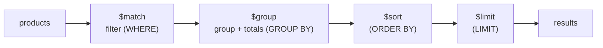

# Insert, Find, Query and Sort: The Complete Guide

> 📚 **Before you start**
>
> - [Databases and Collections](databases-and-collections.md), for connecting with pymongo, collections, `_id` and indexes
> - [What is a Document Database?](what-is-a-document-database.md), for nested documents and arrays
> - [Writing SQL Queries](../02-relational-databases-and-sql/writing-sql-queries.md), because each MongoDB query here is compared with its SQL twin
> - [Functions and Iterators](../../python-programming/course.md#m6) (Python Programming), because `find()` returns an iterator (a cursor)

## Introduction

An online grocery store keeps its catalogue in MongoDB. A shopper types "tea", ticks "in stock" and "under ₹300", and sorts by rating. A category manager wants the five cheapest bestsellers. The finance team wants the stock value per category. Each of these is one call from Python.

In SQL you wrote `WHERE price < 300 AND stock > 0`. In MongoDB you write the same condition as a **Python dictionary**: `{"price": {"$lt": 300}, "stock": {"$gt": 0}}`. Once that clicks, the whole MongoDB query language feels like SQL wearing a JSON costume.

By the end of this article you will insert documents one at a time and in bulk, read them with `find_one` and `find`, filter with every common **query operator** (comparison, logical, element, text pattern and array operators), reach into nested fields with dot notation, choose fields with **projections**, **sort**, **skip** and **limit**, count and find distinct values, and summarise data with the **aggregation pipeline**. Every example runs offline on a small stand-in collection with the same method names as pymongo, and the real Atlas version is one line away.

> 💡 **Key Insight**
>
> A MongoDB **filter is itself a document**. Keys are field names (or `$`-operators like `$or`), and values are either the exact value to match or another small document of operators: `{"price": {"$gte": 100, "$lt": 300}}`. Learn to read and write that shape and you can read any MongoDB query.

---

## Core Explanation

### 1. A collection to practise on

So that everything here runs without an Atlas account, we'll use `MiniCollection`, a small in-memory class with the **same method names and filter syntax as pymongo** (`insert_one`, `find`, `sort`, `count_documents`, `aggregate` and so on). It supports a large subset of the operators covered here, and nothing more. You don't need to read its code to follow the lesson; open it if you're curious how a query engine matches documents.

<details>
<summary>Show the code of MiniCollection (run it, then carry on)</summary>

```python
import copy
import re
from types import SimpleNamespace

ASCENDING, DESCENDING = 1, -1


class DuplicateKeyError(Exception):
    pass


def _lookup(doc, path):
    """Every value found at a dotted path (arrays of sub-documents are searched)."""
    values = [doc]
    for part in path.split("."):
        found = []
        for v in values:
            if isinstance(v, dict) and part in v:
                found.append(v[part])
            elif isinstance(v, list):
                if part.isdigit() and int(part) < len(v):
                    found.append(v[int(part)])
                else:
                    found += [e[part] for e in v if isinstance(e, dict) and part in e]
        values = found
    return values


def _candidates(values):
    """A field matches if the value itself, or any element of an array value, matches."""
    out = []
    for v in values:
        out.append(v)
        if isinstance(v, list):
            out.extend(v)
    return out


def _comparable(a, b):
    num = (int, float)
    if isinstance(a, bool) or isinstance(b, bool):
        return isinstance(a, bool) and isinstance(b, bool)
    return (isinstance(a, num) and isinstance(b, num)) or type(a) is type(b)


def _check(values, ops):
    cands = _candidates(values)
    for op, arg in ops.items():
        if op == "$eq":
            ok = (not values or None in cands) if arg is None else arg in cands
        elif op == "$ne":
            ok = not _check(values, {"$eq": arg})
        elif op in ("$gt", "$gte", "$lt", "$lte"):
            test = {"$gt": lambda c: c > arg, "$gte": lambda c: c >= arg,
                    "$lt": lambda c: c < arg, "$lte": lambda c: c <= arg}[op]
            ok = any(_comparable(c, arg) and test(c) for c in cands)
        elif op == "$in":
            ok = any(_check(values, {"$eq": a}) for a in arg)
        elif op == "$nin":
            ok = not _check(values, {"$in": arg})
        elif op == "$exists":
            ok = bool(values) == bool(arg)
        elif op == "$regex":
            flags = re.IGNORECASE if "i" in ops.get("$options", "") else 0
            ok = any(isinstance(c, str) and re.search(arg, c, flags) for c in cands)
        elif op == "$options":
            continue
        elif op == "$all":
            ok = any(isinstance(v, list) and all(a in v for a in arg) for v in values)
        elif op == "$size":
            ok = any(isinstance(v, list) and len(v) == arg for v in values)
        elif op == "$elemMatch":
            ok = any(isinstance(v, list) and any(_elem_matches(e, arg) for e in v) for v in values)
        elif op == "$not":
            ok = not _check(values, arg)
        else:
            raise ValueError(f"operator {op} is not supported by this mini version")
        if not ok:
            return False
    return True


def _is_ops(cond):
    return isinstance(cond, dict) and cond and all(k.startswith("$") for k in cond)


def _elem_matches(elem, cond):
    if _is_ops(cond):
        return _check([elem], cond)
    return isinstance(elem, dict) and matches(elem, cond)


def matches(doc, filt):
    """True if the document satisfies the filter (a subset of MongoDB's rules)."""
    for key, cond in (filt or {}).items():
        if key == "$and":
            ok = all(matches(doc, f) for f in cond)
        elif key == "$or":
            ok = any(matches(doc, f) for f in cond)
        elif key == "$nor":
            ok = not any(matches(doc, f) for f in cond)
        else:
            ok = _check(_lookup(doc, key), cond if _is_ops(cond) else {"$eq": cond})
        if not ok:
            return False
    return True


def _pick(value, parts):
    """Keep only the sub-field named by parts (used for projections like "rating.avg")."""
    if not parts:
        return value
    if isinstance(value, dict) and parts[0] in value:
        inner = _pick(value[parts[0]], parts[1:])
        return {} if inner is None else {parts[0]: inner}
    if isinstance(value, list):
        return [x for x in (_pick(e, parts) for e in value if isinstance(e, dict)) if x]
    return None


def _merge(a, b):
    for k, v in b.items():
        a[k] = _merge(a[k], v) if isinstance(a.get(k), dict) and isinstance(v, dict) else v
    return a


def _project(doc, projection):
    if not projection:
        return doc
    include = [k for k, v in projection.items() if v and k != "_id"]
    if include:
        out = {"_id": doc["_id"]} if projection.get("_id", 1) and "_id" in doc else {}
        for path in include:
            picked = _pick(doc, path.split("."))
            if picked:
                _merge(out, picked)
        return {k: out[k] for k in doc if k in out}      # keep the document's field order
    return {k: v for k, v in doc.items() if projection.get(k, 1)}


def _sort_key(value):
    # MongoDB puts missing/null values before numbers, and numbers before strings
    if value is None:
        return (0, 0)
    if isinstance(value, (int, float)) and not isinstance(value, bool):
        return (1, value)
    if isinstance(value, str):
        return (2, value)
    return (3, str(value))


def _sorted(docs, spec):
    for field, direction in reversed(spec):
        docs = sorted(docs, key=lambda d: _sort_key((_lookup(d, field) or [None])[0]),
                      reverse=direction == -1)
    return docs


class MiniCursor:
    def __init__(self, docs, projection):
        self._docs, self._projection = docs, projection
        self._sort, self._skip, self._limit = [], 0, 0

    def sort(self, key, direction=ASCENDING):
        self._sort = key if isinstance(key, list) else [(key, direction)]
        return self

    def skip(self, n):
        self._skip = n
        return self

    def limit(self, n):
        self._limit = n
        return self

    def __iter__(self):
        docs = _sorted(self._docs, self._sort)[self._skip:]
        if self._limit:
            docs = docs[:self._limit]
        return iter([_project(copy.deepcopy(d), self._projection) for d in docs])


def _value(doc, expr):
    """Evaluate an aggregation expression: '$field', a constant, or $multiply/$add/$round."""
    if isinstance(expr, str) and expr.startswith("$"):
        found = _lookup(doc, expr[1:])
        return found[0] if found else None
    if isinstance(expr, dict) and len(expr) == 1:
        (op, args), = expr.items()
        vals = [_value(doc, a) for a in args]
        if op == "$multiply":
            result = 1
            for v in vals:
                result *= v
            return result
        if op == "$add":
            return sum(vals)
        if op == "$round":
            return round(vals[0], vals[1] if len(vals) > 1 else 0)
        raise ValueError(f"expression {op} is not supported by this mini version")
    if isinstance(expr, dict):
        return {k: _value(doc, v) for k, v in expr.items()}
    return expr


def _group(docs, spec):
    groups = {}
    for d in docs:
        key = _value(d, spec["_id"])
        groups.setdefault(repr(key), (key, []))[1].append(d)
    out = []
    for key, members in groups.values():
        row = {"_id": key}
        for field, acc in spec.items():
            if field == "_id":
                continue
            (op, expr), = acc.items()
            vals = [_value(m, expr) for m in members]
            nums = [v for v in vals if isinstance(v, (int, float))]
            if op == "$sum":
                row[field] = sum(nums)
            elif op == "$avg":
                row[field] = sum(nums) / len(nums) if nums else None
            elif op == "$min":
                row[field] = min(nums) if nums else None
            elif op == "$max":
                row[field] = max(nums) if nums else None
            elif op == "$push":
                row[field] = vals
            elif op == "$addToSet":
                row[field] = list(dict.fromkeys(vals))
            else:
                raise ValueError(f"accumulator {op} is not supported by this mini version")
        out.append(row)
    return out


def _reshape(doc, spec):
    """$project: keep fields marked 1, compute fields given an expression."""
    out = {"_id": doc["_id"]} if spec.get("_id", 1) and "_id" in doc else {}
    for field, how in spec.items():
        if field == "_id" or how in (0, False):
            continue
        if how in (1, True):
            if field in doc:
                out[field] = doc[field]
        else:
            out[field] = _value(doc, how)
    return out


class MiniCollection:
    """A tiny in-memory stand-in for a pymongo Collection (a subset, for learning only)."""

    def __init__(self, name):
        self.name = name
        self._docs = []
        self._next_id = 1

    def insert_one(self, doc):
        if "_id" not in doc:
            doc["_id"] = self._next_id          # pymongo would add an ObjectId here
            self._next_id += 1
        if any(d["_id"] == doc["_id"] for d in self._docs):
            raise DuplicateKeyError(f"E11000 duplicate key error: _id {doc['_id']!r}")
        self._docs.append(copy.deepcopy({"_id": doc["_id"], **doc}))   # _id is stored first
        return SimpleNamespace(inserted_id=doc["_id"], acknowledged=True)

    def insert_many(self, docs):
        return SimpleNamespace(inserted_ids=[self.insert_one(d).inserted_id for d in docs],
                               acknowledged=True)

    def find(self, filter=None, projection=None):
        return MiniCursor([d for d in self._docs if matches(d, filter)], projection)

    def find_one(self, filter=None, projection=None):
        return next(iter(self.find(filter, projection)), None)

    def count_documents(self, filter):
        return sum(1 for d in self._docs if matches(d, filter))

    def distinct(self, key, filter=None):
        values = []
        for d in self._docs:
            if matches(d, filter):
                for v in _candidates(_lookup(d, key)):
                    if not isinstance(v, list) and v not in values:
                        values.append(v)
        return sorted(values, key=_sort_key)

    def aggregate(self, pipeline):
        docs = [copy.deepcopy(d) for d in self._docs]
        for stage in pipeline:
            (name, spec), = stage.items()
            if name == "$match":
                docs = [d for d in docs if matches(d, spec)]
            elif name == "$group":
                docs = _group(docs, spec)
            elif name == "$sort":
                docs = _sorted(docs, list(spec.items()))
            elif name == "$limit":
                docs = docs[:spec]
            elif name == "$skip":
                docs = docs[spec:]
            elif name == "$unwind":
                field = spec[1:]
                docs = [{**d, field: v} for d in docs for v in (d.get(field) or [])]
            elif name == "$project":
                docs = [_reshape(d, spec) for d in docs]
            elif name == "$count":
                docs = [{spec: len(docs)}]
            else:
                raise ValueError(f"stage {name} is not supported by this mini version")
        return iter(docs)
```

</details>

Now create the collection and some products. Each product has a slightly different shape (some have a `brand`, one has a `discount`), and each has a nested `rating` document and a `tags` array.

```python
products = MiniCollection("products")

# With a real Atlas cluster, this one line is the only change:
#   products = MongoClient(uri)["shop"]["products"]

result = products.insert_one(
    {"name": "Masala Chai Mix", "category": "tea", "price": 180, "stock": 40,
     "tags": ["spicy", "bestseller"], "rating": {"avg": 4.6, "count": 1200}, "brand": "Chaiwala"}
)
print("inserted_id:", result.inserted_id)

result = products.insert_many([
    {"name": "Darjeeling Green Tea", "category": "tea", "price": 450, "stock": 0,
     "tags": ["organic"], "rating": {"avg": 4.2, "count": 310}, "brand": "Hilltop"},
    {"name": "Basmati Rice 5kg", "category": "rice", "price": 799, "stock": 25,
     "tags": ["bestseller"], "rating": {"avg": 4.4, "count": 2100}},
    {"name": "Sona Masoori Rice 10kg", "category": "rice", "price": 1150, "stock": 8,
     "tags": [], "rating": {"avg": 4.1, "count": 640}},
    {"name": "Filter Coffee Powder", "category": "coffee", "price": 320, "stock": 60,
     "tags": ["strong", "bestseller"], "rating": {"avg": 4.7, "count": 980}, "brand": "Kaapi Co"},
    {"name": "Instant Coffee Jar", "category": "coffee", "price": 275, "stock": 15,
     "tags": ["strong"], "rating": {"avg": 3.9, "count": 150}},
    {"name": "Organic Jaggery", "category": "sweetener", "price": 140, "stock": 100,
     "tags": ["organic"], "rating": {"avg": 4.5, "count": 75}, "discount": 10},
])
print("inserted_ids:", result.inserted_ids)
print("total:", products.count_documents({}))
```

Output:

```
inserted_id: 1
inserted_ids: [2, 3, 4, 5, 6, 7]
total: 7
```

### 2. Inserting documents

- **`insert_one(doc)`** inserts one dictionary and returns an `InsertOneResult` whose **`inserted_id`** is the new document's `_id`.
- **`insert_many(list_of_docs)`** inserts many in one round trip to the server (much faster than a loop of `insert_one`) and returns **`inserted_ids`**, in the same order.
- If a document has no `_id`, one is generated. Our stand-in uses 1, 2, 3…; pymongo generates an **ObjectId**. Either way, **the `_id` is added to your Python dict** too.

With real pymongo the same calls look like this:

```python
# not-run: needs a MongoDB Atlas cluster
doc = {"name": "Masala Chai Mix", "category": "tea", "price": 180}
result = products.insert_one(doc)
print(result.inserted_id)
print(doc["_id"] == result.inserted_id)
```

Example output:

```
6acb5718a1b2c3d4e500002a
True
```

Because the `_id` was added to `doc`, running `products.insert_one(doc)` again raises **`DuplicateKeyError`**. Our stand-in behaves the same way:

```python
doc = {"name": "Test item", "price": 1}
products.insert_one(doc)
try:
    products.insert_one(doc)
except DuplicateKeyError as e:
    print("DuplicateKeyError:", e)
products._docs.pop()   # tidy up: remove the test item (only possible in the stand-in)
print("total:", products.count_documents({}))
```

Output:

```
DuplicateKeyError: E11000 duplicate key error: _id 8
total: 7
```

With pymongo, `insert_many` stops at the first failing document by default (`ordered=True`) and raises `BulkWriteError`. Pass `ordered=False` to insert all the valid documents and report the failures at the end.

### 3. find_one and find

**`find_one(filter)`** returns the first matching document as a dict, or `None`. **`find(filter)`** returns a **cursor**: a lazy iterator that fetches matching documents from the server in batches as you loop over it.

```python
print(products.find_one({"name": "Organic Jaggery"}))
print(products.find_one({"name": "Gold Coins"}))

for p in products.find({"category": "coffee"}):
    print(p["name"], p["price"])
```

Output:

```
{'_id': 7, 'name': 'Organic Jaggery', 'category': 'sweetener', 'price': 140, 'stock': 100, 'tags': ['organic'], 'rating': {'avg': 4.5, 'count': 75}, 'discount': 10}
None
Filter Coffee Powder 320
Instant Coffee Jar 275
```

- `{"category": "coffee"}` is the filter: "where `category` equals `'coffee'`". In SQL: `WHERE category = 'coffee'`.
- `find({})` or `find()` returns every document, like `SELECT *`.
- **Several fields in one filter are combined with AND**: `{"category": "tea", "stock": 0}` means tea *and* out of stock.
- A cursor can be read **once**. Use `list(products.find(...))` if you need the results more than once, but beware of loading millions of documents into memory.

```python
print([p["name"] for p in products.find({"category": "tea", "stock": 0})])
```

Output:

```
['Darjeeling Green Tea']
```

### 4. Projection: choosing fields

The optional second argument to `find` is a **projection**: which fields to return. `1` means include, `0` means exclude. `_id` is included unless you exclude it explicitly. This is `SELECT name, price` instead of `SELECT *`, and it reduces the data sent over the network:

```python
for p in products.find({"category": "rice"}, {"name": 1, "price": 1, "_id": 0}):
    print(p)
for p in products.find({"category": "rice"}, {"tags": 0, "rating": 0, "_id": 0}):
    print(p)
```

Output:

```
{'name': 'Basmati Rice 5kg', 'price': 799}
{'name': 'Sona Masoori Rice 10kg', 'price': 1150}
{'name': 'Basmati Rice 5kg', 'category': 'rice', 'price': 799, 'stock': 25}
{'name': 'Sona Masoori Rice 10kg', 'category': 'rice', 'price': 1150, 'stock': 8}
```

You can't mix 1s and 0s in one projection, except for `_id: 0`.

### 5. Comparison operators

To match anything other than exact equality, the field's value becomes a document of **operators**, which all start with `$`:

| Operator | Meaning | SQL | Example |
|---|---|---|---|
| `$eq` | equal | `=` | `{"price": {"$eq": 180}}` (same as `{"price": 180}`) |
| `$ne` | not equal | `<>` | `{"category": {"$ne": "tea"}}` |
| `$gt`, `$gte` | greater (or equal) | `>`, `>=` | `{"stock": {"$gt": 0}}` |
| `$lt`, `$lte` | less (or equal) | `<`, `<=` | `{"price": {"$lte": 300}}` |
| `$in` | equals any in a list | `IN (...)` | `{"category": {"$in": ["tea", "coffee"]}}` |
| `$nin` | equals none in a list | `NOT IN (...)` | `{"category": {"$nin": ["rice"]}}` |

Several operators on the same field are ANDed, which gives you a range (like `BETWEEN`):

```python
def names(cursor):
    return [p["name"] for p in cursor]

print(names(products.find({"price": {"$gte": 150, "$lt": 400}})))
print(names(products.find({"category": {"$in": ["tea", "coffee"]}, "stock": {"$gt": 0}})))
print(names(products.find({"category": {"$ne": "rice"}, "price": {"$lte": 200}})))
```

Output:

```
['Masala Chai Mix', 'Filter Coffee Powder', 'Instant Coffee Jar']
['Masala Chai Mix', 'Filter Coffee Powder', 'Instant Coffee Jar']
['Masala Chai Mix', 'Organic Jaggery']
```

The first line is `WHERE price >= 150 AND price < 400`. The second is "tea or coffee, in stock". One difference from SQL to remember: `$ne` and `$nin` **also match documents where the field is missing**, because a missing field is "not equal" to the value.

### 6. Logical operators: $or, $and, $nor, $not

Top-level **`$or`** takes a **list** of filters and matches documents that satisfy at least one:

```python
# cheap OR highly rated
print(names(products.find({"$or": [{"price": {"$lt": 200}}, {"rating.avg": {"$gte": 4.6}}]})))

# (tea OR coffee) AND price under 300: $or combined with a normal field
print(names(products.find({"$or": [{"category": "tea"}, {"category": "coffee"}],
                           "price": {"$lt": 300}})))
```

Output:

```
['Masala Chai Mix', 'Filter Coffee Powder', 'Organic Jaggery']
['Masala Chai Mix', 'Instant Coffee Jar']
```

| Operator | Takes | Matches documents that… |
|---|---|---|
| `$and` | a list of filters | satisfy all of them |
| `$or` | a list of filters | satisfy at least one |
| `$nor` | a list of filters | satisfy none |
| `$not` | an operator expression on one field | don't satisfy it: `{"price": {"$not": {"$gt": 500}}}` |

You rarely need `$and`, because listing fields already means AND. You need it when you'd otherwise repeat a key, for example two `$or` conditions, since a Python dict can't have the same key twice:

```python
print(names(products.find({"$and": [
    {"$or": [{"category": "tea"}, {"category": "coffee"}]},
    {"$or": [{"stock": 0}, {"rating.avg": {"$lt": 4.0}}]},
]})))
```

Output:

```
['Darjeeling Green Tea', 'Instant Coffee Jar']
```

That reads as "tea or coffee, which is either out of stock or rated under 4".

### 7. Nested fields, missing fields and text patterns

**Dot notation** reaches inside nested documents. The field name must be in quotes because it contains a dot: `"rating.avg"`.

```python
print(names(products.find({"rating.avg": {"$gte": 4.5}, "rating.count": {"$gte": 500}})))
```

Output:

```
['Masala Chai Mix', 'Filter Coffee Powder']
```

**`$exists`** checks whether a field is present at all, which matters with flexible schemas:

```python
print("has a brand:  ", names(products.find({"brand": {"$exists": True}})))
print("has no brand: ", names(products.find({"brand": {"$exists": False}})))
print("discounted:   ", names(products.find({"discount": {"$exists": True}})))
```

Output:

```
has a brand:   ['Masala Chai Mix', 'Darjeeling Green Tea', 'Filter Coffee Powder']
has no brand:  ['Basmati Rice 5kg', 'Sona Masoori Rice 10kg', 'Instant Coffee Jar', 'Organic Jaggery']
discounted:    ['Organic Jaggery']
```

`{"brand": None}` would match both documents where `brand` is `None` (null) **and** documents with no `brand` field. Use `$exists` when you need to tell them apart.

**`$regex`** matches text with a regular expression, like a more powerful `LIKE`. `"$options": "i"` makes it case-insensitive:

```python
print(names(products.find({"name": {"$regex": "coffee", "$options": "i"}})))
print(names(products.find({"name": {"$regex": "^[A-D]"}})))     # starts with A, B, C or D
print(names(products.find({"name": {"$regex": "kg$"}})))        # ends with kg
```

Output:

```
['Filter Coffee Powder', 'Instant Coffee Jar']
['Darjeeling Green Tea', 'Basmati Rice 5kg']
['Basmati Rice 5kg', 'Sona Masoori Rice 10kg']
```

A regex that starts with `^` (anchored to the start) can use an index on the field; other regexes must scan every value. For real search boxes, Atlas offers **Atlas Search**, a full-text search engine built into the cluster.

### 8. Querying arrays

Arrays have a friendly rule: **a filter on an array field matches if any element matches.** No special syntax is needed for "contains":

```python
print("tagged bestseller:", names(products.find({"tags": "bestseller"})))
print("organic or spicy: ", names(products.find({"tags": {"$in": ["organic", "spicy"]}})))
print("strong AND best:  ", names(products.find({"tags": {"$all": ["strong", "bestseller"]}})))
print("exactly 2 tags:   ", names(products.find({"tags": {"$size": 2}})))
print("no tags:          ", names(products.find({"tags": {"$size": 0}})))
```

Output:

```
tagged bestseller: ['Masala Chai Mix', 'Basmati Rice 5kg', 'Filter Coffee Powder']
organic or spicy:  ['Masala Chai Mix', 'Darjeeling Green Tea', 'Organic Jaggery']
strong AND best:   ['Filter Coffee Powder']
exactly 2 tags:    ['Masala Chai Mix', 'Filter Coffee Powder']
no tags:           ['Sona Masoori Rice 10kg']
```

| Operator | Matches when the array… |
|---|---|
| `{"tags": "x"}` | contains `"x"` |
| `{"tags": {"$in": [...]}}` | contains at least one of the values |
| `{"tags": {"$all": [...]}}` | contains all of the values, in any order |
| `{"tags": {"$size": n}}` | has exactly `n` elements |
| `{"items": {"$elemMatch": {...}}}` | has at least one element matching *all* the conditions |
| `{"tags.0": "x"}` | has `"x"` at position 0 |

**`$elemMatch`** matters for arrays of sub-documents. Suppose orders contain item lists:

```python
orders = MiniCollection("orders")
orders.insert_many([
    {"_id": "A1", "items": [{"sku": "tea", "qty": 1}, {"sku": "rice", "qty": 5}]},
    {"_id": "A2", "items": [{"sku": "tea", "qty": 6}]},
])
# Without $elemMatch: SOME item is tea and SOME (maybe different) item has qty >= 5
print([o["_id"] for o in orders.find({"items.sku": "tea", "items.qty": {"$gte": 5}})])
# With $elemMatch: ONE item that is tea AND has qty >= 5
print([o["_id"] for o in orders.find({"items": {"$elemMatch": {"sku": "tea", "qty": {"$gte": 5}}}})])
```

Output:

```
['A1', 'A2']
['A2']
```

Order A1 matched the first query because one item is tea and a *different* item has quantity 5. `$elemMatch` requires both conditions on the same element.

### 9. Sorting, skipping and limiting

Cursor methods shape the result, and they chain like the supabase client did:

- **`.sort(field, direction)`** with `1` (or `pymongo.ASCENDING`) or `-1` (`pymongo.DESCENDING`). For several keys, pass a list: `.sort([("category", 1), ("price", -1)])`.
- **`.limit(n)`** returns at most `n` documents.
- **`.skip(n)`** skips the first `n`, for paging.

```python
print("top 3 by rating:")
for p in products.find({}, {"name": 1, "rating.avg": 1, "_id": 0}).sort("rating.avg", -1).limit(3):
    print("  ", p)

print("by category, then price high to low:")
for p in products.find({}, {"category": 1, "name": 1, "price": 1, "_id": 0}).sort([("category", 1), ("price", -1)]):
    print("  ", p["category"], "|", p["name"], "|", p["price"])

print("page 2 (2 per page), cheapest first:", names(products.find().sort("price", 1).skip(2).limit(2)))
```

Output:

```
top 3 by rating:
   {'name': 'Filter Coffee Powder', 'rating': {'avg': 4.7}}
   {'name': 'Masala Chai Mix', 'rating': {'avg': 4.6}}
   {'name': 'Organic Jaggery', 'rating': {'avg': 4.5}}
by category, then price high to low:
   coffee | Filter Coffee Powder | 320
   coffee | Instant Coffee Jar | 275
   rice | Sona Masoori Rice 10kg | 1150
   rice | Basmati Rice 5kg | 799
   sweetener | Organic Jaggery | 140
   tea | Darjeeling Green Tea | 450
   tea | Masala Chai Mix | 180
page 2 (2 per page), cheapest first: ['Instant Coffee Jar', 'Filter Coffee Powder']
```

Note in the first result that a projection on a nested field keeps the nesting, giving `{"rating": {"avg": ...}}` without the `count`. Like SQL's `LIMIT`, `limit` without `sort` gives you an arbitrary set of documents. Like `OFFSET`, a large `skip` is slow, because the server still walks past the skipped documents.

**Counting and distinct values:**

```python
print("in stock:", products.count_documents({"stock": {"$gt": 0}}))
print("categories:", products.distinct("category"))
print("tags on items under 500:", products.distinct("tags", {"price": {"$lt": 500}}))
```

Output:

```
in stock: 6
categories: ['coffee', 'rice', 'sweetener', 'tea']
tags on items under 500: ['bestseller', 'organic', 'spicy', 'strong']
```

`count_documents(filter)` always needs a filter argument; pass `{}` to count everything. `estimated_document_count()` is a faster count of the whole collection from metadata. `distinct` unwinds arrays, so each tag is listed once. (Our stand-in sorts the result; don't rely on the order from a real server.)

### 10. The aggregation pipeline

`find` returns documents as they are. To **summarise** (totals, averages, groups), MongoDB has the **aggregation pipeline**: a list of **stages**, where each stage transforms the stream of documents and passes the result to the next. It's like a SQL query written as steps.



"For each category of in-stock products, how many products, what's the average price, and what's the total stock value?":

```python
pipeline = [
    {"$match": {"stock": {"$gt": 0}}},
    {"$group": {
        "_id": "$category",
        "products": {"$sum": 1},
        "avg_price": {"$avg": "$price"},
        "stock_value": {"$sum": {"$multiply": ["$price", "$stock"]}},
    }},
    {"$sort": {"stock_value": -1}},
]
for row in products.aggregate(pipeline):
    print(row)
```

Output:

```
{'_id': 'rice', 'products': 2, 'avg_price': 974.5, 'stock_value': 29175}
{'_id': 'coffee', 'products': 2, 'avg_price': 297.5, 'stock_value': 23325}
{'_id': 'sweetener', 'products': 1, 'avg_price': 140.0, 'stock_value': 14000}
{'_id': 'tea', 'products': 1, 'avg_price': 180.0, 'stock_value': 7200}
```

The equivalent SQL is:

```sql
SELECT category AS _id, COUNT(*) AS products, AVG(price) AS avg_price,
       SUM(price * stock) AS stock_value
FROM products
WHERE stock > 0
GROUP BY category
ORDER BY stock_value DESC;
```

Things to notice:

- In stages, **`"$price"` with a dollar sign means "the value of the `price` field"**. Without the `$`, `"price"` would be the literal text "price".
- **`$group`** needs an `_id`: the field (or fields) to group by. `"_id": None` puts every document in one group, for grand totals.
- Accumulators include **`$sum`**, **`$avg`**, **`$min`**, **`$max`**, **`$push`** (collect values into a list) and **`$addToSet`** (collect unique values). `{"$sum": 1}` counts documents.
- Order matters: put **`$match` first** so fewer documents flow through the pipeline, and so it can use indexes.

More common stages:

| Stage | Does | SQL idea |
|---|---|---|
| `$match` | filter documents | `WHERE` (or `HAVING`, after a `$group`) |
| `$group` | group and accumulate | `GROUP BY` + aggregates |
| `$sort`, `$limit`, `$skip` | order and slice | `ORDER BY`, `LIMIT`, `OFFSET` |
| `$project` | choose, rename or compute fields | the `SELECT` list |
| `$unwind` | one output document per array element | turning a list column into rows |
| `$lookup` | pull in matching documents from another collection | `LEFT JOIN` |
| `$count` | count the documents reaching this stage | `COUNT(*)` |

**`$unwind`** is how you count things inside arrays. "How many products carry each tag?":

```python
for row in products.aggregate([
    {"$unwind": "$tags"},
    {"$group": {"_id": "$tags", "count": {"$sum": 1}, "products": {"$push": "$name"}}},
    {"$sort": {"count": -1, "_id": 1}},
]):
    print(row)
```

Output:

```
{'_id': 'bestseller', 'count': 3, 'products': ['Masala Chai Mix', 'Basmati Rice 5kg', 'Filter Coffee Powder']}
{'_id': 'organic', 'count': 2, 'products': ['Darjeeling Green Tea', 'Organic Jaggery']}
{'_id': 'strong', 'count': 2, 'products': ['Filter Coffee Powder', 'Instant Coffee Jar']}
{'_id': 'spicy', 'count': 1, 'products': ['Masala Chai Mix']}
```

**`$project`** reshapes documents, and a `$match` *after* `$group` acts like SQL's `HAVING`:

```python
for row in products.aggregate([
    {"$group": {"_id": "$category", "avg_rating": {"$avg": "$rating.avg"}}},
    {"$match": {"avg_rating": {"$gte": 4.3}}},                                   # like HAVING
    {"$project": {"_id": 0, "category": "$_id", "avg_rating": {"$round": ["$avg_rating", 2]}}},
    {"$sort": {"avg_rating": -1}},
]):
    print(row)
```

Output:

```
{'category': 'sweetener', 'avg_rating': 4.5}
{'category': 'tea', 'avg_rating': 4.4}
{'category': 'coffee', 'avg_rating': 4.3}
```

**`$lookup`** joins another collection. Our stand-in doesn't implement it, so here's the real pymongo form. For each order, it attaches the matching product documents as an array called `product_docs`:

```python
# not-run: needs a MongoDB Atlas cluster with orders and products collections
pipeline = [
    {"$match": {"_id": "A1"}},
    {"$unwind": "$items"},
    {"$lookup": {
        "from": "products",            # the other collection
        "localField": "items.sku",     # field in orders
        "foreignField": "category",    # field in products
        "as": "product_docs",          # name of the new array field
    }},
    {"$project": {"_id": 0, "sku": "$items.sku", "qty": "$items.qty",
                  "matches": {"$size": "$product_docs"}}},
]
for row in db["orders"].aggregate(pipeline):
    print(row)
```

Example output:

```
{'sku': 'tea', 'qty': 1, 'matches': 2}
{'sku': 'rice', 'qty': 5, 'matches': 2}
```

If you find yourself using `$lookup` in every query, it's a sign that the data might be better embedded, or better in a relational database.

### 11. SQL to MongoDB cheat sheet

| SQL | pymongo |
|---|---|
| `SELECT * FROM products` | `products.find({})` |
| `SELECT name, price FROM products` | `products.find({}, {"name": 1, "price": 1, "_id": 0})` |
| `WHERE category = 'tea'` | `find({"category": "tea"})` |
| `WHERE price > 100 AND stock > 0` | `find({"price": {"$gt": 100}, "stock": {"$gt": 0}})` |
| `WHERE a = 1 OR b = 2` | `find({"$or": [{"a": 1}, {"b": 2}]})` |
| `WHERE category IN ('tea', 'coffee')` | `find({"category": {"$in": ["tea", "coffee"]}})` |
| `WHERE name LIKE '%chai%'` (case-insensitive) | `find({"name": {"$regex": "chai", "$options": "i"}})` |
| `WHERE brand IS NULL` | `find({"brand": None})` (also matches a missing field) |
| `ORDER BY price DESC LIMIT 5 OFFSET 10` | `find().sort("price", -1).skip(10).limit(5)` |
| `SELECT COUNT(*) … WHERE …` | `count_documents({...})` |
| `SELECT DISTINCT category` | `distinct("category")` |
| `GROUP BY … HAVING …` | `aggregate([{"$group": ...}, {"$match": ...}])` |
| `INSERT INTO … VALUES …` | `insert_one({...})`, `insert_many([...])` |

### 12. The same code against Atlas

Here's a complete script for a real cluster. Only the setup differs from what you ran above:

```python
# not-run: needs a MongoDB Atlas cluster and MONGODB_URI in .env
import os
from dotenv import load_dotenv
from pymongo import MongoClient, ASCENDING, DESCENDING
from pymongo.server_api import ServerApi

load_dotenv()
client = MongoClient(os.environ["MONGODB_URI"], server_api=ServerApi("1"))
products = client["shop"]["products"]

products.create_index([("category", ASCENDING), ("price", ASCENDING)])

cheap_tea = products.find(
    {"category": "tea", "stock": {"$gt": 0}, "price": {"$lt": 300}},
    {"name": 1, "price": 1, "_id": 0},
).sort("price", ASCENDING).limit(5)
for p in cheap_tea:
    print(p)

client.close()
```

Example output:

```
{'name': 'Masala Chai Mix', 'price': 180}
```

---

## Try It Yourself

Use the `products` collection from above.

1. Names and prices of products that are in stock, cost between ₹200 and ₹800 (inclusive), sorted by price high to low.
2. Products that have no `brand` field **or** have fewer than 200 ratings. Show only names.
3. The single cheapest product tagged `bestseller`, using `sort` and `limit` (or `find_one` with a `sort` argument in pymongo).
4. An aggregation that returns, for each category, the name of every product in it and the highest price, sorted by category.

<details>
<summary>Show answers</summary>

**1.**

```python
for p in products.find({"stock": {"$gt": 0}, "price": {"$gte": 200, "$lte": 800}},
                       {"name": 1, "price": 1, "_id": 0}).sort("price", -1):
    print(p)
```

Output:

```
{'name': 'Basmati Rice 5kg', 'price': 799}
{'name': 'Filter Coffee Powder', 'price': 320}
{'name': 'Instant Coffee Jar', 'price': 275}
```

**2.**

```python
print(names(products.find({"$or": [{"brand": {"$exists": False}}, {"rating.count": {"$lt": 200}}]})))
```

Output:

```
['Basmati Rice 5kg', 'Sona Masoori Rice 10kg', 'Instant Coffee Jar', 'Organic Jaggery']
```

**3.**

```python
print(names(products.find({"tags": "bestseller"}).sort("price", 1).limit(1)))
```

Output:

```
['Masala Chai Mix']
```

In pymongo, `find_one` also accepts a sort: `products.find_one({"tags": "bestseller"}, sort=[("price", 1)])`.

**4.**

```python
for row in products.aggregate([
    {"$group": {"_id": "$category", "names": {"$push": "$name"}, "max_price": {"$max": "$price"}}},
    {"$sort": {"_id": 1}},
]):
    print(row)
```

Output:

```
{'_id': 'coffee', 'names': ['Filter Coffee Powder', 'Instant Coffee Jar'], 'max_price': 320}
{'_id': 'rice', 'names': ['Basmati Rice 5kg', 'Sona Masoori Rice 10kg'], 'max_price': 1150}
{'_id': 'sweetener', 'names': ['Organic Jaggery'], 'max_price': 140}
{'_id': 'tea', 'names': ['Masala Chai Mix', 'Darjeeling Green Tea'], 'max_price': 450}
```

</details>

---

## Real-World Examples

### Example 1: Faceted search on a shopping site

The filter panel on a shopping site ("brand", "price range", "rating 4+", "in stock") turns directly into a filter document built in Python: start with `{}` and add a key for each ticked box. The counts next to each option ("Tea (12)") come from an aggregation with `$group`.

### Example 2: Analytics on app events

Product teams store app events (screen views, clicks) as documents. A daily aggregation `$match`es yesterday's events, `$group`s by event type and screen, and writes the summary to a reporting collection with the `$merge` stage.

### Example 3: Leaderboards

A quiz app keeps each player's best score in a document and shows the leaderboard with `find({}, {"name": 1, "score": 1}).sort("score", -1).limit(10)`, backed by an index on `score`.

---

## Common Misconceptions

### Misconception 1: "find() returns a list"

It returns a **cursor** that fetches documents lazily in batches. You can loop over it once. Convert to a list only when the result is small.

### Misconception 2: "Filters on two array conditions must apply to the same element"

Not unless you use `$elemMatch`. Without it, each condition can be satisfied by a different element, as order A1 showed.

### Misconception 3: "`{"field": None}` finds only nulls"

It also matches documents that don't have the field. Use `{"field": {"$exists": False}}` or `{"field": {"$type": "null"}}` to separate the two cases.

### Misconception 4: "Aggregation is only for big analytics jobs"

Pipelines are the everyday tool for any summary, grouping, reshaping or join in MongoDB. A three-stage pipeline is as normal as a `GROUP BY` in SQL.

---

## Interview Relevance

- *"How do you write AND, OR and IN in MongoDB?"* Multiple keys, `$or` with a list, `$in` with a list.
- *"How do you query a nested field or an array?"* Dot notation, the any-element rule, `$all`, `$size`, `$elemMatch`.
- *"What is a projection?"* The second argument to `find`, choosing fields to return, like the `SELECT` list.
- *"Explain the aggregation pipeline."* A list of stages; `$match`, `$group`, `$sort`, `$project`, `$unwind`, `$lookup`; put `$match` early.
- *"Translate this SQL into MongoDB"* is a common live exercise; the cheat sheet in section 11 is exactly what's tested.
- *"Why is skip-based pagination slow?"* The server walks over skipped documents; use range queries on an indexed field instead.

---

## Key Takeaways

- **Insert** with `insert_one` / `insert_many`; the `_id` is generated if missing and added to your dict.
- **Read** with `find_one` (one dict or `None`) and `find` (a cursor); **filters are documents**, keys are ANDed.
- **Operators** start with `$`: comparison (`$gt`, `$in`…), logical (`$or`, `$and`, `$nor`, `$not`), element (`$exists`), text (`$regex`) and array (`$all`, `$size`, `$elemMatch`). Use **dot notation** for nested fields.
- **Shape results** with projections, `sort`, `skip` and `limit`; count with `count_documents`, list values with `distinct`.
- **Summarise** with the **aggregation pipeline**: `$match` → `$group` → `$sort`, plus `$project`, `$unwind` and `$lookup`.

---

**Up next:** [Update, Delete and Drop](update-delete-and-drop.md)
