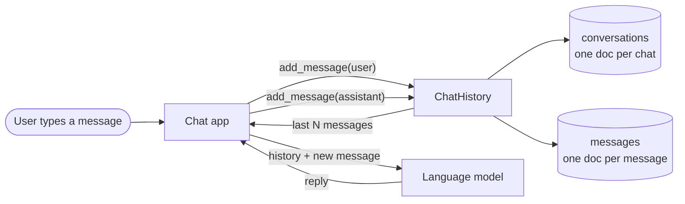

# Lab: Store Chat History in MongoDB

> 📚 **Before you start**
>
> - [What is a Document Database?](what-is-a-document-database.md), for embedding versus referencing and the 16 MB limit
> - [Databases and Collections](databases-and-collections.md), for connecting to Atlas and creating indexes
> - [Insert, Find, Query and Sort](insert-find-query-and-sort.md) and [Update, Delete and Drop](update-delete-and-drop.md), for every operation this lab uses, and the `MiniCollection` stand-in
> - [Functions and Iterators](../../python-fundamentals/course.md#m6) (Python Fundamentals), plus basic classes

## What You'll Build

Every AI chat app, from customer-support bots to coding assistants, has to remember conversations. A language model has no memory of its own: on every turn, the app must send back the earlier messages so the model can see them. Those messages have to live somewhere, survive restarts, and load fast. MongoDB is a natural home for them: messages are JSON-shaped, vary in their fields, and are almost always read by conversation.

You'll build a **`ChatHistory`** class that:

1. Starts conversations for a user and lists a user's conversations, most recent first.
2. Adds messages with a guaranteed, gap-free **sequence number**, updating the conversation's counters atomically.
3. Loads the **last N messages** in order, in the exact format a chat model expects.
4. Deletes a conversation and all its messages.
5. Reports usage per user with an **aggregation pipeline**.
6. Runs offline on the `MiniCollection` stand-in, and on **MongoDB Atlas** with one changed line.



> 💡 **Key Insight**
>
> Store **one document per message** in a `messages` collection, and keep **small, frequently read summaries** (title, counts, last-updated time) in a `conversations` document. Messages grow without limit, so they can't be embedded in one ever-growing document, but the conversation list must load in a single fast query, so its summary fields are kept up to date with atomic `$inc` and `$set` on every new message.

---

## Step 1: Design the Documents

**Should messages be embedded in the conversation?** Look at the rule from the document-database lesson: embed what is bounded and read together; reference what grows without limit. A support chat might have 10 messages, but a long-running assistant thread can have thousands, and the 16 MB document limit is a hard wall. Also, the app usually needs only the **last 20** messages, not all of them. So messages get their own collection.

**conversations**: one document per chat, small and read often (the sidebar of your chat app):

```python
example_conversation = {
    "_id": "conv-0001",
    "user_id": "asha",
    "title": "Trip to Goa",
    "model": "claude-opus-5-5",
    "created_at": "2026-10-11T09:00:00+00:00",
    "updated_at": "2026-10-11T09:04:00+00:00",
    "message_count": 4,      # also the seq of the latest message
    "total_tokens": 61,
}
```

**messages**: one document per message:

```python
example_message = {
    "_id": 7,                       # ObjectId with real MongoDB
    "conversation_id": "conv-0001",
    "user_id": "asha",              # copied on purpose: lets us aggregate per user without a $lookup
    "seq": 3,                       # 1, 2, 3, ... within the conversation
    "role": "user",                 # "user" or "assistant"
    "content": "Which beaches are quiet in December?",
    "tokens": 6,
    "created_at": "2026-10-11T09:03:00+00:00",
}
print(sorted(example_message))
```

Output:

```
['_id', 'content', 'conversation_id', 'created_at', 'role', 'seq', 'tokens', 'user_id']
```

The **indexes** follow from the queries the app will run:

| Query | Index |
|---|---|
| messages of a conversation, in order (and "last N") | `messages`: `(conversation_id, seq)`, **unique**, so two messages can never get the same number |
| a user's conversations, most recent first | `conversations`: `(user_id, updated_at descending)` |
| token usage per user | `messages`: `user_id` (helps the aggregation's `$match`) |

---

## Step 2: The Stand-in Collections and a Test Clock

To run offline we'll use the `MiniCollection` from the last two lessons. Expand the block and run it. Below it, two small additions:

- `create_index` for the stand-in, which only reports the name pymongo would give the index (the stand-in has no real indexes).
- A **fake clock** that returns 09:00, 09:01, 09:02 … so outputs are the same every run. Passing the clock in as a parameter is a standard testing trick; with Atlas you'll pass a function that returns the real time.

<details>
<summary>Show the code of MiniCollection (run it, then carry on)</summary>

```python
import copy
import re
from types import SimpleNamespace

ASCENDING, DESCENDING = 1, -1


class DuplicateKeyError(Exception):
    pass


def _lookup(doc, path):
    """Every value found at a dotted path (arrays of sub-documents are searched)."""
    values = [doc]
    for part in path.split("."):
        found = []
        for v in values:
            if isinstance(v, dict) and part in v:
                found.append(v[part])
            elif isinstance(v, list):
                if part.isdigit() and int(part) < len(v):
                    found.append(v[int(part)])
                else:
                    found += [e[part] for e in v if isinstance(e, dict) and part in e]
        values = found
    return values


def _candidates(values):
    """A field matches if the value itself, or any element of an array value, matches."""
    out = []
    for v in values:
        out.append(v)
        if isinstance(v, list):
            out.extend(v)
    return out


def _comparable(a, b):
    num = (int, float)
    if isinstance(a, bool) or isinstance(b, bool):
        return isinstance(a, bool) and isinstance(b, bool)
    return (isinstance(a, num) and isinstance(b, num)) or type(a) is type(b)


def _check(values, ops):
    cands = _candidates(values)
    for op, arg in ops.items():
        if op == "$eq":
            ok = (not values or None in cands) if arg is None else arg in cands
        elif op == "$ne":
            ok = not _check(values, {"$eq": arg})
        elif op in ("$gt", "$gte", "$lt", "$lte"):
            test = {"$gt": lambda c: c > arg, "$gte": lambda c: c >= arg,
                    "$lt": lambda c: c < arg, "$lte": lambda c: c <= arg}[op]
            ok = any(_comparable(c, arg) and test(c) for c in cands)
        elif op == "$in":
            ok = any(_check(values, {"$eq": a}) for a in arg)
        elif op == "$nin":
            ok = not _check(values, {"$in": arg})
        elif op == "$exists":
            ok = bool(values) == bool(arg)
        elif op == "$regex":
            flags = re.IGNORECASE if "i" in ops.get("$options", "") else 0
            ok = any(isinstance(c, str) and re.search(arg, c, flags) for c in cands)
        elif op == "$options":
            continue
        elif op == "$all":
            ok = any(isinstance(v, list) and all(a in v for a in arg) for v in values)
        elif op == "$size":
            ok = any(isinstance(v, list) and len(v) == arg for v in values)
        elif op == "$elemMatch":
            ok = any(isinstance(v, list) and any(_elem_matches(e, arg) for e in v) for v in values)
        elif op == "$not":
            ok = not _check(values, arg)
        else:
            raise ValueError(f"operator {op} is not supported by this mini version")
        if not ok:
            return False
    return True


def _is_ops(cond):
    return isinstance(cond, dict) and cond and all(k.startswith("$") for k in cond)


def _elem_matches(elem, cond):
    if _is_ops(cond):
        return _check([elem], cond)
    return isinstance(elem, dict) and matches(elem, cond)


def matches(doc, filt):
    """True if the document satisfies the filter (a subset of MongoDB's rules)."""
    for key, cond in (filt or {}).items():
        if key == "$and":
            ok = all(matches(doc, f) for f in cond)
        elif key == "$or":
            ok = any(matches(doc, f) for f in cond)
        elif key == "$nor":
            ok = not any(matches(doc, f) for f in cond)
        else:
            ok = _check(_lookup(doc, key), cond if _is_ops(cond) else {"$eq": cond})
        if not ok:
            return False
    return True


def _pick(value, parts):
    """Keep only the sub-field named by parts (used for projections like "rating.avg")."""
    if not parts:
        return value
    if isinstance(value, dict) and parts[0] in value:
        inner = _pick(value[parts[0]], parts[1:])
        return {} if inner is None else {parts[0]: inner}
    if isinstance(value, list):
        return [x for x in (_pick(e, parts) for e in value if isinstance(e, dict)) if x]
    return None


def _merge(a, b):
    for k, v in b.items():
        a[k] = _merge(a[k], v) if isinstance(a.get(k), dict) and isinstance(v, dict) else v
    return a


def _project(doc, projection):
    if not projection:
        return doc
    include = [k for k, v in projection.items() if v and k != "_id"]
    if include:
        out = {"_id": doc["_id"]} if projection.get("_id", 1) and "_id" in doc else {}
        for path in include:
            picked = _pick(doc, path.split("."))
            if picked:
                _merge(out, picked)
        return {k: out[k] for k in doc if k in out}      # keep the document's field order
    return {k: v for k, v in doc.items() if projection.get(k, 1)}


def _sort_key(value):
    # MongoDB puts missing/null values before numbers, and numbers before strings
    if value is None:
        return (0, 0)
    if isinstance(value, (int, float)) and not isinstance(value, bool):
        return (1, value)
    if isinstance(value, str):
        return (2, value)
    return (3, str(value))


def _sorted(docs, spec):
    for field, direction in reversed(spec):
        docs = sorted(docs, key=lambda d: _sort_key((_lookup(d, field) or [None])[0]),
                      reverse=direction == -1)
    return docs


class MiniCursor:
    def __init__(self, docs, projection):
        self._docs, self._projection = docs, projection
        self._sort, self._skip, self._limit = [], 0, 0

    def sort(self, key, direction=ASCENDING):
        self._sort = key if isinstance(key, list) else [(key, direction)]
        return self

    def skip(self, n):
        self._skip = n
        return self

    def limit(self, n):
        self._limit = n
        return self

    def __iter__(self):
        docs = _sorted(self._docs, self._sort)[self._skip:]
        if self._limit:
            docs = docs[:self._limit]
        return iter([_project(copy.deepcopy(d), self._projection) for d in docs])


def _value(doc, expr):
    """Evaluate an aggregation expression: '$field', a constant, or $multiply/$add/$round."""
    if isinstance(expr, str) and expr.startswith("$"):
        found = _lookup(doc, expr[1:])
        return found[0] if found else None
    if isinstance(expr, dict) and len(expr) == 1:
        (op, args), = expr.items()
        vals = [_value(doc, a) for a in args]
        if op == "$multiply":
            result = 1
            for v in vals:
                result *= v
            return result
        if op == "$add":
            return sum(vals)
        if op == "$round":
            return round(vals[0], vals[1] if len(vals) > 1 else 0)
        raise ValueError(f"expression {op} is not supported by this mini version")
    if isinstance(expr, dict):
        return {k: _value(doc, v) for k, v in expr.items()}
    return expr


def _group(docs, spec):
    groups = {}
    for d in docs:
        key = _value(d, spec["_id"])
        groups.setdefault(repr(key), (key, []))[1].append(d)
    out = []
    for key, members in groups.values():
        row = {"_id": key}
        for field, acc in spec.items():
            if field == "_id":
                continue
            (op, expr), = acc.items()
            vals = [_value(m, expr) for m in members]
            nums = [v for v in vals if isinstance(v, (int, float))]
            if op == "$sum":
                row[field] = sum(nums)
            elif op == "$avg":
                row[field] = sum(nums) / len(nums) if nums else None
            elif op == "$min":
                row[field] = min(nums) if nums else None
            elif op == "$max":
                row[field] = max(nums) if nums else None
            elif op == "$push":
                row[field] = vals
            elif op == "$addToSet":
                row[field] = list(dict.fromkeys(vals))
            else:
                raise ValueError(f"accumulator {op} is not supported by this mini version")
        out.append(row)
    return out


def _reshape(doc, spec):
    """$project: keep fields marked 1, compute fields given an expression."""
    out = {"_id": doc["_id"]} if spec.get("_id", 1) and "_id" in doc else {}
    for field, how in spec.items():
        if field == "_id" or how in (0, False):
            continue
        if how in (1, True):
            if field in doc:
                out[field] = doc[field]
        else:
            out[field] = _value(doc, how)
    return out


class MiniCollection:
    """A tiny in-memory stand-in for a pymongo Collection (a subset, for learning only)."""

    def __init__(self, name):
        self.name = name
        self._docs = []
        self._next_id = 1

    def insert_one(self, doc):
        if "_id" not in doc:
            doc["_id"] = self._next_id          # pymongo would add an ObjectId here
            self._next_id += 1
        if any(d["_id"] == doc["_id"] for d in self._docs):
            raise DuplicateKeyError(f"E11000 duplicate key error: _id {doc['_id']!r}")
        self._docs.append(copy.deepcopy({"_id": doc["_id"], **doc}))   # _id is stored first
        return SimpleNamespace(inserted_id=doc["_id"], acknowledged=True)

    def insert_many(self, docs):
        return SimpleNamespace(inserted_ids=[self.insert_one(d).inserted_id for d in docs],
                               acknowledged=True)

    def find(self, filter=None, projection=None):
        return MiniCursor([d for d in self._docs if matches(d, filter)], projection)

    def find_one(self, filter=None, projection=None):
        return next(iter(self.find(filter, projection)), None)

    def count_documents(self, filter):
        return sum(1 for d in self._docs if matches(d, filter))

    def distinct(self, key, filter=None):
        values = []
        for d in self._docs:
            if matches(d, filter):
                for v in _candidates(_lookup(d, key)):
                    if not isinstance(v, list) and v not in values:
                        values.append(v)
        return sorted(values, key=_sort_key)

    def aggregate(self, pipeline):
        docs = [copy.deepcopy(d) for d in self._docs]
        for stage in pipeline:
            (name, spec), = stage.items()
            if name == "$match":
                docs = [d for d in docs if matches(d, spec)]
            elif name == "$group":
                docs = _group(docs, spec)
            elif name == "$sort":
                docs = _sorted(docs, list(spec.items()))
            elif name == "$limit":
                docs = docs[:spec]
            elif name == "$skip":
                docs = docs[spec:]
            elif name == "$unwind":
                field = spec[1:]
                docs = [{**d, field: v} for d in docs for v in (d.get(field) or [])]
            elif name == "$project":
                docs = [_reshape(d, spec) for d in docs]
            elif name == "$count":
                docs = [{spec: len(docs)}]
            else:
                raise ValueError(f"stage {name} is not supported by this mini version")
        return iter(docs)


# ---------- updates, deletes and drop ----------

class ReturnDocument:
    BEFORE, AFTER = False, True


def _parent(doc, path, create):
    """Return (container, last_key) for a dotted path, creating sub-documents if asked."""
    parts = path.split(".")
    for part in parts[:-1]:
        if part not in doc:
            if not create:
                return None, parts[-1]
            doc[part] = {}
        doc = doc[part]
    return doc, parts[-1]


def _apply_update(doc, update, inserting=False):
    if not update or not all(k.startswith("$") for k in update):
        raise ValueError("update only works with $ operators")
    for op, fields in update.items():
        if op == "$setOnInsert" and not inserting:
            continue
        for path, arg in fields.items():
            parent, key = _parent(doc, path, create=op != "$unset")
            if parent is None:
                continue
            if op in ("$set", "$setOnInsert"):
                parent[key] = copy.deepcopy(arg)
            elif op == "$unset":
                parent.pop(key, None)
            elif op == "$inc":
                parent[key] = parent.get(key, 0) + arg
            elif op == "$mul":
                parent[key] = parent.get(key, 0) * arg
            elif op == "$min":
                parent[key] = arg if key not in parent else min(parent[key], arg)
            elif op == "$max":
                parent[key] = arg if key not in parent else max(parent[key], arg)
            elif op == "$rename":
                if key in parent:
                    doc[arg] = parent.pop(key)
            elif op in ("$push", "$addToSet"):
                items = arg["$each"] if isinstance(arg, dict) and "$each" in arg else [arg]
                target = parent.setdefault(key, [])
                for item in items:
                    if op == "$push" or item not in target:
                        target.append(copy.deepcopy(item))
            elif op == "$pull":
                if isinstance(parent.get(key), list):
                    def pulled(e):
                        return _elem_matches(e, arg) if isinstance(arg, dict) else e == arg
                    parent[key] = [e for e in parent[key] if not pulled(e)]
            elif op == "$pop":
                if parent.get(key):
                    parent[key].pop(0 if arg == -1 else -1)
            else:
                raise ValueError(f"operator {op} is not supported by this mini version")


def _seed_from_filter(filt):
    """An upsert starts from the filter's plain equality fields."""
    return {k: copy.deepcopy(v) for k, v in (filt or {}).items()
            if not k.startswith("$") and not _is_ops(v) and "." not in k}


def _update(self, filt, update, upsert, many):
    matched = modified = 0
    for d in self._docs:
        if matches(d, filt):
            before = copy.deepcopy(d)
            _apply_update(d, update)
            matched += 1
            modified += d != before
            if not many:
                break
    upserted_id = None
    if matched == 0 and upsert:
        new = _seed_from_filter(filt)
        _apply_update(new, update, inserting=True)
        upserted_id = self.insert_one(new).inserted_id
    return SimpleNamespace(matched_count=matched, modified_count=modified, upserted_id=upserted_id)


def update_one(self, filter, update, upsert=False):
    return _update(self, filter, update, upsert, many=False)


def update_many(self, filter, update, upsert=False):
    return _update(self, filter, update, upsert, many=True)


def replace_one(self, filter, replacement, upsert=False):
    if any(k.startswith("$") for k in replacement):
        raise ValueError("replacement can not include $ operators")
    for i, d in enumerate(self._docs):
        if matches(d, filter):
            new = {"_id": d["_id"], **copy.deepcopy(replacement)}
            changed = new != d
            self._docs[i] = new
            return SimpleNamespace(matched_count=1, modified_count=int(changed), upserted_id=None)
    upserted_id = self.insert_one(dict(replacement)).inserted_id if upsert else None
    return SimpleNamespace(matched_count=0, modified_count=0, upserted_id=upserted_id)


def find_one_and_update(self, filter, update, projection=None, sort=None, upsert=False,
                        return_document=ReturnDocument.BEFORE):
    candidates = _sorted([d for d in self._docs if matches(d, filter)], sort or [])
    if not candidates:
        if upsert:
            result = update_one(self, filter, update, upsert=True)
            return self.find_one({"_id": result.upserted_id}, projection) if return_document else None
        return None
    target = candidates[0]
    before = copy.deepcopy(target)
    _apply_update(target, update)
    return _project(copy.deepcopy(target if return_document else before), projection)


def delete_one(self, filter):
    for i, d in enumerate(self._docs):
        if matches(d, filter):
            del self._docs[i]
            return SimpleNamespace(deleted_count=1)
    return SimpleNamespace(deleted_count=0)


def delete_many(self, filter):
    keep = [d for d in self._docs if not matches(d, filter)]
    deleted = len(self._docs) - len(keep)
    self._docs = keep
    return SimpleNamespace(deleted_count=deleted)


def find_one_and_delete(self, filter, sort=None):
    candidates = _sorted([d for d in self._docs if matches(d, filter)], sort or [])
    if not candidates:
        return None
    self._docs.remove(candidates[0])
    return candidates[0]


def drop(self):
    self._docs = []


for _f in (update_one, update_many, replace_one, find_one_and_update,
           delete_one, delete_many, find_one_and_delete, drop):
    setattr(MiniCollection, _f.__name__, _f)
```

</details>

```python
from datetime import datetime, timedelta, timezone

def _create_index(self, keys, **options):
    """Stand-in only: return the name pymongo would give this index."""
    keys = [(keys, ASCENDING)] if isinstance(keys, str) else keys
    return "_".join(f"{field}_{direction}" for field, direction in keys)

MiniCollection.create_index = _create_index

def make_test_clock(start=datetime(2026, 10, 11, 9, 0, tzinfo=timezone.utc)):
    ticks = {"n": 0}
    def now():
        moment = start + timedelta(minutes=ticks["n"])
        ticks["n"] += 1
        return moment
    return now

clock = make_test_clock()
print(clock().isoformat(), clock().isoformat())

test_db = {"conversations": MiniCollection("conversations"), "messages": MiniCollection("messages")}
```

Output:

```
2026-10-11T09:00:00+00:00 2026-10-11T09:01:00+00:00
```

`test_db` is a plain dictionary, and `test_db["messages"]` gives a collection, exactly like `client["chatbot"]["messages"]` does with pymongo. That's all `ChatHistory` will rely on.

---

## Step 3: Start Conversations and Add Messages

The interesting method is `add_message`. Two things must happen for every message: the conversation's counters change, and the message is stored with the next sequence number. We get the number **atomically** from the conversation with `find_one_and_update` and `$inc`, the counter pattern from the last lesson. Even if two messages arrive at the same instant (say, from two browser tabs), they get different numbers, and the unique index on `(conversation_id, seq)` would reject a duplicate anyway.

```python
class ConversationNotFound(Exception):
    pass


class ChatHistory:
    def __init__(self, db, clock, model="claude-opus-5-5", id_prefix="conv"):
        self.conversations = db["conversations"]
        self.messages = db["messages"]
        self.clock = clock
        self.model = model
        self.id_prefix = id_prefix
        self._made = 0

    def setup_indexes(self):
        return [
            self.messages.create_index([("conversation_id", ASCENDING), ("seq", ASCENDING)], unique=True),
            self.messages.create_index("user_id"),
            self.conversations.create_index([("user_id", ASCENDING), ("updated_at", DESCENDING)]),
        ]

    def _new_id(self):
        # Readable ids for the lab. With MongoDB you could leave _id out and get an ObjectId.
        self._made += 1
        return f"{self.id_prefix}-{self._made:04d}"

    def start_conversation(self, user_id, title="New chat"):
        now = self.clock()
        result = self.conversations.insert_one({
            "_id": self._new_id(), "user_id": user_id, "title": title, "model": self.model,
            "created_at": now, "updated_at": now, "message_count": 0, "total_tokens": 0,
        })
        return result.inserted_id

    def add_message(self, conversation_id, role, content):
        if role not in ("user", "assistant"):
            raise ValueError(f"unknown role {role!r}")
        now = self.clock()
        tokens = len(content.split())          # a rough stand-in for a real token count
        conv = self.conversations.find_one_and_update(
            {"_id": conversation_id},
            {"$inc": {"message_count": 1, "total_tokens": tokens}, "$set": {"updated_at": now}},
            return_document=ReturnDocument.AFTER,
        )
        if conv is None:
            raise ConversationNotFound(conversation_id)
        self.messages.insert_one({
            "conversation_id": conversation_id, "user_id": conv["user_id"], "seq": conv["message_count"],
            "role": role, "content": content, "tokens": tokens, "created_at": now,
        })
        return conv["message_count"]


chats = ChatHistory(test_db, clock=make_test_clock())
print(chats.setup_indexes())

goa = chats.start_conversation("asha", "Trip to Goa")
print(goa, chats.add_message(goa, "user", "Plan a 3 day trip to Goa in December"))
print(goa, chats.add_message(goa, "assistant", "Day 1: North Goa beaches. Day 2: Old Goa churches. Day 3: South Goa."))
print(test_db["conversations"].find_one({"_id": goa}))
```

Output:

```
['conversation_id_1_seq_1', 'user_id_1', 'user_id_1_updated_at_-1']
conv-0001 1
conv-0001 2
{'_id': 'conv-0001', 'user_id': 'asha', 'title': 'Trip to Goa', 'model': 'claude-opus-5-5', 'created_at': datetime.datetime(2026, 10, 11, 9, 0, tzinfo=datetime.timezone.utc), 'updated_at': datetime.datetime(2026, 10, 11, 9, 2, tzinfo=datetime.timezone.utc), 'message_count': 2, 'total_tokens': 23}
```

The index names are what pymongo would print. `message_count` is now 2, `total_tokens` is the sum of both messages' tokens, and `updated_at` moved to the time of the last message, all from one atomic update per message.

What if the conversation doesn't exist? `find_one_and_update` returns `None`, and we refuse to store an orphan message:

```python
try:
    chats.add_message("conv-9999", "user", "hello?")
except ConversationNotFound as e:
    print("ConversationNotFound:", e)
print("messages stored:", test_db["messages"].count_documents({}))
```

Output:

```
ConversationNotFound: conv-9999
messages stored: 2
```

MongoDB has no foreign keys, so checks like this live in your code. Doing the counter update first and the insert second means a missing conversation is detected before anything is written.

---

## Step 4: Load History for the Model

Chat models take a list of `{"role": ..., "content": ...}` messages, oldest first. Long conversations don't fit in a model's context window, so apps send only the **last N** messages. Getting the last N in order is a classic query: sort by `seq` **descending**, take N, then reverse in Python. With the `(conversation_id, seq)` index, MongoDB reads exactly N index entries no matter how long the conversation is.

```python
def get_messages(self, conversation_id, last_n=None):
    cursor = self.messages.find(
        {"conversation_id": conversation_id},
        {"_id": 0, "seq": 1, "role": 1, "content": 1},
    )
    if last_n is None:
        return list(cursor.sort("seq", ASCENDING))
    newest_first = list(cursor.sort("seq", DESCENDING).limit(last_n))
    return newest_first[::-1]

def for_model(self, conversation_id, last_n=20):
    return [{"role": m["role"], "content": m["content"]} for m in self.get_messages(conversation_id, last_n)]

ChatHistory.get_messages = get_messages
ChatHistory.for_model = for_model

chats.add_message(goa, "user", "Which beaches are quiet in December?")
chats.add_message(goa, "assistant", "Try Agonda, Cola and Butterfly beach in South Goa.")
chats.add_message(goa, "user", "Is Agonda good for families?")

for m in chats.get_messages(goa):
    print(m)
print("last 3 for the model:")
for m in chats.for_model(goa, last_n=3):
    print("  ", m)
```

Output:

```
{'seq': 1, 'role': 'user', 'content': 'Plan a 3 day trip to Goa in December'}
{'seq': 2, 'role': 'assistant', 'content': 'Day 1: North Goa beaches. Day 2: Old Goa churches. Day 3: South Goa.'}
{'seq': 3, 'role': 'user', 'content': 'Which beaches are quiet in December?'}
{'seq': 4, 'role': 'assistant', 'content': 'Try Agonda, Cola and Butterfly beach in South Goa.'}
{'seq': 5, 'role': 'user', 'content': 'Is Agonda good for families?'}
last 3 for the model:
   {'role': 'user', 'content': 'Which beaches are quiet in December?'}
   {'role': 'assistant', 'content': 'Try Agonda, Cola and Butterfly beach in South Goa.'}
   {'role': 'user', 'content': 'Is Agonda good for families?'}
```

Now plug it into a chat loop. Here a **pretend model** (a plain function) stands in for the LLM so the lab runs offline. It "remembers" only because we send it the history:

```python
def pretend_model(history):
    last = history[-1]["content"].lower()
    mentions_goa = any("goa" in m["content"].lower() for m in history)
    if "families" in last and mentions_goa:
        return "Yes, Agonda is calm and clean, good for families with kids."
    if "budget" in last and mentions_goa:
        return "For 3 days in Goa, plan about Rs 15,000 per person including stay."
    return "Could you tell me a bit more?"

def chat_turn(store, conversation_id, user_text, last_n=6):
    store.add_message(conversation_id, "user", user_text)
    reply = pretend_model(store.for_model(conversation_id, last_n))
    store.add_message(conversation_id, "assistant", reply)
    return reply

# The previous user message has no reply yet; answer it, then continue the chat
reply = pretend_model(chats.for_model(goa, last_n=6))
chats.add_message(goa, "assistant", reply)
print("bot:", reply)
print("bot:", chat_turn(chats, goa, "What budget should I keep?"))

other = chats.start_conversation("asha", "Python help")
print("bot:", chat_turn(chats, other, "What budget should I keep?"))
```

Output:

```
bot: Yes, Agonda is calm and clean, good for families with kids.
bot: For 3 days in Goa, plan about Rs 15,000 per person including stay.
bot: Could you tell me a bit more?
```

The same question gets a Goa-specific answer in the Goa conversation and a "tell me more" in a fresh one, because each conversation's history is loaded separately. With a real model, `pretend_model` becomes an API call that receives the same list:

```python
# not-run: needs the anthropic package and an API key
import anthropic

llm = anthropic.Anthropic()

def real_model(history):
    response = llm.messages.create(model="claude-opus-5-5", max_tokens=500, messages=history)
    return response.content[0].text
```

---

## Step 5: List, Rename and Delete Conversations

The sidebar of a chat app lists a user's conversations, newest activity first, with just the fields it shows. Deleting a conversation must also delete its messages; with no cascading foreign keys, that's two calls, **messages first**, so a crash in between leaves the conversation still visible rather than leaving invisible orphan messages:

```python
def list_conversations(self, user_id, limit=20):
    return list(
        self.conversations.find(
            {"user_id": user_id},
            {"_id": 1, "title": 1, "message_count": 1, "updated_at": 1},
        ).sort("updated_at", DESCENDING).limit(limit)
    )

def rename(self, conversation_id, title):
    return self.conversations.update_one({"_id": conversation_id}, {"$set": {"title": title}}).matched_count == 1

def delete_conversation(self, conversation_id):
    removed = self.messages.delete_many({"conversation_id": conversation_id}).deleted_count
    self.conversations.delete_one({"_id": conversation_id})
    return removed

ChatHistory.list_conversations = list_conversations
ChatHistory.rename = rename
ChatHistory.delete_conversation = delete_conversation

ravi_chat = chats.start_conversation("ravi", "Cricket stats")
chats.add_message(ravi_chat, "user", "Who scored the most runs in the 2011 World Cup final?")

chats.rename(other, "Budget question")
for c in chats.list_conversations("asha"):
    print(c["_id"], "|", c["title"], "|", c["message_count"], "msgs |", c["updated_at"].strftime("%H:%M"))

print("deleted messages:", chats.delete_conversation(other))
print("asha now has:", [c["title"] for c in chats.list_conversations("asha")])
```

Output:

```
conv-0002 | Budget question | 2 msgs | 09:12
conv-0001 | Trip to Goa | 8 msgs | 09:09
deleted messages: 2
asha now has: ['Trip to Goa']
```

"Budget question" was updated most recently, so it's listed first, even though "Trip to Goa" is older and longer.

---

## Step 6: Usage Report with Aggregation

Which users use the bot most? Because every message carries a copy of `user_id`, this is one pipeline on `messages`, with no `$lookup`:

```python
def usage_by_user(self):
    return list(self.messages.aggregate([
        {"$group": {
            "_id": "$user_id",
            "messages": {"$sum": 1},
            "tokens": {"$sum": "$tokens"},
            "conversations": {"$addToSet": "$conversation_id"},
        }},
        {"$project": {"_id": 0, "user_id": "$_id", "messages": 1, "tokens": 1, "conversations": 1}},
        {"$sort": {"tokens": -1}},
    ]))

ChatHistory.usage_by_user = usage_by_user
for row in chats.usage_by_user():
    print(row)
```

Output:

```
{'user_id': 'asha', 'messages': 8, 'tokens': 72, 'conversations': ['conv-0001']}
{'user_id': 'ravi', 'messages': 1, 'tokens': 11, 'conversations': ['conv-0003']}
```

Asha's count doesn't include the deleted "Budget question" messages, because they're gone from `messages`. If you need billing that survives deletes, keep a separate, never-deleted usage collection, or soft-delete conversations instead.

Copying `user_id` into each message is **deliberate denormalisation**: it costs a few bytes per message and saves a join on every report. A user's id never changes, so the copy can't go stale. That's exactly the kind of duplication document databases are designed for.

---

## Step 7: Run It on MongoDB Atlas

Swap the stand-in for real collections. Nothing in `ChatHistory` changes: the clock becomes the real time, the `db` becomes a pymongo database, and `ReturnDocument`, `ASCENDING` and `DESCENDING` come from pymongo.

```python
# not-run: needs a MongoDB Atlas cluster and MONGODB_URI in .env
import os
from datetime import datetime, timezone
from dotenv import load_dotenv
from pymongo import MongoClient, ASCENDING, DESCENDING, ReturnDocument
from pymongo.server_api import ServerApi

load_dotenv()
client = MongoClient(os.environ["MONGODB_URI"], server_api=ServerApi("1"))
store = ChatHistory(client["chatbot"], clock=lambda: datetime.now(timezone.utc))
print(store.setup_indexes())

conv = store.start_conversation("asha", "Trip to Goa")
store.add_message(conv, "user", "Plan a 3 day trip to Goa in December")
store.add_message(conv, "assistant", "Day 1: North Goa beaches. Day 2: Old Goa churches. Day 3: South Goa.")
print(store.for_model(conv, last_n=10))
print(store.usage_by_user())
client.close()
```

Example output:

```
['conversation_id_1_seq_1', 'user_id_1', 'user_id_1_updated_at_-1']
[{'role': 'user', 'content': 'Plan a 3 day trip to Goa in December'}, {'role': 'assistant', 'content': 'Day 1: North Goa beaches. Day 2: Old Goa churches. Day 3: South Goa.'}]
[{'messages': 2, 'tokens': 23, 'conversations': ['conv-0001'], 'user_id': 'asha'}]
```

Open the **Data Explorer** for your cluster in Atlas and browse `chatbot.conversations` and `chatbot.messages` to see the documents. Datetimes are stored as BSON dates, so pymongo hands them back as `datetime` objects (in UTC, and without `tzinfo` unless you create the client with `tz_aware=True`).

In a real app, use MongoDB's default ObjectIds instead of the `conv-0001` counter: the counter restarts each time the program starts, so two runs would try to create `conv-0001` again and hit a `DuplicateKeyError`. Remove the `"_id"` line in `start_conversation` and `insert_one` will generate one.

---

## Try It Yourself

1. **Search a user's messages.** Add `search(user_id, text)` that returns `(conversation_id, seq, content)` for that user's messages containing `text`, case-insensitively, using `$regex`.
2. **Auto-title.** When a conversation's first user message arrives and the title is still `"New chat"`, set the title to the first five words of that message. Where in `add_message` does it go, and which filter makes it safe to run on every message?
3. **Expire old chats.** Which single index would make MongoDB delete messages automatically 90 days after `created_at`? What else would you need so conversations don't keep pointing at deleted messages?
4. **Context budget.** Write `for_model_within(conversation_id, max_tokens)` that returns the most recent messages whose `tokens` add up to at most `max_tokens`, oldest first.

<details>
<summary>Show answers</summary>

**1.**

```python
import re

def search(self, user_id, text):
    cursor = self.messages.find(
        {"user_id": user_id, "content": {"$regex": re.escape(text), "$options": "i"}},
        {"_id": 0, "conversation_id": 1, "seq": 1, "content": 1},
    ).sort([("conversation_id", ASCENDING), ("seq", ASCENDING)])
    return [(m["conversation_id"], m["seq"], m["content"]) for m in cursor]

ChatHistory.search = search
for hit in chats.search("asha", "AGONDA"):
    print(hit)
```

Output:

```
('conv-0001', 4, 'Try Agonda, Cola and Butterfly beach in South Goa.')
('conv-0001', 5, 'Is Agonda good for families?')
('conv-0001', 6, 'Yes, Agonda is calm and clean, good for families with kids.')
```

`re.escape` stops characters like `.` or `(` in the user's search text from being treated as regex syntax.

**2.** Right after the message is inserted, run an update whose filter includes the condition, so it only matches when the title is still the default:

```python
def maybe_auto_title(self, conversation_id, first_text):
    title = " ".join(first_text.split()[:5])
    return self.conversations.update_one(
        {"_id": conversation_id, "title": "New chat"},
        {"$set": {"title": title}},
    ).modified_count

ChatHistory.maybe_auto_title = maybe_auto_title
new_chat = chats.start_conversation("ravi")
chats.add_message(new_chat, "user", "Explain the LBW rule in cricket simply please")
print(chats.maybe_auto_title(new_chat, "Explain the LBW rule in cricket simply please"))
print(chats.maybe_auto_title(new_chat, "something else entirely"))
print(test_db["conversations"].find_one({"_id": new_chat})["title"])
```

Output:

```
1
0
Explain the LBW rule in
```

The second call matched nothing, because the title is no longer "New chat". The check and the change happen in one atomic update.

**3.** A TTL index: `messages.create_index("created_at", expireAfterSeconds=90 * 24 * 3600)`. Conversations would need either their own TTL index on `updated_at` (so a chat disappears 90 days after its last activity), or a scheduled job that deletes conversations whose messages are all gone. Note that `message_count` would then overstate the stored messages, so the UI should rely on the actual messages found.

**4.**

```python
def for_model_within(self, conversation_id, max_tokens):
    picked, used = [], 0
    for m in self.messages.find({"conversation_id": conversation_id}).sort("seq", DESCENDING):
        if used + m["tokens"] > max_tokens:
            break
        picked.append({"role": m["role"], "content": m["content"]})
        used += m["tokens"]
    return picked[::-1]

ChatHistory.for_model_within = for_model_within
for m in chats.for_model_within(goa, max_tokens=30):
    print(m)
```

Output:

```
{'role': 'assistant', 'content': 'Yes, Agonda is calm and clean, good for families with kids.'}
{'role': 'user', 'content': 'What budget should I keep?'}
{'role': 'assistant', 'content': 'For 3 days in Goa, plan about Rs 15,000 per person including stay.'}
```

</details>

---

## What You've Learned

- **Modelling chat data**: a `conversations` collection for small summaries and a `messages` collection for unbounded content, with `user_id` copied into messages on purpose.
- **Indexes from queries**: a unique `(conversation_id, seq)` index for ordered history, and `(user_id, updated_at)` for the conversation list.
- **Atomic counters** with `find_one_and_update` and `$inc` to number messages and keep summaries in sync.
- **"Last N in order"** with sort descending, limit, reverse: the core of feeding history to an LLM.
- **Deleting related documents** without foreign keys, and **reporting** with an aggregation pipeline.
- **Testable data code**: an injected clock and a stand-in collection, swapped for pymongo and the real time in one place.

**Where next?** You now have SQL, PostgreSQL and MongoDB foundations. Continue with [Advanced SQL](../../data-engineering-foundations/course.md#m4) in Data Engineering Foundations (window functions, CTEs, query plans and isolation levels), or take documents further for AI apps in [Vector Databases for AI](../../vector-databases-for-ai/course.md).

---

**Up next:** [Data Engineering Foundations › Advanced SQL](../../data-engineering-foundations/course.md#m4)
