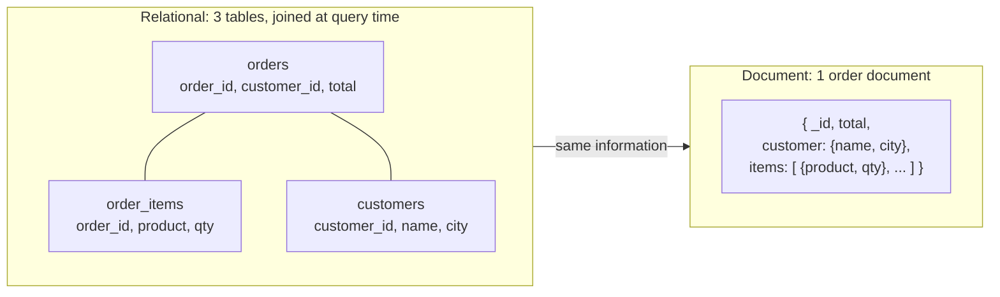

# What is a Document Database? The Complete Guide

> 📚 **Before you start**
>
> - [What is a Relational Database?](../02-relational-databases-and-sql/what-is-a-relational-database.md) and [Primary and Foreign Keys](../02-relational-databases-and-sql/primary-and-foreign-keys.md), because this lesson compares documents with tables, keys and normalisation
> - [Joins and Unions](../02-relational-databases-and-sql/joins-and-unions.md), for what "avoiding a join" means
> - [Dictionaries and Dictionary Views](../../python-fundamentals/course.md#m5) (Python Fundamentals), because a document is basically a Python dictionary

## Introduction

Picture the product catalogue of an Indian e-commerce site. A phone has RAM, storage, screen size and a camera list. A saree has fabric, length, blouse-piece included or not, and a wash-care note. A book has an author, a publisher, an ISBN and a page count. A bag of rice has a weight and a variety.

In a relational database you'd have to choose between a `products` table with hundreds of mostly-empty columns, a separate table per product type, or a generic "attribute name / attribute value" table that makes every query painful. None of them feels natural, because the data isn't naturally a grid.

Now picture each product as a **JSON object**: the phone has the fields a phone needs, the saree has the fields a saree needs, and the list of camera specs is just a list inside the phone. That's a **document**, and a database built to store, index and query documents is a **document database**. MongoDB is the most widely used one.

By the end of this article you'll know what NoSQL means and its four main families, what documents and BSON are, how collections relate to tables, how to decide between **embedding** and **referencing** related data, and when a document database is the better choice and when PostgreSQL still wins. All the examples use plain Python dictionaries, so they run on your machine with no account.

> 💡 **Key Insight**
>
> In a relational database you design tables around **the data**, normalise it, and join it back together at query time. In a document database you design documents around **how the application reads the data**: what is read together is stored together, in one document, so most reads need no join at all.

---

## Core Explanation

### 1. What "NoSQL" means

**NoSQL** is an umbrella name for databases that don't use the relational table model as their main way of storing data. It's usually read as "**not only SQL**", since several of them now support SQL-like queries too. They became popular in the late 2000s when web companies needed to store huge, fast-changing, loosely structured data across many cheap servers.

There are four main families, plus vector databases for AI:

| Family | Data looks like | Good at | Examples |
|---|---|---|---|
| **Document** | JSON-like documents with nested fields and lists | varied, nested records read as a whole: catalogues, profiles, content, chat history | MongoDB, Firestore, Couchbase |
| **Key-value** | a giant dictionary: key → value | very fast lookups by key: caches, sessions, rate limits | Redis, Amazon DynamoDB, Memcached |
| **Wide-column** | rows with flexible, very many columns, grouped in families | huge write volumes spread across many machines: logs, time series, IoT | Apache Cassandra, HBase, Google Bigtable |
| **Graph** | nodes and the relationships between them | following connections: social networks, fraud rings, recommendations | Neo4j, Amazon Neptune |
| **Vector** | lists of numbers (embeddings) | similarity search for AI | Pinecone, Qdrant, pgvector |

This module is about the **document** family, using MongoDB. The [Vector Databases for AI](../../vector-databases-for-ai/course.md) course covers the last row.

### 2. What a document is

A **document** is a set of **field: value** pairs, like a JSON object or a Python `dict`. Values can be strings, numbers, booleans, dates, `null`, **nested documents** (a dict inside a dict) or **arrays** (lists), and those can nest as deeply as you need.

```python
phone = {
    "_id": "P1001",
    "name": "Nova 5G",
    "category": "phone",
    "price": 17999,
    "specs": {"ram_gb": 8, "storage_gb": 256, "screen_in": 6.67},
    "cameras": ["108MP main", "8MP ultra-wide", "2MP macro"],
    "in_stock": True,
}
saree = {
    "_id": "S2001",
    "name": "Kanjeevaram silk saree",
    "category": "saree",
    "price": 12500,
    "fabric": "silk",
    "length_m": 6.3,
    "blouse_piece": True,
    "care": "dry clean only",
}

for product in (phone, saree):
    print(product["name"], "| fields:", sorted(product))
print("RAM:", phone["specs"]["ram_gb"], "GB | first camera:", phone["cameras"][0])
```

Output:

```
Nova 5G | fields: ['_id', 'cameras', 'category', 'in_stock', 'name', 'price', 'specs']
Kanjeevaram silk saree | fields: ['_id', 'blouse_piece', 'care', 'category', 'fabric', 'length_m', 'name', 'price']
RAM: 8 GB | first camera: 108MP main
```

Two products, two different shapes, and both are perfectly valid in the same **collection**. There's no `ALTER TABLE` and no empty columns.

Every MongoDB document has an **`_id`** field, which is its primary key: unique within the collection and unchangeable. If you don't provide one, MongoDB generates an **ObjectId**, a 12-byte id that encodes the time it was created. You'll take one apart in [Databases and Collections](databases-and-collections.md).

### 3. JSON and BSON

You'll see documents written as JSON, but MongoDB actually stores **BSON** ("binary JSON"). BSON is a compact binary encoding of the same structure, with more types than JSON:

| Need | JSON | BSON (MongoDB) | Python type with pymongo |
|---|---|---|---|
| Whole numbers | one "number" type | `int32`, `int64` | `int` |
| Decimals | number | `double`, `decimal128` (exact, for money) | `float`, `bson.Decimal128` |
| Dates | no date type (strings) | `date` | `datetime.datetime` |
| Ids | none | `ObjectId` | `bson.ObjectId` |
| Binary data | none | `binData` | `bytes` |

So with MongoDB you can store a real date and compare dates properly, which plain JSON can't do. The `pymongo` driver converts between BSON and ordinary Python types automatically. One limit to remember: **a single document can be at most 16 MB.**

Python's built-in `json` module shows the JSON side:

```python
import json

text = json.dumps(phone, indent=2)
print(text[:120] + " ...")
print("round trip equal:", json.loads(text) == phone)
```

Output:

```
{
  "_id": "P1001",
  "name": "Nova 5G",
  "category": "phone",
  "price": 17999,
  "specs": {
    "ram_gb": 8,
    "sto ...
round trip equal: True
```

### 4. Tables and documents side by side

Here's the vocabulary mapping. You'll use these words for the rest of the module:

| Relational (PostgreSQL) | Document (MongoDB) |
|---|---|
| database | database |
| table | **collection** |
| row | **document** |
| column | **field** |
| primary key | `_id` field |
| foreign key | a reference field (no automatic enforcement) |
| join | **embedding**, or the `$lookup` aggregation stage |
| `CREATE TABLE` with a schema | collection created on first insert; schema optional |
| SQL | MongoDB Query API (filters written as documents) |
| index | index |



### 5. Same data, two shapes

Let's take order data stored the relational way, as three lists of rows, and build the document version. This is what "store together what is read together" looks like in practice:

```python
customers = [{"customer_id": 1, "name": "Asha", "city": "Mumbai"},
             {"customer_id": 2, "name": "Ravi", "city": "Delhi"}]
orders = [{"order_id": 101, "customer_id": 1, "status": "delivered"},
          {"order_id": 102, "customer_id": 2, "status": "on the way"}]
order_items = [{"order_id": 101, "product": "Masala Chai", "qty": 2, "price": 15},
               {"order_id": 101, "product": "Samosa", "qty": 3, "price": 12},
               {"order_id": 102, "product": "Lassi", "qty": 1, "price": 40}]

def to_document(order):
    """The 'join' happens once, when the document is written."""
    customer = next(c for c in customers if c["customer_id"] == order["customer_id"])
    items = [{k: v for k, v in it.items() if k != "order_id"}
             for it in order_items if it["order_id"] == order["order_id"]]
    return {
        "_id": order["order_id"],
        "status": order["status"],
        "customer": {"name": customer["name"], "city": customer["city"]},
        "items": items,
        "total": sum(it["qty"] * it["price"] for it in items),
    }

order_docs = [to_document(o) for o in orders]
print(json.dumps(order_docs[0], indent=2))
```

Output:

```
{
  "_id": 101,
  "status": "delivered",
  "customer": {
    "name": "Asha",
    "city": "Mumbai"
  },
  "items": [
    {
      "product": "Masala Chai",
      "qty": 2,
      "price": 15
    },
    {
      "product": "Samosa",
      "qty": 3,
      "price": 12
    }
  ],
  "total": 66
}
```

To show order 101 on screen, the relational version needs a three-table join; the document version is **one lookup by `_id`** that returns everything. That's the main performance idea behind document databases.

The cost is **duplication**: Asha's name and city are now copied into every one of her orders. If she moves to Pune, her old orders still say Mumbai. For orders that's actually correct (it's where *that* order was delivered), but for data that must always be current, copying is a problem. That trade-off is the heart of document modelling.

### 6. Embedding vs referencing

When two things are related, you have two choices in a document database:

- **Embed**: put the related data *inside* the document (the order's `items` list).
- **Reference**: store the other document's `_id` and look it up separately (like a foreign key, but the database won't check it).

```python
# Referencing: the review stores the product's id, not a copy of the product
reviews = [
    {"_id": "R1", "product_id": "P1001", "stars": 5, "text": "Great battery"},
    {"_id": "R2", "product_id": "P1001", "stars": 4, "text": "Good camera"},
    {"_id": "R3", "product_id": "S2001", "stars": 5, "text": "Beautiful weave"},
]
products = {p["_id"]: p for p in (phone, saree)}

# Two lookups instead of a join: find the reviews, then fetch the product by id
for r in reviews:
    if r["product_id"] == "P1001":
        print(products[r["product_id"]]["name"], "|", r["stars"], "stars |", r["text"])
```

Output:

```
Nova 5G | 5 stars | Great battery
Nova 5G | 4 stars | Good camera
```

How to choose:

| Embed when… | Reference when… |
|---|---|
| the data is **read together** with the parent almost every time | the data is often read **on its own** |
| it's **one-to-few** (an order's items, a user's 2 addresses) | it's **one-to-many with no limit** (a product's reviews, a channel's messages) |
| it belongs to the parent and is deleted with it | it's **shared** by many parents (a product in many orders) |
| it rarely changes, or a snapshot is what you want (price at time of order) | it changes often and every reader needs the latest value |

The **16 MB document limit** makes the "no limit" row important: an array that grows forever (every message ever posted in a channel) will eventually break the document. Unbounded lists belong in their own collection, with a reference back. You'll use exactly this rule in the [chat history lab](lab-store-chat-history-in-mongodb.md).

### 7. Flexible schema does not mean no schema

Relational databases are **schema-on-write**: the table definition rejects data that doesn't fit. Document databases are often described as **schema-less**, but a better word is **flexible schema**:

- Documents in one collection *can* have different fields, which makes adding a field to new documents trivial: just start writing it.
- Your **application still expects a shape**. If half your products say `price` and the other half say `Price`, your queries will silently miss half of them. This is sometimes called **schema-on-read**: the reader has to cope with whatever shapes exist.
- MongoDB lets you add **schema validation** to a collection (with a JSON Schema) so it rejects badly shaped documents, which you'll see in the next lesson.

```python
docs = [{"name": "Tea", "price": 15}, {"name": "Coffee", "Price": 20}, {"name": "Lassi"}]
print("sum of price:", sum(d.get("price", 0) for d in docs))
print("docs missing 'price':", [d["name"] for d in docs if "price" not in d])
```

Output:

```
sum of price: 15
docs missing 'price': ['Coffee', 'Lassi']
```

The total is wrong by ₹20 because of one capital letter, and nothing complained. Flexibility moves the responsibility for consistency from the database to you.

### 8. Scaling, consistency and transactions

Document databases were designed to **scale out**:

- **Replication**: MongoDB runs as a **replica set**, usually three copies of the data on different servers. One is the *primary* that accepts writes; if it fails, the others elect a new primary within seconds. Atlas sets this up for every cluster, even the free one.
- **Sharding**: a big collection can be split across many servers by a **shard key**, so each server holds part of the data.
- **Transactions**: a write to a **single document** is always atomic, which is another reason embedding is useful. Since version 4.0 MongoDB also supports multi-document ACID transactions, but they cost more, and a well-designed schema rarely needs them.

You may also hear about the **CAP theorem**: when the network between servers breaks (a *partition*), a distributed database must choose between staying **consistent** (refusing some requests) and staying **available** (answering, possibly with stale data). Different databases, and different settings in MongoDB, make different choices. You'll go deeper in the data engineering courses.

### 9. When to choose a document database, and when not to

| Choose a document database (MongoDB) when… | Choose a relational database (PostgreSQL) when… |
|---|---|
| records vary a lot in shape (catalogues, CMS content, forms) | data is uniform and highly related (accounts, inventory, bookings) |
| you mostly read and write **whole objects** by id | you need **ad-hoc questions** across many tables with joins |
| the structure changes quickly during early development | strong constraints matter: foreign keys, uniqueness across tables, `CHECK` rules |
| data is naturally nested (a chat with messages, a profile with settings) | money, ledgers and anything needing multi-row transactions every time |
| you need to spread huge write volumes across machines | reporting and analytics in SQL |

Many companies use both: PostgreSQL for orders and payments, MongoDB for the product catalogue or user activity. And the line is blurring: PostgreSQL has a **`jsonb`** column type that stores and indexes JSON documents inside a table, so a relational database can hold some flexible data too. It's a strong option when most of your data is relational and only a part is free-form.

---

## Try It Yourself

1. Write a document for a train booking that includes the train number, date, and a list of 2 passengers, each with a name, age and berth. Print the second passenger's berth.
2. Using `order_docs` from section 5, print each order's `_id`, customer name and number of items, using only the documents (no `customers` or `order_items` lists).
3. For each of these, decide **embed** or **reference**, and say why: (a) a blog post's comments on a site where popular posts get 50,000 comments; (b) a user's notification settings; (c) the city of a restaurant in a food app where restaurants often move.
4. Find the order totals for orders containing a `Samosa`, using a list comprehension over `order_docs`.

<details>
<summary>Show answers</summary>

**1.**

```python
booking = {
    "_id": "PNR4521987634",
    "train": {"number": "12051", "name": "Jan Shatabdi"},
    "date": "2026-12-14",
    "passengers": [
        {"name": "Asha Rao", "age": 34, "berth": "Lower"},
        {"name": "Vikram Rao", "age": 36, "berth": "Upper"},
    ],
}
print(booking["passengers"][1]["berth"])
```

Output:

```
Upper
```

**2.**

```python
for doc in order_docs:
    print(doc["_id"], doc["customer"]["name"], len(doc["items"]))
```

Output:

```
101 Asha 2
102 Ravi 1
```

**3.** (a) **Reference**: comments are unbounded and could exceed 16 MB; store them in a `comments` collection with a `post_id`, perhaps embedding only the latest few for fast display. (b) **Embed**: one small object, always read with the user. (c) **Reference**, or embed a copy only if a snapshot is fine: the restaurant's current city must be correct everywhere, so keep it in the restaurant's document and look it up.

**4.**

```python
print([d["total"] for d in order_docs if any(it["product"] == "Samosa" for it in d["items"])])
```

Output:

```
[66]
```

</details>

---

## Real-World Examples

### Example 1: Product catalogues

E-commerce and marketplace companies commonly store catalogues in document databases because every category has its own attributes. Search and filtering run on indexed fields, and the product page loads with one document read.

### Example 2: Content management

News sites and content platforms store articles as documents: title, author, tags, a list of content blocks (paragraphs, images, embeds) and SEO metadata. New block types can be added without migrating old articles.

### Example 3: AI chat history

Chatbot backends store each conversation's metadata as a document and each message as another, with fields for the role (`user` or `assistant`), the text, token counts and tool calls, which vary from message to message. That's the lab at the end of this module.

---

## Common Misconceptions

### Misconception 1: "NoSQL databases have no schema"

They have a **flexible** schema. Your application still depends on field names and types, and MongoDB can enforce a schema with validation rules. Sloppy schemas cause silent bugs, as section 7 showed.

### Misconception 2: "Document databases can't do relationships or transactions"

You can reference documents by `_id` and join them in queries with `$lookup`, and MongoDB supports multi-document ACID transactions. They're just used less, because good document design embeds what belongs together.

### Misconception 3: "MongoDB is always faster than PostgreSQL"

It's faster for the access patterns it was modelled for (read a whole object by id). For ad-hoc questions across many entities, a relational database with good indexes is often faster and far easier. Speed depends on matching the model to the queries.

### Misconception 4: "You should normalise documents like tables"

Fully normalised documents mean many lookups for every screen, losing the main benefit. Model around your application's reads instead, and duplicate deliberately where a snapshot is acceptable.

---

## Interview Relevance

- *"SQL vs NoSQL: when would you use each?"* Talk about data shape, access patterns, consistency needs, query flexibility and scaling, with a concrete example of each. Avoid "NoSQL is for big data".
- *"What are the types of NoSQL databases?"* Document, key-value, wide-column, graph (and vector), with one example and use case each.
- *"Embed or reference?"* Read-together, one-to-few, bounded growth → embed; shared, unbounded or independently updated → reference. Mention the 16 MB limit.
- *"What is BSON?"* Binary JSON with extra types such as dates, ObjectId and decimals.
- *"What is the CAP theorem?"* During a network partition, a distributed system chooses between consistency and availability.

---

## Key Takeaways

- **NoSQL** means databases that don't primarily use relational tables: **document, key-value, wide-column and graph** (plus vector).
- A **document** is a JSON-like set of fields that can nest objects and arrays; MongoDB stores it as **BSON** and gives each one a unique **`_id`**.
- **Collections** hold documents of possibly different shapes; schemas are **flexible**, not absent.
- **Embed** what is read together and bounded; **reference** what is shared, unbounded or changes independently.
- Choose documents for varied, nested, object-at-a-time data; choose **PostgreSQL** for highly related data, strict constraints and ad-hoc SQL. Many systems use both.

---

**Up next:** [Databases and Collections](databases-and-collections.md)
