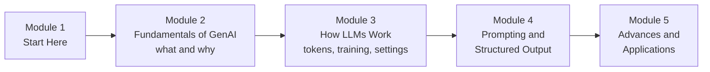

# How This Course Works

> 📚 **Before you start**
>
> - No prior knowledge of generative AI is needed. This is the first lesson of the course.
> - It helps to have met transformers once, in [Sequence Models, Attention and Transformers › Transformers](../../sequence-models-attention-and-transformers/course.md#m6), but every idea you need is re-explained here at an intuitive level.
> - Basic Python (functions, lists, dictionaries) from [Python Programming](../../python-programming/course.md) is enough for the code.

## Introduction

Think of the last week. Perhaps you asked a chat app to turn a messy WhatsApp voice note into a neat to-do list, or to explain a GST notice in plain Hindi, or to draft a leave application that doesn't sound rude. A few years ago each of those would have needed a different specialised program, or a patient friend. Today one kind of system does all of them: a **large language model**, the best-known member of a family called **generative AI**.

Most people use these tools the way they use a car: press the pedal, it moves. That is fine for daily life. But if you want to **build** with them (a support bot for your company, a document-reading agent, a tutoring app for your cousin's coaching centre), you need to know what is under the bonnet: what the model actually computes, why it sometimes makes things up, why the same question can get two different answers, what a "token" costs, and how to make it return clean data your code can trust.

This short article tells you what the course covers, how the lessons are built, and how to get the most out of it.

> 💡 **Key Insight**
>
> An LLM is a **next-token predictor** trained on a huge amount of text and then taught to be helpful. Almost everything surprising about LLMs (their fluency, their mistakes, their love of confident answers, their sensitivity to how you ask) follows from that one sentence. This course unpacks it, piece by piece, until you can predict the behaviour instead of being surprised by it.

---

## What You Will Learn

By the end of this course you will be able to:

- **Explain generative AI** precisely: what it is, how it differs from the "classic" machine learning that predicts labels, and the main families of generative models (autoregressive models, VAEs, GANs, diffusion).
- **Describe how an LLM works from input to output**: tokens, embeddings, the transformer and attention, next-token probabilities and sampling, at a level you can draw on a whiteboard.
- **Explain how LLMs are trained**: pretraining, instruction tuning, and preference training with human feedback (RLHF) or AI feedback (RLAIF), plus the newer reinforcement learning that produces **reasoning models**.
- **Control a model's behaviour** with settings like temperature, top-p, maximum tokens, stop sequences and reasoning effort.
- **Know where LLMs fail** (hallucination, stale knowledge, arithmetic slips, prompt injection) and the standard defences.
- **Write good prompts and system prompts**, and get **structured JSON output** that your code can validate.
- **Find your way around the 2026 model landscape** and the lifecycle of a real GenAI project.

### The course at a glance

| Module | The question it answers |
|---|---|
| **2. Fundamentals of Generative AI** | What is generative AI, how does any generative model learn to create, and what are foundation models? |
| **3. How LLMs Work** | What happens inside an LLM between your prompt and its reply, how was it trained, and where does it break? |
| **4. Prompting and Structured Output** | How do I ask well, set up roles and rules, and get JSON I can trust? |
| **5. Advances and Applications** | What changed recently (reasoning, multimodal, agents), who uses GenAI for what, and how is a project run end to end? |

---

## How Every Lesson Is Built

Every article follows the same shape, so you always know where to look:

| Section | What it gives you |
|---|---|
| **Before you start** | Links to the earlier lessons this one depends on. |
| **Introduction** | Why the topic matters, with an everyday example. |
| **Key Insight** | The one idea to remember. |
| **Core Explanation** | The topic step by step, with pictures, tables and runnable code. |
| **Try It Yourself** | Small exercises, with answers hidden in a fold. |
| **Real-World Examples** | Where you will meet the idea in real products. |
| **Common Misconceptions** | The mistakes almost everyone makes, corrected. |
| **Interview Relevance** | What interviewers ask and what a strong answer covers. |
| **Key Takeaways** | A one-minute summary for revision. |

**Labs** are guided builds. In this course you will make your first LLM API call (Module 3) and build a reliable JSON extractor that validates and repairs model output (Module 4).

---

## What You Need Before Starting

- **Python basics**: functions, lists, dictionaries, loops. A little NumPy helps but every NumPy line is explained.
- **A rough idea of neural networks** is helpful for Module 3, but not required. When the course uses an idea from deep learning (like "weights" or "training"), it explains it in a sentence.
- **No API key** for the runnable code. Every runnable example works offline, either with plain Python and NumPy or with a **fake model** that returns scripted answers. Where a lesson shows a real API call, it is marked `# not-run:` and followed by an example output, so you can copy it later when you have a key.

### A note on dates and model names

Generative AI moves faster than any other part of software. Model names, prices and context-window sizes change every few months. This course was written in **October 2026**. Ideas such as tokens, attention, sampling and training stages last for years; product details do not. When a lesson names a specific model or price, treat it as a snapshot and check the provider's documentation before relying on it.

---

## How to Get the Most Out of It

1. **Predict, then run.** Before you run an example, guess what it prints. Wrong guesses are where learning happens.
2. **Draw the pictures yourself.** If you can redraw the LLM pipeline and the training-stages picture from memory, you understand Module 3.
3. **Use a real chat model as a lab partner.** After each lesson, try the idea on a chat app: change the wording of a prompt, ask for JSON, ask a question past its knowledge cutoff. Watch for the behaviours the lesson describes.
4. **Do the exercises.** They are short and they target the exact points people get wrong in interviews.

---

## Common Misconceptions

### "I need to understand the maths of transformers before I can use LLMs well"

You need the **intuitions**, not the equations: that text becomes tokens, tokens become vectors, attention lets every token look at the others, and the model outputs a probability for every possible next token. This course gives you those intuitions with small, concrete examples. The full maths lives in the [Transformers module](../../sequence-models-attention-and-transformers/course.md#m6) of the previous course.

### "Prompting is just typing questions; there's nothing to learn"

Two prompts that ask for the same thing can produce very different results in quality, format and cost. Prompting well is a real engineering skill, with testing and iteration, and Module 4 treats it that way.

### "LLMs are search engines" or "LLMs know everything"

An LLM generates likely text from patterns it learned during training. It does not look things up unless you connect it to a search tool, and it can be confidently wrong. Knowing this is the first step to using it safely.

---

## Key Takeaways

- **This course explains generative AI and LLMs from the ground up**, then teaches you to use them well.
- **Module 3 is the heart**: tokens, embeddings, transformers, training stages and sampling settings.
- **Modules 4 and 5 make you practical**: prompting, system prompts, structured output, and the current landscape.
- **All runnable code works offline**; real API calls are shown separately for later.
- **Model details change fast**; the ideas in this course do not.

---

**Up next:** [What is Generative AI?](../02-fundamentals-of-generative-ai/what-is-generative-ai.md)
