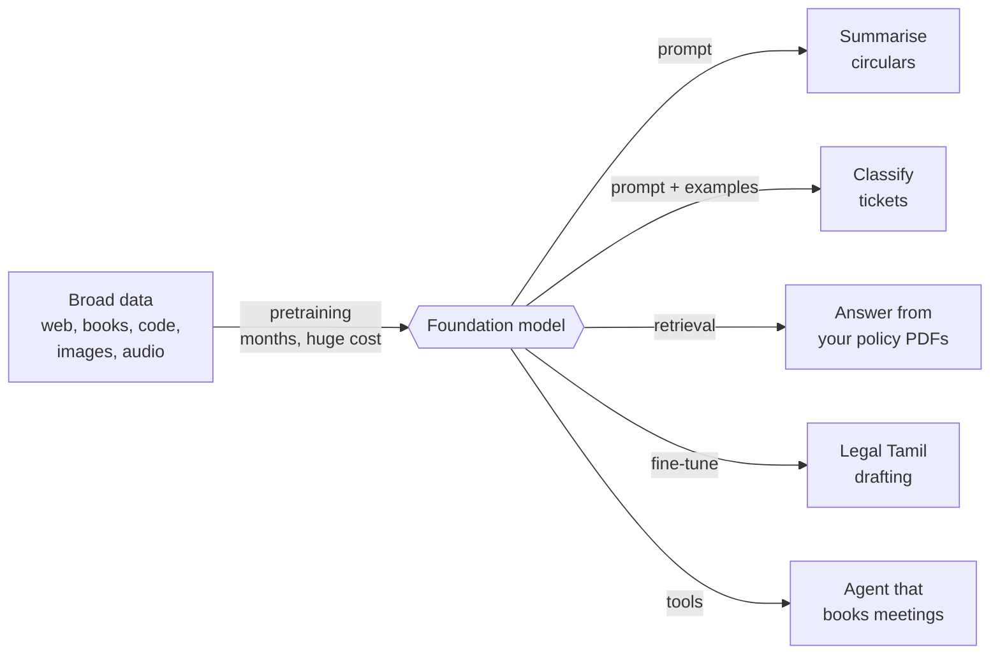
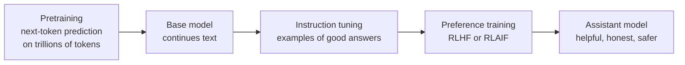

# Foundation Models: The Complete Guide

> 📚 **Before you start**
>
> - [How Generative Models Work](how-generative-models-work.md), for training as "make real data look likely".
> - [The GenAI Roadmap: Builder vs User](the-genai-roadmap-builder-vs-user.md), for the layers of the GenAI stack, where foundation models sit near the bottom.

## Introduction

Before 2018, if a company in Hyderabad wanted AI to sort customer emails, detect angry tweets and translate product pages into Telugu, it built **three separate models**, each trained from scratch on its own labelled data. Three datasets, three training runs, three teams' worth of effort, and none of the models helped the others.

Today the same company calls **one** model for all three jobs, and for a hundred more, often with nothing more than a well-written instruction. That single, general model is a **foundation model**: trained once, at enormous cost, on a broad sweep of data, then adapted cheaply to countless tasks. The change is a bit like the move from every village digging its own well to a city water supply. The supply costs a fortune to build, but once it exists, every house just opens a tap.

By the end of this lesson you'll be able to define a foundation model, explain why "pretrain once, adapt many times" changed the economics of AI, describe scaling laws in plain words and estimate training compute, compare open-weight and closed models, and choose the right adaptation method (prompting, retrieval or fine-tuning) for a problem.

> 💡 **Key Insight**
>
> A foundation model is a **large model trained on broad data with a simple, self-supervised objective** (such as predicting the next token), which turns out to learn general skills that can be **adapted to many downstream tasks**. You pay the huge cost of training once; every adaptation after that is cheap.

---

## Core Explanation

### 1. Definition and where the name came from

The term **foundation model** was popularised by a 2021 report from Stanford researchers. They chose "foundation" deliberately: these models are the base that many applications are built on, and, like a building's foundation, any crack in them spreads to everything above.

A model counts as a foundation model when it has three properties:

| Property | Meaning | Example |
|---|---|---|
| **Broad training data** | Not one task's data, but a wide slice of the world: web text, books, code, images, audio | Trillions of tokens of text and code |
| **Self-supervised objective** | The labels come from the data itself, so no human labelling is needed for the bulk of training | "Predict the next token" for text; "predict the hidden patch" or "match image to caption" for images |
| **Adaptable to many tasks** | One model, many uses, through prompting or light further training | The same LLM summarises, translates, writes SQL and classifies tickets |

**Self-supervised** is the key that unlocked scale. Labelling a million emails by hand is expensive. But every sentence on the internet is already a free training example for "predict the next word". That's why foundation models could train on vastly more data than any labelled dataset.

### 2. Pretrain once, adapt many times



| | The old way (task-specific models) | The foundation-model way |
|---|---|---|
| **Starting point** | Random weights, for every task | A pretrained model that already "knows" language, code and the world |
| **Data needed per task** | Thousands to millions of labelled examples | Zero to a few hundred examples |
| **Time to a working version** | Weeks to months | Hours to days |
| **Who can do it** | ML specialists | Any capable software team |
| **Knowledge shared across tasks** | None | All tasks share one model's knowledge |

This is called **transfer learning**: knowledge learned on one huge task transfers to many small ones. It existed before (for example, image models pretrained on ImageNet), but foundation models took it to the extreme, where many tasks need **no training at all**, just a prompt.

### 3. Kinds of foundation models

| Kind | Trained to | Used for | Examples of families |
|---|---|---|---|
| **Large language models** | Predict the next token of text and code | Chat, writing, coding, reasoning, agents | Claude, GPT, Gemini, Llama, Qwen, DeepSeek, Mistral |
| **Multimodal models** | Handle text plus images, audio and sometimes video together | Reading documents and photos, voice assistants | Most current frontier LLMs are multimodal |
| **Embedding models** | Turn text (or images) into vectors where similar meanings are close | Search, retrieval, clustering, recommendations | Embedding models from most major providers and open-source projects |
| **Image and video generators** | Denoise towards images matching a caption | Creating and editing images and video | Diffusion-based families |
| **Speech models** | Map audio to text and text to audio | Transcription, voice agents, text-to-speech | Speech-recognition and TTS models |
| **Scientific foundation models** | Learn from protein, molecule, weather or genome data | Drug discovery, forecasting | Research models |

**Embedding models** deserve a special mention because builders use them constantly. They don't generate text; they turn text into a list of numbers so that a computer can measure meaning. You'll see embeddings inside LLMs in [What is a Large Language Model?](../course.md#m3) and use them for search in [Embeddings and Similarity Search](../../vector-databases-for-ai/course.md#m2).

### 4. Scale and scaling laws

Foundation models are big because, empirically, **bigger works better in a predictable way**. Research published from 2020 onwards found **scaling laws**: as you increase the number of parameters, the amount of training data and the compute spent, the model's loss falls along a smooth, predictable curve. Labs use these curves to plan training runs before spending the money.

Two ideas from that research are worth knowing:

- **Training compute** for a transformer is roughly **6 × N × D** floating-point operations (FLOPs), where **N** is the number of parameters and **D** is the number of training tokens. (Each token needs about 2 operations per parameter going forwards and about 4 going backwards during learning.)
- **Compute-optimal training**: a 2022 DeepMind study (often called the "Chinchilla" paper) found that for a fixed compute budget, the best results come from training on roughly **20 tokens per parameter**. Earlier models had been too big for the data they saw.

Let's estimate the cost of training a 70-billion-parameter model the compute-optimal way.

```python
params = 70e9                       # N: 70 billion parameters
tokens = 20 * params                # D: about 20 tokens per parameter -> 1.4 trillion tokens
flops = 6 * params * tokens         # training compute

gpu_flops_per_second = 400e12       # an illustrative modern GPU sustaining 400 teraFLOP/s in practice
gpu_seconds = flops / gpu_flops_per_second
gpu_days = gpu_seconds / 86_400

print(f"Training tokens: {tokens / 1e12:.1f} trillion")
print(f"Training compute: {flops:.2e} FLOPs")
print(f"About {gpu_days:,.0f} GPU-days, or {gpu_days / 1000:.0f} days on 1,000 GPUs")
```

Output:

```
Training tokens: 1.4 trillion
Training compute: 5.88e+23 FLOPs
About 17,014 GPU-days, or 17 days on 1,000 GPUs
```

Even this mid-sized model needs about seventeen thousand GPU-days. Today's frontier models are trained on far more than 20 tokens per parameter (because a smaller model trained longer is cheaper to *run* for millions of users), on tens of trillions of tokens, with total compute many times larger. That is why only a handful of organisations train frontier foundation models.

**Emergent abilities** is the name often given to skills that seem to appear suddenly as models scale (for example, multi-step arithmetic or following complex instructions). Researchers debate how "sudden" these really are, since smoother metrics often show gradual improvement. The safe summary: many useful abilities only become reliable at large scale.

### 5. From raw foundation model to helpful assistant

A freshly pretrained LLM (a **base model**) is a brilliant text-continuer but not yet a good assistant. Ask it *"What is the capital of India?"* and it might continue with *"What is the capital of Nepal? What is the capital of..."*, because lists of quiz questions are common on the internet. Turning it into an assistant takes further training stages:



You'll study each stage, including how reasoning models get their extra training, in [What is a Large Language Model?](../course.md#m3). For now, remember that "foundation model" can mean the base model or the finished assistant, and that most products use the finished assistant.

### 6. Open-weight vs closed models

| | Closed (API-only) models | Open-weight models |
|---|---|---|
| **What you get** | Access through an API; the weights stay with the provider | The weights themselves, to download and run |
| **Examples of families** | Claude (Anthropic), GPT (OpenAI), Gemini (Google) | Llama (Meta), Qwen (Alibaba), DeepSeek, Mistral, Gemma (Google), gpt-oss (OpenAI) |
| **Strengths** | Usually the most capable; no infrastructure to run; fast access to new features | Full control, data stays on your servers, can fine-tune deeply, no per-token fees |
| **Weaknesses** | Data leaves your servers (under contract terms); per-token cost; less control | You run the GPUs; usually behind the frontier; you own safety and updates |

Two terms are often mixed up:

- **Open-weight**: the trained weights are published, usually under a licence that may restrict some uses.
- **Open-source** in the strict sense also means the training code and enough about the data to reproduce the model. Few large models meet this bar fully.

Always read the **licence** and the **model card** (the document describing what the model was trained on, what it's good and bad at, and its known risks) before using any model in a product.

### 7. Choosing how to adapt a foundation model

Adapting a foundation model is a ladder. Climb only as far as you need.

| Rung | What you change | Effort | Use when |
|---|---|---|---|
| **Zero-shot prompting** | Just the instruction | Minutes | The task is common and clearly describable |
| **Few-shot prompting** | Add a few worked examples to the prompt | Minutes | The format or style is unusual |
| **Retrieval-augmented generation (RAG)** | Fetch relevant documents and put them in the prompt | Days | The model needs your private or up-to-date facts |
| **Tools and agents** | Let the model call APIs, search or run code | Days to weeks | The task needs live data or actions |
| **Fine-tuning** (often with efficient methods like LoRA, which train a small set of extra weights) | Train the model further on your examples | Weeks | You need a consistent style, a narrow skill, or a smaller cheaper model to match a big one |
| **Pretraining your own** | Everything | Months and a fortune | Almost never, outside AI labs |

A rule of thumb: **knowledge problems** ("it doesn't know our refund policy") are solved with retrieval; **behaviour problems** ("it never uses our report format") are solved with prompting first, then fine-tuning.

```python
def suggest_adaptation(needs_private_facts, facts_change_often, needs_actions, style_hard_to_describe, examples_available):
    steps = ["start with a clear prompt"]
    if needs_private_facts or facts_change_often:
        steps.append("add retrieval (RAG) over your documents")
    if needs_actions:
        steps.append("give the model tools")
    if style_hard_to_describe:
        steps.append("add few-shot examples" if examples_available < 500 else "consider fine-tuning")
    return steps

print(suggest_adaptation(needs_private_facts=True, facts_change_often=True, needs_actions=False,
                         style_hard_to_describe=False, examples_available=0))
print(suggest_adaptation(needs_private_facts=False, facts_change_often=False, needs_actions=False,
                         style_hard_to_describe=True, examples_available=5_000))
```

Output:

```
['start with a clear prompt', 'add retrieval (RAG) over your documents']
['start with a clear prompt', 'consider fine-tuning']
```

### 8. The risks of a shared foundation

Because thousands of products sit on a few foundation models, their weaknesses spread:

- **Homogenisation**: a bias or blind spot in one model shows up in every app built on it.
- **Single points of failure**: an outage or a model change at a provider affects all its customers at once, which is why serious products test before switching model versions.
- **Opaque training data**: it's often unclear exactly what a closed model was trained on, which raises copyright and privacy questions.
- **Concentration of power**: training frontier models needs resources few organisations have.
- **Under-served languages**: models trained mostly on English data can be weaker, and more expensive per word, in many Indian languages (you'll see why in [Tokens and Context Windows](../course.md#m3)). Efforts to build India-focused models and datasets aim to close that gap.

---

## Try It Yourself

1. **Estimate a smaller run.** Using `6 × N × D` and 20 tokens per parameter, how many GPU-days would a 7-billion-parameter model need with the same GPU assumption?
2. **The over-trained model.** Many open models are trained on far more than 20 tokens per parameter. Compute the GPU-days for a 7B model trained on 15 trillion tokens.
3. **Pick the rung.** A bank wants its assistant to answer questions about this week's fixed-deposit interest rates. Which adaptation would you try first, and why not fine-tuning?

<details>
<summary>Show answers</summary>

**1.** and **2.**

```python
def gpu_days(n_params, n_tokens, flops_per_sec=400e12):
    return 6 * n_params * n_tokens / flops_per_sec / 86_400

print(f"7B, compute-optimal (140B tokens): {gpu_days(7e9, 20 * 7e9):,.0f} GPU-days")
print(f"7B, over-trained (15T tokens):     {gpu_days(7e9, 15e12):,.0f} GPU-days")
```

Output:

```
7B, compute-optimal (140B tokens): 170 GPU-days
7B, over-trained (15T tokens):     18,229 GPU-days
```

Training costs scale linearly with both parameters and tokens. A small model trained on a huge number of tokens costs more to *train* than its "optimal" budget, but it is cheap to *run*, which matters more when millions of people use it.

**3.** Retrieval. Interest rates are facts that change often; you want the model to read the current rate table at answer time. Fine-tuning would bake in this week's rates, which would be wrong next week, and retraining weekly is slow and costly.

</details>

---

## Real-World Examples

- **One model, many internal tools**: companies give employees a single assistant that drafts emails, answers HR questions (with retrieval) and writes SQL, all on one foundation model.
- **Fine-tuned open models**: organisations with strict data rules host an open-weight model and fine-tune it on internal documents and formats.
- **Embedding models for search**: e-commerce sites use embedding foundation models so that a search for "kurta for wedding" finds "ethnic festive wear" even with no shared words.
- **Indian-language efforts**: government and private initiatives build datasets and models for Indian languages so foundation models serve more of the country well.

---

## Common Misconceptions

### "A foundation model is just a big neural network"

Size alone isn't the point. It's the combination of broad data, a self-supervised objective and adaptability that makes a model "foundational".

### "Fine-tuning is how you teach a model new facts"

Fine-tuning is better at teaching style, format and narrow skills. For facts, especially changing ones, retrieval is usually more reliable and easier to update.

### "Open-weight means free to use for anything"

Licences vary. Some restrict commercial use above a certain size, certain applications, or using outputs to train other models. Read the licence.

### "The biggest model is always the right choice"

Bigger models cost more and respond more slowly. Many tasks are handled well by smaller models; teams often route easy requests to a small model and hard ones to a large model.

---

## Interview Relevance

*"What is a foundation model and why did it change AI development?"* A strong answer defines it (large, broad data, self-supervised pretraining, adaptable), explains the economics of "pretrain once, adapt many" (transfer learning at scale, few or zero labelled examples per task), and names adaptation methods in order of effort: prompting, few-shot, RAG, tools, fine-tuning (including parameter-efficient methods like LoRA).

Common follow-ups: *"When would you fine-tune instead of using RAG?"* (behaviour, style, format, latency or cost reduction with a smaller model; RAG for knowledge and freshness). *"What are scaling laws?"* (predictable loss improvement with parameters, data and compute; roughly 6ND training FLOPs; the Chinchilla finding of about 20 tokens per parameter for compute-optimal training, and why production models are often trained well beyond that). *"Open versus closed models?"* (control, privacy and cost shape versus capability and convenience).

---

## Key Takeaways

- **Foundation models are trained once on broad data with a self-supervised objective** and adapted to many tasks.
- **Self-supervision unlocked scale**: raw text is its own label.
- **Scaling laws make progress predictable**; training compute is roughly 6 × parameters × tokens.
- **Base models become assistants** through instruction tuning and preference training (Module 3).
- **Adapt with the lightest tool that works**: prompt, then retrieve, then tools, then fine-tune.

---

**Up next:** [What is a Large Language Model?](../course.md#m3)
