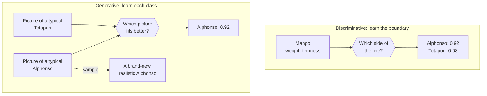

# Generative vs Discriminative Models: The Complete Guide

> 📚 **Before you start**
>
> - [How Generative Models Work](how-generative-models-work.md), for the idea of a data distribution and sampling from it.
> - It helps to have trained a classifier once, for example logistic regression in [Machine Learning Foundations: Data, EDA and Features](../../machine-learning-foundations-data-eda-and-features/course.md). If you haven't, a "classifier" is simply a model that reads an input and outputs a label.

## Introduction

Two fruit sellers at Crawford Market are both excellent at telling **Alphonso** mangoes from **Totapuri** mangoes.

The first seller has spent twenty years with mangoes. Close your eyes and ask him, *"Describe a typical Alphonso,"* and he will tell you its weight, its smell, its colour, how soft it feels. He could even sketch a realistic Alphonso that doesn't exist. To classify a mango, he asks himself *"Does this look more like my picture of an Alphonso or my picture of a Totapuri?"*

The second seller learned a shortcut from her uncle: *"If it's heavier than 250 grams and the skin gives a little when pressed, it's Alphonso."* She is quick and accurate, but if you ask her to describe a typical Totapuri, she shrugs. She only learned **the boundary between the two**, not what either one looks like.

The first seller is a **generative model**. The second is a **discriminative model**. This distinction is one of the oldest in machine learning, and it is the cleanest way to explain what is special about generative AI.

By the end of this lesson you'll be able to state the difference in plain words and in probability notation, train both kinds of model on the same data in scikit-learn, generate new examples from the generative one, and explain when each kind is the right tool.

> 💡 **Key Insight**
>
> A **discriminative** model learns **P(label | input)**: *given this input, which label?* It learns only the boundary. A **generative** model learns how the inputs themselves are distributed, **P(input)** or **P(input, label)**, so it can also **create new inputs**. Every generative AI system is in the second camp; most classic business ML is in the first.

---

## Core Explanation

### 1. The two questions, in plain words and in notation

| | Discriminative | Generative |
|---|---|---|
| **Question it answers** | "Given this mango, is it Alphonso or Totapuri?" | "What do Alphonso mangoes look like? What do Totapuris look like? How common is each?" |
| **What it learns** | **P(y \| x)**: probability of label *y* given input *x* | **P(x \| y)** and **P(y)**, which together give **P(x, y)**; or just **P(x)** with no labels at all |
| **Can it classify?** | Yes, directly | Yes, using Bayes' rule (below) |
| **Can it create new examples?** | No | Yes, by sampling *x* |
| **Classic examples** | Logistic regression, SVMs, decision trees, most neural classifiers, BERT-style classifiers | Naive Bayes, Gaussian mixture models, hidden Markov models, VAEs, GANs, diffusion models, LLMs |

A note on the notation: **P(y | x)** is read "the probability of *y* given *x*". The vertical bar means "given" or "assuming we know".



### 2. How a generative model classifies: Bayes' rule

If a model knows what each class looks like, it can still classify, using **Bayes' rule**:

**P(y | x) = P(x | y) × P(y) / P(x)**

In words: *how likely is it this is an Alphonso, given what I see?* equals *how typical is what I see for an Alphonso* × *how common Alphonsos are in general*, divided by *how common this observation is overall* (a number that is the same for every class, so you can ignore it when comparing).

A tiny worked example. A trader's crates are 30% Alphonso and 70% Totapuri. A mango weighs 260 g. Suppose the trader knows that a 260 g weight is quite typical of Alphonsos (likelihood 0.8 on some scale) but unusual for Totapuris (0.1).

```python
prior = {"Alphonso": 0.30, "Totapuri": 0.70}            # P(y): how common each variety is
likelihood_260g = {"Alphonso": 0.8, "Totapuri": 0.1}    # P(x | y): how typical 260 g is for each

unnormalised = {v: likelihood_260g[v] * prior[v] for v in prior}
total = sum(unnormalised.values())
for variety, score in unnormalised.items():
    print(f"P({variety} | 260 g) = {score / total:.2f}")
```

Output:

```
P(Alphonso | 260 g) = 0.77
P(Totapuri | 260 g) = 0.23
```

Even though Totapuris are more common, the weight is so much more typical of Alphonsos that the generative reasoning picks Alphonso.

### 3. Both kinds on real-looking data

Let's create a dataset of mangoes with two features, **weight in grams** and **firmness** (a 0 to 10 score from a squeeze test), then train one model of each kind.

- **Gaussian Naive Bayes** is a simple generative classifier: for each variety it learns a bell curve for each feature (the mean and spread of weight, the mean and spread of firmness), plus how common each variety is.
- **Logistic regression** is the standard discriminative classifier: it learns a weighted sum of the features and turns it into a probability, which amounts to drawing a straight boundary line.

```python
import numpy as np
from sklearn.linear_model import LogisticRegression
from sklearn.naive_bayes import GaussianNB
from sklearn.model_selection import train_test_split

rng = np.random.default_rng(seed=42)
alphonso = np.column_stack([rng.normal(270, 25, 300), rng.normal(4.0, 1.0, 300)])   # heavier, softer
totapuri = np.column_stack([rng.normal(220, 30, 300), rng.normal(6.5, 1.2, 300)])   # lighter, firmer
X = np.vstack([alphonso, totapuri])
y = np.array(["Alphonso"] * 300 + ["Totapuri"] * 300)

X_train, X_test, y_train, y_test = train_test_split(X, y, test_size=0.3, random_state=0)

generative = GaussianNB().fit(X_train, y_train)
discriminative = LogisticRegression().fit(X_train, y_train)

print(f"Naive Bayes (generative) accuracy:          {generative.score(X_test, y_test):.3f}")
print(f"Logistic regression (discriminative) accuracy: {discriminative.score(X_test, y_test):.3f}")
```

Output:

```
Naive Bayes (generative) accuracy:          0.939
Logistic regression (discriminative) accuracy: 0.939
```

As classifiers they perform identically here. The difference is in **what else they know**. Look inside the generative model: it has learned a description of each class.

```python
for i, variety in enumerate(generative.classes_):
    mean_w, mean_f = generative.theta_[i]
    std_w, std_f = np.sqrt(generative.var_[i])
    print(f"{variety:<9} weight {mean_w:.0f} ± {std_w:.0f} g, firmness {mean_f:.1f} ± {std_f:.1f}, "
          f"share {generative.class_prior_[i]:.2f}")
```

Output:

```
Alphonso  weight 270 ± 24 g, firmness 4.0 ± 1.0, share 0.51
Totapuri  weight 216 ± 30 g, firmness 6.5 ± 1.2, share 0.49
```

And because it knows each class's distribution, it can **generate** new mangoes:

```python
def generate_mango(model, variety, n, seed):
    i = list(model.classes_).index(variety)
    r = np.random.default_rng(seed)
    return r.normal(model.theta_[i], np.sqrt(model.var_[i]), size=(n, 2))

for weight, firmness in generate_mango(generative, "Alphonso", 4, seed=3):
    print(f"New Alphonso: {weight:.0f} g, firmness {firmness:.1f}")
```

Output:

```
New Alphonso: 318 g, firmness 1.4
New Alphonso: 280 g, firmness 3.4
New Alphonso: 259 g, firmness 3.8
New Alphonso: 222 g, firmness 3.8
```

The logistic regression model, by contrast, only knows its boundary: a weight for each feature and a bias.

```python
print("Boundary weights:", np.round(discriminative.coef_, 3).tolist(), "bias:", np.round(discriminative.intercept_, 2).tolist())
```

Output:

```
Boundary weights: [[-0.082, 2.083]] bias: [9.35]
```

There is no way to ask it *"what does a typical Alphonso look like?"* That information was never learned.

### 4. The trade-offs

| | Discriminative | Generative |
|---|---|---|
| **Accuracy on classification with plenty of data** | Usually equal or better: it spends all its capacity on the one thing you asked for | Can be slightly worse if its assumptions about the data's shape are wrong |
| **With very little data** | Can overfit or be unstable | Often learns faster, because its assumptions act as a helpful prior |
| **Handling missing features** | Awkward | Natural: the model knows how features relate |
| **Detecting weird inputs (outliers)** | Hard: it gives every input some label | Possible: an input with very low P(x) is unusual |
| **Creating new data** | Impossible | Its whole purpose |
| **Difficulty** | Easier: the boundary is simpler than the whole distribution | Harder: modelling all of P(x) for images or text needs enormous models |

That last row is the key to the history of AI. For decades, modelling the full distribution of something like images or language was too hard, so practical ML was mostly discriminative: spam filters, credit scores, fraud detection. Deep learning plus scale finally made generative modelling of rich data work, and that is the "generative AI" moment.

### 5. Where LLMs fit, and a twist

An LLM is a **generative model of text**: it learns P(next token | previous tokens), and by the chain rule from [How Generative Models Work](how-generative-models-work.md), that gives P(whole text). It can therefore create new text.

The twist: an LLM can also **act as a discriminative model**. Ask it *"Is this review positive or negative? Answer with one word,"* and it outputs a label. Under the hood it is still generating, but the generated token *is* a classification. This is why one generative model can replace dozens of specialised classifiers, and it's a big reason generative AI spread so fast through businesses.

| Task | Old approach | 2026 approach with a generative LLM |
|---|---|---|
| Classify support tickets into 12 categories | Train a discriminative model on 20,000 labelled tickets | Describe the categories in a prompt; maybe give 5 examples |
| Extract the amount and due date from a bill | Hand-written rules per bill format | Ask for JSON with the fields you need |
| Detect toxic comments | A dedicated classifier | A prompt or a small fine-tuned model |

Discriminative models still win when you have lots of labelled data, need predictions in microseconds, need a calibrated probability, or must run on cheap hardware. A logistic regression scoring a UPI transaction for fraud in a millisecond won't be replaced by an LLM call that takes a second and costs money.

### 6. A one-sentence test

When you meet a new model, ask: **"Could it produce a new, realistic input?"** If yes, it is generative. If it can only score or label inputs you give it, it is discriminative.

---

## Try It Yourself

1. **Spot the odd mango.** Use `generative.predict_proba` on a mango weighing 600 g with firmness 5. What does it say? Then explain why a confident label for such a strange input is a problem, and which kind of model could flag it as unusual.
2. **Generate Totapuris.** Generate 3 Totapuri mangoes with `generate_mango` (seed 5). Do they look lighter and firmer than the Alphonsos?
3. **Little data.** Retrain both models on only the first 10 rows of `X_train` and compare test accuracy.

<details>
<summary>Show answers</summary>

**1.**

```python
weird = np.array([[600, 5.0]])
for variety, p in zip(generative.classes_, generative.predict_proba(weird)[0]):
    print(f"P({variety} | 600 g) = {p:.3f}")
# The generative model can also say how unusual the input is: log of P(x) under its learned distributions.
log_px = np.log(np.exp(generative.predict_joint_log_proba(weird)).sum())
typical_log_px = np.log(np.exp(generative.predict_joint_log_proba(X_test)).sum(axis=1)).mean()
print(f"log P(x) for the weird mango: {log_px:.1f}  (typical test mango: {typical_log_px:.1f})")
```

Output:

```
P(Alphonso | 600 g) = 0.000
P(Totapuri | 600 g) = 1.000
log P(x) for the weird mango: -88.1  (typical test mango: -6.8)
```

The classifier is 100% sure a 600 g mango is a Totapuri (Totapuris have the wider weight spread, so the far tail of their bell curve wins), though no real mango of either kind weighs that. A purely discriminative model can only answer "which side of the boundary?" The generative model can additionally report that P(x) is astronomically lower than for a typical mango, which flags the input as suspicious (perhaps a data-entry error, or a jackfruit).

**2.**

```python
for weight, firmness in generate_mango(generative, "Totapuri", 3, seed=5):
    print(f"New Totapuri: {weight:.0f} g, firmness {firmness:.1f}")
```

Output:

```
New Totapuri: 192 g, firmness 5.0
New Totapuri: 209 g, firmness 7.0
New Totapuri: 250 g, firmness 6.6
```

Yes: around 220 g and firmness around 6 to 7, matching the class description learned from the data.

**3.**

```python
small_nb = GaussianNB().fit(X_train[:10], y_train[:10])
small_lr = LogisticRegression().fit(X_train[:10], y_train[:10])
print(f"10 examples -> Naive Bayes {small_nb.score(X_test, y_test):.3f}, logistic regression {small_lr.score(X_test, y_test):.3f}")
```

Output:

```
10 examples -> Naive Bayes 0.750, logistic regression 0.761
```

Here they come out about level, and with tiny data the result swings a lot depending on which ten rows you happen to get. The classic finding (from a well-known 2002 study by Ng and Jordan) is that generative classifiers like Naive Bayes tend to reach their best accuracy with fewer examples, while discriminative ones catch up and often overtake them as data grows.

</details>

---

## Real-World Examples

- **Discriminative in production**: credit scoring, UPI fraud detection, email spam filters, click-through prediction for ads, medical image classifiers that flag likely tumours for review.
- **Generative in production**: chat assistants, code completion, image generation, synthetic data for testing, voice assistants that speak.
- **Hybrid**: a bank uses an LLM to read free-text complaints and output a category (generative model, discriminative job), then routes them with a fast traditional model.
- **Anomaly detection**: generative models of "normal" factory sensor readings flag readings with very low probability as possible faults.

---

## Common Misconceptions

### "Generative models can't classify"

They can, through Bayes' rule, and LLMs classify simply by generating the label as text.

### "Discriminative models are outdated"

They remain the right choice for high-volume, low-latency, well-labelled prediction problems, which is most of classic business ML.

### "BERT and GPT are the same kind of model because both are transformers"

The architecture is shared, but BERT is usually used as an **encoder** that feeds a discriminative classifier, while GPT-style models are **decoders** trained generatively to predict the next token. Architecture and modelling approach are separate choices.

### "Generative means unsupervised"

Generative models can use labels (P(x, y), as Naive Bayes does) or no labels (P(x), as an LLM's pretraining does). The distinction is about *what is modelled*, not whether labels exist.

---

## Interview Relevance

*"What is the difference between generative and discriminative models?"* A strong answer: discriminative models learn P(y | x), the decision boundary; generative models learn P(x | y) and P(y), or P(x), the data distribution itself, so they can generate samples and classify through Bayes' rule. Give examples of each (logistic regression and SVMs versus Naive Bayes, HMMs, GANs, VAEs, diffusion and LLMs). Discuss trade-offs: discriminative is often more accurate with lots of data and simpler to train; generative handles missing data, can detect outliers, can work better with little data, and can create content. Mention that LLMs blur the line in practice by performing discriminative tasks through generation.

---

## Key Takeaways

- **Discriminative = P(y | x)**: learn the boundary, output a label.
- **Generative = P(x, y) or P(x)**: learn what the data looks like, and therefore create new data.
- **Bayes' rule** lets a generative model classify: likelihood × prior, normalised.
- **Generative AI became possible** when deep learning and scale made modelling P(x) for images and text practical.
- **LLMs are generative but can do discriminative jobs** by generating the label, which is why they replaced many single-purpose classifiers.

---

**Up next:** [The GenAI Roadmap: Builder vs User](the-genai-roadmap-builder-vs-user.md)
