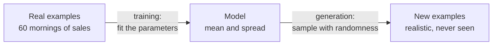

# How Generative Models Work: The Complete Guide

> 📚 **Before you start**
>
> - [What is Generative AI?](what-is-generative-ai.md), where you built a tiny bigram model that generates chai orders.
> - Basic probability helps: the idea that a probability is a number from 0 to 1 and that the probabilities of all outcomes add up to 1. [Statistics for Data Science](../../statistics-for-data-science/course.md) covers it if you need a refresher.

## Introduction

Imagine you run a small bakery in Pune and want a machine that invents new biscuit recipes your customers will love. You could hand it 5,000 recipes from your family notebooks. What would "learning" from them even mean?

The machine needs to discover things like: flour is usually 40 to 60 percent of the weight; sugar and butter rise and fall together; cardamom goes with milk biscuits, not with jeera biscuits. In other words, it needs to learn **which combinations are common, which are rare and which never happen**. Once it knows that, inventing a recipe means **picking a combination that would be common**, even though no one has written that exact one down.

Every generative model, from a 1980s statistics textbook example to a 2026 frontier LLM, does those two things: **learn the shape of the data** during training, then **draw new samples** from that shape. The models differ only in *how* they represent the shape and *how* they draw from it.

By the end of this lesson you'll understand the idea of a **data distribution**, see generation as **sampling**, know the four big families of generative models (autoregressive, diffusion, GANs and VAEs) and what each is used for, and run small NumPy versions of the core ideas.

> 💡 **Key Insight**
>
> A generative model is **a learned recipe for producing data that looks like the training data**. Training adjusts the model's parameters so that real examples look *likely* to it. Generation runs the recipe with fresh randomness, so every run gives a new, plausible example.

---

## Core Explanation

### 1. The data distribution: the "shape" of what's normal

A **probability distribution** tells you how likely each possible outcome is. The **data distribution** is the (unknown) distribution that real-world examples come from: real chai orders, real photos of faces, real Python functions.

You can't write it down for something as rich as photos or essays, but you can build intuition with a simple case. Suppose a Bengaluru tea stall records how many cups it sells each morning.

```python
import numpy as np

rng = np.random.default_rng(seed=7)
# 60 real mornings of sales (we simulate them here so the example is self-contained)
real_sales = rng.normal(loc=180, scale=25, size=60).round()

print("First 10 mornings:", real_sales[:10].astype(int).tolist())
print(f"Average {real_sales.mean():.1f} cups, spread (std) {real_sales.std():.1f}")
```

Output:

```
First 10 mornings: [180, 187, 173, 158, 169, 155, 182, 214, 168, 164]
Average 174.8 cups, spread (std) 22.1
```

**Training a generative model** here means choosing a shape and fitting it. The simplest shape is a bell curve (a **normal** or **Gaussian distribution**), which has just two parameters: the centre (mean) and the spread (standard deviation).

```python
# "Training": estimate the two parameters from the data
mu, sigma = real_sales.mean(), real_sales.std()

# "Generation": sample new, never-seen mornings from the fitted shape
new_mornings = rng.normal(mu, sigma, size=8).round().astype(int)
print("Generated mornings:", new_mornings.tolist())
```

Output:

```
Generated mornings: [179, 165, 178, 149, 162, 170, 195, 200]
```

Those are brand-new, realistic sales figures. Nothing was copied. That is the entire concept of generative modelling, at its smallest:



The hard part, which took the field decades, is that real data is not a bell curve with two numbers. A 512-by-512 colour photo has about 786,000 numbers (pixels times three colours), and they depend on one another in intricate ways: an eye implies another eye nearby, at the right distance, with matching colour. Modern generative models are ways of representing such enormously complicated distributions with neural networks.

### 2. How training works: make real data look likely

How do you know if a model has learned the distribution well? A common test is: **how much probability does the model give to real examples?** A good model says "yes, that's typical" to real data. This idea is called **maximum likelihood**: adjust the parameters so the real data is as likely as possible.

In practice we minimise the **negative log-likelihood**, also called the **loss**. Lower loss means the model finds real data more likely. Let's score three candidate models of our tea stall.

```python
def avg_negative_log_likelihood(data, mu, sigma):
    # log of the normal probability density, averaged over all data points, then negated
    log_p = -0.5 * np.log(2 * np.pi * sigma**2) - (data - mu) ** 2 / (2 * sigma**2)
    return -log_p.mean()

for name, m, s in [("fitted", mu, sigma), ("centre too low", 120, 25), ("spread too wide", mu, 80)]:
    print(f"{name:<16} loss = {avg_negative_log_likelihood(real_sales, m, s):.3f}")
```

Output:

```
fitted           loss = 4.513
centre too low   loss = 6.927
spread too wide  loss = 5.339
```

The fitted model has the lowest loss. Neural generative models are trained the same way, just with billions of parameters instead of two, and with an optimisation method (**gradient descent**) that nudges every parameter a tiny step in the direction that lowers the loss, over and over, across the whole dataset.

For an LLM, the loss is exactly this idea applied to text: **how surprised was the model by the actual next token?** If the text says "ek cutting chai" and the model gave "chai" a high probability after "ek cutting", the loss is low. You'll see this in detail in [What is a Large Language Model?](../03-how-llms-work/what-is-a-large-language-model.md).

### 3. Four families of generative models

The picture below shows the four families you'll hear about. Each one is a different answer to *"how do we turn randomness into realistic data?"*

![Four horizontal bands. Autoregressive: text so far goes into a model that predicts probabilities for the next piece, one piece is picked and appended, and this repeats until done, which is how LLMs work. Diffusion: pure noise is repeatedly cleaned a little, guided by the prompt, until a clean image appears. GAN: a random seed goes into a generator that makes a fake, a discriminator compares fakes with real images and its verdict teaches the generator to improve. VAE: an encoder squeezes an image into a small code of a few numbers and a decoder rebuilds it; to create, pick a new code and decode it](/img/diagrams/generative-ai-and-llm-foundations/four-ways-to-generate.svg)
*Four recipes for turning randomness into realistic data. LLMs use the first; most image and video models use the second.*

### 4. Autoregressive models: one piece at a time

An **autoregressive** model generates a sequence **one piece at a time, each piece conditioned on everything before it**. ("Auto" + "regressive" means predicting a value from earlier values of the same sequence.) Your bigram chai model was autoregressive, with a memory of one word. LLMs are autoregressive with a memory of up to millions of tokens.

The maths behind it is the **chain rule of probability**: the probability of a whole sentence equals the probability of the first word, times the probability of the second given the first, times the third given the first two, and so on.

```python
# Pretend next-word probabilities a trained model might give (made-up numbers for illustration)
next_word = {
    ("<start>",): {"ek": 0.6, "do": 0.4},
    ("<start>", "ek"): {"cutting": 0.5, "masala": 0.3, "samosa": 0.2},
    ("<start>", "ek", "cutting"): {"chai": 0.9, "coffee": 0.1},
}

sentence = ["ek", "cutting", "chai"]
prob, context = 1.0, ("<start>",)
for word in sentence:
    p = next_word[context][word]
    print(f"P({word!r} | {' '.join(context[1:]) or 'start'}) = {p}")
    prob *= p
    context = context + (word,)
print(f"P('ek cutting chai') = {prob:.3f}")
```

Output:

```
P('ek' | start) = 0.6
P('cutting' | ek) = 0.5
P('chai' | ek cutting) = 0.9
P('ek cutting chai') = 0.270
```

Generation runs the same chain forwards, **sampling** a word at each step instead of scoring a given one. Two properties make autoregressive models the standard for text and code:

- **Training is simple and parallel.** Every position in every document is a training example ("predict the next token"), so you get trillions of examples for free from raw text, without anyone labelling anything.
- **They handle any length.** Keep predicting until the model produces an "end" token.

Their weakness is speed: a 1,000-token answer needs 1,000 sequential prediction steps. Much engineering (caching, speculative decoding, smaller models) goes into making that fast.

### 5. Diffusion models: start from noise, clean it step by step

A **diffusion model** learns to **reverse a gradual noising process**. During training, you take a real image, add a little random noise, then more, and more, until it is pure static. The model is trained to look at a noisy image and predict how to make it slightly less noisy. To generate, you start from pure static and apply the cleaning step many times. A text prompt **guides** each cleaning step towards images that match the description.

You can see the idea in one dimension. Our "real data" are numbers clustered near **-2** and **+2** (think of them as two kinds of image). We'll start from pure noise and repeatedly nudge each point towards where data is likely, adding a little fresh randomness each time, with a cleaning rule that we can compute exactly for this simple data. (A real diffusion model *learns* that rule with a neural network.)

```python
def nudge_towards_data(x, noise_level):
    """For data at -2 and +2, return the direction that makes x more likely
    once the data has been blurred by `noise_level` of noise. A real model learns this."""
    var = 0.1**2 + noise_level**2
    w_minus = np.exp(-(x + 2) ** 2 / (2 * var))
    w_plus = np.exp(-(x - 2) ** 2 / (2 * var))
    target = (-2 * w_minus + 2 * w_plus) / (w_minus + w_plus)
    return (target - x) / var

rng = np.random.default_rng(seed=1)
x = rng.normal(0, 3, size=10)                 # start: pure noise
print("start:", np.round(x, 2).tolist())

for noise_level in np.linspace(3, 0.1, 60):   # from very noisy to almost clean
    step = 0.1 * noise_level**2
    x = x + step * nudge_towards_data(x, noise_level) + np.sqrt(step) * 0.3 * rng.normal(size=x.size)

print("end:  ", np.round(x, 2).tolist())
```

Output:

```
start: [1.04, 2.46, 0.99, -3.91, 2.72, 1.34, -1.61, 1.74, 1.09, 0.88]
end:   [1.84, 2.07, -1.94, -1.93, 1.97, -1.93, -1.91, 1.98, -1.96, 1.76]
```

Random numbers spread from about -4 to +3 turned into numbers that sit near -2 or +2, which is exactly what "real" data looks like here. Swap "number" for "every pixel of an image" and "near -2 or +2" for "looks like a photo of a cat on a scooter", and you have the core of image generators. Diffusion is the dominant method for images, video and much audio in 2026, and researchers have also built diffusion-based text models, though autoregressive LLMs still lead for text.

### 6. GANs: a forger and an inspector

A **generative adversarial network (GAN)**, introduced in 2014, trains two networks against each other:

- The **generator** (the forger) turns random numbers into fake examples.
- The **discriminator** (the inspector) sees a mix of real and fake examples and tries to tell them apart.

Each improves by beating the other: the inspector gets sharper at spotting fakes, which forces the forger to produce more convincing fakes. Think of a counterfeit-note maker and the RBI's verification team locked in an arms race; both get better.

GANs produce sharp images and generate very fast (one pass through the generator), and they powered the first wave of realistic fake faces. But they are notoriously **unstable to train** and prone to **mode collapse**, where the forger finds a few fakes that work and only makes those. Diffusion models largely replaced them for high-quality image generation, though GAN ideas survive inside many systems (for example, to speed up or sharpen other models).

### 7. VAEs: squeeze, then rebuild

A **variational autoencoder (VAE)**, introduced in 2013, has two halves:

- An **encoder** squeezes an input (say an image) into a short list of numbers called a **latent code**. The space of all such codes is the **latent space**.
- A **decoder** rebuilds the input from the code.

Training asks for two things at once: rebuild the input faithfully, and keep the codes neatly organised (close to a simple bell-curve shape). Because the latent space is organised, you can **pick a new code at random and decode it** to get a new, plausible image, or **move smoothly between two codes** to morph one face into another.

VAEs on their own give blurrier images than diffusion or GANs, but their idea is everywhere: modern image generators usually run diffusion **inside a VAE's latent space** (a "latent diffusion model"), because cleaning a small code is far cheaper than cleaning millions of pixels.

### 8. Comparing the families

| Family | How it generates | Speed of generating | Typical uses in 2026 | Main weakness |
|---|---|---|---|---|
| **Autoregressive** | One token at a time, each conditioned on the past | Sequential; one step per token | Text, code, also speech and some images | Slow for long outputs; errors can snowball |
| **Diffusion** | Many denoising steps from pure noise | Many steps per sample (can be reduced) | Images, video, audio, some research text models | Compute-heavy generation |
| **GAN** | One pass of a generator trained against a discriminator | Very fast | Speed-ups, super-resolution, style transfer | Unstable training, mode collapse |
| **VAE** | Decode a code sampled from an organised latent space | Fast | Compression inside latent diffusion, representation learning | Blurry when used alone |

There are other families (normalising flows, energy-based models, flow matching, which is closely related to diffusion), but if you understand these four you can read almost any GenAI news story.

### 9. Conditioning: generating *what you asked for*

Unconditional generation ("make any face") is a research demo. Products need **conditional generation**: make an image *of a tiger in a houseboat*, write an answer *to this question*. Every family can be conditioned:

- **Autoregressive**: put the condition in the sequence before generation starts. That is precisely what a **prompt** is: the beginning of the text the model continues.
- **Diffusion**: feed a representation of the prompt into every denoising step so each nudge moves towards matching images.
- **GANs and VAEs**: give the condition to the generator or decoder along with the random input.

This is why prompting matters so much for LLMs: the prompt *is* the condition. Module 4 is devoted to it.

---

## Try It Yourself

1. **A worse model, a higher loss.** Compute the loss of the tea-stall model with `mu=180` and `sigma=5` (far too narrow). Is it better or worse than the fitted model, and why does too narrow a spread get punished?
2. **Score a different sentence.** Using the `next_word` table, compute the probability of `"ek cutting coffee"`. How many times less likely is it than `"ek cutting chai"`, and which single step causes the difference?
3. **Fewer cleaning steps.** Re-run the diffusion example with only 5 noise levels instead of 60. Do the points still reach -2 and +2?

<details>
<summary>Show answers</summary>

**1.**

```python
print(f"too narrow loss = {avg_negative_log_likelihood(real_sales, 180, 5):.3f}")
```

Output:

```
too narrow loss = 12.824
```

Much worse. A narrow bell curve says mornings far from 180 are almost impossible, so every real morning of 150 or 210 cups is a huge surprise. Maximum likelihood punishes overconfidence, which is a lesson LLM training inherits: the model is rewarded for spreading probability sensibly across plausible next tokens.

**2.**

```python
p = 1.0
context = ("<start>",)
for word in ["ek", "cutting", "coffee"]:
    p *= next_word[context][word]
    context = context + (word,)
print(f"P('ek cutting coffee') = {p:.3f}, which is {0.27 / p:.0f}x less likely than 'ek cutting chai'")
```

Output:

```
P('ek cutting coffee') = 0.030, which is 9x less likely than 'ek cutting chai'
```

The first two steps are identical; only the last step differs (0.1 for "coffee" against 0.9 for "chai"). In a chain of multiplications, one unlikely step drags down the whole sequence. Note also that every extra word multiplies by a number below 1, so longer sequences always have lower raw probability, which is why systems that compare whole sequences often normalise by length.

**3.**

```python
rng = np.random.default_rng(seed=1)
x = rng.normal(0, 3, size=10)
for noise_level in np.linspace(3, 0.1, 5):
    step = 0.1 * noise_level**2
    x = x + step * nudge_towards_data(x, noise_level) + np.sqrt(step) * 0.3 * rng.normal(size=x.size)
print("end:", np.round(x, 2).tolist())
```

Output:

```
end: [1.32, 2.04, 1.12, -2.82, 1.86, 1.24, -1.64, 1.28, 1.08, 1.07]
```

With only five big steps the points move towards the clusters but don't settle as cleanly. Real diffusion systems trade quality for speed in exactly this way, and much research goes into getting good samples in fewer steps.

</details>

---

## Real-World Examples

- **Chat assistants and coding tools** (Claude, ChatGPT, Gemini, GitHub Copilot) are autoregressive transformers.
- **Image and video generators** from the major labs and the Stable Diffusion family are diffusion models, most of them latent diffusion with a VAE-style compressor.
- **Text-to-speech** systems often combine an autoregressive model that predicts compact audio tokens with a decoder that turns them into sound.
- **Synthetic data**: banks and hospitals generate realistic but fake records to test software without exposing real customers' data.
- **Drug discovery**: diffusion models generate candidate protein structures and molecules that chemists then test.

---

## Common Misconceptions

### "The model stores the training data and picks from it"

A generative model stores **parameters** that describe patterns. Large models can memorise some frequently repeated items, but generation normally produces new combinations.

### "Randomness means the output is careless"

Randomness is what makes each output new. The model controls *how much* randomness and *where*: a well-trained model puts its probability on plausible choices, so random picks are still sensible. You'll control this yourself with temperature in [Temperature and Model Settings](../03-how-llms-work/temperature-and-model-settings.md).

### "GANs are what make deepfakes, so all image AI is GANs"

GANs did power early deepfakes, but most current image and video generation is diffusion-based.

### "Diffusion is only for images"

Diffusion works on any data you can add noise to: audio, video, 3D shapes, molecules and, in research, text.

---

## Interview Relevance

*"Explain how a generative model works"* is a common opener. A strong answer: the model learns an approximation of the data distribution by adjusting parameters so real data becomes likely (maximum likelihood, or an adversarial game for GANs); generation draws samples from that learned distribution using randomness; conditioning (a prompt) steers the samples.

*"Compare GANs, VAEs, diffusion and autoregressive models."* Cover how each generates, training stability (GANs are hard), sample quality (diffusion and GANs are sharp, VAEs blurrier), speed (GANs and VAEs fast, diffusion and autoregressive sequential), and what each is used for today. Bonus: mention latent diffusion (diffusion inside a VAE's latent space) and that LLMs are autoregressive transformers trained with next-token prediction.

---

## Key Takeaways

- **Generative modelling = learn the data distribution, then sample from it.**
- **Training makes real data look likely**: minimise negative log-likelihood (the loss) with gradient descent.
- **Autoregressive models** generate one piece at a time; LLMs are this family.
- **Diffusion models** clean noise step by step and dominate images and video; **GANs** pit a forger against an inspector; **VAEs** squeeze to a latent code and rebuild.
- **Conditioning steers generation**, and for LLMs the condition is the prompt.

---

**Up next:** [Generative vs Discriminative Models](generative-vs-discriminative-models.md)
