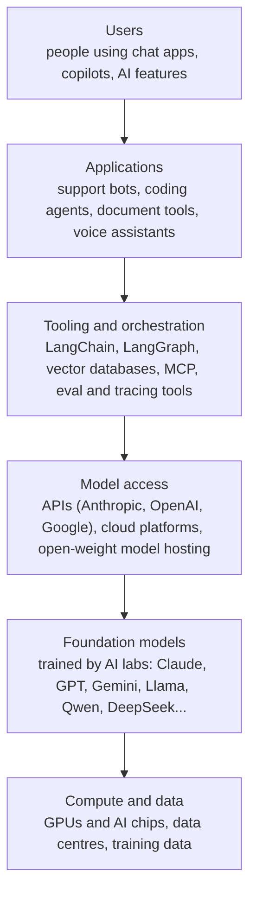
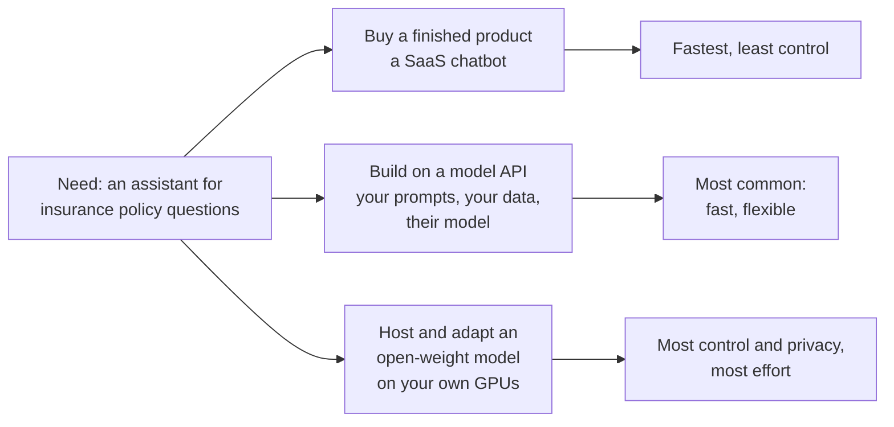
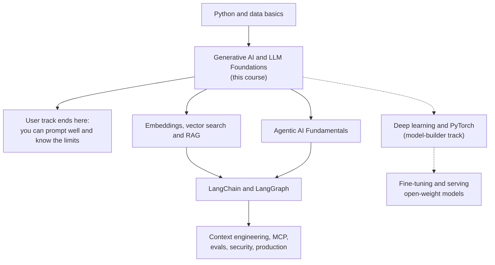

# The GenAI Roadmap: Builder vs User: The Complete Guide

> 📚 **Before you start**
>
> - [What is Generative AI?](what-is-generative-ai.md), for what generative AI is and what it can create.
> - [Generative vs Discriminative Models](generative-vs-discriminative-models.md), for why one generative model can replace many specialised ones.

## Introduction

Think about electricity. A family in Nagpur **uses** it: they switch on a fan, charge a phone, and never think about transformers or grid frequency. An electrician **builds with** it: wiring a house, choosing the right cable, fitting a breaker so a short circuit doesn't start a fire. An engineer at a power plant **builds the electricity itself**. All three "work with electricity", yet their skills barely overlap.

Generative AI has the same layers. A marketing executive who drafts campaigns in a chat app is a **user**. A developer who wires an LLM into the company's support portal is a **builder of applications**. A researcher at an AI lab who trains the model is a **builder of models**. Before you invest months of study, it helps to know which layer you want to work in, because the roadmap for each is different.

By the end of this lesson you'll be able to describe the layers of the GenAI stack, name the roles at each layer and what they do all day, decide whether to "build or buy" for a given problem, and plan your own learning path through this site.

> 💡 **Key Insight**
>
> Almost everyone who works with GenAI is a **user** or an **application builder**, not a model builder. Building applications on top of foundation models (prompting, retrieval, tools, evaluation) is where most jobs and most value are in 2026, and it needs software skills plus a solid understanding of how models behave, not a PhD.

---

## Core Explanation

### 1. The GenAI stack, layer by layer



| Layer | Who works here | What they produce | How many people |
|---|---|---|---|
| **Users** | Everyone: students, lawyers, marketers, developers | Better work, faster | Hundreds of millions |
| **Applications** | AI engineers, full-stack developers, product managers | Products and internal tools that use models | Very many, and growing fastest |
| **Tooling** | Framework and platform engineers | Libraries and services that make apps easier to build | Many |
| **Model access** | Cloud and ML platform engineers | Reliable, fast, affordable ways to call models | Fewer |
| **Foundation models** | Research scientists, ML engineers at labs | The models themselves | Few thousand worldwide at the frontier |
| **Compute** | Hardware and infrastructure engineers | Chips, clusters, data pipelines | Specialised |

The lower the layer, the more capital it takes. Training a frontier model costs hundreds of millions of dollars or more; building an application on top of one can start with a laptop and an API key.

### 2. User vs builder: the core difference

| | User | Builder |
|---|---|---|
| **Goal** | Get a task done with AI help | Make AI do a task reliably for many people |
| **Interface** | A chat window or an AI feature in a product | Code: APIs, prompts as templates, data pipelines |
| **Success looks like** | "This draft saved me an hour" | "This bot answers 80% of tickets correctly, costs ₹0.40 each and never leaks customer data" |
| **Handling mistakes** | Notice and fix them yourself | Measure error rates, add guardrails, design for failure |
| **Key skills** | Clear prompting, judging output, knowing limits | Programming, APIs, prompt design, retrieval, evaluation, security, cost control |

The big shift from user to builder is **from one good answer to reliable answers at scale**. A user can retry a bad answer. A builder's system answers 50,000 people a day and must work without anyone retrying.

### 3. The roles, and what they do all day

| Role | Typical day | What to learn first |
|---|---|---|
| **Power user** (any profession) | Uses AI for research, drafting, analysis; knows when not to trust it | Prompting, limits of LLMs (this course) |
| **Prompt / AI content specialist** | Designs and tests prompts and system prompts for a product, writes evaluation examples | This course, especially Module 4 |
| **AI engineer** (application builder) | Builds features with LLM APIs: retrieval over documents, tool-using agents, structured extraction; monitors quality and cost | Python, APIs, then RAG, LangChain or LangGraph, agents, evaluation |
| **ML engineer** | Fine-tunes models, runs evaluations, serves open-weight models efficiently | Deep learning, PyTorch, MLOps, then everything an AI engineer knows |
| **Research scientist** | Designs new training methods and architectures, runs large experiments | Strong maths, deep learning research, large-scale training |
| **AI product manager** | Decides what to build, defines quality targets, manages risk | User needs, model capabilities and limits, evaluation basics |

The **AI engineer** role grew out of software engineering when foundation models arrived. Before them, using ML in a product meant collecting labelled data and training a model; now a developer can often start with a prompt and an API call and only later decide whether training anything is worth it.

### 4. Build or buy? Three ways to get GenAI into a product

When a company wants, say, a WhatsApp assistant that answers questions about its insurance policies, it has three broad options:



| | Buy a product | Build on an API | Host an open-weight model |
|---|---|---|---|
| **Time to first version** | Days | Weeks | Weeks to months |
| **Control over behaviour** | Low | High (prompts, retrieval, tools) | Highest (you can fine-tune weights) |
| **Data leaves your servers?** | Yes | Yes, under the provider's data terms | No |
| **Cost shape** | Per seat or per conversation | Per token used | Fixed GPU cost, cheap per extra request |
| **Team needed** | Little | Software engineers who understand LLMs | Plus ML and infrastructure engineers |

Training your own foundation model from scratch is almost never the right answer for a normal company. It is a fourth option that only labs and a handful of very large organisations take.

A quick way to feel the cost trade-off is to compare paying per token with renting a GPU. The prices below are **made-up round numbers for illustration**; real prices change often, so always check current rates.

```python
# Illustrative numbers only, not real quotes.
api_cost_per_million_tokens_inr = 400      # blended input+output price for a mid-sized API model
tokens_per_conversation = 3_000            # question, retrieved policy text, answer
gpu_server_cost_per_month_inr = 250_000    # renting a GPU server that can host an open-weight model

for conversations_per_month in [10_000, 100_000, 1_000_000, 5_000_000]:
    api = conversations_per_month * tokens_per_conversation / 1_000_000 * api_cost_per_million_tokens_inr
    cheaper = "API" if api < gpu_server_cost_per_month_inr else "self-host"
    print(f"{conversations_per_month:>9,} chats/month: API ₹{api:>12,.0f} vs GPU ₹{gpu_server_cost_per_month_inr:,} -> {cheaper}")
```

Output:

```
   10,000 chats/month: API ₹      12,000 vs GPU ₹250,000 -> API
  100,000 chats/month: API ₹     120,000 vs GPU ₹250,000 -> API
1,000,000 chats/month: API ₹   1,200,000 vs GPU ₹250,000 -> self-host
5,000,000 chats/month: API ₹   6,000,000 vs GPU ₹250,000 -> self-host
```

At low volume the API is far cheaper. At very high volume a fixed GPU cost can win, **if** the open model is good enough for the task and you have people to run it. Real decisions also weigh quality, privacy rules, latency and engineering time, and at millions of chats a month you would need several servers, not one; this toy ignores all of that. You will revisit this in [The GenAI Project Lifecycle](../course.md#m5).

### 5. A roadmap through this site



- **User track**: this course alone makes you a much stronger user. Modules 3 and 4 are the most useful.
- **Application-builder track (most learners)**: continue to [Embeddings and Similarity Search](../../vector-databases-for-ai/course.md#m2), [Retrieval-Augmented Generation](../../retrieval-augmented-generation-rag/course.md), [Agentic AI Fundamentals](../../agentic-ai-fundamentals/course.md) and [LangGraph Fundamentals](../../langgraph-fundamentals/course.md), then the production topics such as [Agent Evals, Observability and Reliability](../../agent-evals-observability-and-reliability/course.md).
- **Model-builder track**: go deep on [Deep Learning with PyTorch](../../deep-learning-with-pytorch/course.md) and the [Transformers module](../../sequence-models-attention-and-transformers/course.md#m5), then study fine-tuning and serving.

### 6. Skills that matter on every path

Whatever layer you pick, five skills transfer:

1. **A correct mental model of LLMs**: tokens, next-token prediction, training stages, sampling, context. (Module 3.)
2. **Clear specification**: saying exactly what you want, in what format, with what constraints. (Module 4.)
3. **Evaluation**: deciding what "good" means and measuring it on real examples, not by eyeballing three outputs.
4. **Healthy scepticism**: checking facts, numbers and code, and knowing the failure modes. ([Where LLMs Fail](../course.md#m3).)
5. **Keeping current without chasing hype**: models change every few months; fundamentals don't.

---

## Try It Yourself

1. **Classify the role.** For each person, say whether they are a user, an application builder or a model builder: (a) a CA who uses a chat app to summarise new tax circulars; (b) a developer who builds a bot that answers questions from a company's HR policy PDFs; (c) an engineer who fine-tunes an open model on Tamil legal text.
2. **Find the break-even point.** Using the numbers in the cost example, how many conversations per month make the API cost equal the GPU cost?
3. **Change the assumption.** If retrieval adds so much context that each conversation uses 12,000 tokens, where is the break-even now?

<details>
<summary>Show answers</summary>

**1.** (a) user, (b) application builder, (c) model builder (adapting a model's weights), though they may also build the application around it.

**2.** and **3.**

```python
def break_even(tokens_per_chat):
    cost_per_chat = tokens_per_chat / 1_000_000 * api_cost_per_million_tokens_inr
    return gpu_server_cost_per_month_inr / cost_per_chat

print(f"3,000 tokens per chat:  break-even at {break_even(3_000):,.0f} chats/month")
print(f"12,000 tokens per chat: break-even at {break_even(12_000):,.0f} chats/month")
```

Output:

```
3,000 tokens per chat:  break-even at 208,333 chats/month
12,000 tokens per chat: break-even at 52,083 chats/month
```

Quadrupling the tokens per conversation cuts the break-even volume to a quarter. Token usage per request is often the biggest driver of GenAI cost, which is why [Tokens and Context Windows](../course.md#m3) matters so much for builders.

</details>

---

## Real-World Examples

- **Users**: lawyers summarising judgments, teachers creating worksheets in regional languages, analysts drafting reports, developers asking for help with an error message.
- **Application builders**: a fintech company adds a "explain my statement" assistant; a hospital builds a tool that drafts discharge summaries for doctors to review; an e-commerce firm generates product listings in eight languages.
- **Model builders**: AI labs training frontier models; Indian research groups and companies building models tuned for Indian languages; enterprises fine-tuning open-weight models on their own data for privacy.

---

## Common Misconceptions

### "To work in GenAI I need to train my own models"

Most GenAI work is building on existing models. Training is a specialised path, and even many ML engineers mostly adapt and serve models rather than train them from scratch.

### "Prompt engineering is a whole career on its own"

It is a vital skill, but in most teams it is part of the AI engineer's or product person's job, combined with evaluation, retrieval and software engineering.

### "Builders don't need to understand how models work; the API hides it"

The API hides the maths, not the behaviour. Builders who don't understand tokens, sampling, context limits and hallucination ship systems that are expensive, flaky and unsafe.

### "Self-hosting is always cheaper"

Only at high, steady volume, with a model that is good enough, and with the team to run it. Many companies start on APIs and move some traffic to self-hosted models later.

---

## Interview Relevance

*"What does an AI engineer do, compared with an ML engineer or a data scientist?"* A strong answer: an AI engineer builds products on top of foundation models, using APIs, prompts, retrieval, tools and agents, and owns quality, cost and safety through evaluation and monitoring; an ML engineer trains, fine-tunes and serves models; a data scientist analyses data and builds predictive models. Expect follow-ups on **build vs buy**: discuss time to market, control, data privacy, cost shape (per token versus fixed GPU cost), and team skills, and say you'd usually start with an API and revisit the decision when volume, cost or privacy demands it.

---

## Key Takeaways

- **The GenAI stack has layers**: compute, foundation models, model access, tooling, applications and users.
- **Most jobs are at the application layer**, building reliable products on foundation models.
- **Users need one good answer; builders need reliable answers at scale**, which brings evaluation, guardrails and cost control.
- **Buy, build on an API, or self-host an open model**: choose by time, control, privacy, cost shape and team.
- **Understanding how LLMs work pays off on every path**, which is what the rest of this course gives you.

---

**Up next:** [Foundation Models](foundation-models.md)
