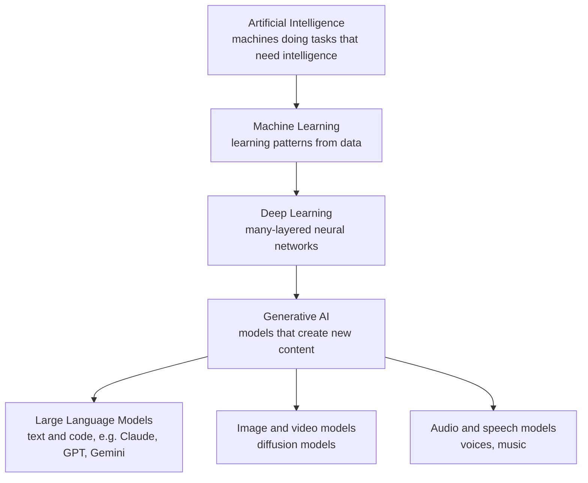
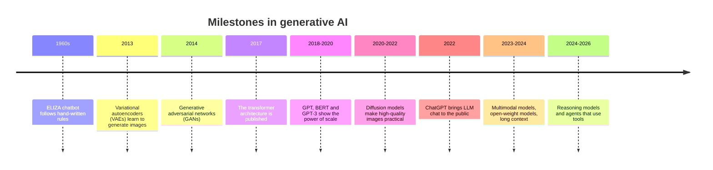

# What is Generative AI?: The Complete Guide

> 📚 **Before you start**
>
> - [How This Course Works](../01-start-here/how-this-course-works.md), for how the course is organised.
> - No other prior knowledge is needed. If you have met machine learning before (for example in [Machine Learning Foundations: Data, EDA and Features](../../machine-learning-foundations-data-eda-and-features/course.md)), you will recognise some words, but every term is explained here.

## Introduction

Walk into any busy chai stall in Mumbai and listen for a minute. *"Ek cutting."* *"Do masala chai, ek samosa."* *"Ek vada pav aur ek cutting."* The chaiwala has heard thousands of orders. If you asked him to invent a new, realistic order he has never heard before, he could do it instantly: *"Do cutting aur ek vada pav."* He isn't copying any single customer. He has absorbed the **patterns** of orders (a number, an item, maybe "aur" and another item) and can produce fresh examples that fit those patterns.

That is the core idea of **generative AI**. A generative AI system studies a huge collection of examples (text, photos, songs, code), learns the patterns in them, and then **produces new examples that follow the same patterns**. When a chat app writes you a poem, when an image tool paints "a tiger in a Kerala houseboat, watercolour style", when a coding assistant writes a function, they are all doing the chaiwala's trick at an enormous scale.

By the end of this lesson you will be able to define generative AI precisely, place it in the AI family tree, name what it can generate today, see a tiny working generative model in Python, and explain both what makes it powerful and where it goes wrong.

> 💡 **Key Insight**
>
> **Generative AI learns the patterns of its training data well enough to produce new data that looks like it came from the same source.** It does not retrieve stored answers. It creates new content one piece at a time by asking, again and again, *"given what I've produced so far, what is a likely next piece?"*

---

## Core Explanation

### 1. A precise definition

**Generative AI** is the branch of artificial intelligence concerned with models that **create new content** (text, images, audio, video, code, 3D shapes, molecules) rather than only analysing or labelling existing content.

Three words in that definition carry the weight:

| Word | What it means here |
|---|---|
| **Model** | A mathematical function with millions or billions of adjustable numbers called **parameters** (or **weights**). Training adjusts them until the model is good at its task. |
| **Create** | The output did not exist before. It is not looked up from a database; it is assembled piece by piece. |
| **Content** | Anything that can be represented as data: words, pixels, sound samples, program code. |

Compare that with the kind of AI most people met first. A spam filter reads an email and outputs one label: *spam* or *not spam*. A loan model reads an application and outputs a number: the chance of default. These models **judge** existing data. A generative model **makes** new data. (Lesson 3 of this module, [Generative vs Discriminative Models](generative-vs-discriminative-models.md), makes this distinction mathematically precise.)

### 2. Where generative AI sits in the AI family tree



- **Artificial intelligence (AI)** is the broad goal: computers doing things that seem to need intelligence.
- **Machine learning (ML)** is the dominant way of getting there: instead of writing rules by hand, you show the computer examples and let it learn the rules.
- **Deep learning** is machine learning with **neural networks** that have many layers. Almost all modern generative AI is deep learning.
- **Generative AI** is the part of deep learning (and some older ML) aimed at creating content.
- **Large language models (LLMs)** are the most famous generative models: they generate text, and because code and structured data are text too, they also generate code and JSON.

### 3. What can it generate today?

| Modality | Example tasks | Example products and model families (2026) |
|---|---|---|
| **Text** | Answer questions, summarise, translate, draft emails, tutor | Claude, ChatGPT, Gemini, open models such as Llama, Qwen, DeepSeek and Mistral |
| **Code** | Write functions, fix bugs, explain a codebase | Claude Code, GitHub Copilot, Cursor, OpenAI Codex |
| **Images** | Create illustrations, product photos, edit pictures with words | Image models from OpenAI, Google, Midjourney, Stable Diffusion family |
| **Audio and speech** | Natural text-to-speech in many Indian languages, voice cloning, music | Speech models from most major labs; music generators |
| **Video** | Short clips from a text prompt, animating a still image | Video models from Google, OpenAI and others |
| **Structured data** | JSON records, synthetic test data, database queries | Any LLM with structured output |
| **Science** | Protein structures, candidate drug molecules, materials | Specialised research models |

Two trends matter more than any single product:

- **Multimodal models.** The leading models no longer handle just one kind of data. The same model can read a photo of a handwritten bill, listen to a voice note and answer in text. You will study these in [Recent Breakthroughs in GenAI](../05-advances-and-applications/recent-breakthroughs-in-genai.md).
- **From generating to doing.** Generative models are increasingly used as the "brain" of **agents** that take actions (search, book, send) rather than only producing content. That is the subject of the [Agentic AI Fundamentals](../../agentic-ai-fundamentals/course.md) course that follows this one.

### 4. A tiny generative model you can read in one screen

The best way to understand "learn patterns, then create new examples" is to build the smallest possible version. The model below learns, from five chai-stall orders, **which word tends to follow which**. Then it generates new orders by repeatedly picking a plausible next word. This is called a **bigram model** (a "bigram" is a pair of neighbouring words).

```python
import random
from collections import defaultdict

corpus = [
    "one cutting chai please",
    "one masala chai please",
    "two cutting chai and one samosa please",
    "one samosa and two masala chai please",
    "two vada pav and one cutting chai please",
]

# Training: for every word, remember every word that came right after it.
follows = defaultdict(list)
for sentence in corpus:
    words = ["<start>"] + sentence.split() + ["<end>"]
    for current, nxt in zip(words, words[1:]):
        follows[current].append(nxt)

print("After 'one' we saw:", sorted(set(follows["one"])))
print("After 'chai' we saw:", sorted(set(follows["chai"])))
```

Output:

```
After 'one' we saw: ['cutting', 'masala', 'samosa']
After 'chai' we saw: ['and', 'please']
```

That table of "what follows what" is the whole model. Its **parameters** are just counts. Now let's generate. We start at `<start>`, pick a random word that followed it in training, then a word that followed *that*, and so on until we pick `<end>`.

```python
def generate(seed):
    rng = random.Random(seed)          # a seeded random generator, so the output is repeatable
    word, out = "<start>", []
    while True:
        word = rng.choice(follows[word])   # words seen more often are chosen more often
        if word == "<end>":
            return " ".join(out)
        out.append(word)

for seed in range(8):
    order = generate(seed)
    label = "copied" if order in corpus else "NEW"
    print(f"{label:<7}{order}")
```

Output:

```
NEW    one samosa please
NEW    one cutting chai and one samosa and two vada pav and one samosa please
NEW    one cutting chai and one samosa and one masala chai please
copied one cutting chai please
NEW    one samosa please
NEW    two masala chai please
NEW    two cutting chai and one cutting chai please
NEW    two cutting chai please
```

Look closely at the lines marked **NEW**. Seven of the eight orders never appeared in the training data, yet "two masala chai please" and "one samosa please" are perfectly sensible orders. That is generation: **new content that follows learned patterns**.

You should also spot the weaknesses, because every one of them has a big brother in real LLMs:

- **It only looks one word back.** After "chai" it can't remember that it has already ordered three things, so it rambles ("one cutting chai and one samosa and two vada pav and one samosa please") or repeats itself ("two cutting chai and one cutting chai"). Real LLMs look back over thousands or millions of words using a mechanism called **attention** (Module 3).
- **It can only use words it has seen.** It will never say "filter coffee". Real LLMs train on trillions of words, so their vocabulary of patterns is vast, but they still know nothing past their training data unless you give it to them.
- **It is fluent, not truthful.** It happily produces orders no one placed. A real LLM, likewise, produces **plausible** text; whether that text is **true** is a separate question. This is the root of **hallucination**, covered in [Where LLMs Fail](../03-how-llms-work/where-llms-fail.md).

### 5. How we got here: a short history



Three forces drove the jump from toy models to today's systems:

1. **Better architectures.** The **transformer** (2017) handles long text efficiently and scales smoothly as you make it bigger.
2. **More data.** Training sets grew from millions of words to many trillions of tokens of web pages, books, code and more.
3. **More compute.** Thousands of GPUs training for months made models with hundreds of billions of parameters possible.

The striking discovery of the late 2010s was that **simply scaling up** the same next-word-prediction recipe kept producing new abilities: translation, summarisation, coding, step-by-step reasoning. That is why the big labs invested so heavily, and why one model can now do so many jobs. You'll see why this matters in [Foundation Models](foundation-models.md).

### 6. What makes generative AI useful, and what makes it risky

| Strengths | Risks and limits |
|---|---|
| **One model, many tasks**: the same LLM writes, translates, summarises and codes | **Hallucination**: fluent, confident, wrong |
| **Natural-language interface**: anyone can use it without learning a query language | **Knowledge cutoff**: it knows nothing after its training data ends unless you supply it |
| **Speed**: a first draft in seconds | **Bias**: it can repeat stereotypes present in its training data |
| **Personalisation**: adapts tone and level to the reader | **Privacy and IP**: questions about what data it trained on and what you send to it |
| **Works across languages**, including Hindi, Tamil, Bengali and many more | **Misuse**: deepfakes, scams, spam at scale |
| | **Cost**: large models need serious compute to run |

Good engineers hold both columns in mind. The rest of this course shows you how to get the left column while managing the right one.

---

## Try It Yourself

1. **Add data, get variety.** Add the sentence `"one filter coffee please"` to `corpus`, rebuild `follows`, and generate 8 orders again. Does "filter coffee" ever appear? Can "two filter coffee" appear even though you never trained on it?
2. **Measure novelty.** Generate 200 orders (seeds 0 to 199) with the original corpus. What fraction are brand new (not in the corpus)?
3. **Spot the nonsense.** Among those 200, find any order that contains the word `"please"` more than once. Why can the model produce it?

<details>
<summary>Show answers</summary>

**1.** Rebuild the table with the extra sentence and look at what can follow "two" and "filter".

```python
corpus2 = corpus + ["one filter coffee please"]
follows = defaultdict(list)
for sentence in corpus2:
    words = ["<start>"] + sentence.split() + ["<end>"]
    for current, nxt in zip(words, words[1:]):
        follows[current].append(nxt)

print("After 'one':", sorted(set(follows["one"])))
print("After 'filter':", sorted(set(follows["filter"])))
```

Output:

```
After 'one': ['cutting', 'filter', 'masala', 'samosa']
After 'filter': ['coffee']
```

Because "filter" can follow "one", and "one" can follow "and", the model can now produce orders like "two cutting chai and one filter coffee please", which it never saw. "two filter coffee" is impossible, though: "filter" was only ever seen after "one", so the pair "two filter" has a count of zero. A bigram model can only recombine pairs it has seen.

**2.** Restore the original table, then count.

```python
follows = defaultdict(list)
for sentence in corpus:
    words = ["<start>"] + sentence.split() + ["<end>"]
    for current, nxt in zip(words, words[1:]):
        follows[current].append(nxt)

orders = [generate(seed) for seed in range(200)]
new = [o for o in orders if o not in corpus]
print(f"{len(new)} of 200 are new ({len(new) / 200:.0%})")
```

Output:

```
132 of 200 are new (66%)
```

**3.**

```python
odd = [o for o in orders if o.split().count("please") > 1]
print(len(odd), "orders say 'please' more than once")
```

Output:

```
0 orders say 'please' more than once
```

None, because "please" is only ever followed by `<end>` in the training data, so the model always stops right after it. Other oddities do appear, though: after "chai" the model may choose "and" and keep going, because it has no memory of how many items it has already ordered. It only sees the previous word. Longer memory (context) is exactly what transformers add.

</details>

---

## Real-World Examples

- **Customer support drafting.** Banks and telecom companies use LLMs to draft replies that a human agent reviews and sends, cutting response times.
- **Coding assistants.** Developers accept, edit or reject code suggested by an LLM inside their editor. Coding is one of the most widely used GenAI applications in 2026.
- **Marketing and e-commerce.** Sellers generate product descriptions in several Indian languages from a short spec sheet, and generate product photos on clean backgrounds.
- **Accessibility.** Text-to-speech in regional languages reads government forms or news aloud; speech-to-text lets people search by voice.
- **Education.** Tutoring apps explain a maths step three different ways until one clicks, in the student's own language.

---

## Common Misconceptions

### "Generative AI copies and pastes from the internet"

It generates new sequences from learned patterns. It *can* reproduce text it saw many times (famous quotes, common code), which is why copyright and memorisation are real concerns, but normal output is newly assembled, not retrieved.

### "Generative AI understands what it says the way a person does"

It models patterns in data extremely well, well enough to reason through many problems. But it has no lived experience, and it can state falsehoods with the same confidence as facts. Treat it as a very capable, sometimes wrong, collaborator.

### "Generative AI means chatbots"

Chat is one interface. The same models write code, fill forms, generate images, speak, and power agents that act on your behalf.

### "Bigger is always better"

Bigger models are usually more capable, but they cost more and respond more slowly. Many real products use small, fast models for simple steps and large ones only where needed.

---

## Interview Relevance

*"What is generative AI, and how is it different from traditional ML?"* A strong answer: generative AI models learn the distribution of their training data well enough to **sample new data** from it (text, images, audio, code), while traditional discriminative models learn to **map inputs to labels or numbers**. Mention that modern generative AI is mostly deep learning, that LLMs are the text branch and work by next-token prediction, and that scale (data, parameters, compute) unlocked general abilities. Strong candidates also name the limits (hallucination, knowledge cutoff, bias, cost) and how teams mitigate them (grounding with retrieval, human review, evaluation).

Follow-ups you might get: *"Give an example of a generative model that isn't a neural network"* (an n-gram text model like the bigram one above, or a Gaussian mixture model). *"Why did generative AI take off around 2022?"* (transformers, scale, instruction tuning and RLHF made models useful and safe enough for the public; see [Foundation Models](foundation-models.md) and [What is a Large Language Model?](../03-how-llms-work/what-is-a-large-language-model.md)).

---

## Key Takeaways

- **Generative AI creates new content** (text, images, audio, video, code) by learning patterns from examples.
- **It sits inside deep learning**, and LLMs are its best-known text-and-code branch.
- **Generation is repeated "what comes next?"**, as the bigram model showed: learn which pieces follow which, then sample.
- **Fluent is not the same as true**: the same mechanism that creates novel sentences also creates confident errors.
- **Scale plus the transformer** turned toy generators into general-purpose assistants.

---

**Up next:** [How Generative Models Work](how-generative-models-work.md)
