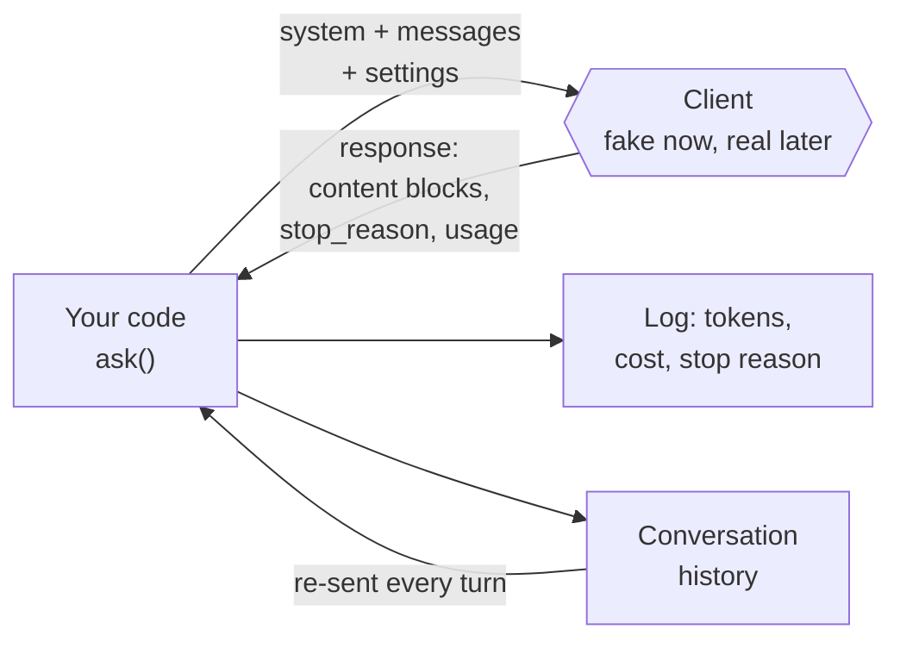

# Lab: Your First LLM API Call

> 📚 **Before you start**
>
> - [What is a Large Language Model?](what-is-a-large-language-model.md), for what happens inside the model when you call it.
> - [Tokens and Context Windows](tokens-and-context-windows.md), for token counts, costs and statelessness.
> - [Temperature and Model Settings](temperature-and-model-settings.md), for `max_tokens`, stop reasons and effort.
> - Python functions, dictionaries and `try`/`except` from [Python Fundamentals](../../python-fundamentals/course.md).

## What You'll Build

A small, **production-shaped** Python helper for talking to an LLM, called `ask()`, plus a multi-turn chat on top of it. It will:

1. Send a **system prompt** and **messages** in the standard chat format.
2. Read the reply the right way: check the **stop reason**, extract the **text blocks**, and record **token usage**.
3. Work out the **cost** of every call in rupees.
4. Keep a **conversation history**, because the API remembers nothing.
5. **Retry** temporary failures with exponential backoff.

You'll build and test everything **offline** with a fake model, so it runs for free with predictable output. At the end, you swap in the real Anthropic client with a few changed lines.



> 💡 **Key Insight**
>
> An LLM API call is just an HTTP request: you send **a list of messages and some settings**, and you get back **content blocks, a stop reason and a usage count**. The skill isn't making the call; it's **handling the response properly**: checking why it stopped, logging tokens and cost, keeping history yourself, and coping with failures.

---

## Step 1: Setting Up (for the real call later)

You don't need any of this for the offline steps, but here is what a real setup looks like, so you know where you're heading.

```bash
pip install anthropic
export ANTHROPIC_API_KEY="sk-ant-..."     # on Windows PowerShell: $env:ANTHROPIC_API_KEY="sk-ant-..."
```

Three rules about API keys, from day one:

- **Never paste a key into your code** or a notebook you might share. Read it from an environment variable (the SDK does this automatically) or a secrets manager.
- **Never commit a key to Git.** If you do by accident, revoke it immediately in the provider's console; deleting the commit isn't enough.
- **Set a spending limit** in the provider's console while you're learning.

## Step 2: The Message Format

Every major chat API uses the same idea: a list of **messages**, each with a **role** and **content**.

| Role | Who writes it | Example |
|---|---|---|
| `system` | You, the developer: instructions for the whole conversation | "You are a helpful assistant for an Indian railway enquiry desk." |
| `user` | The person using your app | "Is the 12951 Rajdhani vegetarian-friendly?" |
| `assistant` | The model (its earlier replies, which you send back) | "Yes, you can choose a vegetarian meal when booking..." |

In Anthropic's Messages API, the system prompt is a separate `system` parameter and `messages` alternates between `user` and `assistant`, starting with `user`. You'll study roles properly in [System Prompts and Roles](../course.md#m4).

```python
system_prompt = "You are a friendly assistant for Chai Junction, a café in Pune. Answer in at most two sentences."
messages = [
    {"role": "user", "content": "Do you have any sugar-free options?"},
]
print(f"{len(messages)} message(s); first role: {messages[0]['role']}")
```

Output:

```
1 message(s); first role: user
```

## Step 3: A First Call with a Fake Model

LangChain ships a **fake chat model** that returns scripted replies. It's perfect for learning the shape of a call without a key or a bill.

```python
from langchain_core.language_models.fake_chat_models import FakeListChatModel
from langchain_core.messages import HumanMessage, SystemMessage

fake_llm = FakeListChatModel(responses=[
    "Yes! We serve sugar-free masala chai and unsweetened green tea, and any drink can be made with jaggery instead of sugar.",
])

reply = fake_llm.invoke([SystemMessage(system_prompt), HumanMessage(messages[0]["content"])])
print(type(reply).__name__)
print(reply.content)
```

Output:

```
AIMessage
Yes! We serve sugar-free masala chai and unsweetened green tea, and any drink can be made with jaggery instead of sugar.
```

That's the whole idea of a call: messages in, a message out. But a real API response carries much more than text, and production code needs all of it. So next we build a pretend client that returns the **same shape** as Anthropic's real responses.

## Step 4: A Pretend Client with a Realistic Response

A real Messages API response contains:

- `content`: a **list of blocks**. Usually `text` blocks, but reasoning models also return `thinking` blocks, and tool-using calls return `tool_use` blocks. Never assume `content[0]` is your text.
- `stop_reason`: why generation ended (`end_turn`, `max_tokens`, `stop_sequence`, `tool_use`, or `refusal` if the model declined for safety reasons).
- `usage`: `input_tokens` and `output_tokens`.

```python
from dataclasses import dataclass, field

@dataclass
class Block:
    type: str
    text: str = ""

@dataclass
class Usage:
    input_tokens: int
    output_tokens: int

@dataclass
class Response:
    content: list
    stop_reason: str
    usage: Usage
    model: str = "pretend-model"

def rough_token_count(text):
    return max(1, round(len(text) / 4))          # about 4 characters per token in English

class PretendClient:
    """Mimics the shape of client.messages.create(...) responses, using scripted replies."""
    def __init__(self, replies):
        self.replies = list(replies)
        self.calls = 0

    def create(self, model, max_tokens, system, messages):
        self.calls += 1
        reply = self.replies.pop(0)
        sent = system + " ".join(m["content"] for m in messages)
        words = reply.split()
        out_tokens = rough_token_count(reply)
        stop = "end_turn"
        if out_tokens > max_tokens:                       # simulate truncation
            reply = " ".join(words[: max_tokens * 3 // 4])
            out_tokens, stop = max_tokens, "max_tokens"
        return Response(
            content=[Block("thinking", ""), Block("text", reply)],   # a hidden thinking block, then the text
            stop_reason=stop,
            usage=Usage(rough_token_count(sent), out_tokens),
        )

client = PretendClient(["We serve sugar-free masala chai and unsweetened green tea. Any drink can be made with jaggery."])
response = client.create(model="pretend-model", max_tokens=200, system=system_prompt, messages=messages)
print(response.stop_reason)
print([b.type for b in response.content])
print(response.usage)
```

Output:

```
end_turn
['thinking', 'text']
Usage(input_tokens=33, output_tokens=24)
```

Notice the first content block is a `thinking` block with no visible text. Code that blindly reads `response.content[0].text` would print an empty string here. That exact bug is common in real projects.

## Step 5: The `ask()` Helper

Now the core of the lab. `ask()` sends a request, then handles the response properly: it **extracts only text blocks**, **checks the stop reason**, and **logs tokens and cost**.

```python
PRICE_PER_MTOK_INR = {"pretend-model": (350.0, 1750.0)}    # (input, output), made-up prices in rupees

call_log = []

def ask(client, system, messages, model="pretend-model", max_tokens=300):
    response = client.create(model=model, max_tokens=max_tokens, system=system, messages=messages)

    text = "".join(block.text for block in response.content if block.type == "text")

    if response.stop_reason == "max_tokens":
        text += "  [WARNING: reply was cut off at max_tokens]"
    elif response.stop_reason == "refusal":
        text = "[The model declined this request.]"

    price_in, price_out = PRICE_PER_MTOK_INR[model]
    cost = response.usage.input_tokens / 1e6 * price_in + response.usage.output_tokens / 1e6 * price_out
    call_log.append({"in": response.usage.input_tokens, "out": response.usage.output_tokens,
                     "stop": response.stop_reason, "cost_inr": cost})
    return text

client = PretendClient(["We serve sugar-free masala chai and unsweetened green tea. Any drink can be made with jaggery."])
print(ask(client, system_prompt, messages))
print(call_log[-1])
```

Output:

```
We serve sugar-free masala chai and unsweetened green tea. Any drink can be made with jaggery.
{'in': 33, 'out': 24, 'stop': 'end_turn', 'cost_inr': 0.05355}
```

Let's prove the truncation check works by setting a tiny `max_tokens`:

```python
client = PretendClient(["Our menu has cutting chai, masala chai, elaichi chai, ginger lemon tea, cold coffee, filter coffee, bun maska, poha and vada pav."])
print(ask(client, system_prompt, [{"role": "user", "content": "What's on the menu?"}], max_tokens=10))
```

Output:

```
Our menu has cutting chai, masala chai,  [WARNING: reply was cut off at max_tokens]
```

Without that check, your app would silently show customers half a menu.

## Step 6: Multi-turn Conversation

The API is **stateless**. To have a conversation, you keep the history and send all of it every time, adding the model's reply as an `assistant` message.

```python
class Chat:
    def __init__(self, client, system):
        self.client, self.system, self.history = client, system, []

    def send(self, user_text):
        self.history.append({"role": "user", "content": user_text})
        reply = ask(self.client, self.system, self.history)
        self.history.append({"role": "assistant", "content": reply})
        return reply

call_log.clear()
chat = Chat(PretendClient([
    "Yes, we have sugar-free masala chai and unsweetened green tea.",
    "The sugar-free masala chai is ₹40 and green tea is ₹50.",
    "Great choice! One sugar-free masala chai will be ready at the counter in five minutes.",
]), system_prompt)

for question in ["Any sugar-free options?", "How much do they cost?", "I'll take the first one."]:
    print("You:  ", question)
    print("Café: ", chat.send(question))

for i, entry in enumerate(call_log, 1):
    print(f"call {i}: input {entry['in']:>3} tokens, output {entry['out']:>2} tokens, ₹{entry['cost_inr']:.4f}")
```

Output:

```
You:   Any sugar-free options?
Café:  Yes, we have sugar-free masala chai and unsweetened green tea.
You:   How much do they cost?
Café:  The sugar-free masala chai is ₹40 and green tea is ₹50.
You:   I'll take the first one.
Café:  Great choice! One sugar-free masala chai will be ready at the counter in five minutes.
call 1: input  30 tokens, output 16 tokens, ₹0.0385
call 2: input  51 tokens, output 14 tokens, ₹0.0423
call 3: input  72 tokens, output 22 tokens, ₹0.0637
```

Look at the input tokens: they **grow every turn**, because each call re-sends the whole conversation. The second question, *"How much do they cost?"*, only makes sense because the history tells the model what "they" are. Forget to send history and the model has no idea.

## Step 7: Retrying Temporary Failures

Real APIs sometimes fail temporarily: **rate limits** (HTTP 429, you sent too many requests), **overloaded servers** (HTTP 529 or 5xx) and network blips. The standard fix is **retry with exponential backoff**: wait 1 second, then 2, then 4, with a little randomness, and give up after a few attempts. Errors like a bad request (400) or a wrong key (401) should **not** be retried; they'll fail every time.

```python
import random

class TemporaryError(Exception):
    """Stands in for rate-limit and overload errors."""

class FlakyClient(PretendClient):
    def __init__(self, replies, failures):
        super().__init__(replies)
        self.failures = failures

    def create(self, **kwargs):
        if self.failures > 0:
            self.failures -= 1
            raise TemporaryError("529 overloaded")
        return super().create(**kwargs)

def ask_with_retry(client, system, messages, attempts=4, base_delay=1.0, sleep=lambda s: None):
    for attempt in range(1, attempts + 1):
        try:
            return ask(client, system, messages)
        except TemporaryError as err:
            if attempt == attempts:
                raise
            delay = base_delay * 2 ** (attempt - 1) + random.uniform(0, 0.1)
            print(f"attempt {attempt} failed ({err}); retrying in {delay:.1f}s")
            sleep(delay)              # in real code: time.sleep(delay)

random.seed(0)
flaky = FlakyClient(["Yes, we are open until 11 pm."], failures=2)
print(ask_with_retry(flaky, system_prompt, [{"role": "user", "content": "Are you open late?"}]))
```

Output:

```
attempt 1 failed (529 overloaded); retrying in 1.1s
attempt 2 failed (529 overloaded); retrying in 2.1s
Yes, we are open until 11 pm.
```

We pass a do-nothing `sleep` so the example runs instantly; real code waits. Good news: the official SDKs already retry these errors automatically (twice by default, configurable), so in practice you mostly tune that setting rather than writing this loop yourself. Writing it once shows you what's happening.

## Step 8: The Real Call

When you have an API key, the real version of `ask()` is almost identical. Only the client and the field names you already know change.

```python
# not-run: needs the anthropic package and an API key
import anthropic

client = anthropic.Anthropic()          # reads ANTHROPIC_API_KEY from the environment

response = client.messages.create(
    model="claude-opus-5-5",
    max_tokens=1024,
    system="You are a friendly assistant for Chai Junction, a café in Pune. Answer in at most two sentences.",
    messages=[{"role": "user", "content": "Do you have any sugar-free options?"}],
)

text = "".join(block.text for block in response.content if block.type == "text")
print(response.stop_reason)
print(text)
print(response.usage.input_tokens, response.usage.output_tokens)
```

Example output:

```
end_turn
We can make most of our chais without sugar, and we also serve unsweetened green tea. If you like a little sweetness, ask for jaggery instead of sugar.
41 63
```

The output token count includes any thinking the model did before writing. For chat interfaces, use **streaming** so text appears as it's generated instead of after a pause:

```python
# not-run: needs the anthropic package and an API key
with client.messages.stream(
    model="claude-opus-5-5",
    max_tokens=1024,
    messages=[{"role": "user", "content": "Explain UPI to my grandmother in three sentences."}],
) as stream:
    for chunk in stream.text_stream:
        print(chunk, end="", flush=True)
    final = stream.get_final_message()
print("\n", final.usage.output_tokens, "output tokens")
```

Other providers' SDKs (OpenAI, Google) follow the same pattern with different names: a client, a create call with a model, messages and settings, and a response with content, a finish reason and usage.

---

## Try It Yourself

1. **Total cost.** Using `call_log` from the conversation in Step 6, print the total cost of the three calls and the share that came from input tokens.
2. **Trim the history.** Change `Chat.send` so it only sends the last 2 messages of history plus the new one. Run the same three questions with a fresh `PretendClient`. What would go wrong with a real model?
3. **Don't retry a bad request.** Add a `BadRequestError` exception that `ask_with_retry` re-raises immediately without retrying, and test it.

<details>
<summary>Show answers</summary>

**1.**

```python
conversation_calls = call_log[:3]          # Step 7's retry demo appended a fourth entry
total = sum(e["cost_inr"] for e in conversation_calls)
input_cost = sum(e["in"] / 1e6 * PRICE_PER_MTOK_INR["pretend-model"][0] for e in conversation_calls)
print(f"Total ₹{total:.4f}; input share {input_cost / total:.0%}")
```

Output:

```
Total ₹0.1446; input share 37%
```

**2.**

```python
class ShortMemoryChat(Chat):
    def send(self, user_text):
        self.history.append({"role": "user", "content": user_text})
        reply = ask(self.client, self.system, self.history[-3:])     # last 2 messages + the new one
        self.history.append({"role": "assistant", "content": reply})
        return reply

call_log.clear()
short = ShortMemoryChat(PretendClient(["Yes.", "₹40.", "Done."]), system_prompt)
for q in ["Any sugar-free options?", "How much do they cost?", "I'll take the first one."]:
    short.send(q)
print([e["in"] for e in call_log])
```

Output:

```
[30, 37, 37]
```

Input stays smaller, but on the third turn the model no longer sees the first question, so "the first one" may be ambiguous. Real systems trim *carefully*: they keep a summary of older turns, or the key facts, instead of just cutting.

**3.**

```python
class BadRequestError(Exception):
    pass

class BrokenClient(PretendClient):
    def create(self, **kwargs):
        raise BadRequestError("400: messages must start with a user turn")

def ask_with_retry_v2(client, system, messages, attempts=4):
    for attempt in range(1, attempts + 1):
        try:
            return ask(client, system, messages)
        except BadRequestError:
            raise                                      # retrying can't fix a malformed request
        except TemporaryError:
            if attempt == attempts:
                raise

try:
    ask_with_retry_v2(BrokenClient([]), system_prompt, [])
except BadRequestError as err:
    print("Failed fast:", err)
```

Output:

```
Failed fast: 400: messages must start with a user turn
```

</details>

---

## What You've Learned

- **A call is messages plus settings in; content blocks, a stop reason and usage out.**
- **Read only `text` blocks** and **always check `stop_reason`** for `max_tokens` truncation and refusals.
- **Log tokens and cost on every call**; input tokens grow as conversations get longer.
- **The API is stateless**: you keep the history and re-send it.
- **Retry temporary errors with backoff; fail fast on bad requests.** The official SDKs already retry common temporary errors.
- **Build offline first** with a fake model, then swap in the real client.

---

**Up next:** [Prompting Fundamentals](../course.md#m4)
