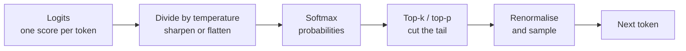

# Temperature and Model Settings: The Complete Guide

> 📚 **Before you start**
>
> - [What is a Large Language Model?](what-is-a-large-language-model.md), for logits, softmax and the generation loop.
> - [Tokens and Context Windows](tokens-and-context-windows.md), for output tokens and limits.

## Introduction

Ask a friend from Lucknow to suggest a name for your new chai café, five times. A cautious friend says "Chai Point" every time. A wildly creative friend gives you "Kulhad Kahani", "Steam & Stories", "The Elaichi Engine", "Adrak Avenue" and "Sip Sutra", including one that makes no sense. Which friend you want depends on the job: for a legal form you want the cautious one; for brainstorming you want the creative one.

An LLM can be either friend. Remember that at every step it produces a **probability for every possible next token**, and something must **choose** one. The settings that control that choice (**temperature**, **top-p**, **top-k**) decide whether the model plays safe or takes risks. Other settings decide how long it may write, when it must stop and, for reasoning models, **how hard it should think** before answering.

By the end of this lesson you'll be able to implement temperature, top-k and top-p sampling yourself in NumPy, predict their effect, pick sensible settings for a task, use limits like maximum tokens and stop sequences, and understand why the newest reasoning models replace sampling knobs with an **effort** setting.

> 💡 **Key Insight**
>
> Settings don't change what the model *knows*; they change **how it picks from the probabilities it computed**. Low temperature means "almost always take the most likely token" (consistent, safe, sometimes dull). High temperature means "give unlikely tokens a real chance" (varied, creative, sometimes wrong). For reasoning models, the most important dial is **effort**: how much thinking to spend before answering.

---

## Core Explanation

### 1. The decoding step, again

At each step the model outputs logits; softmax turns them into probabilities; a **decoding strategy** picks one token. Let's set up the probabilities for the next word after *"Our new café is called The ..."*:

```python
import numpy as np

candidates = ["Chai", "Kulhad", "Elaichi", "Adrak", "Steam", "Monsoon", "Banyan", "Quantum"]
logits = np.array([3.0, 2.2, 1.8, 1.5, 1.0, 0.6, 0.2, -1.5])

def softmax(z):
    e = np.exp(z - z.max())
    return e / e.sum()

for word, p in zip(candidates, softmax(logits)):
    print(f"{word:<8} {p:6.1%}  {'█' * int(p * 50)}")
```

Output:

```
Chai      44.0%  ██████████████████████
Kulhad    19.8%  █████████
Elaichi   13.3%  ██████
Adrak      9.8%  ████
Steam      6.0%  ██
Monsoon    4.0%  █
Banyan     2.7%  █
Quantum    0.5%  
```

Two simple strategies:

- **Greedy decoding**: always take the highest-probability token ("Chai"). Deterministic and consistent, but repetitive, and the most likely token at each step doesn't always add up to the best overall text.
- **Sampling**: pick randomly *in proportion to the probabilities*. "Chai" wins a little under half the time (44%); "Quantum" sneaks in about once in 200 picks.

All the popular settings are ways of reshaping or trimming this distribution before sampling.

### 2. Temperature: sharpen or flatten

**Temperature** divides the logits by a number *T* before softmax:

- **T < 1** sharpens the distribution: the favourite gets even more likely. As T approaches 0, sampling becomes greedy.
- **T = 1** leaves the model's distribution unchanged.
- **T > 1** flattens it: unlikely tokens gain probability.

```python
def with_temperature(logits, T):
    return softmax(logits / T)

for T in [0.2, 0.7, 1.0, 1.5]:
    p = with_temperature(logits, T)
    print(f"T={T:<4} " + "  ".join(f"{w} {q:.0%}" for w, q in zip(candidates[:4], p[:4])) + f"  ... Quantum {p[-1]:.1%}")
```

Output:

```
T=0.2  Chai 98%  Kulhad 2%  Elaichi 0%  Adrak 0%  ... Quantum 0.0%
T=0.7  Chai 58%  Kulhad 18%  Elaichi 10%  Adrak 7%  ... Quantum 0.1%
T=1.0  Chai 44%  Kulhad 20%  Elaichi 13%  Adrak 10%  ... Quantum 0.5%
T=1.5  Chai 33%  Kulhad 19%  Elaichi 15%  Adrak 12%  ... Quantum 1.6%
```

At T=0.2 "Chai" is almost certain; at T=1.5 even "Quantum" has a real chance. Now let's actually sample 10 café names at each temperature, with a fixed random seed so you get the same output:

```python
def sample(probs, rng):
    return candidates[rng.choice(len(probs), p=probs)]

for T in [0.2, 1.0, 1.5]:
    rng = np.random.default_rng(seed=0)
    names = [sample(with_temperature(logits, T), rng) for _ in range(10)]
    print(f"T={T}: {', '.join(names)}")
```

Output:

```
T=0.2: Chai, Chai, Chai, Chai, Chai, Chai, Chai, Chai, Chai, Chai
T=1.0: Kulhad, Chai, Chai, Chai, Adrak, Steam, Kulhad, Elaichi, Kulhad, Monsoon
T=1.5: Elaichi, Chai, Chai, Chai, Steam, Monsoon, Elaichi, Adrak, Elaichi, Banyan
```

Low temperature gives you the cautious friend; high temperature gives you the creative one, including some odd picks. Remember that in a real reply this choice happens **at every token**: a single unlucky low-probability pick early in a sentence changes everything after it, which is why very high temperatures quickly produce nonsense.

### 3. Top-k and top-p: cut off the long tail

Temperature reshapes the whole distribution but never removes anything. Two settings **trim the tail** of unlikely tokens before sampling.

- **Top-k**: keep only the *k* most likely tokens, renormalise, sample. Simple, but a fixed *k* is too many when the model is confident and too few when many choices are reasonable.
- **Top-p** (also called **nucleus sampling**): keep the smallest set of top tokens whose probabilities add up to at least *p* (say 0.9), renormalise, sample. The set grows when the model is unsure and shrinks when it's confident.

```python
def top_k_filter(probs, k):
    keep = np.argsort(probs)[::-1][:k]
    out = np.zeros_like(probs)
    out[keep] = probs[keep]
    return out / out.sum()

def top_p_filter(probs, p):
    order = np.argsort(probs)[::-1]
    cumulative = np.cumsum(probs[order])
    cutoff = np.searchsorted(cumulative, p) + 1          # how many top tokens reach probability p
    keep = order[:cutoff]
    out = np.zeros_like(probs)
    out[keep] = probs[keep]
    return out / out.sum()

base = softmax(logits)
print("top-k=3 keeps:", [w for w, q in zip(candidates, top_k_filter(base, 3)) if q > 0])
print("top-p=0.8 keeps:", [w for w, q in zip(candidates, top_p_filter(base, 0.8)) if q > 0])
print("top-p=0.95 keeps:", [w for w, q in zip(candidates, top_p_filter(base, 0.95)) if q > 0])
```

Output:

```
top-k=3 keeps: ['Chai', 'Kulhad', 'Elaichi']
top-p=0.8 keeps: ['Chai', 'Kulhad', 'Elaichi', 'Adrak']
top-p=0.95 keeps: ['Chai', 'Kulhad', 'Elaichi', 'Adrak', 'Steam', 'Monsoon']
```

"Quantum" is excluded by every filter: the tail is cut, so a rare, bizarre token can never be picked, even at higher temperature. That's why the common recipe in creative settings is **moderate temperature plus top-p**: variety among sensible options, without the nonsense.



Some libraries and open-model servers offer more variants, such as **min-p** (keep tokens at least some fraction as likely as the top one) and **repetition**, **presence** or **frequency penalties** (lower the scores of tokens that have already appeared, to reduce repetition). The idea is the same: adjust the distribution before choosing.

### 4. Limits and control settings

Sampling isn't the only knob. These settings exist on almost every API:

| Setting | What it does | Practical advice |
|---|---|---|
| **Maximum tokens** (`max_tokens`) | Hard cap on output length. Generation stops when reached, even mid-sentence. | Set it generously for real answers; check the stop reason to detect truncation. |
| **Stop sequences** | Strings that end generation as soon as the model produces them (for example `"\n\n"` or `"</answer>"`). | Useful for cutting output at a known delimiter. |
| **System prompt** | Instructions that frame the whole conversation. | Covered in [System Prompts and Roles](../course.md#m4). |
| **Structured output / response format** | Forces output to match a JSON schema. | Covered in [Structured JSON Output](../course.md#m4). |
| **Seed** (some providers and open-model servers) | Fixes the random choices to make sampling more repeatable. | Helps testing, but don't rely on perfect reproducibility. |
| **Stream** | Send tokens as they're generated instead of all at the end. | Use it for chat UIs and long outputs. |

Every response also tells you **why it stopped**, the **stop reason**. In Anthropic's API, for example, `end_turn` means the model finished naturally, `max_tokens` means it hit your cap, `stop_sequence` means it produced one of your stop strings, and `tool_use` means it wants to call a tool. Always check it: a reply cut off by `max_tokens` can look complete at a glance and still be missing the important part.

### 5. Why "temperature 0" isn't perfectly deterministic

Setting temperature to 0 (greedy) makes outputs **much** more consistent, but often not bit-for-bit identical across calls. Large models run on GPUs that process many requests in batches, and tiny floating-point differences between batches can flip a near-tie between two tokens; after that, the texts diverge. Treat LLM output as **probably consistent, not guaranteed identical**, and design tests that check meaning or structure rather than exact strings.

### 6. Reasoning models: effort instead of temperature

Reasoning models (introduced in [What is a Large Language Model?](what-is-a-large-language-model.md)) generate a stretch of **thinking tokens** before the visible answer. For these models the most useful control is **how much to think**:

- Anthropic's current Claude models use **adaptive thinking** (the model decides how much to think for each request) steered by an **effort** setting: `low`, `medium`, `high`, `xhigh` or `max`.
- OpenAI's current models also expose a **reasoning effort** setting with similar levels.
- Google's Gemini models offer thinking controls as well.

Higher effort generally means better answers on hard problems, at the cost of more tokens (you pay for thinking tokens as output) and more time. Lower effort is faster and cheaper for simple tasks.

An important 2026 detail: on the newest Claude models, including Claude Opus 5.5, the classic sampling parameters are **gone**. Sending `temperature`, `top_p` or `top_k` returns an error, and thinking can't be switched off; **effort** is the dial you tune instead. Other providers' reasoning models often restrict sampling settings in similar ways. So check each model's documentation: the knobs available depend on the model, not just the provider.

```python
# not-run: needs the anthropic package and an API key
import anthropic

client = anthropic.Anthropic()
response = client.messages.create(
    model="claude-opus-5-5",
    max_tokens=16000,
    output_config={"effort": "low"},          # low | medium | high | xhigh | max
    messages=[{"role": "user", "content": "Suggest five names for a chai café in Lucknow."}],
)
print(response.stop_reason)
print(next(b.text for b in response.content if b.type == "text"))
print(response.usage.output_tokens, "output tokens (thinking included)")
```

Example output:

```
end_turn
1. Kulhad Kahani
2. Nawabi Chai Ghar
3. Adrak Avenue
4. The Elaichi Room
5. Chowk Chai Co.
212 output tokens (thinking included)
```

### 7. Choosing settings by task

| Task | Classic model settings | Reasoning model setting |
|---|---|---|
| Extracting fields, classification, JSON | Low temperature (0 to 0.3) | Low effort is often enough |
| Factual Q&A over provided documents | Low temperature | Low to medium effort |
| Everyday chat and writing | Temperature around 0.7, top-p around 0.9 | Medium effort |
| Brainstorming names, slogans, stories | Higher temperature (0.9 to 1.2), top-p 0.9 to 0.95 | Medium effort; ask explicitly for variety |
| Maths, tricky code, multi-step analysis | Low temperature | High, xhigh or max effort |
| Agents running long multi-step tasks | Low temperature | High or xhigh effort |

Two more tips:

- **Change one thing at a time.** Temperature and top-p interact; adjust one and evaluate on real examples before touching the other. Many providers advise adjusting only one of them.
- **Variety can come from the prompt too.** "Give me 10 names in different styles: playful, royal, modern" often beats cranking up temperature, and is the main way to get variety from models whose sampling settings are fixed.

---

## Try It Yourself

1. **Measure diversity.** For temperatures 0.2, 1.0 and 1.5, sample 1,000 names (seed 0) and count how many distinct names appear.
2. **Top-p with high temperature.** At T=1.5, apply top-p 0.8 before sampling 1,000 names. How often does "Quantum" appear? Without top-p?
3. **Pick settings.** A hospital wants an assistant to fill a discharge-summary template from a doctor's notes. Which settings would you choose for a classic model, and which effort for a reasoning model?

<details>
<summary>Show answers</summary>

**1.**

```python
for T in [0.2, 1.0, 1.5]:
    rng = np.random.default_rng(seed=0)
    names = [sample(with_temperature(logits, T), rng) for _ in range(1000)]
    print(f"T={T}: {len(set(names))} distinct names, most common {max(set(names), key=names.count)!r}")
```

Output:

```
T=0.2: 4 distinct names, most common 'Chai'
T=1.0: 8 distinct names, most common 'Chai'
T=1.5: 8 distinct names, most common 'Chai'
```

**2.**

```python
for use_top_p in [False, True]:
    rng = np.random.default_rng(seed=0)
    probs = with_temperature(logits, 1.5)
    if use_top_p:
        probs = top_p_filter(probs, 0.8)
    names = [sample(probs, rng) for _ in range(1000)]
    print(f"top-p {'on ' if use_top_p else 'off'}: 'Quantum' picked {names.count('Quantum')} times out of 1000")
```

Output:

```
top-p off: 'Quantum' picked 15 times out of 1000
top-p on : 'Quantum' picked 0 times out of 1000
```

Top-p removes the tail completely, so even a high temperature can't pick the bizarre option.

**3.** Filling a template from notes is extraction, where consistency matters and creativity is a risk: a low temperature (0 to 0.2), a generous `max_tokens`, structured output if the template has fixed fields, and a check of the stop reason. On a reasoning model, low or medium effort is usually enough; raise it only if evaluation shows mistakes on complicated notes. Either way, a doctor reviews the output.

</details>

---

## Real-World Examples

- **Chat apps** use moderate settings so replies feel natural but stay on topic; "regenerate" buttons give you a fresh sample from the same distribution.
- **Data-extraction pipelines** (invoices, KYC documents) run at low temperature or low effort and validate the JSON they get back.
- **Marketing tools** use higher temperature or ask for many varied options, then let a person choose.
- **Coding agents** run reasoning models at high effort for hard bugs and lower effort for routine edits to save time and money.

---

## Common Misconceptions

### "Higher temperature makes the model smarter or more creative in a deep way"

It only makes less likely tokens more likely. Sometimes that gives fresh ideas; past a point it gives errors and nonsense. Creativity mostly comes from the prompt and the model.

### "Temperature 0 guarantees the same answer every time"

It makes answers far more consistent, but GPU batching and floating-point effects can still cause small differences, and some models don't accept the setting at all.

### "Top-p and temperature do the same thing"

Temperature reshapes the whole distribution; top-p removes the unlikely tail. They're complementary, which is why they're often used together carefully.

### "More effort is always better"

Higher effort costs more and takes longer. For simple tasks, low effort usually gives the same answer faster. Measure on your own examples.

---

## Interview Relevance

*"What does temperature do?"* A strong answer: it scales the logits before softmax; below 1 sharpens the distribution (more deterministic), above 1 flattens it (more diverse); 0 approximates greedy decoding. Contrast it with **top-k** (keep the k best tokens) and **top-p / nucleus sampling** (keep the smallest set reaching cumulative probability p), and explain why top-p adapts to the model's confidence.

Follow-ups: *"Why isn't temperature 0 fully deterministic?"* (batching and floating-point non-determinism). *"Which settings would you use for extraction vs brainstorming?"* *"How do reasoning models change this?"* (thinking tokens, effort levels, and on some current models, fixed sampling parameters, so you tune effort and the prompt instead). Mentioning that you always check the stop reason for `max_tokens` truncation shows production experience.

---

## Key Takeaways

- **Settings change how a token is picked, not what the model knows.**
- **Temperature** sharpens (low) or flattens (high) the probability distribution; **top-k** and **top-p** cut off the unlikely tail.
- **Max tokens, stop sequences and the stop reason** control and report where output ends; always check for truncation.
- **Temperature 0 is consistent, not perfectly deterministic.**
- **Reasoning models are tuned with effort**; on the newest Claude models, sampling parameters are removed and effort is the main dial.

---

**Up next:** [Where LLMs Fail](where-llms-fail.md)
