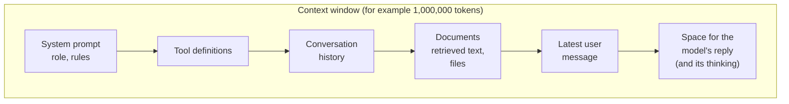

# Tokens and Context Windows: The Complete Guide

> 📚 **Before you start**
>
> - [What is a Large Language Model?](what-is-a-large-language-model.md), where tokens were step 1 of the pipeline.

## Introduction

When you send a parcel through India Post, you don't pay per parcel; you pay by **weight**. A thin envelope and a heavy box to the same address cost very different amounts. And every counter has a **maximum size** it will accept.

LLMs work the same way, except the unit isn't grams but **tokens**. Every request you send is measured in tokens, you are billed per token, the model's speed depends on tokens, and every model has a **context window**: a maximum number of tokens it can handle in one go. A builder who doesn't understand tokens is like a shipping company that doesn't know how much its parcels weigh: surprised by every bill and every rejection.

By the end of this lesson you'll know exactly what a token is, build a small **byte-pair encoding (BPE)** tokenizer yourself, understand why the same sentence costs more in Hindi or Tamil than in English with many tokenizers, estimate the cost of a request in rupees, explain what a context window holds and what happens when it overflows, and use the standard techniques for managing long contexts.

> 💡 **Key Insight**
>
> A **token** is the unit an LLM reads and writes: usually a common word or a piece of a word. **Everything is counted in tokens**: cost, speed, and the **context window**, the model's working memory, which must hold your instructions, the conversation, any documents *and* the answer. Managing tokens well is one of the most practical skills a GenAI builder has.

---

## Core Explanation

### 1. What a token looks like

Tokenizers split text into frequent chunks. In English, common words are usually single tokens, rarer words split into pieces, and spaces are typically attached to the start of the following word. A typical split might look like this (exact splits differ between models):

| Text | Possible tokens | Count |
|---|---|---|
| `I love chai` | `I` · ` love` · ` chai` | 3 |
| `unbelievable` | `un` · `believ` · `able` | 3 |
| `Thiruvananthapuram` | `Th` · `iru` · `van` · `anth` · `ap` · `uram` | 6 |
| `₹1,24,999` | `₹` · `1` · `,` · `24` · `,` · `999` | 6 |
| `{"name": "Asha"}` | `{"` · `name` · `":` · ` "` · `As` · `ha` · `"}` | 7 |

Rules of thumb for **English** with current tokenizers: one token is about **4 characters** or about **three-quarters of a word**, so 1,000 tokens is roughly 750 words, about a page and a half. These ratios are only estimates; for exact counts you ask the provider's token-counting endpoint (section 8).

Why not just use whole words, or single letters?

| Choice | Problem |
|---|---|
| **Whole words** | The vocabulary would need millions of entries (every name, typo, number, hashtag), and unknown words would be impossible to represent. |
| **Single characters** | Sequences become very long (several times more steps per sentence), making the model slower and its job harder. |
| **Subword tokens** | A sweet spot: common words are one token, rare words are a few pieces, and anything at all can still be spelled out. |

### 2. Byte-pair encoding: how a tokenizer learns its vocabulary

Most LLM tokenizers are built with **byte-pair encoding (BPE)** or close relatives. The algorithm is simple:

1. Start with every word split into single characters (real tokenizers start from **bytes**, so any text in any script can be represented).
2. Count every pair of neighbouring symbols across the training text.
3. **Merge the most frequent pair** into a new symbol and add it to the vocabulary.
4. Repeat until the vocabulary reaches the target size.

Let's train one on a small corpus of Mumbai food-stall orders.

```python
from collections import Counter

corpus = ("chai chai chai masala chai cutting chai chai latte "
          "samosa samosa samosa pav pav vada pav vada pav misal pav").split()

# Each word as a tuple of symbols, with an end-of-word marker so merges respect word boundaries.
words = Counter(tuple(w) + ("</w>",) for w in corpus)

def most_frequent_pair(words):
    pairs = Counter()
    for symbols, freq in words.items():
        for a, b in zip(symbols, symbols[1:]):
            pairs[(a, b)] += freq
    return max(sorted(pairs), key=lambda p: pairs[p])   # sorted first so ties break the same way every run

def merge(words, pair):
    merged = {}
    for symbols, freq in words.items():
        out, i = [], 0
        while i < len(symbols):
            if i < len(symbols) - 1 and (symbols[i], symbols[i + 1]) == pair:
                out.append(symbols[i] + symbols[i + 1])
                i += 2
            else:
                out.append(symbols[i])
                i += 1
        merged[tuple(out)] = freq
    return merged

merges = []
for step in range(10):
    pair = most_frequent_pair(words)
    merges.append(pair)
    words = merge(words, pair)
    print(f"merge {step + 1:>2}: {pair[0]!r} + {pair[1]!r} -> {pair[0] + pair[1]!r}")
```

Output:

```
merge  1: 's' + 'a' -> 'sa'
merge  2: 'a' + 'i' -> 'ai'
merge  3: 'ai' + '</w>' -> 'ai</w>'
merge  4: 'c' + 'h' -> 'ch'
merge  5: 'ch' + 'ai</w>' -> 'chai</w>'
merge  6: 'a' + 'v' -> 'av'
merge  7: 'av' + '</w>' -> 'av</w>'
merge  8: 'p' + 'av</w>' -> 'pav</w>'
merge  9: 'a' + '</w>' -> 'a</w>'
merge 10: 'm' + 'o' -> 'mo'
```

The frequent stems ("chai", "pav") become single symbols quickly. Now we can tokenize any word by applying the learned merges in order:

```python
def tokenize(word):
    symbols = list(word) + ["</w>"]
    for a, b in merges:
        i = 0
        while i < len(symbols) - 1:
            if symbols[i] == a and symbols[i + 1] == b:
                symbols[i:i + 2] = [a + b]
            else:
                i += 1
    return symbols

for w in ["chai", "pav", "samosa", "chaiwala", "pizza"]:
    pieces = tokenize(w)
    print(f"{w:<9} -> {pieces}  ({len(pieces)} tokens)")
```

Output:

```
chai      -> ['chai</w>']  (1 tokens)
pav       -> ['pav</w>']  (1 tokens)
samosa    -> ['sa', 'mo', 'sa', '</w>']  (4 tokens)
chaiwala  -> ['ch', 'ai', 'w', 'a', 'l', 'a</w>']  (6 tokens)
pizza     -> ['p', 'i', 'z', 'z', 'a</w>']  (5 tokens)
```

Words that were frequent in training ("chai", "pav") become a single token. "samosa" needs four pieces after only ten merges. "chaiwala" can't use the `chai</w>` token, because that token means "chai at the end of a word", so it reuses the smaller `ch` and `ai` pieces and spells out the rest. "pizza", never seen, falls back to letters. **Frequent in training means cheap to represent; rare means many tokens.** Real tokenizers do the same with tens of thousands of merges learned from terabytes of text.

### 3. Why Indian languages often cost more tokens

Tokenizers learn merges from their training text. If that text is mostly English, English words get efficient merges and text in other scripts gets fewer, so it splits into more, smaller pieces. Byte-level tokenizers make this worse for scripts like Devanagari, Tamil or Bengali, because each of their characters takes **3 bytes** in UTF-8, the standard encoding for text, while an English letter takes 1.

```python
samples = {
    "English": "Please send the bill today",
    "Hindi": "कृपया आज बिल भेज दीजिए",
    "Tamil": "தயவுசெய்து இன்று பில் அனுப்புங்கள்",
}
for lang, text in samples.items():
    print(f"{lang:<8} {len(text):>3} characters, {len(text.encode('utf-8')):>3} UTF-8 bytes")
```

Output:

```
English   26 characters,  26 UTF-8 bytes
Hindi     22 characters,  58 UTF-8 bytes
Tamil     34 characters,  96 UTF-8 bytes
```

The Hindi sentence has fewer characters than the English one but more bytes, and the Tamil sentence has three to four times the bytes. With a tokenizer that hasn't learned many merges for these scripts, the token count follows the bytes more closely. Depending on the model, the same message can cost **noticeably more tokens, sometimes several times more**, in an Indian language than in English. It also uses up more of the context window and takes longer to generate. Newer tokenizers trained on more multilingual data have narrowed the gap considerably, and models built for Indian languages use tokenizers designed for them, so always **measure** with the model you plan to use rather than assume.

### 4. Tokens and money

API providers charge per **million tokens (MTok)**, with separate prices for **input** (what you send) and **output** (what the model writes). Output costs more because each output token needs its own full pass through the model, while input tokens are processed in parallel.

Here's a cost estimator using Anthropic's published list prices for two Claude models as of October 2026 (always check the current pricing page), and an assumed exchange rate.

```python
PRICES_USD_PER_MTOK = {          # (input, output), Anthropic list prices, October 2026
    "claude-opus-5-5": (4.00, 20.00),
    "claude-haiku-5-5": (0.10, 0.50),
}
INR_PER_USD = 88                 # an assumption for illustration; use today's rate

def cost_inr(model, input_tokens, output_tokens):
    price_in, price_out = PRICES_USD_PER_MTOK[model]
    usd = input_tokens / 1e6 * price_in + output_tokens / 1e6 * price_out
    return usd * INR_PER_USD

# A support reply: 2,500 tokens of instructions and context in, 400 tokens out
for model in PRICES_USD_PER_MTOK:
    one = cost_inr(model, 2_500, 400)
    print(f"{model:<17} ₹{one:.3f} per reply, ₹{one * 100_000:,.0f} per 100,000 replies")
```

Output:

```
claude-opus-5-5   ₹1.584 per reply, ₹158,400 per 100,000 replies
claude-haiku-5-5  ₹0.040 per reply, ₹3,960 per 100,000 replies
```

Notice two things. First, the model choice changes the bill by a large factor, which is why products often route simple requests to small models. Second, the **input** side (2,500 tokens of context) is a big part of the cost. Trimming what you send is often the cheapest optimisation available.

### 5. The context window

The **context window** is the maximum number of tokens a model can handle in a single request: **everything it reads plus everything it writes**. It is the model's entire working memory. Anything not in the window doesn't exist for the model.



Context windows have grown fast: early ChatGPT (2022) handled about 4,000 tokens; by 2024, 128,000 to 200,000 was common; in October 2026 several frontier models offer about **1 million tokens** (Anthropic's current Claude models and OpenAI's current flagship models both list windows of about one million), while smaller and older models often have less. A million tokens is several thick novels' worth of text.

Two separate limits matter:

| Limit | Meaning |
|---|---|
| **Context window** | Total tokens in a request: input plus output. |
| **Maximum output tokens** | A cap on how much the model may write in one response, often much smaller than the window (current Claude models allow up to 128,000 output tokens, for example). You set your own `max_tokens` at or below it. |

### 6. Conversations re-send everything

LLM APIs are **stateless**: the model doesn't remember your previous request. A chat app creates the illusion of memory by **sending the whole conversation again** with every new message. That has a surprising cost consequence:

```python
system_tokens = 1_000
tokens_per_user_message = 150
tokens_per_reply = 350

history, total_input = 0, 0
for turn in range(1, 21):
    input_this_turn = system_tokens + history + tokens_per_user_message
    total_input += input_this_turn
    history += tokens_per_user_message + tokens_per_reply
    if turn in (1, 5, 10, 20):
        print(f"turn {turn:>2}: this request sends {input_this_turn:>6,} input tokens; total so far {total_input:>7,}")
```

Output:

```
turn  1: this request sends  1,150 input tokens; total so far   1,150
turn  5: this request sends  3,150 input tokens; total so far  10,750
turn 10: this request sends  5,650 input tokens; total so far  34,000
turn 20: this request sends 10,650 input tokens; total so far 118,000
```

Each turn re-sends all earlier turns, so total input tokens grow roughly with the **square** of the number of turns. Twenty turns cost far more than twenty times one turn. Long-running chats and agents that loop many times hit this hard, which is why **prompt caching** (below) and **trimming history** matter.

### 7. What happens when the context gets long or full

| Situation | What happens | Typical fix |
|---|---|---|
| **Request exceeds the window** | The API returns an error; nothing is generated | Trim, summarise or retrieve less |
| **`max_tokens` reached mid-answer** | The reply stops abruptly; the API reports a stop reason such as `max_tokens` | Raise the limit or ask for shorter output |
| **Very long but within the limit** | Higher cost and latency; the model may pay less attention to details buried in the middle of a huge context | Put key instructions and questions where they're easy to find; include only relevant material |

The third row deserves attention. Research has repeatedly found that models use information **less reliably when it's buried in the middle of a very long context** (a 2023 study called this "lost in the middle"), and practitioners talk about **context rot**: quality drifting down as the context fills with marginally relevant material. Models have improved a lot here, but the lesson holds: **a big window is permission, not a recommendation.** Send what the task needs.

Standard techniques for long inputs:

- **Retrieval (RAG)**: instead of pasting a 500-page manual, retrieve the 5 most relevant passages for each question. Covered in [Retrieval-Augmented Generation](../../retrieval-augmented-generation-rag/course.md).
- **Summarise or compact history**: replace old turns with a short summary. Some APIs offer automatic **compaction** that does this server-side when a conversation approaches a threshold.
- **Prompt caching**: when many requests share the same long prefix (a big system prompt, a document, tool definitions), providers can cache the processed prefix so later requests pay a fraction of the input price for it and run faster. Keep the stable part of the prompt first and the changing part last.
- **Chunk and combine**: process a long document in parts, then combine the partial results.

You'll go much deeper on these in [Context Engineering and Agent Memory](../../context-engineering-and-agent-memory/course.md).

### 8. Counting tokens for real

Each provider's tokenizer is different, so a count from one model doesn't transfer exactly to another. Providers offer a way to count before sending. With Anthropic's Python SDK it looks like this:

```python
# not-run: needs the anthropic package and an API key
import anthropic

client = anthropic.Anthropic()
count = client.messages.count_tokens(
    model="claude-opus-5-5",
    system="You are a helpful assistant for a Mumbai restaurant.",
    messages=[{"role": "user", "content": "Do you have a Jain thali on Sunday?"}],
)
print(count.input_tokens)
```

Example output:

```
27
```

After a real request, the response also reports exact usage (`response.usage.input_tokens` and `response.usage.output_tokens`), which you should log for every call. You'll do that in [Lab: Your first LLM API call](lab-your-first-llm-api-call.md).

---

## Try It Yourself

1. **More merges.** Train the BPE tokenizer for 20 merges instead of 10 (start again from the original `words`). How many tokens does "samosa" take now?
2. **Budget a chatbot.** Using `cost_inr`, what does a 20-turn conversation cost on `claude-opus-5-5` if total input is the `total_input` from section 6 and each of the 20 replies is 350 tokens?
3. **Fit the window.** A model has a 200,000-token window. Your system prompt is 3,000 tokens, tools take 5,000, and you reserve 8,000 for the answer. How many tokens of documents can you include at most?

<details>
<summary>Show answers</summary>

**1.**

```python
words = Counter(tuple(w) + ("</w>",) for w in corpus)
merges = []
for _ in range(20):
    pair = most_frequent_pair(words)
    merges.append(pair)
    words = merge(words, pair)
print("samosa ->", tokenize("samosa"))
```

Output:

```
samosa -> ['samosa</w>']
```

With more merges, "samosa" (which appeared three times) becomes a single token. More merges mean a bigger vocabulary and shorter token sequences.

**2.**

```python
print(f"20-turn chat on Opus: ₹{cost_inr('claude-opus-5-5', total_input, 20 * 350):.2f}")
```

Output:

```
20-turn chat on Opus: ₹53.86
```

**3.** 200,000 − 3,000 − 5,000 − 8,000 = **184,000** tokens of documents, at most. In practice you'd send far less and retrieve only what's relevant.

</details>

---

## Real-World Examples

- **Billing dashboards** at every AI company track input, output and cached tokens per feature, because tokens are the main running cost.
- **Customer-support bots** keep a rolling summary of long conversations so they stay within budget.
- **Coding agents** read large codebases but search for and load only the relevant files, rather than pasting the whole repository into the context.
- **Indian-language products** choose models and tokenizers partly on token efficiency for their users' languages, because it changes cost and speed.

---

## Common Misconceptions

### "A token is a word"

Sometimes. Often it's part of a word, a space plus a word, or punctuation. Numbers, code and non-English text frequently split into many tokens.

### "A 1-million-token window means I should send a million tokens"

You pay for every token, latency grows, and quality can drop as irrelevant material piles up. Send what the task needs.

### "The model remembers our earlier chat"

The API is stateless. The app re-sends the history each time, or stores memories and inserts them. If it's not in the context window, the model doesn't know it.

### "Token counts are the same for every model"

Every tokenizer is different. Count with the model you'll actually use.

---

## Interview Relevance

*"What is a token and why does it matter?"* A strong answer: a token is the model's unit of text, typically a subword produced by a learned tokenizer such as BPE; costs, rate limits, latency and the context window are all measured in tokens; output tokens cost more than input tokens because generation is sequential; non-English text and code can use more tokens per character.

*"How would you handle a document longer than the context window?"* Discuss retrieval of relevant chunks, map-reduce style chunked summarisation, compaction or summarisation of history, and prompt caching for repeated long prefixes, plus the trade-offs (retrieval can miss things; summaries lose detail). Mention that very long contexts raise cost and can reduce attention to details in the middle.

---

## Key Takeaways

- **Tokens are subword chunks** learned by algorithms like BPE; about 4 characters or 0.75 words in English.
- **Everything is measured in tokens**: price (input and output priced separately), speed and limits.
- **Many tokenizers are less efficient for Indian languages**, so measure with your model.
- **The context window holds everything**: instructions, tools, history, documents and the reply.
- **APIs are stateless**, so conversations re-send history; use retrieval, summarisation and prompt caching to keep contexts lean.

---

**Up next:** [Temperature and Model Settings](temperature-and-model-settings.md)
