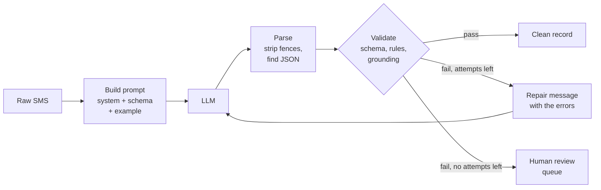

# Lab: Reliable JSON Extraction

> 📚 **Before you start**
>
> - [Structured JSON Output](structured-json-output.md), for schemas, Pydantic validation, the reliability ladder and business-rule checks.
> - [Prompting Fundamentals](prompting-fundamentals.md) and [System Prompts and Roles](system-prompts-and-roles.md), for writing the prompt.
> - [Lab: Your first LLM API call](../03-how-llms-work/lab-your-first-llm-api-call.md), for messages, stop reasons and the pretend-client approach.

## What You'll Build

Every Indian bank account owner gets a stream of SMS alerts: *"Rs.450.00 debited from A/c XX4821..."*, *"INR 25,000.00 credited..."*, plus OTPs and cashback offers mixed in. Each bank writes them differently. A personal-finance app wants to turn these messages into clean transaction records.

You'll build an extraction pipeline that takes a raw SMS and returns either a **validated transaction record** or a clear **"needs human review"** flag, never a silent wrong answer. It will:

1. Define the output as a **Pydantic schema** with business rules.
2. Build a **prompt** with a system prompt, the schema and one example.
3. **Parse** messy model replies (code fences, preambles).
4. **Validate** shape, business rules, and **grounding**: are the extracted values actually in the SMS?
5. **Repair** failures by sending the errors back to the model, with a retry limit.
6. Run a **batch** and report success, repairs and the review queue.

As in earlier labs, everything runs offline with a **scripted pretend model** whose replies include the kinds of mistakes real models make. At the end you'll see the real-API version.




*The model proposes; three layers of checks decide. Nothing reaches the database unchecked.*

> 💡 **Key Insight**
>
> Reliable extraction isn't one clever prompt. It's a **pipeline**: a schema that defines success, a parser that tolerates harmless mess, validators that check shape, rules **and the source text**, a repair loop that shows the model its own errors, and a review queue for whatever still fails. The model is allowed to be wrong; the pipeline isn't allowed to pass it on.

---

## Step 1: The Data

Six messages, in the formats real banks use. Two of them are not transactions at all.

```python
SMS = {
    "s1": "Rs.450.00 debited from A/c XX4821 on 12-Oct-26 to VPA sharmakirana@upi. UPI Ref 629184735201. Not you? Call 1800-000-0000",
    "s2": "Dear Customer, INR 25,000.00 credited to your A/c XX4821 on 11/10/2026 by UPI from RAHUL MEHTA. Ref no 628811223344.",
    "s3": "Your OTP for UPI PIN reset is 482913. Do not share it with anyone.",
    "s4": "A/c XX4821 debited INR 1,299.00 on 13-10-26; Amazon Pay; UPI:630012457788. Avl Bal INR 18,201.50",
    "s5": "Txn of Rs 89 at CHAI POINT failed due to insufficient balance on 13-10-26. Ref 630099887766",
    "s6": "Get 10% cashback on electricity bill payments via UPI this Diwali! T&C apply.",
}
print(len(SMS), "messages")
```

Output:

```
6 messages
```

Notice the variety: `Rs.` and `INR`, three date formats, `UPI Ref`, `Ref no` and `UPI:`, a balance figure that is *not* the transaction amount, and a failed payment. Rule-based parsers break on this kind of variety, which is why teams reach for an LLM.

## Step 2: The Schema

The schema says exactly what a correct answer is. It follows the design tips from [Structured JSON Output](structured-json-output.md): enums for categories, `None` allowed for things that may be missing, and a way to say "this isn't a transaction" so the model is never forced to invent one.

```python
from datetime import date
from typing import Literal, Optional
from pydantic import BaseModel, Field, ValidationError, field_validator, model_validator

TODAY = date(2026, 10, 14)        # fixed so the lab output never changes; real code uses date.today()

class Transaction(BaseModel):
    direction: Literal["debit", "credit"]
    status: Literal["success", "failed"]
    amount_inr: float = Field(description="Transaction amount in rupees, not the balance")
    counterparty: Optional[str] = Field(description="Who was paid or who paid, or null")
    upi_ref: Optional[str] = Field(description="12-digit UPI reference number, or null")
    txn_date: date = Field(description="Transaction date as YYYY-MM-DD")
    account_last4: Optional[str] = Field(description="Last 4 digits of the account, or null")

    @field_validator("amount_inr")
    @classmethod
    def positive_and_plausible(cls, v):
        if not 0 < v <= 1_000_000:
            raise ValueError("amount must be between ₹0 and ₹10,00,000")
        return v

    @field_validator("upi_ref")
    @classmethod
    def twelve_digits(cls, v):
        if v is not None and not (v.isdigit() and len(v) == 12):
            raise ValueError("UPI reference must be exactly 12 digits")
        return v

    @field_validator("txn_date")
    @classmethod
    def not_future(cls, v):
        if v > TODAY:
            raise ValueError("transaction date is in the future")
        return v

class Extraction(BaseModel):
    is_transaction: bool = Field(description="False for OTPs, offers and other non-transaction messages")
    transaction: Optional[Transaction]

    @model_validator(mode="after")
    def consistent(self):
        if self.is_transaction and self.transaction is None:
            raise ValueError("is_transaction is true but transaction is missing")
        if not self.is_transaction and self.transaction is not None:
            raise ValueError("is_transaction is false but a transaction was given")
        return self

print(list(Extraction.model_json_schema()["properties"]))
print(list(Transaction.model_json_schema()["properties"]))
```

Output:

```
['is_transaction', 'transaction']
['direction', 'status', 'amount_inr', 'counterparty', 'upi_ref', 'txn_date', 'account_last4']
```

The `model_validator` checks a rule that spans two fields, something a plain JSON Schema can't express neatly.

## Step 3: The Prompt

The system prompt sets the job and rules (with reasons); the user turn carries the SMS inside tags. Because we are on rung 2 of the ladder (no API-level schema enforcement yet), the schema goes into the prompt too, plus one worked example.

```python
import json

SYSTEM_PROMPT = """You extract transaction details from Indian bank SMS alerts for a personal-finance app.

Rules:
- Use only information in the SMS. If a field isn't there, use null; never guess,
  because users reconcile these records against their bank statements.
- amount_inr is the transaction amount, never the available balance.
- Convert the date to YYYY-MM-DD. Two-digit years are 20xx.
- OTPs, offers and reminders are not transactions: set is_transaction to false and transaction to null.

Reply with only a JSON object that matches this JSON Schema, with no other text:
""" + json.dumps(Extraction.model_json_schema())

EXAMPLE_SMS = "INR 120.00 debited from A/c XX7710 on 02-09-26 to VPA metrocard@upi. UPI Ref 611122233344."
EXAMPLE_JSON = json.dumps({
    "is_transaction": True,
    "transaction": {"direction": "debit", "status": "success", "amount_inr": 120.0,
                    "counterparty": "metrocard@upi", "upi_ref": "611122233344",
                    "txn_date": "2026-09-02", "account_last4": "7710"},
})

def build_messages(sms_text):
    return [
        {"role": "user", "content": f"<sms>\n{EXAMPLE_SMS}\n</sms>"},
        {"role": "assistant", "content": EXAMPLE_JSON},
        {"role": "user", "content": f"<sms>\n{sms_text}\n</sms>"},
    ]

msgs = build_messages(SMS["s1"])
print([m["role"] for m in msgs])
print(msgs[-1]["content"])
print(f"system prompt: {len(SYSTEM_PROMPT.split())} words")
```

Output:

```
['user', 'assistant', 'user']
<sms>
Rs.450.00 debited from A/c XX4821 on 12-Oct-26 to VPA sharmakirana@upi. UPI Ref 629184735201. Not you? Call 1800-000-0000
</sms>
system prompt: 228 words
```

The example is given as an earlier user/assistant exchange, the technique from [System Prompts and Roles](system-prompts-and-roles.md).

## Step 4: A Pretend Model That Makes Real Mistakes

The pretend model returns scripted replies for each SMS and attempt. The scripts are deliberately messy, mirroring what real models do on rung 1 and 2: code fences, chatty preambles, a number written with commas, a reference number with one wrong digit, a "transaction" invented from an advert, and a reply cut off mid-way.

```python
def tx(direction, status, amount, counterparty, ref, day, last4):
    return {"is_transaction": True, "transaction": {
        "direction": direction, "status": status, "amount_inr": amount, "counterparty": counterparty,
        "upi_ref": ref, "txn_date": day, "account_last4": last4}}

SCRIPT = {
    "s1": ["```json\n" + json.dumps(tx("debit", "success", 450.0, "sharmakirana@upi", "629184735201", "2026-10-12", "4821")) + "\n```"],
    "s2": [json.dumps(tx("credit", "success", "25,000.00", "RAHUL MEHTA", "628811223344", "2026-10-11", "4821")),
           json.dumps(tx("credit", "success", 25000.0, "RAHUL MEHTA", "628811223344", "2026-10-11", "4821"))],
    "s3": ['This message is an OTP, not a transaction. {"is_transaction": false, "transaction": null}'],
    "s4": [json.dumps(tx("debit", "success", 1299.0, "Amazon Pay", "630012457789", "2026-10-13", "4821")),
           json.dumps(tx("debit", "success", 1299.0, "Amazon Pay", "630012457788", "2026-10-13", "4821"))],
    "s5": [json.dumps(tx("debit", "failed", 89.0, "CHAI POINT", "630099887766", "2026-10-13", None))],
    "s6": [json.dumps(tx("debit", "success", 0, "Electricity board", None, "2026-10-14", None)),
           '{"is_transaction": true, "transaction": {"direction": "credit", "amount_inr": 10'],
}

class ScriptedLLM:
    """Pretend chat model: finds which SMS it was given and returns the scripted reply for this attempt."""
    def __init__(self, script):
        self.script, self.calls = script, 0

    def reply(self, system, messages):
        self.calls += 1
        sms_text = messages[2]["content"]                      # the real SMS turn (after the example)
        sms_id = next(k for k, v in SMS.items() if v in sms_text)
        attempt = sum(m["role"] == "assistant" for m in messages[2:])   # earlier tries in this conversation
        replies = self.script[sms_id]
        return replies[min(attempt, len(replies) - 1)]

llm = ScriptedLLM(SCRIPT)
print(llm.reply(SYSTEM_PROMPT, build_messages(SMS["s3"])))
```

Output:

```
This message is an OTP, not a transaction. {"is_transaction": false, "transaction": null}
```

## Step 5: Parse Tolerantly

Some mess is harmless: a code fence or a sentence before the JSON doesn't change the data. The parser removes it by taking the text from the first `{` to the last `}`. Anything worse (a cut-off reply, invalid JSON) becomes an error message the repair step can use.

```python
def parse_reply(text):
    """Return (data, error). Tolerates fences and preambles; reports anything else."""
    start, end = text.find("{"), text.rfind("}")
    if start == -1 or end <= start:
        return None, "the reply contained no complete JSON object (it may have been cut off)"
    try:
        return json.loads(text[start:end + 1]), None
    except json.JSONDecodeError as err:
        return None, f"the JSON was invalid: {err.msg} at position {err.pos}"

for sms_id in ["s1", "s3"]:
    data, error = parse_reply(SCRIPT[sms_id][0])
    print(sms_id, "parsed" if data else error)
print("s6", parse_reply(SCRIPT["s6"][1])[1])
```

Output:

```
s1 parsed
s3 parsed
s6 the reply contained no complete JSON object (it may have been cut off)
```

Look at the last line. The cut-off reply stops in the middle of a number and never closes its braces, so there is no complete object to find. The parser reports that rather than guessing what the rest might have been.

## Step 6: Validate Shape, Rules and Grounding

Validation has three layers:

1. **Schema**: types, enums, required fields (Pydantic).
2. **Business rules**: plausible amount, 12-digit reference, no future dates (the validators in Step 2).
3. **Grounding**: are the key values actually present in the SMS? This catches the most dangerous error, a well-formed, plausible, **invented** value.

```python
import re

def numbers_in(text):
    return {float(n.replace(",", "")) for n in re.findall(r"\d[\d,]*(?:\.\d+)?", text)}

def grounding_errors(record, sms_text):
    t = record.transaction
    if t is None:
        return []
    errors = []
    if t.amount_inr not in numbers_in(sms_text):
        errors.append(f"amount_inr {t.amount_inr} does not appear in the SMS")
    if t.upi_ref and t.upi_ref not in sms_text:
        errors.append(f"upi_ref {t.upi_ref} does not appear in the SMS")
    if t.account_last4 and t.account_last4 not in sms_text:
        errors.append(f"account_last4 {t.account_last4} does not appear in the SMS")
    return errors

def validate(data, sms_text):
    """Return (record, errors)."""
    try:
        record = Extraction.model_validate(data)
    except ValidationError as err:
        msgs = []
        for e in err.errors():
            where = ".".join(str(p) for p in e["loc"]) or "object"
            msgs.append(f"{where}: {e['msg'].removeprefix('Value error, ')}")
        return None, msgs
    errors = grounding_errors(record, sms_text)
    return (None, errors) if errors else (record, [])

for sms_id in ["s1", "s2", "s4", "s6"]:
    data, _ = parse_reply(SCRIPT[sms_id][0])
    record, errors = validate(data, SMS[sms_id])
    print(sms_id, "VALID" if record else errors)
```

Output:

```
s1 VALID
s2 ['transaction.amount_inr: Input should be a valid number, unable to parse string as a number']
s4 ['upi_ref 630012457789 does not appear in the SMS']
s6 ['transaction.amount_inr: amount must be between ₹0 and ₹10,00,000']
```

Each layer caught something different. `s2` failed the **schema** (a string with a comma isn't a number). `s6` failed a **business rule** (₹0 isn't a real payment). And `s4` passed both the schema and the rules: a 12-digit reference, a sensible amount, a valid date. Only the **grounding** check noticed that one digit was wrong. Without it, that record would have gone into the database looking perfect.

Notice that grounding compares the amount as a **number**, so `1,299.00` in the SMS matches `1299.0` in the record.

## Step 7: The Repair Loop

When validation fails, the cheapest fix is usually to **show the model its errors** and ask again. The repair message is a new user turn in the same conversation, so the model sees its own previous answer and exactly what was wrong with it. A retry limit stops endless loops, and anything still failing goes to a person.

```python
MAX_ATTEMPTS = 2

def repair_message(errors):
    bullet_list = "\n".join(f"- {e}" for e in errors)
    return ("Your previous reply had these problems:\n" + bullet_list +
            "\nCheck the SMS again and reply with only the corrected JSON object.")

def extract(llm, sms_text):
    messages = build_messages(sms_text)
    history = []
    for attempt in range(1, MAX_ATTEMPTS + 1):
        reply = llm.reply(SYSTEM_PROMPT, messages)
        data, parse_error = parse_reply(reply)
        record, errors = (None, [parse_error]) if parse_error else validate(data, sms_text)
        history.append(errors)
        if record:
            return {"status": "ok", "record": record, "attempts": attempt, "history": history}
        messages = messages + [{"role": "assistant", "content": reply},
                               {"role": "user", "content": repair_message(errors)}]
    return {"status": "review", "record": None, "attempts": MAX_ATTEMPTS, "history": history}

result = extract(ScriptedLLM(SCRIPT), SMS["s4"])
print(result["status"], "after", result["attempts"], "attempts")
print("first attempt's errors:", result["history"][0])
print(repair_message(result["history"][0]))
```

Output:

```
ok after 2 attempts
first attempt's errors: ['upi_ref 630012457789 does not appear in the SMS']
Your previous reply had these problems:
- upi_ref 630012457789 does not appear in the SMS
Check the SMS again and reply with only the corrected JSON object.
```

Specific errors make repair work: "upi_ref 630012457789 does not appear in the SMS" points the model at exactly what to re-read. A vague "that was wrong, try again" works far less often.

## Step 8: Run the Batch

Now process every message and summarise the run, the way a production job would log it.

```python
llm = ScriptedLLM(SCRIPT)
results = {sms_id: extract(llm, text) for sms_id, text in SMS.items()}

print(f"{'id':<4}{'status':<8}{'tries':<7}{'type':<8}{'amount':>10}  ref")
for sms_id, r in results.items():
    rec = r["record"]
    if rec and rec.transaction:
        t = rec.transaction
        kind, amount, ref = f"{t.direction}{'*' if t.status == 'failed' else ''}", f"₹{t.amount_inr:,.2f}", t.upi_ref
    elif rec:
        kind, amount, ref = "none", "-", "-"
    else:
        kind, amount, ref = "?", "?", "?"
    print(f"{sms_id:<4}{r['status']:<8}{r['attempts']:<7}{kind:<8}{amount:>10}  {ref}")

ok = sum(r["status"] == "ok" for r in results.values())
repaired = sum(r["status"] == "ok" and r["attempts"] > 1 for r in results.values())
print(f"\n{ok}/{len(results)} extracted ({repaired} needed a repair), "
      f"{len(results) - ok} sent to human review, {llm.calls} model calls")
print("review queue:", [k for k, r in results.items() if r["status"] == "review"],
      "| last errors:", results["s6"]["history"][-1])
```

Output:

```
id  status  tries  type        amount  ref
s1  ok      1      debit      ₹450.00  629184735201
s2  ok      2      credit  ₹25,000.00  628811223344
s3  ok      1      none             -  -
s4  ok      2      debit    ₹1,299.00  630012457788
s5  ok      1      debit*      ₹89.00  630099887766
s6  review  2      ?                ?  ?

5/6 extracted (2 needed a repair), 1 sent to human review, 9 model calls
review queue: ['s6'] | last errors: ['the reply contained no complete JSON object (it may have been cut off)']
```

(`debit*` marks the failed payment.) Read the result as an engineer would:

- **Five of six** messages produced correct records, two of them only thanks to the repair loop.
- The **advert (`s6`)** never produced a valid answer, and the pipeline **refused to guess**: it went to review with its error history attached. A wrong "₹0 debit to the electricity board" in someone's expense report would have been worse than a flagged message.
- **Nine model calls for six messages**: repairs cost money and time. Tracking this number tells you when prompt or schema improvements would pay off.

In production you would also log every attempt (prompt version, reply, errors) so you can study the failures and add them to your [evaluation set](prompting-fundamentals.md).

## Step 9: The Real Version

With an API that supports schema-constrained output (rung 4 of the ladder), the shape problems disappear: no fences, no preambles, no strings where numbers belong, no cut-off JSON unless `max_tokens` is hit. Grounding and business-rule problems **don't** disappear, so the repair loop and review queue stay. Only the call changes:

```python
# not-run: needs the anthropic package and an API key
import anthropic

client = anthropic.Anthropic()

def real_reply(sms_text, extra_messages=()):
    response = client.messages.parse(
        model="claude-opus-5-5",
        max_tokens=2048,
        system=SYSTEM_PROMPT,
        messages=build_messages(sms_text) + list(extra_messages),
        output_format=Extraction,
    )
    if response.stop_reason in ("refusal", "max_tokens"):
        return None, [f"stopped early: {response.stop_reason}"]
    record = response.parsed_output                 # already schema-valid
    return record, grounding_errors(record, sms_text)

record, errors = real_reply(SMS["s4"])
print(record.transaction.upi_ref if record else None, errors)
```

Example output:

```
630012457788 []
```

Two notes on the real version:

- The SDK builds the parsed object from your Pydantic model, so your field validators run as well. If one of them rejects a value, expect a validation error instead of a record: catch it and turn it into a repair message exactly as in Step 7.
- With the schema enforced by the API, you can shorten the system prompt by removing the pasted JSON Schema, which saves tokens on every call. Keep the rules and the example.

---

## Try It Yourself

1. **A new bank format.** Add `"s7": "Paid Rs 2,150 to KAVYA STORES via UPI on 14/10/26. UPI Ref: 631234567890. A/c **4821"` to `SMS`, and script a correct first reply for it in `SCRIPT`. Run `extract` on it and print the status and amount.
2. **Catch the balance mistake.** Script a reply for `s4` where the model uses the available balance (18201.5) as the amount. Does any validator catch it? Why or why not, and what would?
3. **Measure repair value.** Using `results` from Step 8, compute what fraction of messages would have failed with `MAX_ATTEMPTS = 1`.

<details>
<summary>Show answers</summary>

**1.**

```python
SMS["s7"] = "Paid Rs 2,150 to KAVYA STORES via UPI on 14/10/26. UPI Ref: 631234567890. A/c **4821"
SCRIPT["s7"] = [json.dumps(tx("debit", "success", 2150.0, "KAVYA STORES", "631234567890", "2026-10-14", "4821"))]
r = extract(ScriptedLLM(SCRIPT), SMS["s7"])
print(r["status"], r["record"].transaction.amount_inr)
```

Output:

```
ok 2150.0
```

The new format needed no code changes: the model handles the variety, the pipeline handles the checking.

**2.**

```python
balance_mistake = json.dumps(tx("debit", "success", 18201.5, "Amazon Pay", "630012457788", "2026-10-13", "4821"))
data, _ = parse_reply(balance_mistake)
print(validate(data, SMS["s4"]))
```

Output:

```
(Extraction(is_transaction=True, transaction=Transaction(direction='debit', status='success', amount_inr=18201.5, counterparty='Amazon Pay', upi_ref='630012457788', txn_date=datetime.date(2026, 10, 13), account_last4='4821')), [])
```

Nothing catches it: 18,201.50 **does** appear in the SMS, and it's a plausible amount. Grounding checks that a value exists in the source, not that it's the *right* value from the source. Defences: the explicit rule in the system prompt ("never the available balance"), an `evidence` field holding the exact phrase the amount came from (and a check that it doesn't contain "Bal"), and evaluation cases like this one in your test set.

**3.**

```python
first_try_ok = sum(r["status"] == "ok" and r["attempts"] == 1 for r in results.values())
print(f"{1 - first_try_ok / len(results):.0%} would need review with no repair step")
```

Output:

```
50% would need review with no repair step
```

The repair loop cut the review queue from three messages to one, at the cost of three extra model calls (one of which, for `s6`, still failed).

</details>

---

## What You've Learned

- **A schema defines success**: enums, nullable fields, an explicit "not a transaction" option, and validators for rules that span fields.
- **Parse tolerantly, but only for harmless mess**: strip fences and preambles; report everything else.
- **Validate in three layers**: schema, business rules, and grounding against the source text, which catches plausible invented values.
- **Repair with specific errors**: show the model its reply and exactly what failed, with a retry limit.
- **Never guess on failure**: send what still fails to a human review queue, with its error history.
- **Constrained decoding removes shape errors, not value errors**: keep grounding, rules and review when you switch to a real structured-output API.

---

**Up next:** [Recent Breakthroughs in GenAI](../course.md#m5)
