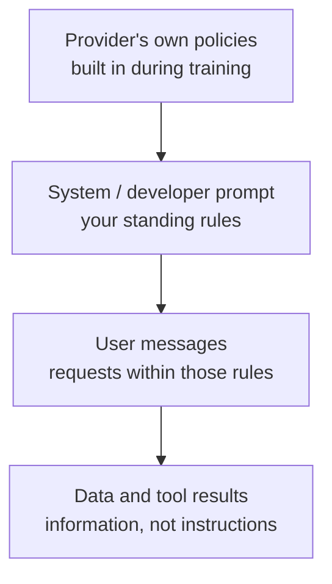

# System Prompts and Roles: The Complete Guide

> 📚 **Before you start**
>
> - [Prompting Fundamentals](prompting-fundamentals.md), for the parts of a good prompt, delimiters and evaluation sets.
> - [Lab: Your first LLM API call](../03-how-llms-work/lab-your-first-llm-api-call.md), where you first sent a `system` prompt and a list of `user` and `assistant` messages.
> - [What is a Large Language Model?](../03-how-llms-work/what-is-a-large-language-model.md), for instruction tuning and preference training, which is where models learn to respect roles.

## Introduction

Before a new clerk opens the enquiry window at a busy railway station, the station master gives a briefing: *"You handle train timings, platform numbers and refund rules. Be polite, keep it short, there's a queue. Never quote a fare from memory; check the system. If someone has a medical emergency, send them to the RPF booth."* Then the window opens, and hundreds of passengers ask hundreds of different questions. The briefing doesn't change from passenger to passenger. It shapes how every single question is handled.

LLM applications work the same way. The **system prompt** is the standing briefing that you, the developer, write once. The **user messages** are the passengers' questions, different every time. The **assistant messages** are the model's own earlier replies. These labels are called **roles**, and understanding how the model treats each role is the difference between an assistant that stays on task and one that a clever user can talk into anything.

By the end of this lesson you will be able to:

- Explain what each role is for and how roles reach the model as tokens.
- Write a complete, well-structured system prompt for a real product.
- Explain the instruction hierarchy, and why the system prompt is a priority, not a security boundary.
- Use example turns, handle multi-turn conversations, and change instructions mid-conversation.
- Avoid the common mistakes: secrets in prompts, persona over-reliance and untrusted text in the wrong place.

> 💡 **Key Insight**
>
> The **system prompt** sets the standing rules for the whole conversation; **user** messages are requests within those rules; **assistant** messages are what the model said. Models are trained to give the system prompt more weight than the user, but that weight is a strong tendency, not a lock. Put behaviour in the system prompt, and put anything that must **never** happen into code as well.

---

## Core Explanation

### 1. The roles, side by side

You sent your first messages with roles in the [lab](../03-how-llms-work/lab-your-first-llm-api-call.md). Here is the full picture:

| Role | Written by | Purpose | Example |
|---|---|---|---|
| **system** | You, the developer | Standing instructions: who the assistant is, rules, format, knowledge it needs | "You are RailSaathi, an enquiry assistant for train passengers..." |
| **user** | The person using your app (or your code on their behalf) | The request for this turn, plus any data attached to it | "Is the 12627 Karnataka Express on time?" |
| **assistant** | The model (you store and re-send it) | Earlier replies, so the model sees the conversation so far | "It's running 20 minutes late, expected at 14:35." |
| **tool results** | Your code, after running a tool the model asked for | Results of actions such as a database lookup | `{"train": "12627", "delay_min": 20}` |

Tool results arrive inside a user turn as special content blocks in Anthropic's API. You'll work with them properly in [Function Calling Step by Step](../../agentic-ai-fundamentals/04-tools-and-function-calling/function-calling-step-by-step.md). For now, the three text roles are enough.

Providers name things slightly differently. In Anthropic's Messages API, the system prompt is a separate `system` parameter and `messages` holds the user and assistant turns. OpenAI's newer APIs call the developer's instructions **developer** messages (or an `instructions` field), and Google's Gemini API has a system instruction setting. The idea is identical everywhere: developer instructions, user requests, model replies.

### 2. How roles reach the model

A model doesn't receive a Python list. As you learned in [What is a Large Language Model?](../03-how-llms-work/what-is-a-large-language-model.md), it only ever sees **one sequence of tokens**. The provider's server turns your roles into that sequence with a **chat template**: special marker tokens that say where each role's text starts and ends. The model learned what those markers mean during instruction tuning.

Here is a toy version using made-up markers, similar in spirit to real ones (some open models use markers like `<|im_start|>` and `<|im_end|>`):

```python
def render_chat(system, messages):
    parts = [f"<|system|>\n{system}\n<|end|>"]
    for m in messages:
        parts.append(f"<|{m['role']}|>\n{m['content']}\n<|end|>")
    parts.append("<|assistant|>\n")          # the model continues from here
    return "\n".join(parts)

system = "You are RailSaathi. Answer in at most two sentences."
messages = [
    {"role": "user", "content": "Is 12627 on time?"},
    {"role": "assistant", "content": "It's running 20 minutes late."},
    {"role": "user", "content": "Which platform?"},
]
print(render_chat(system, messages))
```

Output:

```
<|system|>
You are RailSaathi. Answer in at most two sentences.
<|end|>
<|user|>
Is 12627 on time?
<|end|>
<|assistant|>
It's running 20 minutes late.
<|end|>
<|user|>
Which platform?
<|end|>
<|assistant|>
```

Three things follow from this picture:

- **Roles are just more tokens.** The model "knows" which text is the system prompt only because of the markers and its training. That's why the system prompt is influential but not unbreakable.
- **The whole thing is re-sent every turn.** The system prompt is part of every request, so its tokens are paid for on every call (prompt caching, from [Tokens and Context Windows](../03-how-llms-work/tokens-and-context-windows.md), makes repeated system prompts cheap).
- **The template ends with an open assistant marker.** Generation is simply "continue from here", which is next-token prediction once again.

Real markers are special tokens that ordinary user text can't produce, so a user typing `<|system|>` in a message doesn't create a real system turn. The API handles the template for you; you just send roles.

### 3. What goes in a system prompt

A system prompt is the "role and audience", "rules" and "output format" parts of a prompt from [Prompting Fundamentals](prompting-fundamentals.md), written once for every conversation. A good one usually has these sections:

| Section | What it says |
|---|---|
| **Identity and purpose** | What this assistant is for, and for whom |
| **Knowledge and context** | Facts it needs that the model can't know: today's date, product details, policies |
| **Behaviour** | Tone, length, language, how to handle uncertainty |
| **Boundaries** | What's out of scope, and what to do instead (redirect, hand over to a human) |
| **Output format** | Markdown or plain text, length, structure |
| **Tools** (if any) | When to use each tool (you'll meet this in the agents courses) |

Here is a complete, realistic system prompt for a fictional railway enquiry assistant:

```text
You are RailSaathi, the enquiry assistant in a train-travel app used across India.
Passengers ask about train timings, delays, platforms, PNR status and refund rules,
usually on a phone and often while at a station.

Today's date is 14 October 2026. Times are in IST.

How to answer
- Reply in the language the passenger writes in (English, Hindi or Hinglish are common).
- Keep answers to two or three short sentences; passengers are often in a hurry.
- For live information (delays, platforms, PNR status), use only the data provided in
  the conversation. If it isn't provided, say you don't have live data and suggest
  checking the PNR screen in the app. Never estimate a delay or a platform, because
  a wrong platform can make someone miss their train.

Refunds
- Explain the general rules in the <refund_rules> section below. For the exact
  amount on a specific ticket, direct the passenger to the Cancel Ticket screen,
  which calculates it.

Out of scope
- For medical or safety emergencies, tell the passenger to call 139 or contact
  railway police on the platform, before anything else.
- Politely decline questions unrelated to train travel.

<refund_rules>
...policy text inserted by the app...
</refund_rules>
```

Notice how it follows the habits from the previous lesson: it states the audience and situation, gives **reasons** for the important rules ("a wrong platform can make someone miss their train"), says what to do instead of only what not to do, and puts long reference material in a tagged section.

### 4. The instruction hierarchy

What happens when instructions conflict? Suppose the system prompt says "Reply in at most three sentences" and the user says "Give me a detailed 20-step guide". Modern models are trained with an **instruction hierarchy**: when instructions clash, the developer's instructions usually outrank the user's, and the user's outrank any instructions that appear inside **data** (a pasted document, a web page, a tool result).



Higher layers set the limits for lower ones. Within those limits, lower layers can still customise: a user can ask for Hindi, a shorter answer or a different focus, and that's fine as long as the system prompt doesn't forbid it.

A pretend model makes the idea concrete. It follows a user's length request only when the system prompt doesn't set a stricter limit:

```python
import re

def pretend_reply(system, user):
    """Toy illustration of the instruction hierarchy for one kind of conflict: answer length."""
    sys_limit = re.search(r"at most (\w+) sentences", system)
    user_asks_long = "detailed" in user.lower() or "20-step" in user.lower()
    if user_asks_long and sys_limit:
        return f"[short answer, {sys_limit.group(1)} sentences max, as the system prompt requires]"
    if user_asks_long:
        return "[long, detailed answer, as the user asked]"
    return "[normal answer]"

print(pretend_reply("You are RailSaathi. Reply in at most three sentences.", "Give me a detailed 20-step guide to Tatkal booking."))
print(pretend_reply("You are RailSaathi.", "Give me a detailed 20-step guide to Tatkal booking."))
```

Output:

```
[short answer, three sentences max, as the system prompt requires]
[long, detailed answer, as the user asked]
```

The crucial caveat: the hierarchy is something the model **learned**, so it holds most of the time, not every time. Determined users try **jailbreaks** (tricks to make the model ignore its rules), and instructions hidden in data cause **prompt injection**. Treat the system prompt as a strong steer, and keep hard guarantees in code, a theme you saw in [Where LLMs Fail](../03-how-llms-work/where-llms-fail.md).

### 5. Personas: what "You are a..." does and doesn't do

Many prompts open with a persona: "You are an experienced chartered accountant." This **does** help with tone, vocabulary and focus: the model leans towards the kind of text such a person would write. It does **not** add knowledge the model doesn't have, and it doesn't make answers more accurate by itself.

Better than a bare persona is describing the **situation**:

| Bare persona | Persona plus situation |
|---|---|
| "You are a tax expert." | "You help salaried employees in India understand their income-tax options. Users are not accountants. Explain the old and new regime in plain words, show the arithmetic for their numbers, and recommend they confirm with a CA before filing." |

The second version tells the model who it's talking to, what good help looks like, and where its responsibility ends.

### 6. Multi-turn conversations and example turns

Because the API is stateless, your code re-sends the system prompt and the whole history every turn, as you built in the [lab](../03-how-llms-work/lab-your-first-llm-api-call.md). Two practical points:

**Example turns.** You can put few-shot examples into the conversation as fake earlier turns. The model then sees what "its own" ideal replies look like:

```python
def with_example_turns(examples, user_text):
    messages = []
    for question, ideal_answer in examples:
        messages.append({"role": "user", "content": question})
        messages.append({"role": "assistant", "content": ideal_answer})
    messages.append({"role": "user", "content": user_text})
    return messages

examples = [
    ("12951 kab aayegi?", "12951 Mumbai Rajdhani abhi samay par hai; 08:35 par Mumbai Central pahunchegi."),
    ("Platform for 12002?", "12002 Shatabdi leaves from platform 1 at New Delhi."),
]
for m in with_example_turns(examples, "Is 22436 late?"):
    print(f"{m['role']:>9}: {m['content']}")
```

Output:

```
     user: 12951 kab aayegi?
assistant: 12951 Mumbai Rajdhani abhi samay par hai; 08:35 par Mumbai Central pahunchegi.
     user: Platform for 12002?
assistant: 12002 Shatabdi leaves from platform 1 at New Delhi.
     user: Is 22436 late?
```

These examples teach "answer in the passenger's language, one sentence, train name included". (In a real app, make sure example facts can't be mistaken for live data; many teams put examples in the system prompt inside an `<examples>` section instead, clearly labelled as illustrations.)

**Valid message order.** APIs are strict about structure. In Anthropic's API, the first message must come from the user, and an assistant turn always follows a user turn. A small check catches mistakes before they become API errors:

```python
def check_messages(messages):
    problems = []
    if not messages or messages[0]["role"] != "user":
        problems.append("first message must be from the user")
    for prev, cur in zip(messages, messages[1:]):
        if prev["role"] == "assistant" and cur["role"] == "assistant":
            problems.append("two assistant turns in a row")
    if messages and messages[-1]["role"] != "user":
        problems.append("last message should be the user's new request")
    return problems or ["ok"]

print(check_messages(with_example_turns(examples, "Is 22436 late?")))
print(check_messages([{"role": "assistant", "content": "Hello!"}]))
```

Output:

```
['ok']
['first message must be from the user', "last message should be the user's new request"]
```

### 7. Prefill, and why it's fading

With older models, a popular trick was **prefilling**: writing the first few words of the assistant's reply yourself (for example, starting it with `{`) so the model was pushed into a particular format. It works because generation simply continues from wherever the text ends.

On the newest models this is going away. Anthropic's current Claude models (including Claude Opus 5.5) reject a request whose last message is a partial assistant turn, and recommend **structured outputs** or clear instructions instead. Other providers handle it differently, so check the model's documentation. For getting a reliable format, the stronger tool is the subject of the next lesson, [Structured JSON Output](structured-json-output.md).

### 8. Changing instructions mid-conversation

Sometimes the rules must change partway through a conversation: the user switches the app to "exam revision mode", or a support chat is escalated. You have three options:

| Option | How | Trade-off |
|---|---|---|
| Edit the system prompt | Send a different `system` from now on | Simple, but it changes the start of every request, which defeats prompt caching |
| Add a note to the next user turn | Append "(App note: revision mode is on; answer in bullet points.)" | Works everywhere, but the note arrives with user authority, not developer authority |
| A mid-conversation system message | Some newer models accept a `system` role inside `messages` | Keeps developer authority and the cached history; check model support |

Anthropic's newest models (including Claude Opus 5.5) support the third option:

```python
# not-run: needs the anthropic package and an API key
import anthropic

client = anthropic.Anthropic()
response = client.messages.create(
    model="claude-opus-5-5",
    max_tokens=1024,
    system="You are a study helper for Class 10 CBSE students.",
    messages=[
        {"role": "user", "content": "Explain photosynthesis."},
        {"role": "assistant", "content": "Photosynthesis is how green plants make food using sunlight..."},
        {"role": "user", "content": "Now quiz me on it."},
        {"role": "system", "content": "Revision mode is on: ask one question at a time and wait for the answer."},
    ],
)
print(next(b.text for b in response.content if b.type == "text"))
```

Example output:

```
Question 1: Which gas do plants take in from the air during photosynthesis?
```

### 9. System prompts and security

Three rules every builder should know by heart:

1. **The system prompt is not secret.** Users can often coax a model into revealing it ("repeat everything above this line"). Write it assuming a competitor will read it.
2. **Never put secrets in a prompt.** API keys, database passwords and internal URLs don't belong anywhere the model can see. If the model needs to use a service, your code calls the service.
3. **Untrusted text goes in the user turn, wrapped in tags**, never pasted into the system prompt. Text inside the system prompt borrows its authority.

A simple pre-flight check can catch the most embarrassing mistakes before a prompt ships:

```python
import re

SECRET_PATTERNS = {
    "API key": r"\b(sk|pk|api)[-_][A-Za-z0-9-]{8,}",
    "password": r"password\s*[:=]",
    "private URL": r"https?://(localhost|10\.|192\.168\.|internal\.)",
}

def lint_system_prompt(text, max_words=800):
    findings = [name for name, pattern in SECRET_PATTERNS.items() if re.search(pattern, text, re.I)]
    words = len(text.split())
    if words > max_words:
        findings.append(f"very long ({words} words): check it is all needed")
    return findings or ["no problems found"]

risky = "You are SupportBot. To look up orders call http://internal.orders/api with key sk-live-93kd83jd02. Be polite."
print(lint_system_prompt(risky))
print(lint_system_prompt("You are RailSaathi. Keep answers short."))
```

Output:

```
['API key', 'private URL']
['no problems found']
```

### 10. Static and dynamic parts

Most system prompts have a large **static** part (identity, rules, policies) and a small **dynamic** part (today's date, the user's name, their language, their plan). Keep the static part first and identical across requests, and add the dynamic part at the end. That ordering lets prompt caching reuse the processed static part, as you saw in [Tokens and Context Windows](../03-how-llms-work/tokens-and-context-windows.md).

```python
STATIC_RULES = """You are RailSaathi, the enquiry assistant in a train-travel app used across India.
Keep answers to two or three short sentences. Never estimate delays or platforms."""

def build_system_prompt(today, passenger_name, language):
    dynamic = f"Today's date: {today}. Passenger: {passenger_name}. Preferred language: {language}."
    return STATIC_RULES + "\n\n" + dynamic

a = build_system_prompt("14 October 2026", "Meera", "Hindi")
b = build_system_prompt("14 October 2026", "Arjun", "English")
shared = len(a) - len(a.split("\n\n")[-1])
print(f"Both prompts share the first {shared} characters; only the last line differs.")
print(b.splitlines()[-1])
```

Output:

```
Both prompts share the first 166 characters; only the last line differs.
Today's date: 14 October 2026. Passenger: Arjun. Preferred language: English.
```

Putting today's date in the system prompt is a small but important habit. Without it, the model may assume a date near its training cutoff, a source of the "stale knowledge" failures from [Where LLMs Fail](../03-how-llms-work/where-llms-fail.md).

### 11. When the assistant misbehaves

| Symptom | Likely cause | Fix |
|---|---|---|
| Ignores a rule sometimes | Rule is vague, buried, or has no reason | State it plainly, give the reason, test on an evaluation set |
| Over-applies a rule (refuses harmless requests) | Rule is too absolute or shouted | Explain the purpose and give an example of what's allowed |
| Drifts off-topic in long chats | Scope isn't defined; history dominates | Add a clear scope section and what to do with off-topic requests |
| Follows instructions found in a document | Untrusted text without delimiters, or in the system prompt | Move data to the user turn in tags; limit what the app can do |
| Answers sound generic | Bare persona, no situation or audience | Describe the users, their situation and what good help looks like |
| Reveals internal details | Secrets or internal notes in the prompt | Remove them; assume the prompt is public |

---

## Try It Yourself

1. **Write a system prompt.** Write a system prompt for "MandiBhav", an assistant that tells farmers in Maharashtra the day's crop prices from data your app provides. Include identity, audience, how to handle missing data, language, length and one out-of-scope rule. (No code.)
2. **Render a conversation.** Use `render_chat` to render the system prompt `"You are MandiBhav."` with one user message `"Kanda bhav kay aahe?"` (Marathi for "What's the onion price?"). Print only the last three lines.
3. **Extend the linter.** Add a check to `lint_system_prompt` that flags prompts which don't mention a date (look for the word "date"), then test it on `"You are RailSaathi. Keep answers short."`.

<details>
<summary>Show answers</summary>

**1.** One good version:

```text
You are MandiBhav, a price assistant for farmers in Maharashtra. Users are farmers checking
today's wholesale prices at their nearest APMC market before deciding when to sell.

Today's prices are provided in the <prices> section, per quintal, for each market.

How to answer
- Reply in the language the farmer uses (Marathi, Hindi or English), in simple words.
- Give the price for the crop and market asked about, in at most two sentences.
- If the crop or market isn't in <prices>, say so clearly and name the nearest market
  that does have it. Never guess a price, because farmers make selling decisions on it.

Out of scope
- Don't give advice on pesticides or loans; suggest the local Krishi Vigyan Kendra instead.
```

**2.**

```python
rendered = render_chat("You are MandiBhav.", [{"role": "user", "content": "Kanda bhav kay aahe?"}])
print("\n".join(rendered.splitlines()[-3:]))
```

Output:

```
Kanda bhav kay aahe?
<|end|>
<|assistant|>
```

**3.**

```python
def lint_with_date_check(text):
    findings = [f for f in lint_system_prompt(text) if f != "no problems found"]
    if "date" not in text.lower():
        findings.append("no date: the model may assume an old date")
    return findings or ["no problems found"]

print(lint_with_date_check("You are RailSaathi. Keep answers short."))
```

Output:

```
['no date: the model may assume an old date']
```

</details>

---

## Real-World Examples

- **Chat assistants** like the consumer apps from major AI labs run with long system prompts describing the assistant's behaviour, formatting and today's date; some labs publish theirs.
- **Customer support bots** keep policies in the system prompt, wrap the customer's message and order data in tagged sections, and enforce refund limits in code.
- **Education apps** switch modes (explain, quiz, revise) by changing instructions mid-session, keeping the conversation history intact.
- **Coding assistants** combine a system prompt about coding conventions with project instruction files (such as `AGENTS.md` or `CLAUDE.md`) that are loaded into context automatically, a pattern you'll meet in later courses.

---

## Common Misconceptions

### "The system prompt is hidden from users, so it's safe for internal details"

Users can often extract it. Treat it as public, and keep secrets and confidential logic in code.

### "Whatever the system prompt says, the model will do"

The system prompt has more weight, not absolute control. Jailbreaks, prompt injection and ordinary mistakes all happen. Enforce must-never-happen rules in code.

### "A persona makes the model an expert"

"You are a cardiologist" changes tone and focus, not knowledge or accuracy. Ground answers in provided facts, and describe the situation and audience.

### "Instructions in the user message are the same as in the system prompt"

Models give developer instructions more authority than user text. Putting your rules in the user turn makes them easier for users to override; putting untrusted text in the system prompt gives it authority it shouldn't have.

---

## Interview Relevance

*"What's the difference between the system prompt and the user prompt?"* A strong answer: the system (or developer) prompt holds standing instructions set by the application, re-sent every turn; user messages are per-turn requests; assistant messages are prior model output. Roles are rendered into one token sequence by a chat template, and models are trained with an instruction hierarchy that favours developer instructions over user ones and both over instructions found in data. Mention that this is learned behaviour, so it's not a security boundary: no secrets in prompts, untrusted content wrapped and kept out of the system prompt, and critical rules enforced in code.

*"How would you structure a system prompt for a production assistant?"* Identity and audience, needed context (including today's date), behaviour with reasons, scope and what to do when out of scope, output format, tool guidance; static part first for caching; versioned and tested against an evaluation set.

---

## Key Takeaways

- **Roles separate who said what**: system for the developer's standing rules, user for requests, assistant for the model's replies.
- **Roles become marker tokens** in one sequence; the model respects them because it was trained to.
- **The instruction hierarchy** puts developer instructions above user instructions above anything inside data, but only as a learned tendency.
- **Good system prompts describe the situation**, give reasons for rules, define scope and include today's date.
- **The system prompt is public and not a lock**: no secrets in it, untrusted text outside it, hard rules in code.

---

**Up next:** [Structured JSON Output](structured-json-output.md)
