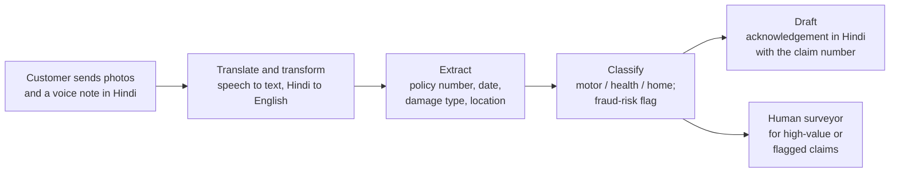
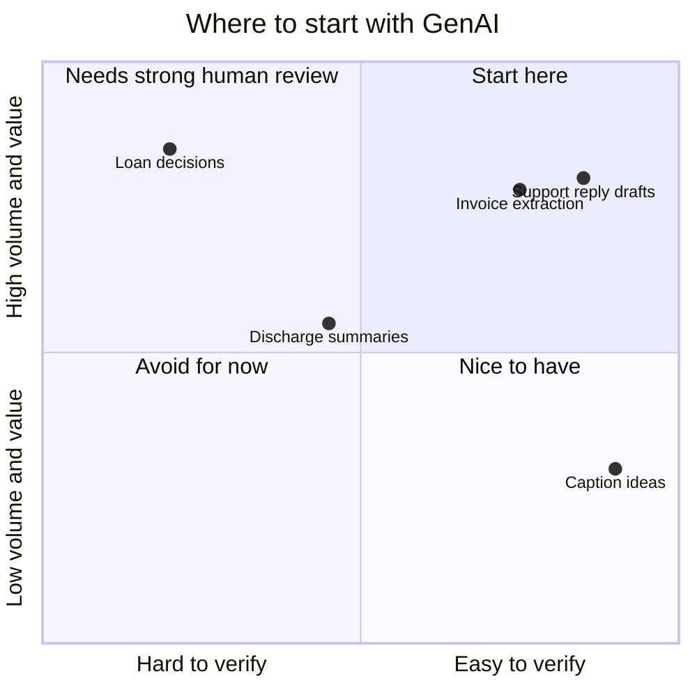

# GenAI Applications Across Industries: The Complete Guide

> 📚 **Before you start**
>
> - [Recent Breakthroughs in GenAI](recent-breakthroughs-in-genai.md), for the six levers (multimodality, long context, tools and so on) that make these applications possible.
> - [The GenAI Roadmap: Builder vs User](../02-fundamentals-of-generative-ai/the-genai-roadmap-builder-vs-user.md), for the build-or-buy choice.
> - [Where LLMs Fail](../03-how-llms-work/where-llms-fail.md), for hallucination, prompt injection and the defence-in-depth picture.
> - [Structured JSON Output](../04-prompting-and-structured-output/structured-json-output.md), because most business applications turn model output into data.

## Introduction

Walk into any Indian bank branch, hospital, kirana distributor or software office in 2026 and ask, "Where do you use generative AI?" The answers sound wildly different. The bank says "reading KYC documents". The hospital says "drafting discharge summaries". The distributor says "a WhatsApp bot that takes orders in Hinglish". The software team says "coding agents".

Look closer and the same few building blocks repeat. The bank's KYC reader and the hospital's lab-report reader are both **extraction**. The insurance helpline and the HR policy bot are both **answering from documents**. What really differs between industries is not the technology but three things around it: **what data they have, how costly a mistake is, and who checks the output**.

By the end of this lesson you will be able to:

- Break any GenAI application into a handful of reusable task patterns.
- Describe real uses in banking, insurance, healthcare, retail, education, law, software, manufacturing, agriculture, media and government.
- Judge whether a use case is a good fit, with a simple scoring method based on value, volume and how easy the output is to check.
- Estimate the business impact of a GenAI feature, including the cost of its mistakes.
- Recognise the rules (such as India's data protection law) that shape what is allowed.

> 💡 **Key Insight**
>
> Across industries, GenAI applications are built from the **same eight task patterns**: draft, summarise, extract, classify, answer from documents, translate, write code, and act. The best first use cases are those where **checking the output is much cheaper than producing it**, and where a mistake is caught before it hurts anyone.

---

## Core Explanation

### 1. The eight building blocks

Every application in this lesson is one of these patterns, or a few of them chained together ([Prompting Fundamentals](../04-prompting-and-structured-output/prompting-fundamentals.md) showed how to chain prompts).

| Pattern | What goes in | What comes out | Example |
|---|---|---|---|
| **Draft** | A request plus context | New text a person edits | Reply to a customer complaint |
| **Summarise** | Long text, audio or a conversation | A short version | Minutes of a two-hour meeting |
| **Extract** | A document, photo or message | Structured fields (JSON) | Name, PAN and address from a KYC form |
| **Classify and route** | A message or document | A label from a fixed list | "Billing", "technical", "fraud" for a support email |
| **Answer from documents** | A question plus relevant documents | An answer with sources | "Does my policy cover flood damage?" |
| **Translate and transform** | Text in one form | The same meaning in another | English circular into Hindi, Tamil and Marathi |
| **Write code** | A description or an existing codebase | Code, SQL or tests | "Show me last month's top ten SKUs" turned into SQL |
| **Act** | A goal plus tools | Actions in other systems | Book a service appointment, raise a refund |

The first four you have already practised in this course. **Answer from documents** is called **retrieval-augmented generation (RAG)**: find the relevant passages, put them in the prompt, and ask the model to answer only from them. You'll build it in [Retrieval-Augmented Generation](../../retrieval-augmented-generation-rag/course.md). **Act** is what an **agent** does: a model that decides which tool to call, sees the result and continues. That is the subject of [Agentic AI Fundamentals](../../agentic-ai-fundamentals/course.md).

Here is what a real business use case looks like once it's broken down. An insurer's claim-intake assistant on WhatsApp:



Five patterns, one product. When someone describes a GenAI product to you, try naming its patterns; it tells you at once what can go wrong and what needs checking.

### 2. What a typical industry application looks like inside

Under the industry-specific details, most production applications share one shape:


*The model is one box among many. The boxes around it are what make the application safe and useful in a real industry.*

Read it left to right:

1. **Channel.** Where users are: WhatsApp (huge in India), a mobile app, a website, a phone line, an internal tool.
2. **Backend.** Your code. It checks who the user is, what they're allowed to see, and builds the prompt.
3. **Context.** The company's own knowledge: policy documents, product catalogues, the customer's account. The model doesn't know any of it until you supply it.
4. **Model.** A foundation model through an API, or an open-weight model the company hosts.
5. **Checks.** Schema validation, business rules ("refund can't exceed order value"), safety filters ([Where LLMs Fail](../03-how-llms-work/where-llms-fail.md) called this defence in depth).
6. **Human review.** For anything high-stakes or low-confidence.
7. **Business systems.** Where answers go and actions happen: the CRM, core banking, the hospital record system.
8. **Logs and evaluation.** Every request is recorded so quality, cost and new failure patterns can be tracked.

### 3. Banking, fintech and insurance

Finance has huge volumes of documents and conversations, strict rules, and expensive mistakes.

| Use case | Patterns | Who checks |
|---|---|---|
| Reading KYC and loan documents (Aadhaar-masked IDs, salary slips, bank statements) | Extract | Rules plus a human for mismatches |
| Customer-support assistants in many languages | Answer from documents, translate | Escalation to an agent when unsure |
| Summarising a customer's history before a call | Summarise | The relationship manager reading it |
| Explaining a credit decision in plain language | Draft | Compliance-approved templates |
| Fraud-team copilots that summarise suspicious transaction patterns | Summarise, classify | Fraud analysts |
| Claims intake and first-pass assessment (insurance) | Extract, classify | Surveyors for high-value claims |

Note what's **not** on the list: letting a model decide who gets a loan. Credit decisions need to be explainable, consistent and free of unfair bias, so they remain with traditional, auditable models and people; GenAI helps around the decision (gathering documents, explaining it), not in it. In India, the Reserve Bank of India published a framework for responsible AI use in finance (called FREE-AI) in August 2025, which stresses governance, fairness and human accountability.

### 4. Healthcare and pharma

The potential is large and so is the risk, so nearly every serious use keeps a clinician in the loop.

| Use case | Patterns | Who checks |
|---|---|---|
| **Ambient clinical notes**: listen to a consultation, draft the notes | Summarise | The doctor signs them |
| Drafting discharge summaries and referral letters | Draft, summarise | The doctor |
| Reading lab reports and old prescriptions into structured records | Extract | Staff and validation rules |
| Patient FAQ in regional languages (timings, preparation for a test) | Answer from documents, translate | Scope limited to non-medical questions |
| Searching medical literature for a research question | Answer from documents | The researcher reads the sources |
| Drug discovery: generating candidate molecules or protein designs | Generative models for molecules (not only LLMs) | Lab experiments |

The rule of thumb in healthcare: **GenAI drafts, clinicians decide.** A model suggesting a diagnosis directly to a patient is a very different (regulated, high-risk) product from one that saves a doctor fifteen minutes of typing.

### 5. Retail, e-commerce and consumer brands

Retail loves GenAI because content volume is enormous and most mistakes are cheap to fix.

- **Product content**: titles, descriptions and attribute tags for thousands of SKUs, in several languages, from a photo and a spec sheet.
- **Conversational shopping**: "I need a kurta for a wedding in Jaipur in December, under ₹3,000" turned into filtered search results.
- **Review summarisation**: "Customers like the battery, complain about the charger."
- **Customer support**: order status, returns, refunds, often with **act** steps that call the order system.
- **Marketing creatives**: ad copy variants and generated images for festive campaigns, reviewed by the brand team.
- **Catalogue cleanup**: classifying products into the right category and fixing inconsistent attributes.

Small sellers benefit too: a shop owner can photograph a saree and get a listing in English and Hindi in seconds.

### 6. Education

- **Personal tutors** that explain a concept in the student's language and level, and ask questions instead of giving answers away.
- **Teacher assistants** that draft lesson plans, question papers and rubric-based feedback.
- **Content in Indian languages**: translating and adapting course material.
- **Practice and doubt-solving** at any hour.

The risks: wrong explanations stated confidently, and students outsourcing thinking. Good products ground answers in the syllabus and make the student do the work.

### 7. Legal, compliance and professional services

- **Contract review**: extract key clauses (termination, liability, payment terms) and flag unusual ones.
- **Due diligence**: answer questions across thousands of documents in a data room.
- **Drafting**: first drafts of notices, agreements and memos from templates.
- **Regulatory tracking**: summarise new circulars and map them to internal policies.

Hallucinated case citations have already embarrassed lawyers in several countries, so every legal output must be checked against the actual source. Products that **cite the exact passage** they used make that check fast.

### 8. Software and IT

Software is where GenAI adoption has gone deepest, because code has a built-in checker: it compiles, and tests pass or fail.

- **Code completion and chat** inside the editor.
- **Coding agents** that take a task, edit several files, run the tests and open a pull request (the breakthrough you met in the last lesson).
- **Test generation, code review, documentation and migration** of old code.
- **IT support**: password resets, access requests, incident summaries.
- **Text to SQL**: business users ask questions in plain language and get a query.

### 9. Manufacturing, agriculture, media and government

| Industry | Example uses |
|---|---|
| **Manufacturing** | Technicians ask questions of thousand-page machine manuals; maintenance logs summarised into failure patterns; quality reports drafted from inspection data |
| **Agriculture** | Voice advisory bots in local languages for crop disease, weather and scheme information; reading soil-test reports; photo-based pest identification (vision models) |
| **Media and entertainment** | Subtitles and dubbing in many languages, highlight summaries of a cricket match, headline variants, image and video generation for promotions |
| **Government and public services** | Citizen helplines in Indian languages, translating schemes and circulars, summarising grievances by theme. India's Bhashini programme builds language technology (translation, speech) for Indian languages for exactly these uses |
| **Telecom and utilities** | Bill explanations, outage communication, call-centre summaries and agent assistance |

### 10. A simple way to judge a use case

Not every idea is a good first project. A useful question is: **how does the cost of checking the output compare with the cost of producing it?**

- Writing a product description takes a person 15 minutes; checking a draft takes 1 minute. **Great fit.**
- Deciding a loan takes careful analysis; checking a model's decision properly takes the **same** careful analysis. **Poor fit**: the model saves nothing once you check it properly, and if you don't check it you take on large risk.

You can turn this into a rough score. Rate each use case from 1 (low) to 5 (high) on: **value** per task, **volume** of tasks, **ease of verifying** the output, **cost of an error**, and how ready the **data** is.

```python
def fit_score(value, volume, verify_ease, error_cost, data_ready):
    """Each input is 1 (low) to 5 (high). Returns a 0-100 score and a verdict."""
    benefit = value * volume                  # 1..25
    safety = verify_ease * (6 - error_cost)   # 1..25, high when checking is easy and mistakes are cheap
    score = round(100 * (benefit * safety) ** 0.5 / 25 * (0.6 + 0.1 * data_ready))
    verdict = "start here" if score >= 50 else "pilot with care" if score >= 25 else "not yet"
    return score, verdict

USE_CASES = {
    "Support reply drafts (agent edits)": dict(value=3, volume=5, verify_ease=5, error_cost=2, data_ready=4),
    "Invoice field extraction":           dict(value=3, volume=5, verify_ease=4, error_cost=2, data_ready=5),
    "Loan approval decisions":            dict(value=5, volume=4, verify_ease=2, error_cost=5, data_ready=3),
    "Discharge summary drafts":           dict(value=4, volume=3, verify_ease=3, error_cost=4, data_ready=2),
    "Marketing caption ideas":            dict(value=2, volume=3, verify_ease=5, error_cost=1, data_ready=3),
}
for name, ratings in sorted(USE_CASES.items(), key=lambda kv: -fit_score(**kv[1])[0]):
    score, verdict = fit_score(**ratings)
    print(f"{name:<36} {score:>3}  {verdict}")
```

Output:

```
Support reply drafts (agent edits)    69  start here
Invoice field extraction              68  start here
Marketing caption ideas               44  pilot with care
Discharge summary drafts              27  pilot with care
Loan approval decisions               23  not yet
```

The formula is a teaching tool, not a law; the ratings are judgement calls and real teams argue about them. But the ranking matches what companies actually experience: high-volume, easy-to-check work goes first. Notice that "loan approval" ranks last despite having the highest value. High value with high error cost and hard verification is the classic trap.



### 11. Measuring the business impact, including mistakes

A use case is worth doing only if its benefits beat its costs, and **errors are a cost**. Take a telecom support desk handling 60,000 tickets a month. Today an agent spends 8 minutes per ticket; with AI-drafted replies that the agent checks and sends, it drops to 3 minutes. The numbers below are illustrative.

```python
def monthly_impact(tickets, minutes_before, minutes_after, cost_per_agent_minute,
                   ai_cost_per_ticket, error_rate, cost_per_error):
    saved = tickets * (minutes_before - minutes_after) * cost_per_agent_minute
    ai_bill = tickets * ai_cost_per_ticket
    errors = tickets * error_rate * cost_per_error
    return saved, ai_bill, errors, saved - ai_bill - errors

saved, bill, errors, net = monthly_impact(
    tickets=60_000, minutes_before=8, minutes_after=3, cost_per_agent_minute=6,
    ai_cost_per_ticket=1.5, error_rate=0.02, cost_per_error=150)
print(f"agent time saved   ₹{saved:>12,.0f}")
print(f"model bill        -₹{bill:>12,.0f}")
print(f"cost of errors    -₹{errors:>12,.0f}")
print(f"net per month      ₹{net:>12,.0f}")

print()
for err in [0.02, 0.10, 0.25]:
    *_, net = monthly_impact(60_000, 8, 3, 6, 1.5, err, 150)
    print(f"error rate {err:.0%}: net ₹{net:,.0f}")
```

Output:

```
agent time saved   ₹   1,800,000
model bill        -₹      90,000
cost of errors    -₹     180,000
net per month      ₹   1,530,000

error rate 2%: net ₹1,530,000
error rate 10%: net ₹810,000
error rate 25%: net ₹-540,000
```

Three lessons hide in these numbers:

- **The model bill is usually the smallest line.** The value is in people's time; the risk is in errors.
- **Quality decides profit.** The same feature goes from very profitable to loss-making as the error rate climbs. That's why the next lesson puts evaluation at the centre of the project.
- **"Errors" include more than wrong answers**: an angry customer, a compliance breach, a wrong refund. Some errors (leaking another customer's data) are so costly that no saving justifies them; those need hard guarantees in code, not a percentage.

### 12. The rules that shape applications

Industries differ sharply in regulation, and regulation shapes design as much as technology does.

| Concern | What it means for design |
|---|---|
| **Personal data** | India's Digital Personal Data Protection Act, 2023, with rules notified in November 2025 and phased in over the following months, governs how personal data is collected and used: purpose limits, consent, security. Send models only the data a task needs, and know where your provider processes it |
| **Sector regulators** | Finance (RBI, SEBI, IRDAI), healthcare and telecom have their own rules on outsourcing, record-keeping and customer communication |
| **Data residency** | Some data must stay in India or on the company's own servers, which pushes towards in-country cloud regions or self-hosted open-weight models |
| **Explainability and fairness** | Decisions affecting people (credit, hiring, insurance) must be explainable and non-discriminatory |
| **Intellectual property** | Who owns generated content, and whether training data or outputs copy protected work |
| **Disclosure** | Users increasingly expect, and some rules require, to know when they're talking to an AI or seeing generated media |

These rules change. Treat this table as a map of the questions to ask your legal or compliance team, not as legal advice.

### 13. Common patterns that fail

- **The demo trap.** A chatbot that impressed in a five-question demo fails on the thousandth real question, because no one built an evaluation set.
- **Automating the decision instead of the drudgery.** Replacing the judgement step (loan approval, diagnosis) instead of the paperwork around it.
- **No owner for the knowledge.** An "answer from documents" bot is only as good as the documents; outdated policy PDFs give outdated answers.
- **Ignoring the channel.** A brilliant web app no one opens, when customers live on WhatsApp and phone calls.
- **No path to a human.** Users get stuck in a loop with a bot that can't help.

---

## Try It Yourself

1. **Name the patterns.** List the task patterns in each: (a) a bot that reads a photo of an electricity bill and fills in the amount and due date in a payments app; (b) a tool that turns a two-hour board meeting recording into minutes with action items; (c) an assistant that answers employee questions about leave policy and can apply for leave on their behalf.
2. **Score a farm advisory bot.** A voice bot advises farmers on crop disease in Marathi. Rate it value 4, volume 4, verify_ease 2, error_cost 4, data_ready 2 and compute its score. Then imagine the bot only answers from an approved agriculture-department handbook and always shows the handbook passage, raising verify_ease to 4 and lowering error_cost to 2. Score it again.
3. **Break-even error rate.** In the support-desk example, at what error rate does the net benefit become zero?
4. **Find the risky step.** For the insurance claim-intake flow in section 1, which step would you never let run without a human, and why?

<details>
<summary>Show answers</summary>

**1.** (a) **Extract** (vision input to structured fields), possibly **classify** (which biller). (b) **Translate and transform** (speech to text), **summarise**, and **extract** (action items as a list). (c) **Answer from documents** (the leave policy) and **act** (applying for leave through the HR system's tool).

**2.**

```python
print(fit_score(value=4, volume=4, verify_ease=2, error_cost=4, data_ready=2))
print(fit_score(value=4, volume=4, verify_ease=4, error_cost=2, data_ready=2))
```

Output:

```
(26, 'pilot with care')
(51, 'start here')
```

Same idea, very different risk: grounding answers in an approved source and showing that source makes the output easier to verify and mistakes less likely, which moves it from a cautious pilot to a good starting point.

**3.** The net is zero when the cost of errors equals the time saved minus the model bill.

```python
saved, bill, _, _ = monthly_impact(60_000, 8, 3, 6, 1.5, 0.0, 150)
break_even = (saved - bill) / (60_000 * 150)
print(f"break-even error rate: {break_even:.0%}")
```

Output:

```
break-even error rate: 19%
```

**4.** The **fraud-risk flag and the claim decision**. Calling a customer's claim fraudulent, or rejecting it, has legal and human consequences, and the model's judgement is hard to verify. The model can gather and organise the evidence; a person decides.

</details>

---

## Real-World Examples

- **Banks and insurers** use vision-capable models with structured output to read forms and claims documents, sending mismatches to human operators, the same pattern you built in the [JSON extraction lab](../04-prompting-and-structured-output/lab-reliable-json-extraction.md).
- **Hospitals** in many countries have adopted ambient documentation tools that draft clinical notes from the consultation for the doctor to review and sign.
- **E-commerce marketplaces** generate and translate product listings at catalogue scale and summarise reviews on product pages.
- **Software companies** report a large share of their new code being written with AI assistance, increasingly by coding agents that open pull requests for human review.
- **Indian public services** use language technology for translation and voice access in Indian languages, so citizens can use services in their own language.

---

## Common Misconceptions

### "Every industry needs its own special AI model"

Most applications use general foundation models plus the company's own context and checks. Industry-specific models exist, but the industry difference is mostly in data, rules and review, not the model.

### "The best use cases are the highest-value decisions"

High value often comes with high error cost and hard verification. The best first projects are high-volume, easy-to-check tasks where the model drafts and a person (or a rule) confirms.

### "GenAI replaces the people doing the job"

In most successful deployments it removes the repetitive part of the job (typing notes, filling forms, first drafts) and leaves judgement with people. Roles change, and some tasks disappear, but the human check is usually what makes the system safe.

### "The model cost decides whether it's worth it"

The model bill is usually small next to staff time and the cost of errors. Quality, measured on real cases, decides whether a feature pays.

---

## Interview Relevance

*"Give examples of GenAI use cases in [banking / healthcare / retail]."* A strong answer names concrete uses, maps each to a pattern (extract, summarise, answer from documents, and so on), says who checks the output, and points out what should **not** be automated in that industry and why.

*"How would you choose which GenAI use case to build first?"* Talk about value times volume, the cost of verifying output compared with producing it, the cost of an error, data readiness, and regulation. Mention starting with human-in-the-loop drafting and measuring time saved and error rates.

*"How do you measure the ROI of a GenAI feature?"* Time or money saved, minus model and engineering costs, minus the cost of errors; show that error rate can flip the result, and mention adoption (a feature nobody uses saves nothing).

---

## Key Takeaways

- **Eight patterns build almost every application**: draft, summarise, extract, classify, answer from documents, translate, write code and act.
- **Industries differ in data, error cost and who checks**, much more than in the technology they use.
- **Start where checking is cheap**: high-volume work where verifying a draft takes far less effort than producing it.
- **Errors are a cost line**: quality, not the model bill, decides whether a GenAI feature pays.
- **Regulation shapes the design**: personal data, sector rules, residency and fairness requirements decide what data goes where and which decisions stay with people.

---

**Up next:** [The GenAI Project Lifecycle](the-genai-project-lifecycle.md)
