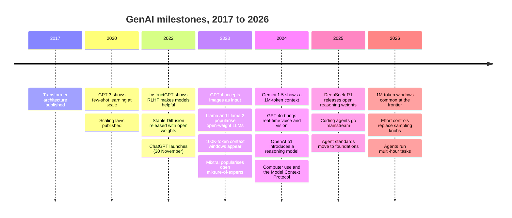

# Recent Breakthroughs in GenAI: The Complete Guide

> 📚 **Before you start**
>
> - [What is Generative AI?](../02-fundamentals-of-generative-ai/what-is-generative-ai.md), for the short history up to 2022.
> - [Foundation Models](../02-fundamentals-of-generative-ai/foundation-models.md), for scaling laws and open-weight vs closed models.
> - [What is a Large Language Model?](../03-how-llms-work/what-is-a-large-language-model.md), for the four training stages, including reinforcement learning for reasoning.
> - [Tokens and Context Windows](../03-how-llms-work/tokens-and-context-windows.md) and [Structured JSON Output](../04-prompting-and-structured-output/structured-json-output.md), which this lesson builds on.

## Introduction

Think of how mobile phones changed between 2007 and 2015. Every few months there was a headline: a better camera, a faster chip, 4G, fingerprint unlock, UPI apps. If you only read headlines, it felt like chaos. If you understood the few underlying forces (cheaper chips, better batteries, faster networks, app stores), every headline made sense, and you could guess what was coming next.

Generative AI since 2022 has felt even faster. ChatGPT, then GPT-4, open-weight Llama, million-token context, Sora's videos, reasoning models, DeepSeek-R1, computer-using agents, MCP, coding agents that work for hours. This lesson doesn't just list these events. It groups them into a handful of **levers** that keep producing breakthroughs, so that when the next announcement arrives you can place it, judge it and know what it means for what you build.

By the end of this lesson you will be able to:

- Place the major GenAI milestones from 2017 to 2026 on a timeline.
- Explain the six levers behind recent progress: scale and data, post-training, test-time compute, multimodality, long context and efficiency, and tools and agents.
- Show with a small calculation why "thinking longer" makes models more accurate.
- Estimate the memory needed to run a model and the effect of quantization and mixture-of-experts.
- Name the research trends worth watching, and read a GenAI headline critically.

> 💡 **Key Insight**
>
> Nearly every GenAI breakthrough since 2022 pulls one of six levers: **more and better data and compute**, **better post-training**, **more thinking at answer time**, **more kinds of input and output**, **longer context at lower cost**, and **tools that let models act**. Learn the levers and every headline becomes a question you can answer: *which lever, how much, and what does it cost?*

---

## Core Explanation

### 1. The timeline



The dates are less important than the pattern. Each row is one of the levers below, pulled harder.


*Every headline in the timeline pulls at least one of these six levers.*

### 2. Lever 1: scale and data quality

You met **scaling laws** in [Foundation Models](../02-fundamentals-of-generative-ai/foundation-models.md): more parameters, data and compute give predictably lower loss. Two things changed after 2022:

- **Data quality became the main battleground.** The public web is finite and noisy. Labs now spend enormous effort filtering, deduplicating and balancing data, and add **synthetic data**: text, code and problems generated by earlier models and then checked. Well-chosen data can make a smaller model beat a larger one trained on worse data.
- **Models are "over-trained" on purpose.** Training a smaller model on far more tokens than the compute-optimal amount costs more once, but makes the model cheaper to run for millions of users. Since running costs dominate for popular models, this trade is usually worth it.

What it means for you: a newer, smaller model is often better than an older, bigger one. Compare models by measured quality and price on **your** task, not by parameter count.

### 3. Lever 2: post-training made models useful

The jump from GPT-3 (2020) to ChatGPT (2022) was not mainly a bigger model. It was **post-training**: instruction tuning and preference training with human feedback (RLHF), which you studied in [What is a Large Language Model?](../03-how-llms-work/what-is-a-large-language-model.md). OpenAI's InstructGPT work in early 2022 found that people preferred the answers of a much smaller model trained with RLHF to those of the far larger original GPT-3.

Since then, post-training has kept improving: AI feedback guided by written principles (RLAIF), direct preference optimisation (DPO), training against sycophancy and hallucination, better refusal behaviour, and much better tool use and instruction following. A large part of the difference between model versions today comes from post-training rather than pretraining.

### 4. Lever 3: thinking at answer time (test-time compute)

The biggest shift of 2024 to 2025 was a **new direction for scaling**. Instead of only spending compute on training, spend more compute **while answering**: let the model write a long chain of reasoning, check its work and try alternatives before giving the final answer. OpenAI's o1 (September 2024) was the first widely used **reasoning model**; DeepSeek-R1 (January 2025) showed that the recipe, reinforcement learning with verifiable rewards, could produce a strong reasoning model with openly released weights. Today every frontier lab ships reasoning models, usually with an **effort** setting ([Temperature and Model Settings](../03-how-llms-work/temperature-and-model-settings.md)).

Why does thinking longer help? A simple model of it is **self-consistency**: sample several independent answers and take the majority. If each attempt is right with probability *p* and attempts are independent, the chance that the majority is right rises quickly with the number of attempts:

```python
from math import comb

def majority_correct(p, n):
    """Probability that more than half of n independent answers are right, if each is right with prob p."""
    need = n // 2 + 1
    return sum(comb(n, k) * p**k * (1 - p) ** (n - k) for k in range(need, n + 1))

print("attempts   p=0.60   p=0.75")
for n in [1, 3, 5, 9, 15]:
    print(f"{n:>8}   {majority_correct(0.60, n):.3f}    {majority_correct(0.75, n):.3f}")
```

Output:

```
attempts   p=0.60   p=0.75
       1   0.600    0.750
       3   0.648    0.844
       5   0.683    0.896
       9   0.733    0.951
      15   0.787    0.983
```

With a 75% single-attempt accuracy, fifteen votes push accuracy to about 98%. Real reasoning models do something richer than voting (they explore, notice mistakes and backtrack inside one long chain of thought), and real attempts aren't fully independent, so gains are smaller than this ideal. But the lesson holds: **accuracy can be bought with compute at answer time**. The flip side is visible in the table too: if a model is usually wrong (*p* below 0.5), more votes make things worse. Thinking longer helps most on problems the model can *sometimes* solve.

What it means for you: for hard tasks (maths, tricky code, multi-step analysis), raise effort or choose a reasoning model; for simple tasks, low effort is faster and cheaper. Thinking tokens are billed as output, so effort is a cost dial as well as a quality dial.

### 5. Lever 4: multimodality

Early LLMs read and wrote text only. Since 2023, frontier models increasingly **read images, documents, audio and video**, and some **generate** images and speech:

| Capability | What changed | Typical use |
|---|---|---|
| **Vision input** | Models read photos, screenshots, charts and scanned PDFs | Reading invoices and forms, answering questions about a chart |
| **Native voice** | Speech in and speech out in one model, with low delay | Voice assistants, call-centre bots in Indian languages |
| **Image generation** | Diffusion models and, increasingly, LLMs that generate images directly | Marketing creatives, product mock-ups |
| **Video generation** | Diffusion-based video models produce short realistic clips from text | Ads, storyboards, education |
| **Computer use** | Models read screenshots and control a mouse and keyboard | Automating apps that have no API |

The family tree from [How Generative Models Work](../02-fundamentals-of-generative-ai/how-generative-models-work.md) is still the right map: autoregressive transformers dominate text, while diffusion dominates images and video, and the two are increasingly combined in one system.

### 6. Lever 5: long context and efficiency

**Context windows** grew from about 4,000 tokens (2022) to 100,000 (2023) to around a million at the frontier by 2026 ([Tokens and Context Windows](../03-how-llms-work/tokens-and-context-windows.md)). At the same time, the **price per token** of a given level of quality fell steeply year after year. Several techniques made this possible:

- **Mixture of experts (MoE).** The model has many "expert" sub-networks, and a small router picks a few of them for each token. Total parameters (knowledge capacity) are large, but the compute per token is that of a much smaller model.
- **Quantization.** Storing weights with fewer bits (8 or 4 instead of 16) cuts memory and speeds up inference with a modest quality loss.
- **Distillation.** A small "student" model is trained to imitate a large "teacher", keeping much of the quality at a fraction of the cost.
- **Prompt caching and better serving.** Reusing processed prefixes and batching requests efficiently on GPUs.

A quick calculation shows why quantization and MoE matter so much for anyone who wants to run open-weight models:

```python
def weight_memory_gb(params_billion, bits):
    return params_billion * 1e9 * bits / 8 / 1e9

print("70B dense model, memory for weights alone:")
for bits in [16, 8, 4]:
    print(f"  {bits:>2}-bit: {weight_memory_gb(70, bits):6.1f} GB")

total_experts, active_experts = 8, 2
expert_params, shared_params = 5.6, 2.0            # billions, an illustrative MoE layout
total = shared_params + total_experts * expert_params
active = shared_params + active_experts * expert_params
print(f"\nMoE: {total:.1f}B parameters stored, {active:.1f}B used per token "
      f"({active / total:.0%} of the compute of a dense model that size)")
```

Output:

```
70B dense model, memory for weights alone:
  16-bit:  140.0 GB
   8-bit:   70.0 GB
   4-bit:   35.0 GB

MoE: 46.8B parameters stored, 13.2B used per token (28% of the compute of a dense model that size)
```

At 16-bit, a 70-billion-parameter model doesn't fit on even a large single GPU; at 4-bit it fits on one high-memory GPU. The MoE model must store all 46.8 billion parameters, but each token only runs through 13.2 billion of them, so it answers about as fast as a 13B dense model.

What it means for you: long documents and many examples are now affordable, small models can run on laptops and phones, and the cheapest model that passes your evaluation set is often far cheaper than you'd expect. Re-check prices and options every few months.

### 7. Lever 6: tools, agents and protocols

The final lever turns a model that **talks** into a system that **acts**. The steps came quickly:

| Step | What it added |
|---|---|
| **Function calling** (2023) | The model outputs a structured request to call a tool, which your code runs (structured output again, from [Structured JSON Output](../04-prompting-and-structured-output/structured-json-output.md)) |
| **Computer use** (late 2024) | The model operates a desktop or browser from screenshots |
| **Model Context Protocol (MCP)** (November 2024) | An open standard for connecting models to tools and data sources, so one integration works across many apps |
| **Coding agents** (2025) | Agents that read a codebase, edit files and run tests for long stretches |
| **Agent standards and foundations** (2025 to 2026) | Protocols such as MCP and agent-to-agent (A2A) moved to neutral, multi-company foundations, with stable versions |

Reasoning (lever 3) and long context (lever 5) are what made agents practical: an agent needs to plan, notice its own mistakes and keep a long history of what it has done. You'll build agents step by step in [Agentic AI Fundamentals](../../agentic-ai-fundamentals/course.md).

### 8. Open-weight models close the gap

Running alongside all six levers is a story about **who** has access. In 2023, Meta's Llama models made capable open-weight LLMs widely available. Mistral, Qwen, Gemma, DeepSeek and others followed, and in 2025 OpenAI also released open-weight models. Open-weight models have typically trailed the best closed models by months rather than years. For builders, that means real choices: a closed frontier API for the hardest tasks, and an open model you host yourself where data control, cost at scale or deep customisation matters ([Foundation Models](../02-fundamentals-of-generative-ai/foundation-models.md) covers the trade-offs).

### 9. Research trends worth watching

These are active research directions as of October 2026. Treat them as things to follow, not settled facts.

| Trend | The question it tackles |
|---|---|
| **Reinforcement learning beyond maths and code** | Can verifiable-reward training extend to tasks where "correct" is harder to check, such as research or writing? |
| **Long-horizon agents** | How do agents stay on track over hours or days of work, with memory, planning and self-checking? |
| **Synthetic data** | How much of a model's training can safely come from other models' output without quality collapsing? |
| **Interpretability** | Can we see *inside* the model, finding the internal features and circuits behind a behaviour, to debug and verify it? |
| **Evaluation** | Benchmarks saturate quickly and test questions leak into training data; how do we measure real capability? |
| **Efficiency and on-device models** | How small can a useful model get, for phones, laptops and offline use? |
| **Safety and alignment** | How do we keep more capable, more autonomous systems honest, controllable and resistant to misuse? |
| **Indian-language AI** | Better tokenizers, data and models for Hindi, Tamil, Bengali and other Indian languages, a goal of both companies and public programmes |

### 10. How to read a GenAI headline

When the next "breakthrough" arrives, run it through these questions:

| Question | Why it matters |
|---|---|
| **Which lever does it pull?** | Places it in the map above and tells you what kind of improvement to expect |
| **Measured on what?** | A benchmark score says little about your task; look for evaluations similar to your use case |
| **Could the test have leaked?** | Models trained on web data may have seen popular benchmark questions |
| **At what cost and speed?** | A better score at ten times the price or latency may not help you |
| **Can you use it today?** | A research paper, a waitlist preview and a generally available API are very different things |
| **What does it change for your system?** | Often the honest answer is "re-run my evaluation set on it and compare" |

The last row is the one that matters most. Because you keep an evaluation set ([Prompting Fundamentals](../04-prompting-and-structured-output/prompting-fundamentals.md)), you can test any new model on your own task in an afternoon, instead of guessing from headlines.

---

## Try It Yourself

1. **When does voting hurt?** Using `majority_correct`, print the majority-vote accuracy for 1, 5 and 15 attempts when each attempt is right with probability 0.4. What does that tell you about using more test-time compute on tasks a model is bad at?
2. **Will it fit?** A laptop has 16 GB of memory free for model weights. Using `weight_memory_gb`, find the largest of these models that fits at 4-bit: 8B, 14B, 32B, 70B.
3. **Place the headline.** For each made-up headline, name the lever: (a) "New model reads hour-long lecture videos and answers questions about them"; (b) "Same model, new setting: 'max' effort solves 20% more olympiad problems"; (c) "Assistant can now book train tickets on your behalf through the railway's booking service".

<details>
<summary>Show answers</summary>

**1.**

```python
for n in [1, 5, 15]:
    print(n, round(majority_correct(0.4, n), 3))
```

Output:

```
1 0.4
5 0.317
15 0.213
```

When a single attempt is usually wrong, the majority is wrong even more often. More thinking helps on problems the model can sometimes solve; for problems beyond it, you need a better model, tools, or better context, not more votes.

**2.**

```python
for size in [8, 14, 32, 70]:
    gb = weight_memory_gb(size, 4)
    print(f"{size}B at 4-bit: {gb:.1f} GB -> {'fits' if gb <= 16 else 'too big'}")
```

Output:

```
8B at 4-bit: 4.0 GB -> fits
14B at 4-bit: 7.0 GB -> fits
32B at 4-bit: 16.0 GB -> fits
70B at 4-bit: 35.0 GB -> too big
```

The 32B model fits exactly on paper, but in practice you also need memory for the context (the attention cache) and the runtime, so the 14B model is the realistic choice.

**3.** (a) **Multimodality** (video input), helped by **long context**. (b) **Test-time compute**: same weights, more thinking. (c) **Tools and agents**: the model acts through a booking tool, and the safeguards around that tool decide whether it's safe.

</details>

---

## Real-World Examples

- **Chat assistants** now commonly offer a "thinking" or effort option, which is lever 3 surfaced directly to users.
- **Document-heavy businesses** (banks, insurers, law firms) moved from OCR plus templates to vision-capable LLMs that read scanned forms directly, combined with the structured output you built in the [lab](../04-prompting-and-structured-output/lab-reliable-json-extraction.md).
- **Software teams** use coding agents that work through multi-file changes and run tests, which depends on reasoning, long context and tool use together.
- **Startups and enterprises in India** fine-tune or host open-weight models for Indian languages and for data that must stay on their own servers.

---

## Common Misconceptions

### "Progress is just bigger models"

Since 2022, much of the progress came from post-training, test-time thinking, efficiency and tools. Smaller, newer models often beat larger, older ones.

### "Reasoning models are always better"

They are better at multi-step problems and cost more tokens and time. For simple extraction or chat, a fast model at low effort is often just as accurate and much cheaper.

### "A benchmark record means the model is better for my app"

Benchmarks measure narrow skills and can be contaminated. Only your own evaluation set tells you what a model does on your task.

### "Open-weight models are years behind"

They have typically trailed the best closed models by months, and for many tasks the gap doesn't matter. Choose by measured quality, cost and data needs.

---

## Interview Relevance

*"What have been the most important recent developments in LLMs?"* A strong answer groups developments by lever instead of listing products: post-training (RLHF and its successors) turned base models into assistants; reasoning models trained with verifiable rewards opened a new scaling axis, test-time compute; multimodality added vision, voice and video; long context and efficiency (MoE, quantization, distillation, caching) cut cost per token sharply; and tool use, computer use and protocols like MCP made agents practical. It adds the open-weight story and a sober note on evaluation: benchmark saturation and contamination, so real decisions come from task-specific evaluation.

*"Why does more test-time compute improve accuracy?"* Explain sampling multiple solutions or longer reasoning that can catch errors, the majority-vote intuition (helps when single-attempt accuracy is above chance, hurts when below), and the cost trade-off since thinking tokens are billed.

---

## Key Takeaways

- **Six levers explain most breakthroughs**: scale and data, post-training, test-time compute, multimodality, long context and efficiency, and tools and agents.
- **Post-training and reasoning**, not just size, made the biggest recent differences.
- **Thinking longer buys accuracy** on problems the model can sometimes solve, at the price of tokens and time.
- **Efficiency techniques** (MoE, quantization, distillation, caching) made long context and small local models practical.
- **Read headlines with questions**: which lever, measured how, at what cost, usable when, and how does it do on *your* evaluation set?

---

**Up next:** [GenAI Applications Across Industries](genai-applications-across-industries.md)
