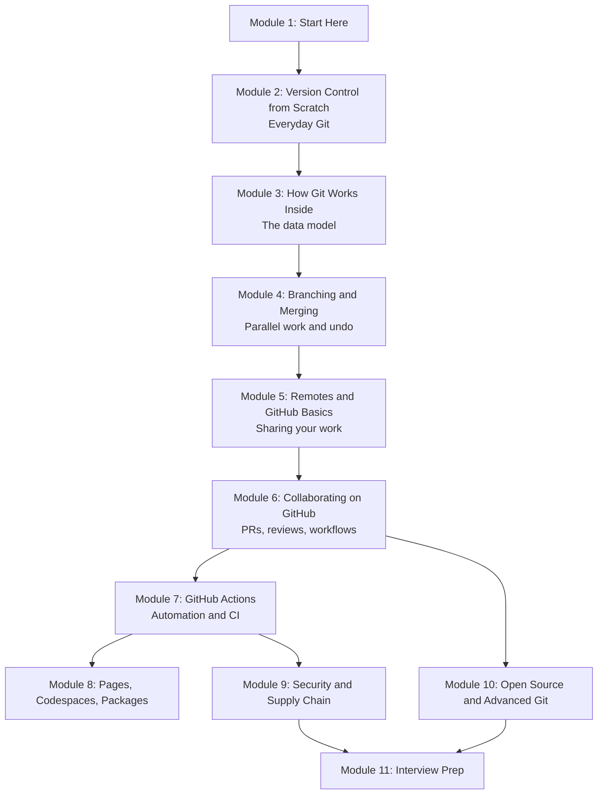
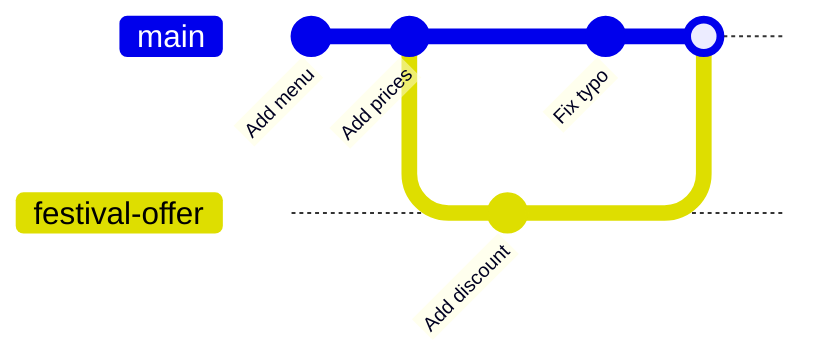

# How This Course Works

## Introduction

Think about the last time you lost work. Maybe a file got overwritten, maybe a "small fix" broke something that worked yesterday and you couldn't remember what you changed, or maybe two people edited the same document and one person's changes quietly vanished. Every software team in the world has these problems, every single day, and almost all of them solve them with the same tool: **Git**. And most of them share their Git projects, review each other's work and run their automation on **GitHub**.

Git is often the first tool a new developer, data engineer or AI engineer is expected to "just know", and also the tool people feel least sure about. Many working engineers survive on five memorised commands and panic when they see the words *detached HEAD* or *merge conflict*. This course exists so that you never have to feel that way.

This first article is short. It explains what you will learn, how the lessons are built, what you need before starting and how to get the most out of the course.

> 💡 **Key Insight**
>
> Git is not a pile of commands to memorise. It is a **small, simple data model** (snapshots, pointers to snapshots, and a few areas where files live) with commands on top. Once you can picture that model, every command, every error message and every "how do I undo this?" becomes something you can reason about instead of something you look up.

---

## What You Will Learn

By the end of this course you will be able to:

- **Use Git confidently every day**: create repositories, stage and commit work, read history, write good commit messages and keep secrets and junk out of your repository.
- **Explain how Git works inside**: blobs, trees, commits, tags, hashes, refs, `HEAD` and the reflog, and use that knowledge to get yourself out of any mess.
- **Branch, merge and rebase** without fear, resolve conflicts calmly, and undo almost anything with `restore`, `reset`, `revert`, `cherry-pick`, `stash` and the reflog.
- **Work with GitHub**: clone, fetch, pull and push, authenticate with SSH keys or tokens, use the GitHub CLI, fork projects and present a repository well.
- **Collaborate like a professional team**: pull requests, code review, issues and Projects, branching workflows, branch protection, rulesets, CODEOWNERS, merge strategies and merge queues.
- **Automate and ship**: GitHub Actions, Pages, Codespaces, Packages and releases.
- **Keep a project secure** and contribute to open source, then walk into a Git interview prepared.

### The course at a glance



The first half of the course (modules 2 to 6) is about **Git itself and working with other people**. Module 2 gets you productive on your own machine. Module 3 opens the `.git` folder so the rest of the course makes sense. Module 4 is the heart of Git: branches, merges, rebases and undoing mistakes. Modules 5 and 6 take your work to GitHub and teach the team habits that companies expect.

The second half (modules 7 to 11) builds on that foundation: automation with [GitHub Actions](../course.md#m7), hosting and environments in [module 8](../course.md#m8), [security](../course.md#m9), [open source and advanced Git](../course.md#m10), and [interview preparation](../course.md#m11). Using AI coding agents on GitHub (Copilot, agents that open pull requests, the GitHub MCP server) is taught later, in [Coding Agents on GitHub](../../coding-agents-and-harness-engineering/course.md#m3), once you have learned how agents and MCP work.

### Git and GitHub are different things

You will hear the two names used as if they were one. They are not:

| | Git | GitHub |
|---|---|---|
| **What it is** | A program that runs on your computer | A website and service run by a company (owned by Microsoft) |
| **What it does** | Records the history of a folder of files and lets you branch, merge and undo | Hosts Git repositories online and adds collaboration: pull requests, issues, Actions, Pages and more |
| **Needs the internet?** | No. Almost everything works offline | Yes |
| **Alternatives** | Mercurial, Subversion (older, much less common now) | GitLab, Bitbucket, Azure Repos, Gitea |

Everything you learn about Git in modules 2 to 4 works the same whether your team uses GitHub, GitLab or a server in the office.

---

## How Every Lesson Is Built

Every article follows the same shape, so you always know where to look:

| Section | What it gives you |
|---|---|
| **Before you start** | Links to the earlier lessons this one depends on. If a term is unfamiliar, follow the link. |
| **Introduction** | Why the topic matters, with an everyday example. |
| **Key Insight** | The one idea to remember if you remember nothing else. |
| **Core Explanation** | The topic step by step, with diagrams of the commit history, real commands and their real output. |
| **Try It Yourself** | Small exercises to run in a practice repository, with answers hidden in a fold. |
| **Real-World Examples** | How teams use the idea at work. |
| **Common Misconceptions** | The mistakes almost everyone makes, corrected. |
| **Interview Relevance** | What interviewers ask about this topic and what a strong answer covers. |
| **Key Takeaways** | A one-minute summary to review later. |

**Labs** are guided builds. You start from an empty folder and finish with a working repository (or a working team setup on GitHub). Labs are where commands turn into habits, so please don't skip them.

### How commands and output are shown

Commands appear in blocks like this. You type them into a terminal, one line at a time:

```bash
git --version
```

Below most commands you'll see an **Example output** block. It is real output, captured by running the command in a practice repository:

Example output:

```
git version 2.43.0
```

Your output will differ in small ways: your Git version, your name, your file paths and especially the **commit hashes** (the strings like `a22a95b`). Hashes depend on the exact time and author of each commit, so yours will never match ours. That is expected, and module 3 explains exactly why.

Commit histories are drawn as diagrams like this one, where each dot is a commit and the labels are branches:



Don't worry about reading that yet. By the end of module 4 it will feel obvious.

---

## What You Need Before Starting

You do **not** need any programming experience to follow modules 2 to 6. You do need:

- **Comfort in a terminal.** You should know how to open a terminal, move between folders with `cd`, list files with `ls`, and create and edit text files. If any of that feels new, work through [Terminal Fundamentals](../../the-command-line-and-linux-basics/course.md#m2) in The Command Line and Linux Basics first. The lesson on SSH keys also builds on [SSH and Remote Servers](../../the-command-line-and-linux-basics/course.md#m3).
- **A computer you can install software on**: Windows, macOS or Linux all work.
- **A free GitHub account** from module 5 onwards. You can create it at github.com when you get there.
- **A code editor** such as VS Code. Any editor works; it just needs to save plain text.

A few lessons include short, optional Python snippets (for example, computing a Git hash yourself). You can skip them, or pick up the basics in [Python Programming](../../python-programming/course.md).

### Use a practice folder

Make a folder just for this course, for example `~/git-practice`, and create a fresh repository inside it for each lesson. You can't hurt anything in a practice repository, so break things on purpose. Making a mess and then cleaning it up is the fastest way to learn Git.

---

## How to Get the Most Out of It

1. **Type every command yourself.** Don't copy and paste. Typing makes you notice each flag and what it does.
2. **Run `git status` constantly.** Before and after every command, at least while you're learning. It tells you where you are and usually what to do next.
3. **Predict before you run.** Before each command, say what you expect to happen to your files and your history. When you're wrong, you've found the exact thing worth understanding.
4. **Draw the graph.** When branches get confusing, draw dots and arrows on paper, or run `git log --oneline --graph --all`. Every Git problem is easier once you can see the graph.
5. **Do the Try It Yourself exercises and the labs.** They're designed to put you in the situations that confuse people at work, while the stakes are zero.
6. **Mark lessons complete.** The button at the bottom of each lesson saves your progress in your browser, and the course page shows how far you've got.

---

## Common Misconceptions

### Misconception 1: "Git and GitHub are the same thing"

Git is the tool; GitHub is one place to host what the tool produces. You can use Git for years without GitHub, and you could move a project from GitHub to GitLab without losing a single commit, because the history lives in Git, not in the website.

### Misconception 2: "I'll just learn the commands I need when I need them"

That works until the first conflict, the first force-push or the first "where did my commit go?". Without a picture of what Git stores, every fix is guesswork from a search result. This course spends a whole module on internals precisely so that you can reason your way out of trouble.

### Misconception 3: "Git is only for programmers"

Data engineers version SQL and pipeline code, analysts version notebooks, ML engineers version training code, writers version documentation, and AI coding agents work entirely through Git branches and pull requests. If you produce files that change over time and matter, Git is for you.

### Misconception 4: "If I make a mistake I'll lose everything"

Git is very hard to lose committed work in. Even after a "destructive" command, the reflog (module 3) usually lets you get it back. The real danger is work you never committed, which is one more reason to commit early and often.

---

## Key Takeaways

- **Git is the tool, GitHub is a hosting and collaboration service** built around it.
- The course goes from **everyday Git**, to **how Git works inside**, to **branching**, **GitHub collaboration**, **automation**, **AI**, **security** and **interviews**.
- Every article follows the **same template**; commands come with **real example output**, and your hashes will always differ from ours.
- You need **basic terminal skills**, an editor and (from module 5) a free GitHub account.
- Use a **practice folder**, run **`git status` often**, **predict** before you run, and **draw the graph** when confused.

---

**Up next:** [Why Version Control Exists](../02-version-control-from-scratch/why-version-control-exists.md)
