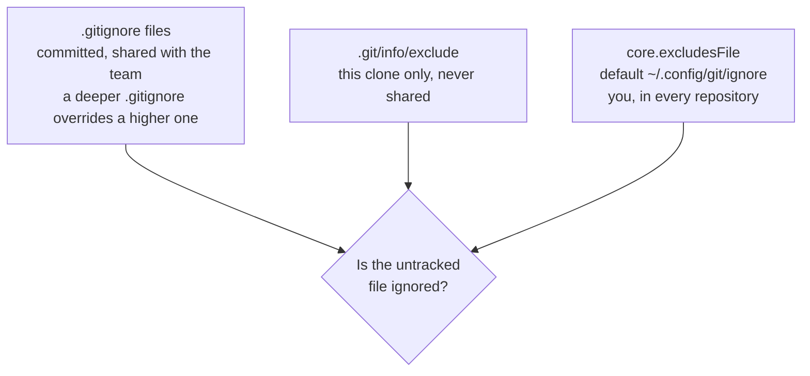
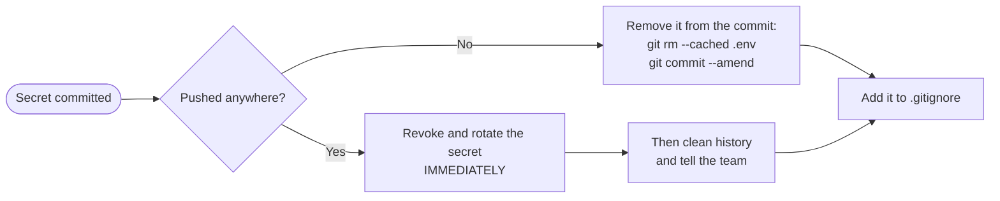

# .gitignore and What Never to Commit: The Complete Guide

> 📚 **Before you start**
>
> - [The Three Areas: Working Tree, Staging and Repository](the-three-areas-working-tree-staging-and-repository.md), for untracked files, `git add` and `git rm --cached`
> - [Processes, Ports and Environment Variables](../../the-command-line-and-linux-basics/course.md#m3) (The Command Line and Linux Basics), for why secrets live in environment variables

## Introduction

When you pack for a trip, you don't pack the whole house. You leave the fridge, the furniture and yesterday's newspaper behind, and you definitely don't tape your house keys and bank PIN to the outside of the suitcase.

A project folder is full of things that shouldn't travel with the code: Python's `__pycache__` folders, a `.venv` with hundreds of megabytes of installed packages, `node_modules`, log files, build output, your editor's settings, macOS `.DS_Store` files, gigabytes of raw data, and the most dangerous item of all, a `.env` file holding real API keys and passwords. If you run `git add .` without thinking, all of it goes in, and things that enter Git history are very hard to get back out.

By the end of this article you'll know what belongs in a repository and what never does, how to write `.gitignore` patterns (including the tricky rules for `/`, `**` and `!`), where else ignore rules can live, how to debug "why is this file ignored?" or "why isn't it?", how to stop tracking a file that was committed by mistake, and exactly what to do if a secret slips into a commit.

> 💡 **Key Insight**
>
> A repository should contain **what a teammate needs to rebuild the project, and nothing they could generate or must keep private**. Source code, configuration templates and lock files go in. Generated files, dependencies, data dumps, personal editor clutter and **secrets** stay out. `.gitignore` only stops **untracked** files from being added; it does nothing for files Git already tracks.

---

## Core Explanation

### 1. What Belongs in the Repository, and What Doesn't

| Commit it | Never commit it | Why not |
|---|---|---|
| Source code, tests, docs | **Secrets**: `.env`, API keys, passwords, private keys (`id_ed25519`, `*.pem`), cloud credential files | Anyone with repository access, now or later, can read them, and history keeps them forever |
| `requirements.txt`, `pyproject.toml`, `package.json` | **Dependencies**: `.venv/`, `venv/`, `node_modules/` | Huge, platform-specific, and rebuilt from the dependency files |
| Lock files: `uv.lock`, `poetry.lock`, `package-lock.json` | **Build output**: `build/`, `dist/`, `*.egg-info/`, compiled binaries | Generated from source; they go stale and cause conflicts |
| `.env.example` with empty values | **Caches**: `__pycache__/`, `*.pyc`, `.pytest_cache/`, `.ipynb_checkpoints/` | Generated automatically on every run |
| Small sample data for tests | **Large or private data**: raw exports, database dumps, model weights | Bloats every clone forever; may contain personal data |
| `.gitignore`, `.gitattributes`, `.editorconfig` | **Logs and temp files**: `*.log`, `*.tmp` | Noise that changes constantly |
| Shared editor settings, if the team agrees | **Personal and OS clutter**: `.DS_Store`, `Thumbs.db`, personal `.idea/` or `.vscode/` settings | Means nothing to anyone else |

Two rules of thumb: if a file is **generated** by a command, ignore it and commit the command's inputs instead; and if a file would be **dangerous on a public website**, it must never be committed, even to a private repository.

### 2. How .gitignore Works

`.gitignore` is a plain text file, usually in the repository root, that you **commit** so the whole team shares it. Each line is a pattern. Untracked files matching a pattern are hidden from `git status` and skipped by `git add .`.

Start from a messy project with dependencies, caches, data, logs, build output and a secret:

```bash
git status --short --untracked-files=all
```

Example output:

```
?? .DS_Store
?? .env
?? .env.example
?? .venv/bin/python
?? build/output.bin
?? data/raw/.gitkeep
?? data/raw/sales-2026-10-04.csv
?? logs/app.log
?? src/__pycache__/app.cpython-313.pyc
?? src/app.py
```

(Without `--untracked-files=all`, Git shows an untracked folder as a single line like `?? .venv/`.) Now create `.gitignore`:

```
# Python
__pycache__/
*.py[cod]
.venv/

# Secrets: never commit these
.env
.env.*
!.env.example

# Data, logs and build output
data/raw/*
!data/raw/.gitkeep
*.log
/build/

# OS junk
.DS_Store
```

```bash
git status --short --untracked-files=all
```

Example output:

```
?? .env.example
?? .gitignore
?? data/raw/.gitkeep
?? src/app.py
```

Only the four files that belong in the repository are left. Git doesn't track empty folders, so the empty `.gitkeep` file is a common convention to keep `data/raw/` in the repository while ignoring its contents. The name means nothing special to Git.

### 3. Pattern Syntax, Rule by Rule

| Pattern | Matches | Notes |
|---|---|---|
| `# text` | Nothing; a comment | Use `\#` for a file name that starts with `#` |
| `.env` | A file or folder named `.env` **at any depth** | No slash, so it matches anywhere |
| `*.log` | Any name ending in `.log`, anywhere | `*` matches anything except `/` |
| `*.py[cod]` | `.pyc`, `.pyo`, `.pyd` | `[...]` is a set of characters; `?` matches one character |
| `build/` | Folders named `build` anywhere (not a file called `build`) | A trailing `/` means "only directories" |
| `/build/` | Only the `build` folder **next to this .gitignore** | A leading `/` anchors the pattern |
| `data/raw/*` | Everything directly inside `data/raw` | A `/` in the middle also anchors to this .gitignore's folder |
| `**/temp` | `temp` in any folder | Leading `**/` means "in any directory" |
| `logs/**` | Everything inside `logs`, at any depth | Trailing `/**` |
| `a/**/b` | `a/b`, `a/x/b`, `a/x/y/b` | `/**/` matches zero or more folders |
| `!.env.example` | Re-includes a file an earlier pattern ignored | Order matters: the **last** matching pattern wins |

**The negation trap.** If you ignore a **folder**, Git doesn't even look inside it, so a later `!` rule for a file inside can't bring it back. Compare:

```
logs/              # ignores the folder itself
!logs/keep.log     # has NO effect: Git never looks inside logs/
```

```
logs/*             # ignores everything INSIDE logs/
!logs/keep.log     # works: the folder is visited, this file is re-included
```

That's why the example above used `data/raw/*` with `!data/raw/.gitkeep`, not `data/raw/`.

### 4. Where Ignore Rules Can Live



| Location | Shared? | Use it for |
|---|---|---|
| `.gitignore` (root or any subfolder) | Yes, it's committed | Anything the project generates: caches, builds, dependencies, `.env` |
| `.git/info/exclude` | No, only this clone | Your own scratch files in one project, like `notes.tmp` |
| Global ignore file (`core.excludesFile`, default `~/.config/git/ignore`) | No, only you | Your OS and editor clutter: `.DS_Store`, `*.swp`, `.idea/` |

Patterns in a subfolder's `.gitignore` are relative to that subfolder. When several sources match, a `.gitignore` closer to the file beats one higher up, and committed `.gitignore` files take priority over `.git/info/exclude` and the global file.

A global ignore file keeps project `.gitignore` files focused on the project:

```bash
mkdir -p ~/.config/git
printf '.DS_Store\nThumbs.db\n*.swp\n.idea/\n' >> ~/.config/git/ignore
```

That path is used automatically. If you prefer another file, point to it with `git config --global core.excludesFile <path>`.

### 5. Debugging: Why Is This File Ignored?

`git check-ignore -v` tells you which file and line made a path ignored:

```bash
git check-ignore -v .env src/__pycache__/app.cpython-313.pyc logs/app.log data/raw/sales-2026-10-04.csv
```

Example output:

```
.gitignore:7:.env	.env
.gitignore:2:__pycache__/	src/__pycache__/app.cpython-313.pyc
.gitignore:14:*.log	logs/app.log
.gitignore:12:data/raw/*	data/raw/sales-2026-10-04.csv
```

Each line reads *source:line:pattern  path*. With `-v`, Git also reports paths whose last matching rule is a negation, so you can see a `!` rule winning:

```bash
git check-ignore -v .env.example
```

Example output:

```
.gitignore:9:!.env.example	.env.example
```

To see everything that's currently ignored, use `git status --ignored`:

```bash
git status --short --ignored
```

Example output:

```
?? .env.example
?? .gitignore
?? data/
?? src/
!! .DS_Store
!! .env
!! .venv/
!! build/
!! data/raw/sales-2026-10-04.csv
!! logs/
!! src/__pycache__/
```

If you really must add an ignored file, Git makes you say so:

```bash
git add .env
```

Example output:

```
The following paths are ignored by one of your .gitignore files:
.env
hint: Use -f if you really want to add them.
hint: Turn this message off by running
hint: "git config advice.addIgnoredFile false"
```

`git add -f` forces it. Never do that with secrets.

### 6. The Most Common Surprise: Already-Tracked Files

`.gitignore` only affects **untracked** files. If a file was committed before you ignored it, Git keeps tracking it and showing its changes. Here a team committed `debug.log` and a `logs/` folder, then added `*.log` to `.gitignore`:

```bash
git status -s
git ls-files --cached --ignored --exclude-standard
```

Example output:

```
?? .gitignore
debug.log
logs/app.log
logs/keep.log
```

The second command lists **tracked files that match an ignore pattern**: the ones `.gitignore` can't help with. To stop tracking them while keeping them on disk, remove them from the index only:

```bash
git rm -r --cached -q logs debug.log
git status -s
```

Example output:

```
D  debug.log
D  logs/app.log
D  logs/keep.log
?? .gitignore
```

Commit that (together with `.gitignore`). The files stay on your disk and are now ignored. One warning: when teammates pull this commit, Git **deletes those files from their working trees**, because the commit says they were removed. That's fine for logs; for something like a local settings file, warn the team to back it up first.

### 7. Cleaning Up Untracked and Ignored Files

`git clean` deletes untracked files. It's destructive, so **always run it with `-n` (dry run) first**:

| Command | Would remove |
|---|---|
| `git clean -n` | Untracked files that are **not** ignored |
| `git clean -nd` | ...plus untracked folders |
| `git clean -nX` | **Only ignored** files |
| `git clean -ndx` | Untracked **and** ignored files and folders: a full "fresh clone" reset |

In the example project (where you've also got a scratch `notes.tmp` and an ignored `settings.local.ini`):

```bash
git clean -ndx
```

Example output:

```
Would remove .DS_Store
Would remove .env
Would remove .venv/
Would remove build/
Would remove data/raw/sales-2026-10-04.csv
Would remove logs/
Would remove notes.tmp
Would remove settings.local.ini
Would remove src/__pycache__/
```

Note that `.env` and your virtual environment are on that list. Replace `-n` with `-f` to actually delete, and `-i` gives an interactive menu.

### 8. Starting Points: Templates

You don't have to write `.gitignore` from scratch. GitHub maintains the **github/gitignore** repository with templates for most languages and tools (`Python.gitignore`, `Node.gitignore` and so on), and GitHub offers to add one when you create a repository. Start from the template for your language, then add project-specific lines. Read what you're adding: templates are long, and you should know why each line is there.

### 9. Secrets: Keep Them Out, and What to Do If One Gets In

**Keeping secrets out:**

1. Store secrets in **environment variables** or a `.env` file that is **ignored from the very first commit**.
2. Commit a **`.env.example`** with the variable names and empty or fake values, so teammates know what to set:

   ```
   # .env.example
   LEDGER_UPI_ID=
   SMS_API_KEY=
   ```
3. Run `git diff --staged` before every commit.
4. Turn on automated checks: GitHub's **secret scanning** and **push protection** can block pushes that contain many known token formats, and pre-commit hooks can scan locally (both covered in [module 10](../course.md#m10) and [module 11](../course.md#m11)).

**If a secret is committed:**



- **Not pushed yet:** unstage and amend. If it's buried in older unpushed commits, interactive rebase can remove it (module 4).
- **Pushed, even for a minute, even to a private repository:** assume it's compromised. Bots scan public GitHub for keys within minutes of a push. **Revoke the key and create a new one first.** Cleaning history comes second, because the old commit may already be in other clones, forks, caches and CI logs. The full clean-up procedure is in [Removing a Leaked Secret from History](../course.md#m10).

Deleting the file in a new commit is **not** enough: the secret is still in every earlier commit, readable with `git show <old-commit>:.env`.

---

## Try It Yourself

1. **Write a .gitignore** for a Python project with `.venv/`, `__pycache__/`, `.env`, `.env.example`, `output/` (generated reports) and `data/` (where only `data/README.md` should be committed). Check it with `git status --short --untracked-files=all`.
2. **Debug a rule.** Use `git check-ignore -v` to find which line ignores `data/2026-10-04.csv`.
3. **Fix a tracked file.** Commit a `debug.log`, then add `*.log` to `.gitignore`. Confirm `git status` still shows changes to it. Make Git stop tracking it without deleting it.
4. **Negation trap.** Explain why `output/` followed by `!output/summary.txt` doesn't keep `summary.txt`, and fix it.

<details>
<summary>Show answers</summary>

1. One working version:

   ```
   .venv/
   __pycache__/
   .env
   output/
   data/*
   !data/README.md
   ```
   `.env.example` doesn't match `.env` (the pattern has no wildcard), so it shows up as untracked and can be committed.
2. `git check-ignore -v data/2026-10-04.csv` prints `.gitignore:5:data/*	data/2026-10-04.csv` (the line number depends on your file).
3. Edits to `debug.log` still appear as ` M debug.log`. Run `git rm --cached debug.log`, then commit together with the `.gitignore` change.
4. `output/` ignores the folder itself, so Git never looks inside it and the negation can't apply. Use `output/*` followed by `!output/summary.txt`.

</details>

---

## Real-World Examples

### Example 1: The Leaked Cloud Key

A student pushes a weekend project to a public repository with a cloud access key in `config.py`. Within hours, automated scanners find it and start crypto-mining on the account, running up a large bill. The fix that would have prevented it was one line in `.gitignore` and the key in an environment variable. Cloud providers and GitHub now detect many such keys automatically, but the safe habit is not to rely on that.

### Example 2: The 2 GB Repository

A data team commits a few CSV exports "just for now". Months later every clone downloads 2 GB of old data that nobody needs, and CI takes minutes just to check out the code. Removing large files from history is a painful rewrite; ignoring `data/` from day one (and storing data in object storage or with [Git LFS](../course.md#m11)) would have avoided it.

### Example 3: Shared vs Personal Editor Settings

A team commits `.vscode/settings.json` and `.vscode/extensions.json` so everyone gets the same formatter and recommended extensions, but ignores the rest of `.vscode/`. Each developer keeps personal clutter in their global ignore file instead of everyone's `.gitignore`.

---

## Common Misconceptions

### Misconception 1: "Adding a file to .gitignore removes it from the repository"

Ignore rules only apply to **untracked** files. A tracked file stays tracked until you `git rm --cached` it.

### Misconception 2: "A private repository is a safe place for secrets"

Private repositories get shared with new teammates, contractors, CI systems and integrations, and they can be made public by mistake. History is forever. Secrets belong in a secrets manager or environment variables.

### Misconception 3: "Deleting the secret in a new commit fixes the leak"

The old commit still contains it. Anyone with the history can read it. Rotate the secret, then clean history.

### Misconception 4: "!pattern always re-includes a file"

Not if one of its parent folders is excluded. Ignore the folder's **contents** (`folder/*`) instead of the folder itself.

---

## Interview Relevance

Expect this in practical rounds and especially in security-aware teams. A strong answer covers:

- **What to ignore and why**: generated files, dependencies, caches, large data, OS/editor clutter, and secrets.
- **Pattern rules**: anchoring with `/`, directory-only trailing `/`, `**`, `!` negation and the excluded-parent trap.
- **Rule locations**: `.gitignore`, `.git/info/exclude`, global `core.excludesFile`.
- **Tracked files**: `.gitignore` doesn't affect them; `git rm --cached` does.
- **Leaked secrets**: rotate first, then rewrite history, and add prevention (push protection, pre-commit scanning).

---

## Key Takeaways

- Commit what's needed to **rebuild** the project; ignore what's **generated, huge, personal or secret**.
- **Last matching pattern wins**; `/` anchors, trailing `/` means directories, `**` spans folders, and **`!` can't re-include inside an ignored folder**.
- Use **`.gitignore`** for the team, **`.git/info/exclude`** for one clone and a **global ignore file** for your own clutter.
- Debug with **`git check-ignore -v`** and **`git status --ignored`**; clean with **`git clean -n`** first.
- **`.gitignore` doesn't affect tracked files**: use `git rm --cached`.
- A pushed secret is a **leaked secret: rotate it immediately**, then clean history.

---

**Up next:** [Lab: Put a project under version control](lab-put-a-project-under-version-control.md)
