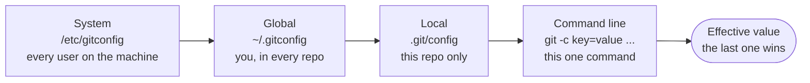

# Installing and Configuring Git: The Complete Guide

> 📚 **Before you start**
>
> - [Why Version Control Exists](why-version-control-exists.md)
> - [Terminal Fundamentals](../../the-command-line-and-linux-basics/course.md#m2) (The Command Line and Linux Basics), for paths, hidden files and editing text files
> - [Package Managers and Virtual Environments](../../the-command-line-and-linux-basics/course.md#m3) (The Command Line and Linux Basics), if you'll install Git with Homebrew, winget or apt

## Introduction

When you get a new phone, the first ten minutes go on setup: your name, your account, your language, your keyboard. Skip it and the phone still works, but every message you send is signed "User" and the autocorrect keeps fighting you.

Git is the same. It installs in a minute, but if you skip configuration your commits go out with a wrong or embarrassing name and email, your editor opens something you don't know how to quit, line endings get mangled between Windows and Mac teammates, and new repositories start on a branch called `master` while GitHub expects `main`.

By the end of this article you'll have Git installed on Windows, macOS or Linux, you'll understand the three levels of Git configuration and how they override each other, you'll have set every setting a beginner should set, and you'll know how to find help for any command without leaving the terminal.

> 💡 **Key Insight**
>
> Git configuration lives in plain text files at three levels: **system** (the whole machine), **global** (you, in every repository) and **local** (one repository). The **most specific level wins**, which is how you can be `asha@example.com` for personal projects and `asha.rao@company.example` for work on the same laptop.

---

## Core Explanation

### 1. Installing Git

First check whether you already have it. Open a terminal and run:

```bash
git --version
```

Example output:

```
git version 2.43.0
```

If you see a version number, Git is installed. Any 2.x version from the last couple of years is fine for this course, though newer is better. If you see `command not found`, install it for your system:

**Windows.** Install **Git for Windows** from the official site, git-scm.com, or with the built-in package manager:

```bash
winget install --id Git.Git -e --source winget
```

The installer asks many questions; the defaults are sensible. It gives you **Git Bash** (a terminal with Linux-style commands, which this course's examples assume) and **Git Credential Manager**, which handles GitHub sign-in for you later. Close and reopen your terminal afterwards so it can find `git`.

**macOS.** Two options:

```bash
xcode-select --install   # Apple's command line tools, which include a version of Git
brew install git          # with Homebrew: usually a newer Git, easy to keep updated
```

**Linux.** Use your distribution's package manager:

```bash
sudo apt update && sudo apt install git   # Debian, Ubuntu
sudo dnf install git                      # Fedora, RHEL
```

Distribution packages can lag behind the latest Git release. That's fine for learning; if you need the newest features on Ubuntu, the Git maintainers' PPA (`ppa:git-core/ppa`) carries current builds.

**Graphical tools.** VS Code, JetBrains IDEs and GitHub Desktop all have Git built in or use your installed Git. They're useful, but learn the command line first: every GUI button maps to a command, and when something goes wrong, the error messages and online answers are in command-line terms.

### 2. The Three Configuration Levels

Git reads settings from several files, from least to most specific. Later levels override earlier ones:



| Level | Flag | File | Typical use |
|---|---|---|---|
| **System** | `--system` | `/etc/gitconfig` (Git for Windows keeps it under its install folder) | Set by administrators; you rarely touch it |
| **Global** | `--global` | `~/.gitconfig` (or `~/.config/git/config`) | Your name, email, editor, aliases: settings for *you* |
| **Local** | `--local` (the default inside a repo) | `.git/config` in the repository | Per-project overrides, such as a work email |
| **Worktree** | `--worktree` | `.git/config.worktree` | Per-worktree overrides (advanced, covered with worktrees in module 4) |

You can also set a value for a single command with `git -c key=value <command>`.

### 3. The Settings Every Beginner Should Set

**Your identity.** Every commit records an author name and email. Git refuses to commit without them:

```bash
git config --global user.name "Asha Rao"
git config --global user.email "asha@example.com"
```

Use the email you'll sign up to GitHub with, so GitHub can link commits to your account. If you'd rather not publish your real email in commit history, GitHub gives every account a private **noreply** address (shown in your GitHub email settings, in the form `ID+username@users.noreply.github.com`) that you can use here instead.

**The default branch name.** New repositories start on a branch. Older Git versions call it `master` and print a long hint about it; GitHub and most teams now use `main`. Set it once:

```bash
git config --global init.defaultBranch main
```

**Your editor.** When Git needs a longer message from you (a detailed commit message, an interactive rebase), it opens an editor. If you haven't chosen one, you'll often land in Vim, and many beginners can't get out. (If that happens: press `Esc`, type `:q!` and press Enter to quit without saving, or `:wq` to save and quit.) Pick one you know:

```bash
git config --global core.editor "code --wait"   # VS Code: --wait makes Git wait until you close the tab
git config --global core.editor "nano"          # simple terminal editor
git config --global core.editor "vim"           # if you already know Vim
```

**Line endings.** Windows ends lines with two characters (CRLF, `\r\n`); macOS and Linux use one (LF, `\n`). If a team mixes them, every line of a file can look "changed". The `core.autocrlf` setting converts automatically:

```bash
git config --global core.autocrlf true    # on Windows: check out CRLF, commit LF
git config --global core.autocrlf input   # on macOS/Linux: commit LF, never convert on checkout
```

Teams usually also add a `.gitattributes` file to the repository with the line `* text=auto`, so the rule travels with the project instead of depending on each person's settings.

**Pull and push behaviour.** You'll meet these properly in [module 5](../course.md#m5); setting them now avoids warnings later:

```bash
git config --global pull.rebase false          # 'git pull' merges (the classic default); 'true' rebases instead
git config --global push.autoSetupRemote true  # first 'git push' on a new branch sets its upstream automatically
```

**A clearer conflict display** (explained in the [merge conflicts lesson](../course.md#m4)):

```bash
git config --global merge.conflictStyle zdiff3
```

### 4. Reading and Checking Your Configuration

List everything set at the global level:

```bash
git config --global --list
```

Example output:

```
user.name=Asha Rao
user.email=asha@example.com
init.defaultbranch=main
core.editor=nano
core.autocrlf=input
pull.rebase=false
push.autosetupremote=true
alias.lg=log --oneline --graph --decorate --all
alias.st=status --short --branch
```

Notice the keys are printed in lowercase: Git config keys are case-insensitive (`init.defaultBranch` and `init.defaultbranch` are the same setting). The file itself is plain text, organised in `[sections]`, and you can open it with `git config --global --edit`:

```bash
cat ~/.gitconfig
```

Example output:

```
[user]
	name = Asha Rao
	email = asha@example.com
[init]
	defaultBranch = main
[core]
	editor = nano
	autocrlf = input
[pull]
	rebase = false
[push]
	autoSetupRemote = true
[alias]
	lg = log --oneline --graph --decorate --all
	st = status --short --branch
```

Read a single value by giving just the key:

```bash
git config user.email
```

Example output:

```
asha@example.com
```

If a key isn't set, Git prints nothing and exits with status 1, which is handy in scripts.

### 5. Overrides in Action: A Work Email for a Work Repo

Inside a work repository, set a local email. No `--global`, so it goes into that repo's `.git/config`:

```bash
cd work-proj
git config user.email "asha.rao@company.example"
```

Now ask Git to show every setting with its **scope** and the **file it came from**:

```bash
git config --list --show-origin --show-scope
```

Example output:

```
global	file:/home/asha/.gitconfig	user.name=Asha Rao
global	file:/home/asha/.gitconfig	user.email=asha@example.com
global	file:/home/asha/.gitconfig	init.defaultbranch=main
global	file:/home/asha/.gitconfig	core.editor=nano
global	file:/home/asha/.gitconfig	core.autocrlf=input
global	file:/home/asha/.gitconfig	pull.rebase=false
global	file:/home/asha/.gitconfig	push.autosetupremote=true
global	file:/home/asha/.gitconfig	alias.lg=log --oneline --graph --decorate --all
global	file:/home/asha/.gitconfig	alias.st=status --short --branch
local	file:.git/config	core.repositoryformatversion=0
local	file:.git/config	core.filemode=true
local	file:.git/config	core.bare=false
local	file:.git/config	core.logallrefupdates=true
local	file:.git/config	user.email=asha.rao@company.example
```

`user.email` appears twice, global and local. Which one wins?

```bash
git config --show-origin user.email
git config --get-all user.email
```

Example output:

```
file:.git/config	asha.rao@company.example
asha@example.com
asha.rao@company.example
```

The local value wins inside this repository; everywhere else you're still `asha@example.com`. When a commit shows up with the "wrong" email, `--show-origin` is the fastest way to find out why.

**Automatic switching with `includeIf`.** Setting a local email in every work repo is easy to forget. Instead, keep all work repositories under one folder and tell Git to load extra settings there:

```
# in ~/.gitconfig
[includeIf "gitdir:~/work/"]
	path = ~/.gitconfig-work
```

```
# in ~/.gitconfig-work
[user]
	email = asha.rao@company.example
```

Any repository under `~/work/` now picks up the work email automatically. (The trailing slash matters: it means "this folder and everything inside it".)

**Removing a setting:**

```bash
git config --global --unset core.editor
```

Newer Git versions (2.46 and later) also accept subcommand-style forms such as `git config list`, `git config get user.email`, `git config set --global user.name "Asha Rao"` and `git config unset --global core.editor`. The classic forms shown above still work everywhere, so this course uses them.

### 6. Aliases: Your Own Shortcuts

An alias is a short name for a longer command. Two that pay for themselves on day one:

```bash
git config --global alias.st "status --short --branch"
git config --global alias.lg "log --oneline --graph --decorate --all"
```

Now `git st` and `git lg` run the longer commands. Keep aliases few and obvious; you still need to know the real commands when you're on someone else's machine.

### 7. Getting Help Without Leaving the Terminal

Git ships its full manual. Three levels of help:

| Command | What you get |
|---|---|
| `git <command> -h` | A short summary of options, printed right in the terminal |
| `git help <command>` or `git <command> --help` | The full manual page for that command |
| `git help -a` | Every command Git has, grouped |
| `git help config` | Every configuration key, with explanations |

For example:

```bash
git commit -h
```

Example output (first lines):

```
usage: git commit [-a | --interactive | --patch] [-s] [-v] [-u<mode>] [--amend]
                  [--dry-run] [(-c | -C | --squash) <commit> | --fixup [(amend|reword):]<commit>)]
                  [-F <file> | -m <msg>] [--reset-author] [--allow-empty]
                  [--allow-empty-message] [--no-verify] [-e] [--author=<author>]
                  [--date=<date>] [--cleanup=<mode>] [--[no-]status]
                  [-i | -o] [--pathspec-from-file=<file> [--pathspec-file-nul]]
                  [(--trailer <token>[(=|:)<value>])...] [-S[<keyid>]]
                  [--] [<pathspec>...]

    -q, --[no-]quiet      suppress summary after successful commit
    -v, --[no-]verbose    show diff in commit message template
```

Read it like this: square brackets mean optional, `|` means "one or the other", and `<...>` is something you fill in. The official documentation at git-scm.com/docs has the same manual pages, plus the free *Pro Git* book.

### 8. A Recommended Starting Configuration

Putting it together, this is a sensible `~/.gitconfig` for a new developer on macOS or Linux (use `autocrlf = true` on Windows):

```
[user]
	name = Your Name
	email = you@example.com
[init]
	defaultBranch = main
[core]
	editor = code --wait
	autocrlf = input
[pull]
	rebase = false
[push]
	autoSetupRemote = true
[merge]
	conflictStyle = zdiff3
[alias]
	st = status --short --branch
	lg = log --oneline --graph --decorate --all
```

---

## Try It Yourself

1. **Install and check.** Install Git if needed, then run `git --version`. Is your version from the last two years?
2. **Configure yourself.** Set `user.name`, `user.email`, `init.defaultBranch` and `core.editor` globally. Run `git config --global --list` and then open `~/.gitconfig` to see the same settings as a file.
3. **Override locally.** Create a practice repository with `git init`, set a different `user.email` inside it, and use `git config --show-origin user.email` both inside and outside the repo. What changes?
4. **Find a flag.** Using only `git log -h`, find the option that limits output to a number of commits.

<details>
<summary>Show answers</summary>

1. `git version 2.x.y`. If yours is several years old, update it through the same tool you installed it with (`brew upgrade git`, `winget upgrade Git.Git`, or your Linux package manager).
2. The list shows `user.name=...`, `user.email=...`, `init.defaultbranch=main`, `core.editor=...`, and the file has matching `[user]`, `[init]` and `[core]` sections.
3. Inside the repo, the origin is `file:.git/config` with the local email. Outside, it's your global file with the global email. The most specific level wins.
4. `-<number>` or `-n <number>` (for example `git log -3`) limits the number of commits shown.

</details>

---

## Real-World Examples

### Example 1: The Wrong Email on Every Commit

A developer joins a company and pushes a week of work, then notices GitHub shows a grey "unknown" avatar on every commit: the commits were made with an old college email that isn't on their GitHub account. Adding that email to the GitHub account (or switching to the right one and amending future commits) fixes the link. An `includeIf` rule for the work folder prevents it from happening again.

### Example 2: The "Every Line Changed" Pull Request

A Windows teammate opens a pull request where a 300-line file shows as entirely changed, though they edited two lines. Their editor converted LF to CRLF. The team adds `* text=auto` to `.gitattributes`, the teammate sets `core.autocrlf true`, and the noise disappears.

### Example 3: Company-Wide Defaults

IT teams that manage developer laptops sometimes set system-level configuration, for example a credential helper or a proxy. Because system settings sit at the lowest level, each developer can still override them in their global file.

---

## Common Misconceptions

### Misconception 1: "user.name and user.email are my GitHub login"

They're just text stamped into each commit. Git doesn't check them against anything. GitHub links a commit to your account by matching the email to one of the emails on your account. Signing in to GitHub is a separate thing (SSH keys or tokens, in [module 5](../course.md#m5)).

### Misconception 2: "Changing my email fixes my old commits"

Configuration affects only **new** commits. Existing commits keep the name and email they were made with, because a commit can never change once created (module 3 explains why).

### Misconception 3: "Local config is shared when I push"

`.git/config` is never pushed. Settings that must travel with the project belong in tracked files such as `.gitattributes`, `.gitignore` or `.editorconfig`.

### Misconception 4: "I'm stuck in Vim forever"

Press `Esc`, then type `:q!` and Enter to quit without saving (which aborts the commit if the message is empty), or `:wq` to save and quit. Then set `core.editor` to something you like.

---

## Interview Relevance

Configuration rarely gets a whole interview question, but it shows up in practical rounds and in "tell me about your setup" chats. Be ready to:

- **Name the levels** (system, global, local, plus worktree and `-c`) and say that the most specific wins.
- **Explain how to use different identities** for work and personal projects (`includeIf` or local config).
- **Explain line-ending problems** and the fixes (`core.autocrlf`, `.gitattributes`).
- **Debug an unexpected value** with `git config --show-origin --show-scope`.

---

## Key Takeaways

- **Install** Git with git-scm.com/winget on Windows, Xcode tools or Homebrew on macOS, or your package manager on Linux; check with `git --version`.
- Config has **system, global and local** levels; **the most specific wins**. Inspect with `--list --show-origin --show-scope`.
- Always set **`user.name`, `user.email`, `init.defaultBranch`, `core.editor`** and a sensible **`core.autocrlf`**.
- Use **`includeIf`** to switch identity automatically for work folders.
- **Help is built in**: `git <cmd> -h` for a summary, `git help <cmd>` for the full manual.

---

**Up next:** [The Three Areas: Working Tree, Staging and Repository](the-three-areas-working-tree-staging-and-repository.md)
