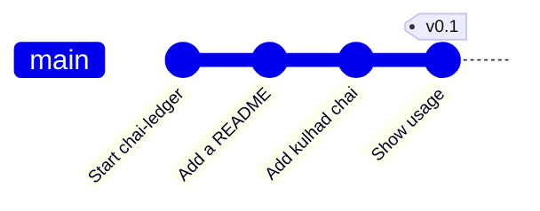

# Lab: Put a Project under Version Control

> 📚 **Before you start**
>
> - [Installing and Configuring Git](installing-and-configuring-git.md)
> - [The Three Areas: Working Tree, Staging and Repository](the-three-areas-working-tree-staging-and-repository.md)
> - [Reading History with log, show and diff](reading-history-with-log-show-and-diff.md)
> - [Writing Good Commit Messages](writing-good-commit-messages.md)
> - [.gitignore and What Never to Commit](gitignore-and-what-never-to-commit.md)

## What You'll Build

You'll take a small, real-looking project that has **never** been under version control, a script that totals a chai stall's daily sales, and turn it into a clean Git repository. The folder already contains things that must not be committed: a `.env` file with the stall's UPI ID, Python's `__pycache__` folder and a day's raw sales export.

By the end you'll have:

- A repository with a `.gitignore` written **before** the first commit, so no secret or junk ever enters history.
- Four small, well-described commits.
- A tag, `v0.1`, marking the first working version.
- Practice in every everyday command: `init`, `status`, `add`, `commit`, `diff`, `restore`, `log`, `show` and `tag`.



> 💡 **Key Insight**
>
> The order matters: **write `.gitignore` first, check `git status`, then make the first commit.** Ignoring a file *after* it's been committed doesn't remove it from history, and if that file is a secret, it has already leaked to everyone who gets a copy.

You need Git configured with your name and email, and Python 3 if you want to run the script (optional; Git doesn't care what's in the files).

---

## Step 1: Create the Project (Without Git)

Make a folder with the script, a data file, a secret and a cache folder, exactly like a project that grew before anyone thought about Git:

```bash
mkdir -p chai-ledger/data
cd chai-ledger
```

Create `ledger.py`:

```python
# not-run: a command-line script that reads a CSV file named on the command line
import csv
import sys

PRICES = {"masala": 20, "ginger": 25, "elaichi": 25}


def day_total(path):
    total = 0
    with open(path) as f:
        for row in csv.DictReader(f):
            total += PRICES[row["item"]] * int(row["qty"])
    return total


if __name__ == "__main__":
    print(f"Total: Rs {day_total(sys.argv[1])}")
```

Create `data/sales-2026-10-04.csv`:

```
item,qty
masala,42
ginger,17
elaichi,9
```

And a secret plus a cache folder (normally your tools create these):

```bash
echo 'LEDGER_UPI_ID=chaistall@okbank' > .env
mkdir __pycache__ && echo x > __pycache__/ledger.cpython-313.pyc
ls -A
```

Example output:

```
.env
__pycache__
data
ledger.py
```

Git doesn't know about this folder yet:

```bash
git status
```

Example output:

```
fatal: not a git repository (or any of the parent directories): .git
```

---

## Step 2: Initialise the Repository

```bash
git init
git status
```

Example output:

```
Initialized empty Git repository in /home/asha/projects/chai-ledger/.git/
On branch main

No commits yet

Untracked files:
  (use "git add <file>..." to include in what will be committed)
	.env
	__pycache__/
	data/
	ledger.py

nothing added to commit but untracked files present (use "git add" to track)
```

Stop here. If you ran `git add .` now, the `.env` secret, the cache and the raw sales data would all go into the first commit. Don't.

---

## Step 3: Write .gitignore Before Anything Else

Create `.gitignore` in the project root:

```
# Python bytecode and virtual environments
__pycache__/
*.py[cod]
.venv/

# Secrets
.env

# Daily sales exports stay out of the repo
data/*.csv
```

Check what Git would now pick up, listing every file individually:

```bash
git status --short --untracked-files=all
```

Example output:

```
?? .gitignore
?? ledger.py
```

Exactly the two files that belong in the repository. Verify the secret is really ignored, and by which rule:

```bash
git check-ignore -v .env data/sales-2026-10-04.csv
```

Example output:

```
.gitignore:7:.env	.env
.gitignore:10:data/*.csv	data/sales-2026-10-04.csv
```

---

## Step 4: The First Commit

Stage everything that isn't ignored and review it **before** committing:

```bash
git add .
git status
```

Example output:

```
On branch main

No commits yet

Changes to be committed:
  (use "git rm --cached <file>..." to unstage)
	new file:   .gitignore
	new file:   ledger.py

```

```bash
git commit -m "Start chai-ledger: daily sales total from a CSV"
git log
```

Example output:

```
[main (root-commit) 7120c82] Start chai-ledger: daily sales total from a CSV
 2 files changed, 26 insertions(+)
 create mode 100644 .gitignore
 create mode 100644 ledger.py
commit 7120c8284a184b75c8deaaecfdb26b3cd41461af
Author: Asha Rao <asha@example.com>
Date:   Mon Oct 5 10:39:00 2026 +0530

    Start chai-ledger: daily sales total from a CSV
```

The script still works with the (ignored) data file, which stays on your disk:

```bash
python3 ledger.py data/sales-2026-10-04.csv
```

Example output:

```
Total: Rs 1490
```

(42 × 20 + 17 × 25 + 9 × 25 = 840 + 425 + 225 = 1490.)

---

## Step 5: Add a README

Create `README.md`:

```
# chai-ledger

Adds up a day's chai sales from a CSV export.

    python3 ledger.py data/sales-2026-10-04.csv
```

```bash
git add README.md
git commit -m "Add a README with usage"
```

Example output:

```
[main cea2634] Add a README with usage
 1 file changed, 5 insertions(+)
 create mode 100644 README.md
```

---

## Step 6: Change Code, Review the Diff, Commit

The stall now sells kulhad chai for 30 rupees. Edit the `PRICES` line in `ledger.py` to:

```
PRICES = {"masala": 20, "ginger": 25, "elaichi": 25, "kulhad": 30}
```

Review the change before staging it:

```bash
git diff
```

Example output:

```
diff --git a/ledger.py b/ledger.py
index cd2549e..95f7c0c 100644
--- a/ledger.py
+++ b/ledger.py
@@ -1,7 +1,7 @@
 import csv
 import sys
 
-PRICES = {"masala": 20, "ginger": 25, "elaichi": 25}
+PRICES = {"masala": 20, "ginger": 25, "elaichi": 25, "kulhad": 30}
 
 
 def day_total(path):
```

One line changed, exactly as intended. Since `ledger.py` is already tracked, `-a` can stage and commit in one go:

```bash
git commit -am "Add kulhad chai at 30 rupees"
```

Example output:

```
[main 971b979] Add kulhad chai at 30 rupees
 1 file changed, 1 insertion(+), 1 deletion(-)
```

---

## Step 7: A Second Code Change

Running the script without a file crashes with an unfriendly `IndexError`. Change the end of `ledger.py` to:

```
if __name__ == "__main__":
    if len(sys.argv) != 2:
        sys.exit("usage: python3 ledger.py <sales.csv>")
    print(f"Total: Rs {day_total(sys.argv[1])}")
```

```bash
git commit -am "Show usage when no CSV is given"
git show --stat
python3 ledger.py
```

Example output:

```
[main 527895a] Show usage when no CSV is given
 1 file changed, 2 insertions(+)
commit 527895a49d4a8af090eea975147b24f2f9330efc
Author: Asha Rao <asha@example.com>
Date:   Mon Oct 5 11:56:00 2026 +0530

    Show usage when no CSV is given

 ledger.py | 2 ++
 1 file changed, 2 insertions(+)
usage: python3 ledger.py <sales.csv>
```

---

## Step 8: Make a Mistake and Undo It

Accidentally add junk to the README:

```bash
echo "typo" >> README.md
git status -s
```

Example output:

```
 M README.md
```

It isn't staged or committed, so throw it away by restoring the committed version:

```bash
git restore README.md
git status
```

Example output:

```
On branch main
nothing to commit, working tree clean
```

**Working tree clean** is the state to aim for before you switch tasks: everything is either committed or deliberately ignored.

---

## Step 9: Review Your History and Tag a Version

```bash
git log --oneline --stat
```

Example output:

```
527895a Show usage when no CSV is given
 ledger.py | 2 ++
 1 file changed, 2 insertions(+)
971b979 Add kulhad chai at 30 rupees
 ledger.py | 2 +-
 1 file changed, 1 insertion(+), 1 deletion(-)
cea2634 Add a README with usage
 README.md | 5 +++++
 1 file changed, 5 insertions(+)
7120c82 Start chai-ledger: daily sales total from a CSV
 .gitignore | 10 ++++++++++
 ledger.py  | 16 ++++++++++++++++
 2 files changed, 26 insertions(+)
```

Confirm what Git is tracking. The secret, the cache and the data are nowhere to be seen:

```bash
git ls-files
```

Example output:

```
.gitignore
README.md
ledger.py
```

Mark this as the first working version with a **tag**, a permanent name for a commit (tags are covered in depth in [module 3](../03-how-git-works-inside/blobs-trees-commits-and-tags.md)):

```bash
git tag v0.1
git log --oneline --decorate -1
```

Example output:

```
527895a (HEAD -> main, tag: v0.1) Show usage when no CSV is given
```

Finally, peek at how much Git stored:

```bash
git count-objects -v
```

Example output:

```
count: 13
size: 52
in-pack: 0
packs: 0
size-pack: 0
prune-packable: 0
garbage: 0
size-garbage: 0
```

Thirteen stored **objects** in 52 KB on disk (sizes are reported in kilobytes): file contents, folder listings and commits. What those objects are, and how they fit together, is exactly what module 3 is about.

---

## Try It Yourself

1. **Add a config template.** Create `.env.example` containing `LEDGER_UPI_ID=` and commit it. Confirm with `git check-ignore -v .env.example` that it is *not* ignored (no output, exit code 1).
2. **Keep a sample file.** Add a small `data/sample.csv` that *should* be committed for testing, without un-ignoring the daily exports. What line do you add to `.gitignore`?
3. **Fix the last message.** Make a commit with a typo in the subject, then fix it without creating a second commit. How did the hash change?
4. **Answer questions from history.** Using only Git commands, answer: (a) which commit introduced kulhad chai, (b) what `ledger.py` looked like at `v0.1~2`, (c) how many lines changed between the first commit and `v0.1`.

<details>
<summary>Show answers</summary>

1. `git add .env.example && git commit -m "Add .env.example listing required settings"`. The pattern `.env` matches only that exact name, so `.env.example` isn't ignored.
2. `!data/sample.csv` after the `data/*.csv` line. It works because the pattern ignores files inside `data/`, not the `data/` folder itself.
3. `git commit --amend -m "Correct subject"`. The commit gets a **new hash**, because amending creates a new commit that replaces the old one.
4. (a) `git log --oneline -S"kulhad"` shows `971b979 Add kulhad chai at 30 rupees`. (b) `git show v0.1~2:ledger.py`. (c) `git diff --stat 7120c82 v0.1` (use your own first commit's hash, or `git rev-list --max-parents=0 HEAD` to find it).

</details>

---

## What You've Learned

- **Starting safely**: `git init`, then **`.gitignore` before the first `git add`**, then `git status` to check.
- **The everyday loop**: edit, `git diff`, `git add` (or `commit -a`), `git commit` with a clear message.
- **Undoing uncommitted edits** with `git restore`.
- **Reviewing** with `git log --oneline --stat`, `git show` and `git ls-files`.
- **Marking versions** with `git tag`.

---

**Up next:** [Blobs, Trees, Commits and Tags](../03-how-git-works-inside/blobs-trees-commits-and-tags.md)
