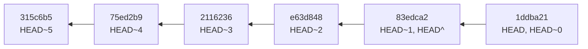
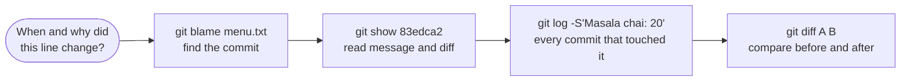

# Reading History with log, show and diff: The Complete Guide

> 📚 **Before you start**
>
> - [The Three Areas: Working Tree, Staging and Repository](the-three-areas-working-tree-staging-and-repository.md), for commits and reading a diff
> - [Pipes, Redirection and grep](../../the-command-line-and-linux-basics/course.md#m3) (The Command Line and Linux Basics), helpful for filtering output

## Introduction

A cricket scorecard isn't just the final score. Ball by ball, it records who bowled, who faced, what happened and when. If a commentator wants to know when the run rate collapsed, or how many runs a batter scored off one bowler, the answer is in the scorecard.

Your Git history is the scorecard of your project. It can answer "when did this price change?", "who wrote this line and why?", "what changed between last week's release and today?", and "which commit introduced this function?". But only if you know how to ask. Most people use `git log` with no options and scroll. Professionals filter, format and search history in seconds.

By the end of this article you'll be able to list and filter history by author, date, message, file and even code content; show any commit or any old version of a file; compare any two points in history; find who last touched each line with `git blame`; and name commits with `HEAD~2`, `main^` and ranges like `A..B`.

> 💡 **Key Insight**
>
> Three commands answer almost every history question: **`git log` lists commits** (and filters them), **`git show` opens one thing** (a commit, or a file at a commit), and **`git diff` compares two things** (two commits, a commit and your files, or two areas). Everything else is options.

---

## Core Explanation

The examples use a small `chai-ledger` repository with six commits made by two people, Asha and Ravi. Make a similar history in a practice repo so you can follow along; your hashes and dates will differ.

### 1. git log: The List of Commits

With no options, `git log` shows every commit reachable from where you are, newest first:

```bash
git log
```

Example output:

```
commit 1ddba21c4550bd44d3d0dc2cf4abc30e4173f11c
Author: Asha Rao <asha@example.com>
Date:   Mon Oct 5 13:19:00 2026 +0530

    Add apply_discount() for festival offers

commit 83edca22e1f765f43f64d4f4fcfc7671f20a32c5
Author: Ravi Kumar <ravi@example.com>
Date:   Mon Oct 5 12:42:00 2026 +0530

    Raise masala chai price to 22
    
    Milk prices went up by 4 rupees a litre this month.

commit e63d8488fc966520851cefd34ab02d278852eda7
Author: Asha Rao <asha@example.com>
Date:   Mon Oct 5 12:05:00 2026 +0530

    Add a README

commit 2116236cc923515775866a415bf3edcf92195317
Author: Ravi Kumar <ravi@example.com>
Date:   Mon Oct 5 11:28:00 2026 +0530

    Add elaichi chai to menu and prices

commit 75ed2b9dd270ee58b1d2491d6ef9b626a46e3856
Author: Asha Rao <asha@example.com>
Date:   Mon Oct 5 10:51:00 2026 +0530

    Add a total() helper for orders

commit 315c6b50e6512c237cb794d6c972db6b37e1d91d
Author: Asha Rao <asha@example.com>
Date:   Mon Oct 5 10:14:00 2026 +0530

    Add the menu
```

Each entry shows the full 40-character **commit hash** (the commit's unique ID), the author, the date with time zone, and the message. On a long history Git opens a **pager** (usually `less`): use Space and `b` to page, `/word` to search, and `q` to quit.

The one-line view is what you'll use most. The hash is shortened to its first seven characters, which is enough to identify a commit in almost any repository:

```bash
git log --oneline
```

Example output:

```
1ddba21 Add apply_discount() for festival offers
83edca2 Raise masala chai price to 22
e63d848 Add a README
2116236 Add elaichi chai to menu and prices
75ed2b9 Add a total() helper for orders
315c6b5 Add the menu
```

Add `--graph --decorate --all` to draw branches and show which branch and tag labels point where. With one branch it's a straight line; in module 4 it becomes essential:

```bash
git log --oneline --graph --decorate --all
```

Example output:

```
* 1ddba21 (HEAD -> main) Add apply_discount() for festival offers
* 83edca2 Raise masala chai price to 22
* e63d848 Add a README
* 2116236 Add elaichi chai to menu and prices
* 75ed2b9 Add a total() helper for orders
* 315c6b5 Add the menu
```

`HEAD -> main` means "you are on branch `main`, and it points at this commit".

### 2. Showing What Each Commit Changed

`--stat` adds a summary of files and lines changed; `-p` (patch) adds the full diff. Limit the count with `-<n>`:

```bash
git log --stat -2
```

Example output:

```
commit 1ddba21c4550bd44d3d0dc2cf4abc30e4173f11c
Author: Asha Rao <asha@example.com>
Date:   Mon Oct 5 13:19:00 2026 +0530

    Add apply_discount() for festival offers

 prices.py | 4 ++++
 1 file changed, 4 insertions(+)

commit 83edca22e1f765f43f64d4f4fcfc7671f20a32c5
Author: Ravi Kumar <ravi@example.com>
Date:   Mon Oct 5 12:42:00 2026 +0530

    Raise masala chai price to 22
    
    Milk prices went up by 4 rupees a litre this month.

 menu.txt  | 2 +-
 prices.py | 2 +-
 2 files changed, 2 insertions(+), 2 deletions(-)
```

```bash
git log -p -1
```

Example output:

```
commit 1ddba21c4550bd44d3d0dc2cf4abc30e4173f11c
Author: Asha Rao <asha@example.com>
Date:   Mon Oct 5 13:19:00 2026 +0530

    Add apply_discount() for festival offers

diff --git a/prices.py b/prices.py
index d98bdd1..e6811e9 100644
--- a/prices.py
+++ b/prices.py
@@ -6,3 +6,7 @@ def total(order):
 
 
 print(total(["masala", "ginger"]))
+
+
+def apply_discount(amount, percent):
+    return round(amount * (100 - percent) / 100)
```

The text after the second `@@` (`def total(order):`) is a hint Git adds: the nearest function or heading above the change, so you know where you are.

### 3. Filtering: Finding the Commits You Want

| Question | Command |
|---|---|
| Commits by an author | `git log --author="Ravi"` (matches part of the name or email) |
| Commits whose **message** mentions a word | `git log --grep="price"` (add `-i` for case-insensitive) |
| Commits that **added or removed** a piece of code | `git log -S"apply_discount"` (the "pickaxe") |
| Commits whose diff matches a regex | `git log -G"discount\("` |
| Commits that touched a file or folder | `git log -- menu.txt` |
| Commits in a time window | `git log --since="2 weeks ago" --until="yesterday"` |
| Only merge commits / no merges | `git log --merges` / `git log --no-merges` |
| The first N commits | `git log -n 5` or `git log -5` |

Some of these in action:

```bash
git log --oneline --author="Ravi"
git log --oneline --grep="price"
git log --oneline -S"apply_discount"
git log --oneline -- menu.txt
```

Example output:

```
83edca2 Raise masala chai price to 22
2116236 Add elaichi chai to menu and prices
83edca2 Raise masala chai price to 22
2116236 Add elaichi chai to menu and prices
1ddba21 Add apply_discount() for festival offers
83edca2 Raise masala chai price to 22
2116236 Add elaichi chai to menu and prices
315c6b5 Add the menu
```

The `--` in `git log -- menu.txt` separates options and commit names from file paths. It's optional when there's no ambiguity, but it's a good habit: if a file and a branch ever share a name, `--` tells Git you mean the file.

Dates accept absolute values or plain English:

```bash
git log --since="2026-10-05 11:00" --until="2026-10-05 12:00" --oneline
```

Example output:

```
2116236 Add elaichi chai to menu and prices
```

**Following a renamed file.** By default, `git log -- <path>` stops at the commit where the file got its current name. Add `--follow` to trace it through renames:

```bash
git mv menu.txt chai-menu.txt
git commit -m "Rename menu.txt to chai-menu.txt"
git log --oneline -- chai-menu.txt
git log --oneline --follow -- chai-menu.txt
```

Example output:

```
3786962 Rename menu.txt to chai-menu.txt
3786962 Rename menu.txt to chai-menu.txt
83edca2 Raise masala chai price to 22
2116236 Add elaichi chai to menu and prices
315c6b5 Add the menu
```

**Following a function.** `git log -L :<function>:<file>` shows the history of one function's lines. For example, `git log -L :total:prices.py` lists every commit that changed `total()`, with the diff of just that function.

### 4. Formatting the Output Your Way

`--pretty=format:` takes placeholders, which is great for reports and scripts:

```bash
git log --pretty=format:'%h | %ad | %an | %s' --date=short
```

Example output:

```
1ddba21 | 2026-10-05 | Asha Rao | Add apply_discount() for festival offers
83edca2 | 2026-10-05 | Ravi Kumar | Raise masala chai price to 22
e63d848 | 2026-10-05 | Asha Rao | Add a README
2116236 | 2026-10-05 | Ravi Kumar | Add elaichi chai to menu and prices
75ed2b9 | 2026-10-05 | Asha Rao | Add a total() helper for orders
315c6b5 | 2026-10-05 | Asha Rao | Add the menu
```

| Placeholder | Meaning |
|---|---|
| `%H` / `%h` | Full / short commit hash |
| `%an` / `%ae` | Author name / email |
| `%ad` / `%ar` | Author date (style set by `--date=`) / relative date ("6 days ago") |
| `%cn` / `%cd` | Committer name / date |
| `%s` / `%b` | Subject (first line) / body |
| `%d` | Branch and tag names pointing here |

Two more views worth knowing: `git log --reverse` lists oldest first, and `git shortlog` groups commits by author, which is handy for release notes:

```bash
git shortlog -sn HEAD
```

Example output:

```
     4	Asha Rao
     2	Ravi Kumar
```

(`-s` gives counts only, `-n` sorts by count. Pass a commit such as `HEAD`; without one, `shortlog` reads from standard input when it isn't attached to a terminal, for example inside a script.)

### 5. Naming Commits: HEAD, ~, ^ and Ranges

You can refer to commits without copying hashes:

| Syntax | Means |
|---|---|
| `HEAD` | The commit you're currently on |
| `HEAD~1` or `HEAD~` | Its parent (one commit back) |
| `HEAD~3` | Three commits back, following first parents |
| `HEAD^` | The first parent (same as `HEAD~1`) |
| `HEAD^2` | The **second** parent of a merge commit (module 4) |
| `main`, `v1.0` | The commit a branch or tag points to |
| `1ddba21` | Any unique prefix of a hash (at least 4 characters) |
| `A..B` | Commits reachable from B but **not** from A ("what B has that A doesn't") |
| `A...B` | Commits on either side but not both (useful when two branches diverged) |



```bash
git rev-parse HEAD
git rev-parse --short HEAD~2
git log --oneline HEAD~4..HEAD
```

Example output:

```
1ddba21c4550bd44d3d0dc2cf4abc30e4173f11c
e63d848
1ddba21 Add apply_discount() for festival offers
83edca2 Raise masala chai price to 22
e63d848 Add a README
2116236 Add elaichi chai to menu and prices
```

`git rev-parse` turns any name into a full hash, which is useful for checking what a name points to. Notice that `HEAD~4..HEAD` lists four commits: `HEAD~4` itself is excluded.

### 6. git show: Open One Thing

With no argument, `git show` displays the current commit and its diff. Give it any commit name to see that one, with the same `--stat` and `--name-only` options as `log`:

```bash
git show --stat HEAD~1
```

Example output:

```
commit 83edca22e1f765f43f64d4f4fcfc7671f20a32c5
Author: Ravi Kumar <ravi@example.com>
Date:   Mon Oct 5 12:42:00 2026 +0530

    Raise masala chai price to 22
    
    Milk prices went up by 4 rupees a litre this month.

 menu.txt  | 2 +-
 prices.py | 2 +-
 2 files changed, 2 insertions(+), 2 deletions(-)
```

The `commit:path` form prints a file exactly as it was in that commit, without touching your working tree. Perfect for "what did the menu say before the price change?":

```bash
git show HEAD~2:menu.txt
```

Example output:

```
Masala chai: 20
Ginger chai: 25
Elaichi chai: 25
```

Redirect it to save the old version as a separate file: `git show HEAD~2:menu.txt > old-menu.txt`.

### 7. git diff Between Commits

Last lesson you used `git diff` to compare the three areas. Give it commit names to compare any two points in history, optionally limited to some paths:

```bash
git diff HEAD~3 HEAD -- menu.txt
```

Example output:

```
diff --git a/menu.txt b/menu.txt
index 59b5ea5..d4f1c56 100644
--- a/menu.txt
+++ b/menu.txt
@@ -1,3 +1,3 @@
-Masala chai: 20
+Masala chai: 22
 Ginger chai: 25
 Elaichi chai: 25
```

Summaries are often more useful than full diffs:

```bash
git diff --stat HEAD~5 HEAD
git diff --name-status HEAD~5
```

Example output:

```
 README.md |  2 ++
 menu.txt  |  3 ++-
 prices.py | 12 ++++++++++++
 3 files changed, 16 insertions(+), 1 deletion(-)
A	README.md
M	menu.txt
A	prices.py
```

(`A` added, `M` modified, `D` deleted, `R` renamed. With one commit, `git diff HEAD~5` compares that commit with your working tree.)

For small changes inside long lines, `--word-diff` marks changed words instead of whole lines:

```bash
git diff --word-diff HEAD~2 HEAD~1 -- menu.txt
```

Example output:

```
diff --git a/menu.txt b/menu.txt
index 59b5ea5..d4f1c56 100644
--- a/menu.txt
+++ b/menu.txt
@@ -1,3 +1,3 @@
Masala chai: [-20-]{+22+}
Ginger chai: 25
Elaichi chai: 25
```

Other handy options: `--name-only` (just paths), `-w` (ignore whitespace changes), `--color-words` (word diff in colour), and `git diff main..feature` or `git diff main...feature` to compare branches (module 4).

### 8. git blame: Who Last Touched Each Line

`git blame` annotates every line with the commit, author and date that last changed it:

```bash
git blame menu.txt
```

Example output:

```
83edca22 (Ravi Kumar 2026-10-05 12:42:00 +0530 1) Masala chai: 22
^315c6b5 (Asha Rao   2026-10-05 10:14:00 +0530 2) Ginger chai: 25
2116236c (Ravi Kumar 2026-10-05 11:28:00 +0530 3) Elaichi chai: 25
```

The `^` before `315c6b5` marks a line unchanged since the very first (root) commit. Limit to some lines with `-L 10,20`, ignore whitespace-only changes with `-w`, and detect lines moved or copied from elsewhere with `-M` and `-C`. Then run `git show <hash>` on the interesting line's commit to read *why* it changed.

Despite its name, blame isn't for blaming people. Its real use is finding the commit, and therefore the message, the pull request and the context, behind a line of code. Teams can list big formatting-only commits in a file and point `blame.ignoreRevsFile` at it so blame skips them; GitHub's blame view reads a `.git-blame-ignore-revs` file in the repository root automatically.

### 9. A History Detective Workflow

Putting it together, here's how you'd investigate "the masala chai price is wrong on the board, when did it change and why?":



1. `git blame menu.txt` shows that line 1 was last changed by Ravi in `83edca2`.
2. `git show 83edca2` explains: *"Milk prices went up by 4 rupees a litre this month."*
3. `git log -S"Masala chai: 20" --oneline` lists every commit that added or removed the old text.
4. `git diff 83edca2~1 83edca2` shows the exact before and after.

---

## Try It Yourself

1. **Build a history.** In a practice repo, make at least six commits across two files, using `git -c user.name="Ravi Kumar" -c user.email="ravi@example.com" commit ...` for two of them so you have two authors.
2. **Filter.** Show only Ravi's commits, only commits that touched one file, and the commit that first added a particular word to a file.
3. **Time travel.** Print one file as it was three commits ago without changing your working tree.
4. **Report.** Produce a list of `date author: subject` lines for every commit, oldest first.

<details>
<summary>Show answers</summary>

1. Any six commits work. `git -c` sets a configuration value for one command only, so your global identity stays the same.
2. `git log --oneline --author="Ravi"`, `git log --oneline -- <file>`, and `git log --oneline -S"<word>"` (the oldest commit in that list is the one that first added it; add `--reverse` to put it first).
3. `git show HEAD~3:<file>`.
4. `git log --reverse --date=short --pretty=format:'%ad %an: %s'`.

</details>

---

## Real-World Examples

### Example 1: Release Notes in One Command

Before a release, a maintainer runs `git log --oneline v1.4.0..HEAD` to list everything merged since the last release, and `git shortlog -sn v1.4.0..HEAD` to thank contributors. Clear commit messages make this list publishable almost as is.

### Example 2: The Mysterious Config Change

A data pipeline starts loading yesterday's data twice. The engineer runs `git log -p --since="3 days ago" -- config/` and spots a change to a schedule setting in thirty seconds, with a commit message linking to the ticket that asked for it.

### Example 3: Code Archaeology

Before deleting an odd-looking line in a payment module, a careful developer runs `git blame` on it. The commit message reads "Handle bank timeouts that report success twice; see incident 2025-11". The line stays. Blame turned a risky "cleanup" into a five-minute history check.

---

## Common Misconceptions

### Misconception 1: "git log shows everything in the repository"

It shows commits **reachable from where you are** (by default, `HEAD`). Commits on other branches are hidden unless you add `--all` or name the branch.

### Misconception 2: "HEAD~2 and HEAD^2 are the same"

`~2` goes back two generations along first parents. `^2` means the second parent of a merge commit. On a straight history they differ: `HEAD^2` doesn't even exist unless `HEAD` is a merge.

### Misconception 3: "The date in git log is when I pushed"

It's the **author date**, when the change was originally made. Commits also carry a **committer date**, which changes when a commit is rewritten (by amend or rebase). Neither records when it was pushed.

### Misconception 4: "blame tells you who wrote the code"

It tells you who **last changed** each line. A reformatting commit or a moved block can make one person "own" thousands of lines they never wrote. Use `-w`, `-M`, `-C` and ignore-revs files to see past that noise.

---

## Interview Relevance

Practical interviews and pair-programming sessions often include "find when this bug was introduced" or "who changed this and why". Be ready to:

- **Filter history**: `--author`, `--grep`, `-S` vs `-G`, `-- path`, `--since/--until`, `--follow`.
- **Name commits**: `HEAD~n`, `^` vs `^2`, and what `A..B` and `A...B` mean.
- **Distinguish** `git show` (one object) from `git diff` (two points) and `git log` (a list).
- **Explain `git blame`** and its limits, and that `git bisect` (module 4) finds the bad commit automatically when you can test for the bug.

---

## Key Takeaways

- **`git log`** lists commits; **`--oneline --graph --decorate --all`** is the everyday overview.
- **Filter** by author, message, code content (`-S`), path (`-- file`), date and renames (`--follow`).
- **`git show <commit>:<path>`** prints any file from any point in history.
- **`git diff A B`** compares any two commits; `--stat`, `--name-status` and `--word-diff` summarise.
- **`HEAD~n`**, **`^`** and **`A..B`** name commits and ranges without copying hashes.
- **`git blame`** finds the commit behind a line, so you can read **why** it changed.

---

**Up next:** [Writing Good Commit Messages](writing-good-commit-messages.md)
