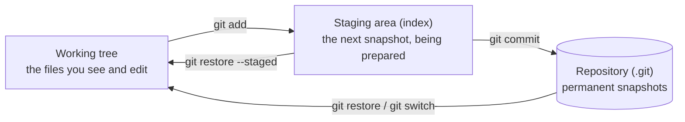
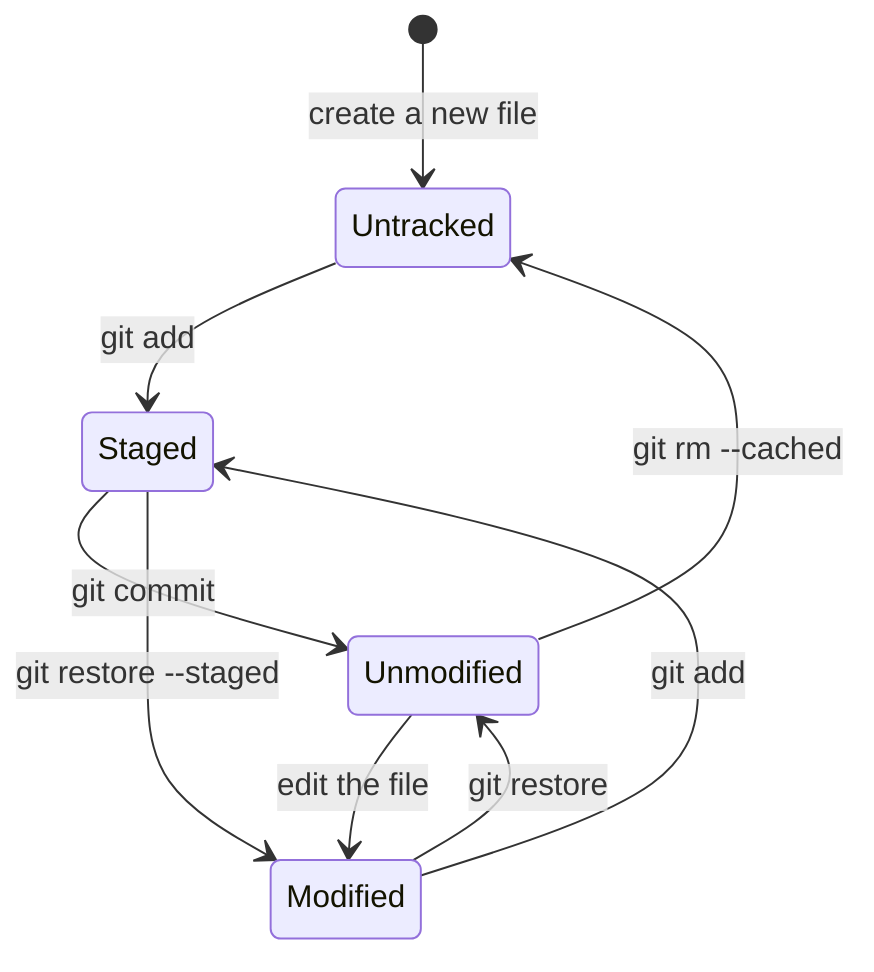
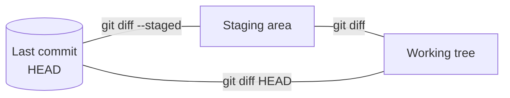

# The Three Areas: Working Tree, Staging and Repository: The Complete Guide

> 📚 **Before you start**
>
> - [Why Version Control Exists](why-version-control-exists.md), for what a commit is
> - [Installing and Configuring Git](installing-and-configuring-git.md), so your name and email are set

## Introduction

Think of a courier shop near a railway station. You walk in with things you want to send (that's your desk at home, full of stuff in various states). At the counter, you put the items you want to send *this time* into a box. You can add things, take things out and rearrange them; nothing has been sent yet. When you're happy, the clerk seals the box, stamps it with a date and tracking number, and puts it on the train. Once sealed and dispatched, that parcel's contents never change.

Git works exactly like this, with three places your work can be:

- Your **desk**, where you edit freely: the **working tree**.
- The **box at the counter**, where you collect the changes for the next snapshot: the **staging area** (also called the **index**).
- The **dispatched parcels**, sealed and permanent: the **repository** of commits.

Most beginner confusion with Git ("why didn't my change get committed?", "what's the difference between `git diff` and `git diff --staged`?", "how do I unstage this?") disappears once you can picture these three areas. By the end of this article you'll be able to move changes between them in every direction, read `git status` fluently in both long and short forms, and use `add`, `commit`, `diff`, `restore`, `rm` and `mv` with confidence.

> 💡 **Key Insight**
>
> A commit is made from **the staging area, not from your files**. `git add` copies the current content of a file into the staging area; `git commit` seals whatever is in the staging area into a permanent snapshot. If you edit a file after adding it, the commit gets the version you added, not the newer one.

---

## Core Explanation

### 1. The Three Areas



| Area | Where it lives | What it holds |
|---|---|---|
| **Working tree** | Your project folder | The files as you see them in your editor right now |
| **Staging area / index** | The file `.git/index` | A full list of what the *next* commit will contain |
| **Repository** | The `.git/objects` folder (and friends) | Every commit ever made, compressed and permanent |

A subtle but important point: the staging area isn't a list of *changes*. It's a complete picture of the next snapshot. Right after a commit, the staging area matches that commit exactly. `git add` updates the entry for one file in that picture.

### 2. The Life Cycle of a File

Every file in your project is in one of these states:



- **Untracked**: Git sees the file but has never stored it. It won't be in any commit until you add it.
- **Unmodified**: tracked, and identical to the last commit.
- **Modified**: tracked, and different from what's staged.
- **Staged**: the new content is in the staging area, ready for the next commit.

### 3. Watching the Areas with git status

Start a fresh practice repository:

```bash
mkdir chai-ledger
cd chai-ledger
git init
git status
```

Example output:

```
On branch main

No commits yet

nothing to commit (create/copy files and use "git add" to track)
```

Create two files (in your editor, or with the commands below) and check again:

```bash
printf 'Masala chai: 20\nGinger chai: 25\n' > menu.txt
printf 'prices = {"masala": 20, "ginger": 25}\nprint(prices)\n' > app.py
git status
```

Example output:

```
On branch main

No commits yet

Untracked files:
  (use "git add <file>..." to include in what will be committed)
	app.py
	menu.txt

nothing added to commit but untracked files present (use "git add" to track)
```

Notice how `git status` tells you the next command to use. Read its hints; they are usually exactly right. The short form is easier to scan once you know the codes:

```bash
git status --short
```

Example output:

```
?? app.py
?? menu.txt
```

### 4. Staging with git add

Stage only the menu:

```bash
git add menu.txt
git status
```

Example output:

```
On branch main

No commits yet

Changes to be committed:
  (use "git rm --cached <file>..." to unstage)
	new file:   menu.txt

Untracked files:
  (use "git add <file>..." to include in what will be committed)
	app.py

```

```bash
git status -s
```

Example output:

```
A  menu.txt
?? app.py
```

The short format has **two columns**. The left column is the **staging area** compared with the last commit; the right column is the **working tree** compared with the staging area:

| Code | Meaning |
|---|---|
| `??` | Untracked |
| `A ` | Added (new file, staged) |
| `M ` | Modified and staged |
| ` M` | Modified in the working tree, not staged |
| `MM` | Staged, then modified again after staging |
| `D ` / ` D` | Deleted and staged / deleted but not staged |
| `R ` | Renamed and staged |
| `!!` | Ignored (shown only with `--ignored`) |

Ways to stage:

| Command | Stages |
|---|---|
| `git add <file>` | That file (or every file inside a folder) |
| `git add .` | Everything changed or new in the current folder and below |
| `git add -A` | Everything changed, new or deleted in the whole repository |
| `git add -u` | Changes and deletions of **tracked** files only; ignores new files |
| `git add -p` | Pieces of files, one chunk at a time (section 8) |

### 5. Committing

```bash
git commit -m "Add the menu"
```

Example output:

```
[main (root-commit) 0325aed] Add the menu
 1 file changed, 2 insertions(+)
 create mode 100644 menu.txt
```

Reading that line: the branch is `main`, this is the first commit (`root-commit`, it has no parent), its short hash is `0325aed`, and the message follows. `100644` is the file mode for a normal, non-executable file.

`app.py` is still untracked, because we never added it. Commit it too:

```bash
git add app.py
git commit -m "Add the price script"
```

Example output:

```
[main 01ff273] Add the price script
 1 file changed, 2 insertions(+)
 create mode 100644 app.py
```

Useful `git commit` flags:

| Flag | What it does |
|---|---|
| `-m "msg"` | Message on the command line; repeat `-m` for extra paragraphs |
| (no `-m`) | Opens your editor for a longer message |
| `-a` | Stage every change to **tracked** files, then commit (new files are not included) |
| `-v` | Show the diff in the editor while you write the message |
| `--amend` | Replace the last commit with a new one (new message and/or staged changes) |
| `--dry-run` | Show what would be committed without committing |
| `--allow-empty` | Commit even if nothing changed (useful to trigger automation) |

### 6. Seeing Each Area with git diff

This is where the three areas really pay off. Add a line to the menu and stage it, then add another line *without* staging:

```bash
echo "Elaichi chai: 25" >> menu.txt
git add menu.txt
echo "Kulhad chai: 30" >> menu.txt
git status -s
```

Example output:

```
MM menu.txt
```

`MM` means the file has a staged change *and* a newer unstaged change. Three different `diff` commands compare three different pairs:



Working tree versus staging area (what you have **not** staged yet):

```bash
git diff
```

Example output:

```
diff --git a/menu.txt b/menu.txt
index 59b5ea5..1fb4cd3 100644
--- a/menu.txt
+++ b/menu.txt
@@ -1,3 +1,4 @@
 Masala chai: 20
 Ginger chai: 25
 Elaichi chai: 25
+Kulhad chai: 30
```

Staging area versus the last commit (what **will be** committed). `--cached` is an older name for the same flag:

```bash
git diff --staged
```

Example output:

```
diff --git a/menu.txt b/menu.txt
index f3998fe..59b5ea5 100644
--- a/menu.txt
+++ b/menu.txt
@@ -1,2 +1,3 @@
 Masala chai: 20
 Ginger chai: 25
+Elaichi chai: 25
```

Working tree versus the last commit (everything you've changed, staged or not):

```bash
git diff HEAD
```

Example output:

```
diff --git a/menu.txt b/menu.txt
index f3998fe..1fb4cd3 100644
--- a/menu.txt
+++ b/menu.txt
@@ -1,2 +1,4 @@
 Masala chai: 20
 Ginger chai: 25
+Elaichi chai: 25
+Kulhad chai: 30
```

How to read a diff: `---` is the old version and `+++` the new one. The `@@ -1,2 +1,4 @@` header says "starting at line 1, 2 lines of the old file became 4 lines in the new file". Lines starting with a space are unchanged context, `-` lines were removed and `+` lines were added. If you committed right now, only the elaichi line would go in.

### 7. Moving Changes Backwards: git restore

`git restore` (added in Git 2.23 to replace confusing uses of `git checkout` and `git reset`) moves content back:

```bash
git restore --staged menu.txt   # unstage: staging area takes the version from the last commit
git status -s
```

Example output:

```
 M menu.txt
```

Both lines are still in the working file; they're just no longer staged. To throw away working tree changes entirely and go back to the staged (here, the committed) version:

```bash
git restore menu.txt
git status -s
cat menu.txt
```

Example output:

```
Masala chai: 20
Ginger chai: 25
```

> ⚠️ `git restore <file>` **permanently discards** uncommitted edits to that file. Git never stored them, so it can't bring them back. Double-check with `git diff` first.

| Command | Effect |
|---|---|
| `git restore <file>` | Working tree ← staging area (discard unstaged edits) |
| `git restore --staged <file>` | Staging area ← last commit (unstage, keep your edits) |
| `git restore --staged --worktree <file>` | Both ← last commit (discard everything) |
| `git restore --source=<commit> <file>` | Working tree ← that file from any older commit |

You'll still see older equivalents in tutorials and in Git's own hints: `git checkout -- <file>` (same as `git restore <file>`) and `git reset HEAD <file>` (same as `git restore --staged <file>`).

### 8. Staging Part of a File with git add -p

Good commits contain one logical change. But often you've made two unrelated edits in the same file. `git add -p` ("patch") walks through each changed chunk (a **hunk**) and asks what to do. For this example we use a slightly bigger script, `prices.py`, with a `total()` and a `receipt()` function. Suppose you've edited it to add a new price *and* a new receipt line:

```bash
git add -p prices.py
```

Example output (answering `y` to the first hunk and `n` to the second):

```
diff --git a/prices.py b/prices.py
index 9ff4814..151dc5a 100644
--- a/prices.py
+++ b/prices.py
@@ -1,4 +1,4 @@
-PRICES = {"masala": 20, "ginger": 25}
+PRICES = {"masala": 20, "ginger": 25, "elaichi": 25}
 
 
 def total(order):
(1/2) Stage this hunk [y,n,q,a,d,j,J,g,/,e,?]? y
@@ -7,6 +7,7 @@ def total(order):
 
 def receipt(order):
     lines = [f"{item}: Rs {PRICES[item]}" for item in order]
+    lines.append(f"TOTAL: Rs {total(order)}")
     return "\n".join(lines)
 
 
(2/2) Stage this hunk [y,n,q,a,d,K,g,/,e,?]? n
```

The most useful answers: `y` stage this hunk, `n` skip it, `s` split it into smaller hunks (offered when possible), `e` edit the hunk by hand, `q` quit, `?` help. Now the file is half staged:

```bash
git status -s
git commit -m "Add elaichi chai"
git diff
```

Example output:

```
MM prices.py
[main c77772f] Add elaichi chai
 1 file changed, 1 insertion(+), 1 deletion(-)
diff --git a/prices.py b/prices.py
index 6480876..151dc5a 100644
--- a/prices.py
+++ b/prices.py
@@ -7,6 +7,7 @@ def total(order):
 
 def receipt(order):
     lines = [f"{item}: Rs {PRICES[item]}" for item in order]
+    lines.append(f"TOTAL: Rs {total(order)}")
     return "\n".join(lines)
```

The price change is committed alone; the receipt change waits in the working tree for its own commit. `-p` also works with `git restore -p` and `git commit -p`.

### 9. Removing, Untracking and Renaming

**Stop tracking a file but keep it on disk** (for example, a `notes.md` you swept up with `git add .` by mistake):

```bash
git add .
git status -s
git rm --cached notes.md
git status -s
```

Example output:

```
A  notes.md
rm 'notes.md'
?? notes.md
```

**Delete a tracked file** from the working tree *and* stage the deletion: `git rm <file>` (status shows `D `). Deleting a file with your file manager or `rm` works too; then `git add <file>` or `git add -A` stages the deletion.

**Rename or move** a file. Back in the `chai-ledger` repository from section 5, rename the script:

```bash
git mv app.py prices.py
git status -s
git commit -m "Rename app.py to prices.py"
```

Example output:

```
R  app.py -> prices.py
[main 9dd9c41] Rename app.py to prices.py
 1 file changed, 0 insertions(+), 0 deletions(-)
 rename app.py => prices.py (100%)
```

Git doesn't actually store "renames". It stores snapshots, and *detects* renames afterwards by noticing that a deleted file and an added file have the same (or very similar) content. The `(100%)` is the similarity. So `git mv` is just a shortcut for moving the file and staging both sides; doing it by hand gives the same result.

### 10. Fixing the Last Commit with --amend

Typo in the message, or forgot a file? Stage any extra changes and amend:

```bash
git commit -a -m "Print the item count"
git commit --amend -m "Print how many items are on the menu"
git log --oneline
```

Example output:

```
[main 6c3f33e] Print the item count
 1 file changed, 1 insertion(+)
[main 17e224f] Print how many items are on the menu
 Date: Mon Oct 5 10:42:00 2026 +0530
 1 file changed, 1 insertion(+)
17e224f Print how many items are on the menu
9dd9c41 Rename app.py to prices.py
01ff273 Add the price script
0325aed Add the menu
```

The hash changed from `6c3f33e` to `17e224f`. Amending doesn't edit a commit; it **replaces** it with a new one. That's harmless for commits only you have, but don't amend commits you've already pushed and shared (module 4 explains why). Use `git commit --amend --no-edit` to add staged changes while keeping the message.

### 11. Where This Lives on Disk

Everything Git knows is inside `.git`:

```bash
ls .git
```

Example output:

```
COMMIT_EDITMSG
HEAD
branches
config
description
hooks
index
info
logs
objects
refs
```

`index` is the staging area, `objects` holds the stored content and commits, `refs` holds branch pointers, `HEAD` says which branch you're on, and `config` is the local configuration. Module 3 explores each one. Deleting `.git` deletes the entire history, and the folder becomes a plain folder again.

---

## Try It Yourself

1. **Status codes.** In a practice repo with one committed file, produce each of these short statuses: `??`, `A `, ` M`, `M `, `MM`. Write down the commands you used.
2. **Three diffs.** Get a file into the `MM` state. Before running them, predict what `git diff`, `git diff --staged` and `git diff HEAD` will show.
3. **Commit what you staged.** Stage a change, then edit the file again and run `git commit -m "test"` (without `-a`). Which version got committed? Prove it with `git show HEAD:<file>` and `git diff`.
4. **Undo a mistaken add.** You ran `git add .` and staged `debug.log` along with real work. Unstage just the log without losing anything.

<details>
<summary>Show answers</summary>

1. `??`: create a new file. `A `: `git add` the new file. ` M`: edit the committed file. `M `: `git add` that edit. `MM`: edit the same file again after adding it.
2. `git diff` shows only the second (unstaged) edit; `git diff --staged` shows only the first (staged) edit; `git diff HEAD` shows both.
3. The staged version. `git show HEAD:<file>` prints the content as staged, and `git diff` still shows the later edit as uncommitted.
4. `git restore --staged debug.log` (or `git rm --cached debug.log` if it was a new file; for a new file both leave it untracked). Then add it to `.gitignore` (next-but-one lesson).

</details>

---

## Real-World Examples

### Example 1: Two Fixes, One File

A developer fixes a crash and, while there, renames a confusing variable. Using `git add -p`, they commit the crash fix alone with a clear message, then commit the rename separately. A month later the crash fix needs to be copied to an older release branch; because it's a clean, single-purpose commit, that takes one command.

### Example 2: Reviewing Before Committing

Many experienced engineers never commit without running `git diff --staged` first. It catches debug `print` statements, stray test files and accidental secrets before they enter permanent history, where removing them is far harder.

### Example 3: Editor Integrations

VS Code's Source Control panel shows "Changes" and "Staged Changes" as two lists, with `+` and `-` buttons to move files and even single lines between them. That's exactly the working tree and staging area; knowing the model makes every Git GUI immediately readable.

---

## Common Misconceptions

### Misconception 1: "git add means 'start tracking this file' once"

`git add` copies the file's **current content** into the staging area every time you run it. If you edit after adding, you must add again, or that edit won't be in the commit.

### Misconception 2: "git commit -a commits new files too"

`-a` only stages changes to files Git already tracks. New files still need an explicit `git add`.

### Misconception 3: "The staging area is pointless; it just slows me down"

It's what lets you craft focused commits out of messy work, review exactly what's going in, and commit part of a file. You can skip it with `-a` when that's what you want, but it's a feature, not a hurdle.

### Misconception 4: "git restore can recover my lost edits"

`git restore` *overwrites* working tree content with a stored version. Edits that were never added or committed are not stored anywhere in Git, so they're gone for good.

---

## Interview Relevance

"Explain the staging area" and "What's the difference between `git diff` and `git diff --staged`?" are classic screening questions. A strong answer covers:

- **The three areas**: working tree, index/staging area, repository, and which commands move content between them.
- **That commits are built from the index**, which enables partial commits with `git add -p`.
- **The diff trio**: `git diff` (working tree vs index), `git diff --staged` (index vs HEAD), `git diff HEAD` (working tree vs HEAD).
- **Undoing at each level**: `git restore --staged`, `git restore`, and `git commit --amend` for the last commit.
- **Renames are detected, not recorded.**

---

## Key Takeaways

- Git has **three areas**: the **working tree** you edit, the **staging area/index** you prepare, and the **repository** of permanent commits.
- **`git add` copies current content to the index; `git commit` snapshots the index.**
- **`git status -s`** has two columns: index on the left, working tree on the right.
- **`git diff`**, **`git diff --staged`** and **`git diff HEAD`** compare different pairs of areas.
- **`git restore --staged`** unstages; **`git restore`** discards working-tree edits permanently; **`--amend`** replaces the last commit.
- Use **`git add -p`** to keep every commit about one thing.

---

**Up next:** [Reading History with log, show and diff](reading-history-with-log-show-and-diff.md)
