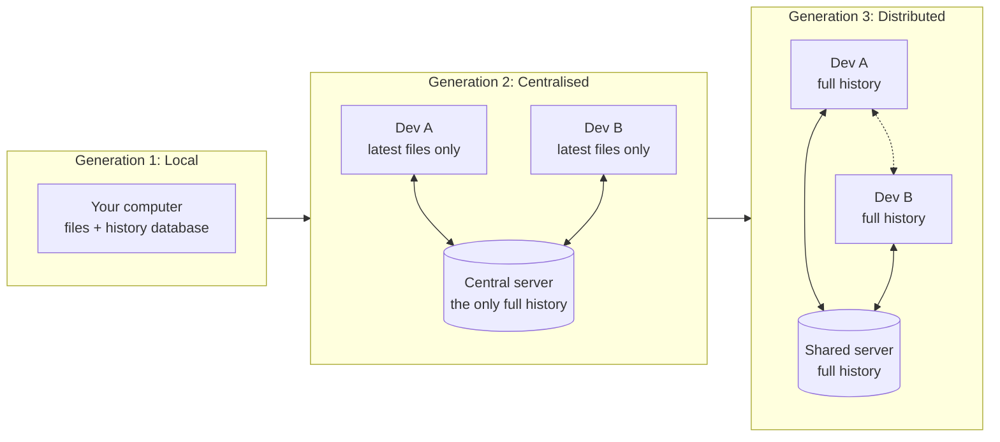
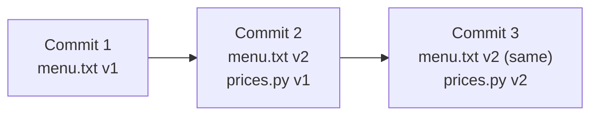
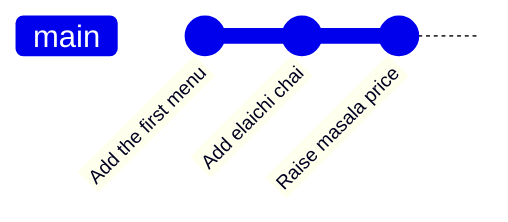

# Why Version Control Exists: The Complete Guide

> 📚 **Before you start**
>
> No Git knowledge is needed. You should be able to open a terminal and move between folders:
> - [Terminal Fundamentals](../../the-command-line-and-linux-basics/course.md#m2) (The Command Line and Linux Basics)
> - [How This Course Works](../01-start-here/how-this-course-works.md)

## Introduction

Open the "Documents" folder of almost anyone who writes for a living and you'll find something like this:

```
report.docx
report_v2.docx
report_v2_final.docx
report_v2_final_REALLY_final.docx
report_v3_ravi_comments.docx
report_v3_ravi_comments_merged_asha.docx
```

That folder is a home-made version control system, and a bad one. Which file is the latest? What changed between `v2_final` and `v2_final_REALLY_final`? Did Ravi's comments make it into the merged copy, or did Asha's edits overwrite them? If yesterday's version was better, which file *is* yesterday's version? Nobody knows, and the folder can't tell you.

Now imagine the same chaos with code: forty files, five people, changes every hour, and a live app that thousands of customers are using to pay their electricity bills over UPI. One wrong "save as" can take the whole thing down. **Version control** is the discipline, and the tool, that makes this manageable.

By the end of this article you will understand what problems version control solves, the three generations of version control tools, why Git won, what a "commit" really is, and you'll have run your first few Git commands to see the idea in action.

> 💡 **Key Insight**
>
> A version control system is a **time machine with a logbook** for a folder. It saves named, dated **snapshots** of your whole project, records **who** changed **what** and **why**, lets you **jump back** to any snapshot, and lets several people work **in parallel** and combine their work safely.

---

## Core Explanation

### 1. The Problems Version Control Solves

Every project that changes over time runs into the same five problems. Version control exists to solve all five at once.

| Problem | Without version control | With version control |
|---|---|---|
| **"What did it look like before?"** | Hunt through `_v2`, `_old`, `_backup` copies, if they exist | Every saved snapshot is kept; jump to any one in seconds |
| **"What exactly changed?"** | Open two files side by side and squint | Ask for the difference (a *diff*) between any two snapshots, line by line |
| **"Who changed this, and why?"** | Ask around in chat and hope someone remembers | Every snapshot records the author, the time and a message explaining why |
| **"Two of us edited the same file"** | Copy-paste one person's edits into the other's file by hand | The tool combines (*merges*) both sets of changes automatically, and flags only true clashes |
| **"I want to try something risky"** | Make a copy of the whole folder, then forget which copy is which | Create a *branch*: a separate line of work you can merge in or throw away |

Two more benefits appear once you use it daily:

- **Backup and recovery.** If your laptop dies, a copy of the full history on a server (such as GitHub) means you lose nothing you had pushed.
- **Accountability and audit.** Banks, hospitals and governments must be able to show who changed a system and when. Version control gives that record for free.

### 2. Some Vocabulary First

You'll meet these words constantly. Each gets a full lesson later; for now, a one-line meaning is enough.

| Term | Plain meaning |
|---|---|
| **Repository** (repo) | A project folder whose history is being tracked, plus the stored history itself |
| **Commit** | One saved snapshot of the whole project, with an author, a date and a message |
| **History** | The chain of commits, each pointing back to the one before |
| **Diff** | The line-by-line difference between two versions of a file |
| **Branch** | A named line of work that can move forward independently |
| **Merge** | Combining the work from two branches into one |
| **Remote** | A copy of the repository somewhere else, usually on a server like GitHub |

### 3. Three Generations of Version Control

Version control tools have existed since the 1970s. They fall into three generations, and knowing them explains a lot about why Git works the way it does.



**Generation 1: local version control (1970s to 1980s).** Tools like SCCS and RCS kept the history of individual files in a small database on one machine. Fine for one person, useless for a team.

**Generation 2: centralised version control (1990s to 2000s).** CVS, then Subversion (SVN) and Perforce, put the history on one central server. Developers "check out" the latest files, edit them, and "commit" straight back to the server. Teams could finally collaborate, but:

- **No server, no work.** Viewing history, committing and branching all need the network.
- **One point of failure.** If the server's disk dies without a backup, the project's history is gone.
- **Branching was painful.** Branches were slow, heavy copies, so teams avoided them and merges became scary events.

**Generation 3: distributed version control (2005 onwards).** Git and Mercurial gave **every developer a complete copy of the whole history**. You commit, branch, view history and compare versions on your own machine, offline, in milliseconds. You **share** commits with others by sending and receiving them (to and from a server, or even directly). Every clone is a full backup.

### 4. Where Git Came From

Git was written by **Linus Torvalds**, the creator of Linux, in **April 2005**. The Linux kernel had been using a proprietary distributed tool called BitKeeper for free, and when that arrangement ended the kernel developers needed a replacement quickly. Torvalds set out to build something that was:

- **Fast**, even for a project with tens of thousands of files and thousands of contributors.
- **Distributed**, so no single server is in charge.
- **Safe against corruption**, so that any change to stored history, accidental or malicious, is detectable. (Module 3 shows how hashes make this work.)
- **Good at branching and merging**, because thousands of people work on the kernel in parallel.

Within months, maintenance passed to **Junio Hamano**, who still leads the project today. GitHub launched in 2008 and made Git the default for open source. Today Git is used by the overwhelming majority of professional developers, and hosting services like GitHub, GitLab and Bitbucket are all built around it.

Git is still actively developed, with a new release every few months. As of October 2026 the current releases are in the 2.5x series, and the project is preparing **Git 3.0**, which will change some long-standing defaults (for example, `main` instead of `master` as the default branch name for new repositories). Everything in this course works on any reasonably recent Git.

### 5. Snapshots, Not Lists of Changes

Many older systems stored each file as a starting version plus a list of edits. Git thinks differently: **every commit is a snapshot of the entire project** as it was at that moment.



That sounds wasteful, but Git is clever: if a file didn't change between commits, the new snapshot simply **points at the same stored copy** instead of storing it again. Later, Git also compresses similar files together. You get the simplicity of "every commit is the whole project" with the storage cost of "only changes are stored". Module 3 opens this machinery up in detail.

Each commit also points back to the commit before it (its **parent**). That chain of parent pointers *is* the history:



### 6. A First Taste of Git

You'll install and configure Git properly in the next lesson. If you already have it, here is the whole idea in a few commands. Make a practice folder, turn it into a repository and save a first snapshot:

```bash
mkdir chai-ledger
cd chai-ledger
git init
```

Example output:

```
Initialized empty Git repository in /home/asha/projects/chai-ledger/.git/
```

`git init` created a hidden `.git` folder. That folder **is** the repository: the database where every snapshot will be stored. Your project files live next to it.

Create a file, tell Git you want it in the next snapshot (`git add`), and take the snapshot (`git commit`) with a message saying what you did:

```bash
printf 'Masala chai: 20\nGinger chai: 25\n' > menu.txt
git add menu.txt
git commit -m "Add the first menu"
```

Example output:

```
[main (root-commit) 141faf4] Add the first menu
 1 file changed, 2 insertions(+)
 create mode 100644 menu.txt
```

Make two more changes, committing after each. The `-a` flag tells `git commit` to include every change to files Git already tracks:

```bash
printf 'Masala chai: 20\nGinger chai: 25\nElaichi chai: 25\n' > menu.txt
git commit -am "Add elaichi chai"
sed -i 's/Masala chai: 20/Masala chai: 22/' menu.txt
git commit -am "Raise masala chai price to 22"
```

Example output:

```
[main a22a95b] Add elaichi chai
 1 file changed, 1 insertion(+)
[main bb37665] Raise masala chai price to 22
 1 file changed, 1 insertion(+), 1 deletion(-)
```

(On macOS, write `sed -i ''` instead of `sed -i`, or just edit the file in your editor.)

Now use the time machine. List the history, newest first:

```bash
git log --oneline
```

Example output:

```
bb37665 Raise masala chai price to 22
a22a95b Add elaichi chai
141faf4 Add the first menu
```

See exactly what changed between the first snapshot and the latest (`HEAD` means "the commit I'm on", and `HEAD~2` means "two commits before that"):

```bash
git diff HEAD~2 HEAD
```

Example output:

```
diff --git a/menu.txt b/menu.txt
index f3998fe..d4f1c56 100644
--- a/menu.txt
+++ b/menu.txt
@@ -1,2 +1,3 @@
-Masala chai: 20
+Masala chai: 22
 Ginger chai: 25
+Elaichi chai: 25
```

Lines starting with `-` were removed and lines starting with `+` were added. And you can read any file exactly as it was in any old snapshot:

```bash
git show HEAD~1:menu.txt
```

Example output:

```
Masala chai: 20
Ginger chai: 25
Elaichi chai: 25
```

That's version control in miniature: snapshots, messages, history, differences and the ability to look back. Everything else in this course builds on these ideas.

### 7. What Version Control Is Not

- **It is not a backup tool by itself.** History on your laptop dies with your laptop. Pushing to a remote such as GitHub is what makes it a backup.
- **It is not good at huge binary files.** Videos, large datasets and model weights bloat a repository quickly. Tools like [Git LFS](../course.md#m10) or data-versioning tools handle those.
- **It does not save automatically.** Nothing is recorded until you commit. Uncommitted work is unprotected.
- **It is not a place for secrets.** Passwords and API keys committed to history are very hard to remove. The [.gitignore lesson](gitignore-and-what-never-to-commit.md) covers how to keep them out.

---

## Try It Yourself

1. **Spot the problems.** Look at the `report_v2_final_REALLY_final.docx` folder from the introduction. For each of the five problems in the table in section 1, write one sentence describing how it shows up in that folder.
2. **Centralised or distributed?** For each situation, decide which generation of tool copes better and why: (a) the office internet is down for a day; (b) the server's disk fails and the last backup is a month old; (c) a developer wants to try three experimental ideas without disturbing anyone.
3. **Run the first taste.** If Git is already installed, run section 6 in a practice folder, then add a fourth commit that adds `Kulhad chai: 30`. Run `git log --oneline` and `git diff HEAD~1 HEAD`. How many lines does the diff show as added?
4. **Snapshot thinking.** A project has three files. Commit 2 changes only one of them. How many complete copies of the unchanged files does Git store for commit 2?

<details>
<summary>Show answers</summary>

1. *Before:* nobody knows which copy is older. *What changed:* you can't see the difference between `v2_final` and `v2_final_REALLY_final` without comparing by hand. *Who and why:* the file names hint at Ravi and Asha, but not what or why. *Two editors:* the "merged" file was combined by hand, so edits may be lost. *Risky changes:* every experiment means another copy with a confusing name.
2. (a) Distributed: you can still commit, branch and read history offline, and share later. (b) Distributed: every developer's clone has the full history, so any clone can restore the server. (c) Distributed: branches are cheap and local, so you can create three and delete the ones that don't work.
3. The diff shows one added line, `+Kulhad chai: 30`, and `git log --oneline` shows four commits, newest first.
4. None. The new snapshot reuses the stored copies of the two unchanged files; only the changed file's new content is stored.

</details>

---

## Real-World Examples

### Example 1: An App Release Goes Wrong

A payments team ships a release on Friday evening and refunds start failing. Because every release is a tagged commit, the on-call engineer redeploys the previous tag in minutes, then uses `git diff` between the two releases to see the forty lines that changed and finds the bug by Monday morning. Without version control, "what changed?" would have taken days.

### Example 2: Two Hundred People, One Codebase

Large open-source projects such as the Linux kernel or Python receive changes from hundreds of people every release. Each contributor works on their own branch in their own clone, and maintainers merge the work in. The distributed model is what makes this scale: nobody waits for anyone else's network connection or permission to start work.

### Example 3: Data and AI Teams

A data engineering team keeps its SQL models, pipeline definitions and configuration in Git. When a dashboard number suddenly looks wrong, `git log -- models/revenue.sql` shows who changed the revenue calculation last week and the commit message explains why. AI coding agents work the same way: they make changes on a branch and propose them as a pull request, so humans can review exactly what the agent did.

---

## Common Misconceptions

### Misconception 1: "Version control is just backup"

Backup copies files somewhere safe. Version control records *meaningful, labelled steps* in the project's life, shows the difference between any two, and lets people work in parallel and merge. Pushing to a remote gives you backup as a side effect, but that's the smallest part of the value.

### Misconception 2: "Git stores the differences between versions"

Conceptually, every Git commit is a **full snapshot**. Git avoids duplication by reusing unchanged files and compressing similar content, but `git diff` *computes* differences on demand from snapshots; it doesn't read stored change lists.

### Misconception 3: "Distributed means there's no central server"

Most teams still agree on one shared copy (on GitHub, say) as the official one. "Distributed" means every clone is complete and can work independently, not that the team has no meeting point.

### Misconception 4: "My work is saved because I edited the file"

Git records nothing until you commit. A file you edited but never committed is not in the history and cannot be recovered by Git if you overwrite it.

---

## Interview Relevance

Interviewers for any engineering role may open with "What is version control and why do we use it?" or "Why is Git called distributed?". A strong answer covers:

- **Definition:** a system that records snapshots of a project over time with author, time and message, so you can compare, restore and collaborate.
- **The problems it solves:** history, diffs, accountability, parallel work through branches, and safe merging.
- **Centralised vs distributed:** in Git every clone has the full history, so most operations are local and fast, work offline, and every clone is a backup.
- **Snapshots:** each commit is a snapshot of the whole project, with unchanged files shared between snapshots.
- **Git vs GitHub:** the tool versus a hosting and collaboration service.

Common follow-ups:

- *"Name a disadvantage of Git."* A steeper learning curve, and poor handling of very large binary files without extensions like Git LFS.
- *"Who created Git and why?"* Linus Torvalds in 2005, for Linux kernel development after the free BitKeeper licence ended.

---

## Key Takeaways

- **Version control** records snapshots of a project with who, when and why, and lets you compare, restore, branch and merge.
- Tools evolved from **local**, to **centralised** (CVS, SVN), to **distributed** (Git, Mercurial), where **every clone has the full history**.
- **Git** was created by Linus Torvalds in 2005 for the Linux kernel and is now the industry standard.
- Each **commit is a full snapshot**; unchanged files are shared, so it's cheap.
- **Git is the tool; GitHub hosts it** and adds collaboration features.
- Nothing is protected until you **commit**, and nothing is backed up until you **push**.

---

**Up next:** [Installing and Configuring Git](installing-and-configuring-git.md)
