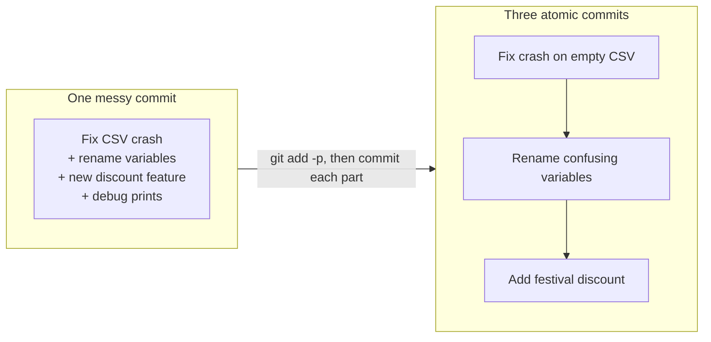

# Writing Good Commit Messages: The Complete Guide

> 📚 **Before you start**
>
> - [The Three Areas: Working Tree, Staging and Repository](the-three-areas-working-tree-staging-and-repository.md), for `git commit`, `--amend` and `git add -p`
> - [Reading History with log, show and diff](reading-history-with-log-show-and-diff.md), because messages are what you read in the log

## Introduction

Railway stations in India announce trains in a fixed pattern: train number, name, from where to where, and platform. "Train number 12951, Mumbai Rajdhani Express, from Mumbai Central to New Delhi, will arrive on platform 3." Thousands of people, half-listening over chai, get exactly the information they need, because the format never changes.

Now imagine the announcer said "stuff happening on some platform". That's what most commit histories look like:

```
a91c2e0 fix
77b03d1 changes
e2f1a9c wip
0c44b18 asdf
5d9e301 final fix hopefully
```

Six months later, when a bug appears and someone runs `git log` or `git blame` to understand a line, those messages are worthless. The code shows *what* changed. Only the message can say *why*.

By the end of this article you'll know the conventional shape of a Git commit message and the reasons behind each rule, how to write subjects and bodies that are useful years later, the Conventional Commits format many teams use for automated releases, trailers like `Co-authored-by` and `Signed-off-by`, how GitHub links commits to issues, and how to keep each commit about one thing.

> 💡 **Key Insight**
>
> Write each commit message for **a future teammate who is debugging at 2 a.m.** and has only `git log` and `git blame`. The subject says **what the commit does** in a few words; the body says **why** it was needed and anything not obvious from the code.

---

## Core Explanation

### 1. The Anatomy of a Commit Message

A commit message has up to three parts, separated by blank lines:

```
Raise masala chai price to 22                        <- subject line

Milk prices went up by 4 rupees a litre this month,  <- body: why, context,
so the stall raised the masala chai price to keep       consequences
the same margin. Ginger and elaichi stay the same.

Refs: #41                                            <- trailers: key: value
Co-authored-by: Ravi Kumar <ravi@example.com>           metadata
```

Git itself only cares that the first line is the **subject**. Many tools build on that: `git log --oneline`, GitHub's commit lists, pull request titles, email patches and release notes all show only the subject. That's why it has to stand on its own.

### 2. The Seven Rules (and Why Each Exists)

These conventions come from long community practice, including the Git project's own guidelines. Each has a practical reason:

| Rule | Why |
|---|---|
| **Separate subject from body with a blank line** | Tools treat everything up to the first blank line as the subject |
| **Keep the subject short: aim for 50 characters, never above about 72** | One-line views, terminals and GitHub's web pages truncate long subjects |
| **Capitalise the subject** | Consistency; it reads like a title |
| **No full stop at the end of the subject** | It's a title, and space is precious |
| **Use the imperative mood: "Add", not "Added" or "Adds"** | It matches Git's own messages ("Merge branch...", "Revert...") and reads as an instruction: *if applied, this commit will* **add a README** |
| **Wrap the body at about 72 characters** | Git doesn't wrap text, and `git log` indents the body; long lines become hard to read in terminals |
| **Use the body to explain what and why, not how** | The diff already shows how; the reasoning exists nowhere else |

The imperative test: a good subject completes the sentence **"If applied, this commit will ..."**

- *If applied, this commit will* **Add apply_discount() for festival offers** ✔
- *If applied, this commit will* **fixed bug** ✘

### 3. Good and Bad Subjects

| Weak | Better | What improved |
|---|---|---|
| `fix` | `Fix crash when the sales CSV is empty` | Says which problem |
| `Updated prices.py` | `Raise masala chai price to 22` | Says the intent, not the file |
| `changes from review` | `Validate UPI ID format before saving` | Describes the change itself |
| `WIP` | (don't push WIP commits; squash them first) | History stays readable |
| `Add feature and fix bug and update docs` | Three separate commits | One change per commit |
| `Refactored the total function to use sum() with a generator expression instead of a for loop because it is shorter` | `Simplify total() with sum()` + a body | Short subject, details in body |

### 4. Writing the Body

Not every commit needs a body. "Fix typo in README" is complete on its own. Write a body when any of these are true:

- **The reason isn't obvious.** Why this approach? What else did you try?
- **There's context from outside the code**: a customer complaint, an incident, a law, a vendor's limit.
- **There are consequences**: a behaviour change, a migration to run, a performance trade-off.

Example of a body that will save someone hours:

```
Retry UPI status checks up to 3 times

The bank's status API sometimes returns HTTP 502 for a few seconds
during its nightly batch window (around 23:30 IST). We were marking
those payments as failed and customers were paying twice.

Retry with 2, 4 and 8 second waits before giving up. Longer waits
would hold the checkout page open for too long.
```

To write a body, run `git commit` **without** `-m`; Git opens your editor. Lines starting with `#` are comments and are removed. `git commit -v` also shows the diff below the message (as comments) so you can describe what you're actually committing. On the command line you can pass several `-m` options; each becomes its own paragraph:

```bash
git commit -m "Raise masala chai price to 22" -m "Milk prices went up by 4 rupees a litre this month."
```

### 5. A Commit Template

`commit.template` points to a file whose contents pre-fill the editor. A template with reminders helps a whole team:

```
# ~/.gitmessage

# Subject: imperative, max 50 chars, no full stop
# |<----  Using a maximum of 50 characters  ---->|
#
# Body: explain WHY, wrap at 72 characters
#
# Trailers, e.g.  Refs: #12   Co-authored-by: Name <email>
```

```bash
git config --global commit.template ~/.gitmessage
```

The template only appears when Git opens the editor (not with `-m`), and the comment lines are stripped from the final message.

### 6. Trailers: Structured Metadata

**Trailers** are `Key: value` lines in the last paragraph of the message. Git and GitHub understand several:

| Trailer | Meaning |
|---|---|
| `Co-authored-by: Name <email>` | GitHub shows both people as authors of the commit (pair programming, or applying a suggestion) |
| `Signed-off-by: Name <email>` | The author certifies they have the right to submit the code, often under the Developer Certificate of Origin (DCO); added by `git commit -s` |
| `Reviewed-by:`, `Reported-by:`, `Refs:` | Common conventions; Git can parse any key |

Here's a full message written from a heredoc (you'd normally type it in your editor):

```bash
git commit -F - <<MSG
Show a sample festival discount

Diwali week starts on Monday and the stall owner wants to see what
a 10 percent discount looks like before printing new price boards.

Fixes #12

Co-authored-by: Ravi Kumar <ravi@example.com>
MSG
git log -1
```

Example output:

```
commit 16b9f86d738d525c48517e478d8b713fd928b563
Author: Asha Rao <asha@example.com>
Date:   Mon Oct 5 09:06:00 2026 +0530

    Show a sample festival discount
    
    Diwali week starts on Monday and the stall owner wants to see what
    a 10 percent discount looks like before printing new price boards.
    
    Fixes #12
    
    Co-authored-by: Ravi Kumar <ravi@example.com>
```

Git can extract trailers for scripts:

```bash
git log -1 --format="%(trailers:key=Co-authored-by,valueonly)"
```

Example output:

```
Ravi Kumar <ravi@example.com>
```

Notice `Fixes #12` sits in its own paragraph. It isn't in `Key: value` form, so if it shared the last paragraph with the trailers, Git would no longer recognise that paragraph as a trailer block. Add trailers from the command line with `-s` for sign-off and `--trailer` for anything else:

```bash
git commit -s -m "Add a.txt"
git commit --amend --no-edit --trailer "Reviewed-by: Meera Iyer <meera@example.com>"
git log -1 --format=%B
```

Example output:

```
Add a.txt

Signed-off-by: Asha Rao <asha@example.com>
Reviewed-by: Meera Iyer <meera@example.com>
```

### 7. Linking Commits to GitHub Issues

On GitHub, `#12` in a commit message becomes a link to issue or pull request 12. Certain keywords go further and **close** the issue: `close`, `closes`, `closed`, `fix`, `fixes`, `fixed`, `resolve`, `resolves` and `resolved`, followed by the reference (`Fixes #12`, or `Fixes owner/repo#12` for another repository). The issue closes when the commit reaches the repository's **default branch**, usually `main`. You'll use the same keywords in pull request descriptions in [module 6](../course.md#m6).

### 8. Conventional Commits

Many teams adopt **Conventional Commits** (specification version 1.0.0), a format machines can read:

```
<type>[optional scope][!]: <description>

[optional body]

[optional footer(s)]
```

```
feat(ledger): add weekly sales summary
fix: handle an empty sales CSV without crashing
docs: explain the CSV format in the README
refactor(prices)!: rename PRICES to MENU_PRICES

BREAKING CHANGE: code importing PRICES must use MENU_PRICES.
```

| Type | Use for | Release effect (with semantic versioning) |
|---|---|---|
| `feat` | A new feature | Minor version bump (1.**3**.0) |
| `fix` | A bug fix | Patch bump (1.2.**1**) |
| `!` after the type, or a `BREAKING CHANGE:` footer | Incompatible change | Major bump (**2**.0.0) |
| `docs`, `refactor`, `test`, `ci`, `build`, `perf`, `style`, `chore` | Common extra types (conventions, not required by the spec) | No release by default |

The pay-off is automation: release tools can read the history, decide the next version number and generate a changelog. The cost is a little ceremony on every commit. Notice Conventional Commits subjects are often lowercase after the colon; follow whichever style your team uses consistently. Versioning and release automation are covered in [module 10](../course.md#m10), and enforcing a format with commit hooks in the same module.

### 9. One Logical Change per Commit

A good message is only possible if the commit is about one thing. An **atomic commit** contains one complete, self-contained change: the code, its tests and its docs, and nothing unrelated.



Why it matters:

- **Review**: reviewers can understand each step.
- **Revert**: you can undo the discount feature without undoing the crash fix.
- **Bisect and blame**: tools that hunt for the commit that broke something (module 4) point to a small, understandable change.
- **Cherry-pick**: a single fix can be copied to a release branch cleanly.

Tools for keeping commits atomic: `git add -p` to stage parts of files, `git commit --amend` to fold a forgotten change into the last commit, and `git commit --fixup <commit>` to mark a correction for an older commit:

```bash
git commit --fixup HEAD~1
git log --oneline
```

Example output:

```
64f5ad4 fixup! Show a sample festival discount
836511b Add a.txt
16b9f86 Show a sample festival discount
86590d3 Add prices
```

That `fixup!` commit is a note to yourself: before sharing, an interactive rebase with `--autosquash` merges it into the commit it fixes ([Rebase and Interactive Rebase](../course.md#m4)).

### 10. Fixing a Message

- **Last commit, not pushed yet:** `git commit --amend` opens the editor with the old message (or use `--amend -m "New subject"`).
- **An older commit, not pushed yet:** interactive rebase with `reword` (module 4).
- **Already pushed and shared:** usually leave it. Rewriting shared history causes trouble for everyone else. If the message is actively misleading, add a follow-up commit or note in the pull request.

Git refuses to create a commit with an empty message:

```bash
git commit -m "" --allow-empty
```

Example output:

```
Aborting commit due to empty commit message.
```

---

## Try It Yourself

1. **Rewrite these subjects** using the rules: `fixed the bug in login`, `Updates.`, `added tests and changed the db schema and fixed typo`.
2. **Write a body.** You changed the stall's opening time in a config file from 6:00 to 5:30 because morning train passengers were arriving before opening. Write the full commit message.
3. **Trailers.** Make a commit with a `Co-authored-by` trailer and a sign-off, then print only the trailers with `git log -1 --format="%(trailers)"`.
4. **Conventional Commits.** Write Conventional Commit subjects for: a new CSV export feature; a fix for wrong GST rounding; removing a command-line flag that other scripts use.

<details>
<summary>Show answers</summary>

1. `Fix login failing for emails with uppercase letters` (say *which* bug); `Updates.` has no information: name the change, for example `Update ginger chai price to 27`; the last one should be three commits: `Add tests for order totals`, `Add customer_phone column to orders table`, `Fix typo in README`.
2. Something like:

   ```
   Open the stall at 5:30 instead of 6:00

   Passengers from the 5:40 local were arriving before we opened and
   buying chai from the stall across the platform. Opening 30 minutes
   earlier covers that train.
   ```
3. `git commit -s -m "Subject" -m "Co-authored-by: Name <email>"`; the `%(trailers)` format prints the `Co-authored-by` and `Signed-off-by` lines.
4. `feat: add CSV export of daily sales`, `fix: round GST to the nearest paisa`, `feat!: remove the --legacy flag` (or any type with `!`, plus a `BREAKING CHANGE:` footer explaining what callers must do).

</details>

---

## Real-World Examples

### Example 1: The Linux Kernel

Kernel commits are known for long, careful bodies: what was wrong, how it was found, why this fix, and trailers such as `Signed-off-by`, `Reviewed-by`, `Reported-by` and `Fixes: <hash> ("subject")`. With thousands of contributors and decades of history, the messages are the project's memory.

### Example 2: Automated Releases

A team using Conventional Commits runs a release tool in CI. When `feat:` commits land on `main`, the tool bumps the minor version, writes a CHANGELOG entry from the subjects, tags the release and publishes it, with nobody editing version numbers by hand.

### Example 3: Pair Programming Credit

Two developers pair on a tricky migration on one laptop. The person typing adds `Co-authored-by:` for their partner, so GitHub shows both avatars on the commit and both get credit in contribution graphs.

---

## Common Misconceptions

### Misconception 1: "The diff explains the change, so the message doesn't matter"

The diff shows **what** changed. It can't show **why**, which alternatives were rejected, or what external fact forced the change. That's exactly what a future reader needs.

### Misconception 2: "Long messages are always better"

A good message is **complete, not long**. "Fix typo in README" needs no body. Save bodies for changes whose reasoning isn't obvious.

### Misconception 3: "Conventional Commits is a Git rule"

It's an optional convention some teams choose for automation. Git itself only distinguishes the subject (first line) and recognises trailers.

### Misconception 4: "I'll clean up my messages later"

Once commits are pushed and shared, rewriting them is disruptive. The cheap moment to write a good message, or to squash `wip` commits, is before you push.

---

## Interview Relevance

Interviewers use commit messages as a quick signal of professionalism, and sometimes ask "What makes a good commit?" directly. A strong answer covers:

- **Atomic commits**: one logical change, buildable and testable on its own.
- **Message shape**: short imperative subject, blank line, body explaining why, wrapped at about 72 characters.
- **Why it matters**: review, `revert`, `cherry-pick`, `bisect` and `blame` all work better with small, well-described commits.
- **Team conventions**: Conventional Commits and how they drive semantic versioning and changelogs.
- **Trailers and issue linking**: `Co-authored-by`, `Signed-off-by`, and closing keywords like `Fixes #12`.

---

## Key Takeaways

- The **subject** stands alone: imperative, capitalised, about **50 characters**, no full stop.
- The **body** (after a blank line) explains **why**, wrapped at about **72 characters**.
- **Trailers** like `Co-authored-by` and `Signed-off-by` add structured metadata; **`Fixes #12`** closes GitHub issues when the commit reaches the default branch.
- **Conventional Commits** (`feat:`, `fix:`, `!`) let tools automate versions and changelogs.
- Keep commits **atomic** with `git add -p`, `--amend` and `--fixup`, and clean them up **before** you push.

---

**Up next:** [.gitignore and What Never to Commit](gitignore-and-what-never-to-commit.md)
