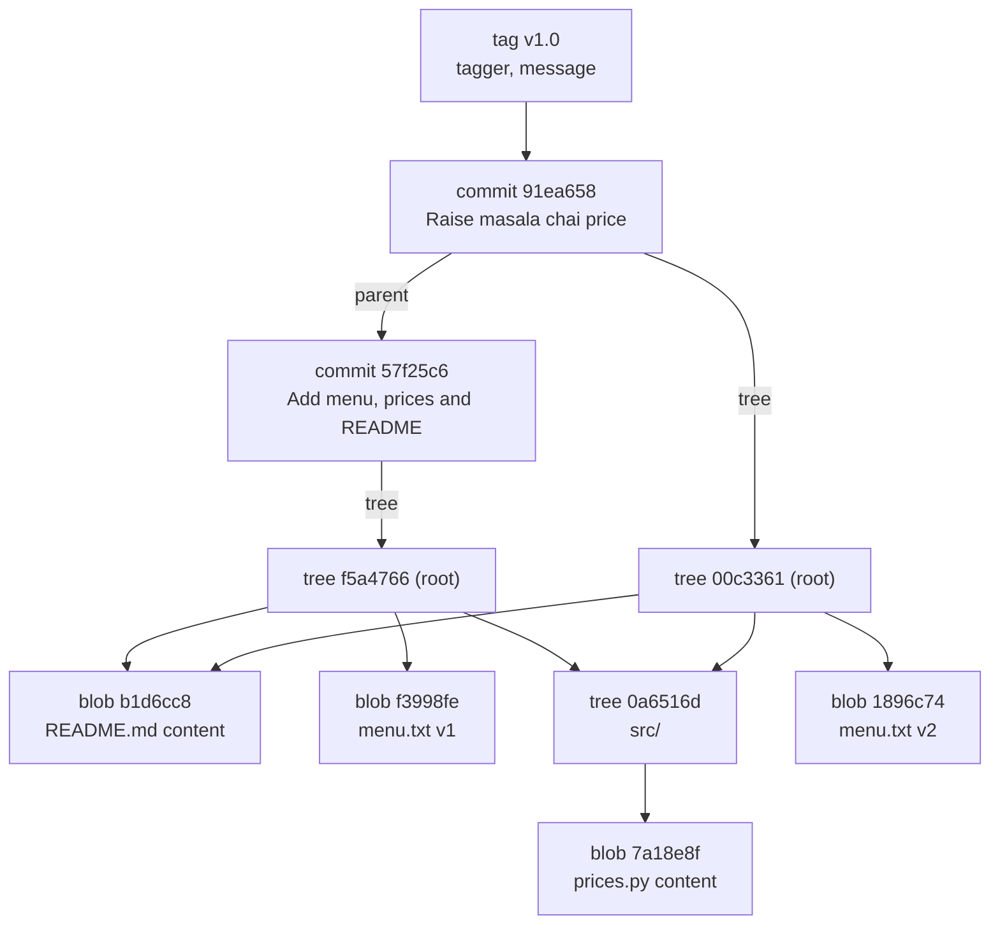

# Blobs, Trees, Commits and Tags: The Complete Guide

> 📚 **Before you start**
>
> - [The Three Areas: Working Tree, Staging and Repository](../02-version-control-from-scratch/the-three-areas-working-tree-staging-and-repository.md), for the `.git` folder and the index
> - [Reading History with log, show and diff](../02-version-control-from-scratch/reading-history-with-log-show-and-diff.md), for `HEAD~1` and `commit:path` names
> - [Lab: Put a project under version control](../02-version-control-from-scratch/lab-put-a-project-under-version-control.md)

## Introduction

Think of a library. Each **book** sits on a shelf with a catalogue number. A **shelf list** says which catalogue numbers are on which shelf, and shelf lists can point to sub-sections. Every evening the librarian writes a dated **register entry**: "Today the library looked like *this* master shelf list; yesterday's entry is on the previous page; signed, Asha." And for special occasions, a framed **plaque** on the wall says "Opening day collection: see register page 12."

That library is, almost exactly, how Git stores your project. Git has just **four kinds of object**:

- **Blobs**: the books, the contents of files.
- **Trees**: the shelf lists, which say which names map to which blobs and sub-trees.
- **Commits**: the register entries, a snapshot (one top tree) plus author, date, message and a link to the previous commit.
- **Tags**: the plaques, a permanent, annotated name for one object, usually a release commit.

Every command you've used so far (`add`, `commit`, `log`, `show`, `diff`) reads and writes these four objects. By the end of this article you'll be able to inspect each object type with `git cat-file` and `git ls-tree`, explain exactly what a commit contains, see why unchanged files cost nothing to store, and create and inspect both lightweight and annotated tags.

> 💡 **Key Insight**
>
> A commit doesn't store changes. It stores **one pointer to a tree** (the full snapshot), **pointers to its parent commits**, and some metadata. Trees point to blobs and other trees. Everything is identified by a hash of its content, so **identical content is stored once and shared** by every snapshot that contains it.

---

## Core Explanation

### 1. The Object Database

Everything Git stores lives in `.git/objects`, a **key-value store**: the key is a hash computed from the object's content (the next lesson explains exactly how), and the value is the compressed object. Every object has a **type** and a **size**. There are four types:

| Object | Stores | Points to |
|---|---|---|
| **blob** | The raw bytes of one file. No name, no permissions, no date | Nothing |
| **tree** | A list of entries: mode, type, hash, name | Blobs (files) and trees (sub-folders) |
| **commit** | Tree hash, parent hash(es), author, committer, message | One tree and zero or more parent commits |
| **tag** (annotated) | Target hash and type, tag name, tagger, message | Usually one commit |



Look closely at that diagram: the second commit's tree reuses the README blob and the entire `src/` tree from the first commit. Only `menu.txt` changed, so only one new blob and one new root tree were needed.

### 2. Your Tools: cat-file and ls-tree

Two commands let you look at any object:

| Command | Shows |
|---|---|
| `git cat-file -t <object>` | The object's type |
| `git cat-file -s <object>` | Its size in bytes |
| `git cat-file -p <object>` | Its content, pretty-printed |
| `git ls-tree <tree-ish> [path]` | The entries of a tree (`-r` recurses into sub-trees) |

You can name objects by hash or with the names from the history lesson: `HEAD`, `HEAD~1`, `v1.0`, `HEAD:menu.txt` (a file in a commit) and `HEAD^{tree}` (the tree of a commit).

Set up a small repository to explore, with a file in a sub-folder:

```bash
mkdir chai-ledger && cd chai-ledger && git init
printf 'Masala chai: 20\nGinger chai: 25\n' > menu.txt
mkdir src && printf 'PRICES = {"masala": 20, "ginger": 25}\n' > src/prices.py
printf '# Chai Ledger\n' > README.md
git add . && git commit -m "Add menu, prices and README"
```

### 3. Commits

```bash
git cat-file -t HEAD
git cat-file -p HEAD
```

Example output:

```
commit
tree f5a47664d9a9408c92856bd46cdef09cf16c59e2
author Asha Rao <asha@example.com> 1791171600 +0530
committer Asha Rao <asha@example.com> 1791171600 +0530

Add menu, prices and README
```

That's the **entire** commit object. Line by line:

- **`tree`**: the hash of the root tree, the full snapshot of the project.
- **`parent`**: missing here, because this is the first (root) commit. Normal commits have one parent line; merge commits have two or more.
- **`author`**: who wrote the change, with a timestamp in **seconds since 1 January 1970 UTC** (Unix time) and their time zone offset.
- **`committer`**: who created this commit object. Usually the same person, but different when someone applies another person's patch, or when a commit is rebased or amended.
- A blank line, then the **message**.

There's no list of changed files and no diff. When `git show` displays a diff, it computes it on the spot by comparing this commit's tree with its parent's tree.

### 4. Trees

Follow the `tree` line:

```bash
git cat-file -p HEAD^{tree}
```

Example output:

```
100644 blob b1d6cc8799be707e235bc9e7bbfd32e5484b7d5f	README.md
100644 blob f3998fe782971cacfe265d9e28f3c519f8233e62	menu.txt
040000 tree 0a6516db4cc97c48ca96578434502357338e658f	src
```

Each entry is **mode, type, hash, name**. The modes Git uses are few:

| Mode | Meaning |
|---|---|
| `100644` | Normal file |
| `100755` | Executable file |
| `120000` | Symbolic link |
| `040000` | Sub-tree (a folder) |
| `160000` | Submodule (a commit in another repository; [module 10](../course.md#m10)) |

Notice what's **not** there: timestamps, owners, and most permissions. Git tracks only whether a file is executable. It also doesn't track empty folders, because a tree only exists if it has entries.

`src` is a tree of its own. Look inside it directly, or list everything recursively:

```bash
git cat-file -p HEAD:src
git ls-tree -r HEAD
```

Example output:

```
100644 blob 7a18e8f637367a7e1432becd990c0225e460674d	prices.py
100644 blob b1d6cc8799be707e235bc9e7bbfd32e5484b7d5f	README.md
100644 blob f3998fe782971cacfe265d9e28f3c519f8233e62	menu.txt
100644 blob 7a18e8f637367a7e1432becd990c0225e460674d	src/prices.py
```

### 5. Blobs

```bash
git cat-file -t f3998fe
git cat-file -s f3998fe
git cat-file -p f3998fe
```

Example output:

```
blob
32
Masala chai: 20
Ginger chai: 25
```

A blob is just bytes: 32 of them here (two lines of 16 characters each, including the newlines). It has **no file name**. The name lives in the tree that points to it. This is why renaming a file creates no new blob, and why two files with identical content, anywhere in the project, anywhere in history, share **one** blob.

### 6. What a Second Commit Adds

Change one line and commit:

```bash
printf 'Masala chai: 22\nGinger chai: 25\n' > menu.txt
git commit -am "Raise masala chai price to 22"
git cat-file -p HEAD
```

Example output:

```
tree 00c3361d5b60eb18c70b857fa440ee021c40c592
parent 57f25c6594257b653bb6c75027f036ebefaa233a
author Asha Rao <asha@example.com> 1791175800 +0530
committer Asha Rao <asha@example.com> 1791175800 +0530

Raise masala chai price to 22
```

Now there's a `parent` line pointing at the first commit. Compare the two root trees:

```bash
git cat-file -p HEAD^{tree}
git cat-file -p HEAD~1^{tree}
```

Example output:

```
100644 blob b1d6cc8799be707e235bc9e7bbfd32e5484b7d5f	README.md
100644 blob 1896c74743f9597be16a9acadad11551f1a0d493	menu.txt
040000 tree 0a6516db4cc97c48ca96578434502357338e658f	src
100644 blob b1d6cc8799be707e235bc9e7bbfd32e5484b7d5f	README.md
100644 blob f3998fe782971cacfe265d9e28f3c519f8233e62	menu.txt
040000 tree 0a6516db4cc97c48ca96578434502357338e658f	src
```

`README.md` and `src` have the **same hashes** in both. Only `menu.txt` points to a new blob. Count the objects on disk:

```bash
find .git/objects -type f | sort
```

Example output:

```
.git/objects/00/c3361d5b60eb18c70b857fa440ee021c40c592
.git/objects/0a/6516db4cc97c48ca96578434502357338e658f
.git/objects/18/96c74743f9597be16a9acadad11551f1a0d493
.git/objects/57/f25c6594257b653bb6c75027f036ebefaa233a
.git/objects/7a/18e8f637367a7e1432becd990c0225e460674d
.git/objects/91/ea658f51601e03a0ce508d5126c8c329cff606
.git/objects/b1/d6cc8799be707e235bc9e7bbfd32e5484b7d5f
.git/objects/f3/998fe782971cacfe265d9e28f3c519f8233e62
.git/objects/f5/a47664d9a9408c92856bd46cdef09cf16c59e2
```

Nine objects: three blobs, two trees and one commit from the first snapshot (six), plus one new blob, one new root tree and one new commit (three). The `src` tree and two blobs were shared. Each object is stored in a folder named after the first two characters of its hash, with the remaining 38 characters as the file name. This is the "snapshots are cheap" promise from module 2, made visible.

### 7. Tags: Lightweight and Annotated

A **tag** gives a permanent, human-friendly name to a commit, typically a release. Unlike a branch, a tag isn't supposed to move. There are two kinds:

| | Lightweight tag | Annotated tag |
|---|---|---|
| **Created with** | `git tag v0.1` | `git tag -a v1.0 -m "message"` |
| **What it is** | Just a name pointing at a commit (a ref, next-but-one lesson) | A real **tag object** with tagger, date and message, plus a name pointing at it |
| **Can be signed?** | No | Yes (`-s`; [module 9](../course.md#m9)) |
| **Use for** | Private bookmarks | **Releases** and anything you share |

```bash
git tag v0.1-light HEAD~1
git tag -a v1.0 -m "First release for the Diwali menu"
git tag -n
```

Example output:

```
v0.1-light      Add menu, prices and README
v1.0            First release for the Diwali menu
```

(`-n` shows the tag message, or for a lightweight tag, the commit's subject.) Now ask what each name points to:

```bash
git cat-file -t v0.1-light
git cat-file -t v1.0
git cat-file -p v1.0
```

Example output:

```
commit
tag
object 91ea658f51601e03a0ce508d5126c8c329cff606
type commit
tag v1.0
tagger Asha Rao <asha@example.com> 1791178200 +0530

First release for the Diwali menu
```

The lightweight tag points **straight at a commit**. The annotated tag points at a **tag object**, which in turn points at the commit. Git "peels" a tag to the commit when it needs one, and you can do the same with `^{commit}`:

```bash
git rev-parse v1.0 v1.0^{commit}
```

Example output:

```
fdc6e3bcd326c88ed3c018ea1a8018016a23cfaf
91ea658f51601e03a0ce508d5126c8c329cff606
```

`git show` on an annotated tag prints the tag's details first, then the commit:

```bash
git show v1.0 --stat
```

Example output:

```
tag v1.0
Tagger: Asha Rao <asha@example.com>
Date:   Mon Oct 5 11:00:00 2026 +0530

First release for the Diwali menu

commit 91ea658f51601e03a0ce508d5126c8c329cff606
Author: Asha Rao <asha@example.com>
Date:   Mon Oct 5 10:20:00 2026 +0530

    Raise masala chai price to 22

 menu.txt | 2 +-
 1 file changed, 1 insertion(+), 1 deletion(-)
```

**More tag commands:**

| Command | Does |
|---|---|
| `git tag` / `git tag -l "v1*"` | List tags / list matching a pattern |
| `git tag -a v1.1 <commit> -m "..."` | Tag an older commit |
| `git tag -d v0.1-light` | Delete a local tag |
| `git push origin v1.0` / `git push origin --tags` | Share tags (they are **not** pushed by default; [module 5](../05-remotes-and-github-basics/clone-fetch-pull-and-push.md)) |
| `git describe` | Name the current commit relative to the nearest annotated tag |

`git describe` is handy for build version strings. On the tagged commit it prints the tag; one commit later it prints `tag-count-g<hash>`:

```bash
git describe
```

Example output:

```
v1.0-1-g4af2aff
```

Read it as "1 commit after `v1.0`, at commit `4af2aff`" (the `g` stands for Git). By default `describe` only considers annotated tags; `--tags` includes lightweight ones too.

### 8. Seeing Every Object at Once

`--batch-all-objects` lists everything in the database with type and size:

```bash
git cat-file --batch-check --batch-all-objects
```

Example output:

```
00c3361d5b60eb18c70b857fa440ee021c40c592 tree 103
0a6516db4cc97c48ca96578434502357338e658f tree 37
1896c74743f9597be16a9acadad11551f1a0d493 blob 32
48daf23ea743ba6c4b151ebc74ff19eea83c4bce tree 140
4af2affd066f2119d9a8da1a279151beebc3a0c6 commit 212
57f25c6594257b653bb6c75027f036ebefaa233a commit 182
587be6b4c3f93f93c489c0111bba5596147a26cb blob 2
7a18e8f637367a7e1432becd990c0225e460674d blob 38
91ea658f51601e03a0ce508d5126c8c329cff606 commit 232
b1d6cc8799be707e235bc9e7bbfd32e5484b7d5f blob 14
f3998fe782971cacfe265d9e28f3c519f8233e62 blob 32
f5a47664d9a9408c92856bd46cdef09cf16c59e2 tree 103
fdc6e3bcd326c88ed3c018ea1a8018016a23cfaf tag 156
```

(This includes a third commit, `4af2aff`, which added a small `notes.txt`.) Thirteen objects describe the whole history: five blobs (including the 2-byte `notes.txt`), four trees, three commits and one tag object. Everything else Git shows you is computed from these.

### 9. Porcelain and Plumbing

Git's commands come in two layers:

- **Porcelain**: the friendly, everyday commands (`add`, `commit`, `log`, `switch`, `merge`). Their output can change between versions to be more helpful.
- **Plumbing**: low-level commands that do one precise thing on objects and refs (`cat-file`, `ls-tree`, `hash-object`, `write-tree`, `commit-tree`, `update-ref`, `rev-parse`). Their output is stable, so scripts use them.

Every porcelain command is built from plumbing steps. In the [lab at the end of this module](lab-explore-the-git-folder-by-hand.md) you'll make commits using only plumbing.

---

## Try It Yourself

1. **Walk the graph.** In any repository, start from `git cat-file -p HEAD` and follow hashes by hand (commit to tree to blob) until you print the content of one file. Then do the same in one step with `git cat-file -p HEAD:<path>`.
2. **Prove sharing.** Make a commit that changes one file in a project with three files. Which hashes in `git cat-file -p HEAD^{tree}` match those in `HEAD~1^{tree}`?
3. **Duplicate files.** Create two files with exactly the same content in different folders and commit. How many new blobs appear in `git cat-file --batch-check --batch-all-objects`?
4. **Tags.** Create a lightweight tag and an annotated tag on the same commit. What does `git cat-file -t` print for each, and why?

<details>
<summary>Show answers</summary>

1. `cat-file -p HEAD` gives the tree hash; `cat-file -p <tree>` lists entries; for a file in a sub-folder, follow the `tree` entry; finally `cat-file -p <blob>` prints the content.
2. Every unchanged file and every folder with no changes inside keeps the same hash. Only the changed file's blob, the trees on the path to it, and the commit are new.
3. One. Blobs are identified by content alone, so both tree entries point at the same blob.
4. The lightweight tag prints `commit` because the name points directly at the commit. The annotated tag prints `tag` because the name points at a tag object, which points at the commit.

</details>

---

## Real-World Examples

### Example 1: Why Huge Repos Stay Manageable

A repository with 100,000 files and 50,000 commits doesn't store 5 billion file copies. Each commit only adds blobs for the files that actually changed and trees along their paths; everything else is shared. Packfiles (next lesson) then compress similar blobs against each other.

### Example 2: Release Tags in CI

Most teams create an annotated tag like `v2.3.0` for each release. CI pipelines trigger on tag pushes to build and publish packages, and `git describe` stamps development builds with strings like `v2.3.0-14-g5e3a1c2`, so a crash report tells you exactly which commit was running ([module 8](../course.md#m8) covers releases on GitHub).

### Example 3: Explaining "Git Is a Content-Addressed Filesystem"

Engineers who know the object model can reason about strange situations directly: why a renamed file shows as a delete plus an add in some tools, why an empty folder vanished after cloning, or why changing a file's permission bit (`chmod +x`) shows up as a change even though no content changed (the tree's mode changed).

---

## Common Misconceptions

### Misconception 1: "Each commit stores a diff"

A commit stores a pointer to a full tree. Diffs are computed when you ask for them. (Packfiles do store some objects as deltas internally, but that's a storage optimisation invisible to the object model.)

### Misconception 2: "A blob knows its file name"

Names live in trees. The same blob can appear under different names in different trees.

### Misconception 3: "Tags are just branches that don't move"

Lightweight tags are close to that, but annotated tags are real objects with their own author, date and message, and they can be cryptographically signed. Use annotated tags for releases.

### Misconception 4: "Git tracks folders"

Git tracks files; folders exist only as trees that contain something. That's why people add a placeholder like `.gitkeep` to keep an empty folder.

---

## Interview Relevance

"How does Git store data internally?" is a favourite question for mid-level and senior roles. A strong answer covers:

- **The four object types** and what each points to.
- **Snapshots via trees**, with unchanged content shared by hash.
- **What's in a commit**: tree, parents, author, committer, message; no diff.
- **Author vs committer**, and why they can differ.
- **Lightweight vs annotated tags**, and why releases use annotated (and often signed) tags.
- **Porcelain vs plumbing**, with examples like `cat-file` and `ls-tree`.

---

## Key Takeaways

- Git's database holds **four object types: blob, tree, commit and tag**.
- **Blobs** are file contents without names; **trees** map names and modes to blobs and sub-trees.
- A **commit** is a tree pointer, parent pointer(s), author, committer and message. **No diffs are stored.**
- Identical content is stored **once** and shared across files and commits.
- **Annotated tags** are real objects (tagger, message, optional signature); **lightweight tags** are bare names.
- Inspect anything with **`git cat-file -t/-s/-p`** and **`git ls-tree`**.

---

**Up next:** [Hashes and Content Addressing](hashes-and-content-addressing.md)
