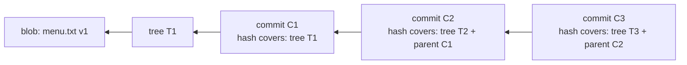

# Hashes and Content Addressing: The Complete Guide

> 📚 **Before you start**
>
> - [Blobs, Trees, Commits and Tags](blobs-trees-commits-and-tags.md), for the four object types and `git cat-file`
> - [Python Fundamentals](../../python-fundamentals/course.md) (optional), to follow the Python examples

## Introduction

Every Aadhaar card has a 12-digit number, and every UPI transaction gets a reference number. Those IDs are **assigned**: some system hands out the next number. Now imagine a different kind of ID: one you could **compute from the thing itself**. Give two people the same document, ask them each to compute its ID, and they get the same answer without talking to each other. Change a single comma and the ID becomes completely different.

That's how Git names everything. The `f3998fe...` strings you've been seeing aren't serial numbers. Each one is a **hash**: a fingerprint calculated from the object's exact content. This one design decision gives Git deduplication, tamper detection, cheap comparisons and easy syncing between machines, all for free.

By the end of this article you'll be able to compute a Git object hash yourself (with `git hash-object` and with ten lines of Python), explain why changing one old file changes every commit hash after it, read how objects are stored on disk and in packfiles, use short hashes safely, and explain Git's move from SHA-1 to SHA-256.

> 💡 **Key Insight**
>
> In Git, **an object's name is the hash of its content**. Same content, same name, on every computer in the world; different content, different name. Because commits contain the hash of their tree and their parent, a commit hash fingerprints **the entire history** behind it. You can't change anything in the past without every later hash changing too.

---

## Core Explanation

### 1. What a Hash Function Is

A **cryptographic hash function** takes input of any size and produces a fixed-size output (a **digest**) with these properties:

- **Deterministic**: the same input always gives the same output.
- **Avalanche effect**: a tiny change in the input changes the output completely.
- **One-way**: you can't work backwards from the digest to the input.
- **Collision-resistant**: it should be practically impossible to find two different inputs with the same digest.

Git has always used **SHA-1**, which produces 160 bits, written as **40 hexadecimal characters**. Newer repositories can use **SHA-256** (256 bits, 64 characters), covered in section 8.

### 2. Hashing a Blob with git hash-object

`git hash-object` computes the hash Git would give some content, without storing it (add `-w` to store it):

```bash
printf 'hello\n' | git hash-object --stdin
```

Example output:

```
ce013625030ba8dba906f756967f9e9ca394464a
```

Run that on any computer with Git and you'll get exactly the same 40 characters. But it's **not** simply the SHA-1 of `hello\n`. Git first prepends a small **header**: the object type, a space, the content length in bytes, and a zero byte (`\0`). You can reproduce it with the standard `sha1sum` tool:

```bash
printf 'blob 6\0hello\n' | sha1sum
```

Example output:

```
ce013625030ba8dba906f756967f9e9ca394464a  -
```

Identical. So a Git object ID is simply:

```
SHA-1( "<type> <size>\0" + content )
```

### 3. Computing Git Hashes in Python

The same formula in Python, using the standard `hashlib` module:

```python
import hashlib

def git_hash(obj_type, content, algo="sha1"):
    """Return the Git object ID for raw content of the given type."""
    header = f"{obj_type} {len(content)}\0".encode()
    return hashlib.new(algo, header + content).hexdigest()

print(git_hash("blob", b"hello\n"))
```

Output:

```
ce013625030ba8dba906f756967f9e9ca394464a
```

The two versions of `menu.txt` from the previous lesson give exactly the blob hashes Git showed there, `f3998fe...` and `1896c74...`. And the avalanche effect is easy to see: changing `20` to `22` changes every character of the hash.

```python
print(git_hash("blob", b"Masala chai: 20\nGinger chai: 25\n"))
print(git_hash("blob", b"Masala chai: 22\nGinger chai: 25\n"))
```

Output:

```
f3998fe782971cacfe265d9e28f3c519f8233e62
1896c74743f9597be16a9acadad11551f1a0d493
```

Check it in a terminal: `git hash-object menu.txt` on a file with that content prints the same ID, and so does `git rev-parse HEAD:menu.txt` for the committed version.

### 4. Trees and Commits Are Hashed the Same Way

Trees and commits are just objects with a specific text or binary layout, hashed with the same formula. A **tree's** content is a sequence of entries, each `<mode> <name>\0` followed by the **20 raw bytes** of the entry's hash (not the 40-character text form), sorted by name. Let's rebuild the first commit of the `chai-ledger` repository from the previous lesson entirely in Python:

```python
readme = git_hash("blob", b"# Chai Ledger\n")
menu = git_hash("blob", b"Masala chai: 20\nGinger chai: 25\n")
prices = git_hash("blob", b'PRICES = {"masala": 20, "ginger": 25}\n')

def tree_hash(entries):
    """entries: list of (mode, name, hex hash). Git sorts them by name."""
    body = b""
    for mode, name, hexsha in sorted(entries, key=lambda e: e[1]):
        body += f"{mode} {name}\0".encode() + bytes.fromhex(hexsha)
    return git_hash("tree", body)

src = tree_hash([("100644", "prices.py", prices)])
root = tree_hash([("100644", "README.md", readme),
                  ("100644", "menu.txt", menu),
                  ("40000", "src", src)])
print("src tree: ", src)
print("root tree:", root)
```

Output:

```
src tree:  0a6516db4cc97c48ca96578434502357338e658f
root tree: f5a47664d9a9408c92856bd46cdef09cf16c59e2
```

Both match what `git cat-file -p HEAD^{tree}` showed. (Inside the stored tree, the folder mode is written `40000`; `cat-file` pads it to `040000` for display. Git also sorts a folder as if its name ended in `/`, which only matters when names like `src` and `src.txt` sit side by side.)

A **commit's** content is exactly the text `git cat-file -p` prints:

```python
commit_text = (
    f"tree {root}\n"
    "author Asha Rao <asha@example.com> 1791171600 +0530\n"
    "committer Asha Rao <asha@example.com> 1791171600 +0530\n"
    "\n"
    "Add menu, prices and README\n"
)
print(git_hash("commit", commit_text.encode()))
```

Output:

```
57f25c6594257b653bb6c75027f036ebefaa233a
```

That's the commit hash Git gave the real commit. A commit ID is fully determined by: the snapshot (tree), the parents, the author and committer names, emails and timestamps, and the message. This is also why **your hashes never match the ones in these lessons**: your name, email and timestamps differ.

### 5. The Chain: Why History Is Tamper-Evident

Because each commit contains its parent's hash, and each tree contains its children's hashes, the whole history forms a **Merkle tree** (more precisely, a Merkle DAG: a graph where every node's ID is a hash covering everything below it).



Change one byte in an old blob and:

1. the blob's hash changes, so
2. the tree containing it changes, so
3. that commit's hash changes, so
4. its child's `parent` line changes, so the child's hash changes...

...and so on up to the newest commit. That has big consequences:

- **Integrity**: if anything in the database is corrupted, the stored content no longer matches its name. `git fsck` checks every object this way.
- **Trust**: if you know one commit hash is good (say, from a signed release tag), you've verified the entire history behind it.
- **Rewriting creates new commits**: `--amend`, `rebase` and history clean-up tools can't edit commits in place. They create new commits with new hashes. That's why rewriting *shared* history is disruptive: other people still have the old hashes.
- **Cheap comparisons**: if two trees have the same hash, the whole folders are identical, and Git can skip them without looking inside. This is a big part of why `git diff` and `git status` are fast.
- **Easy syncing**: when two repositories exchange data (`fetch`, `push`), they compare hashes ("I have these commits, what do you have?") and send only missing objects.

### 6. How Objects Are Stored on Disk

**Loose objects.** A freshly written object is a single file under `.git/objects/`. The first two hex characters of the hash become a folder name and the other 38 the file name, which keeps any one folder from holding millions of files. The file content is the header plus content, compressed with **zlib**:

```python
import zlib

raw = b"blob 16\0Masala chai: 20\n"     # exactly what Git hashes
stored = zlib.compress(raw)              # roughly what Git writes to disk
print(len(raw), "bytes before,", len(stored), "bytes after compression")

header, _, body = zlib.decompress(stored).partition(b"\0")
print(header, body)
print(hashlib.sha1(raw).hexdigest())
```

Output:

```
24 bytes before, 32 bytes after compression
b'blob 16' b'Masala chai: 20\n'
5372231a7456b8b9d3fd5d7a77204df01a9102e5
```

(Tiny files grow slightly when compressed because zlib adds its own header; real source files shrink a lot.) In a repository where you've stored that blob, you can read the actual file the same way: `zlib.decompress(open('.git/objects/53/72231a7456b8b9d3fd5d7a77204df01a9102e5', 'rb').read())`. You'll do exactly that in the lab.

**Packfiles.** Thousands of small loose files are slow and wasteful, so Git periodically **packs** objects into a single `.pack` file with an `.idx` index. Inside a pack, an object can be stored as a **delta**: "take this other object and apply these changes", which is how ten slightly different versions of a big file end up taking little more space than one. Packing happens automatically (`git gc` runs in the background after some commands) and whenever objects are sent over the network.

```bash
git gc
find .git/objects -type f | sort
```

Example output:

```
.git/objects/info/commit-graph
.git/objects/info/packs
.git/objects/pack/pack-e5467218ae8263a81a49893b120ff14a74ca570f.idx
.git/objects/pack/pack-e5467218ae8263a81a49893b120ff14a74ca570f.pack
.git/objects/pack/pack-e5467218ae8263a81a49893b120ff14a74ca570f.rev
```

All the loose objects are gone, packed into one file. `git verify-pack -v` lists what's inside (columns: hash, type, size, size in pack, offset, and for deltas the chain depth and base object):

```bash
git verify-pack -v .git/objects/pack/pack-*.idx
```

Example output:

```
4af2affd066f2119d9a8da1a279151beebc3a0c6 commit 212 148 12
91ea658f51601e03a0ce508d5126c8c329cff606 commit 232 160 160
fdc6e3bcd326c88ed3c018ea1a8018016a23cfaf tag    156 142 320
57f25c6594257b653bb6c75027f036ebefaa233a commit 182 136 462
48daf23ea743ba6c4b151ebc74ff19eea83c4bce tree   140 141 598
0a6516db4cc97c48ca96578434502357338e658f tree   37 47 739
00c3361d5b60eb18c70b857fa440ee021c40c592 tree   8 19 786 1 48daf23ea743ba6c4b151ebc74ff19eea83c4bce
f5a47664d9a9408c92856bd46cdef09cf16c59e2 tree   103 110 805
b1d6cc8799be707e235bc9e7bbfd32e5484b7d5f blob   14 23 915
1896c74743f9597be16a9acadad11551f1a0d493 blob   32 35 938
587be6b4c3f93f93c489c0111bba5596147a26cb blob   2 11 973
7a18e8f637367a7e1432becd990c0225e460674d blob   38 45 984
f3998fe782971cacfe265d9e28f3c519f8233e62 blob   32 35 1029
non delta: 12 objects
chain length = 1: 1 object
.git/objects/pack/pack-e5467218ae8263a81a49893b120ff14a74ca570f.pack: ok
```

Tree `00c3361` is stored as an 8-byte delta against tree `48daf23`. Packing never changes any object's **hash**: hashes are always computed on the uncompressed, undeltified content. `git count-objects -vH` summarises loose versus packed storage. The `commit-graph` file is an extra index that speeds up walking history in big repositories.

### 7. Short Hashes

You rarely type 40 characters. Git accepts any **unique prefix** of at least 4 characters, and shows abbreviated hashes (7 characters by default in small repositories, growing automatically as the repository gets bigger):

```bash
git rev-parse --short HEAD
git rev-parse --short=12 HEAD
```

Example output:

```
4af2aff
4af2affd066f
```

If a prefix is ambiguous, Git refuses and lists the candidates; if it matches nothing, you get `fatal: Not a valid object name`. How long until 7 characters stop being unique? By the "birthday" rule, collisions in a space of N values become likely after about √(2N·ln 2) items:

```python
import math

for hex_digits in (4, 7, 12):
    space = 16 ** hex_digits
    likely_collision_after = math.sqrt(2 * space * math.log(2))
    print(f"{hex_digits:>2} hex digits: 50% chance of a clash after ~{likely_collision_after:,.0f} objects")
```

Output:

```
 4 hex digits: 50% chance of a clash after ~301 objects
 7 hex digits: 50% chance of a clash after ~19,291 objects
12 hex digits: 50% chance of a clash after ~19,753,662 objects
```

That's why large projects show longer abbreviations, and why **scripts, documentation and anything permanent should use full hashes**. A short hash that's unique today may be ambiguous next year.

### 8. SHA-1, SHAttered and SHA-256

In 2017, researchers published **SHAttered**, the first practical SHA-1 collision: two different PDF files with the same SHA-1. Producing it took an enormous amount of computation, and later attacks made it cheaper. For Git, a collision could in theory let an attacker swap content without changing hashes. The response came in two parts:

- **Hardened SHA-1.** Since 2017, Git uses a SHA-1 implementation with **collision detection**: it recognises the patterns these attacks need and refuses such input. In practice this blocks the known attacks.
- **SHA-256 repositories.** Git can create repositories that use SHA-256 for every object:

```bash
git init --object-format=sha256 sha-demo
cd sha-demo
printf 'hello\n' | git hash-object --stdin
git rev-parse --show-object-format
```

Example output:

```
2cf8d83d9ee29543b34a87727421fdecb7e3f3a183d337639025de576db9ebb4
sha256
```

Same formula, different algorithm. Our Python function gives the same result with `algo="sha256"`:

```python
print(git_hash("blob", b"hello\n", algo="sha256"))
```

Output:

```
2cf8d83d9ee29543b34a87727421fdecb7e3f3a183d337639025de576db9ebb4
```

The catch is compatibility: a SHA-1 repository and a SHA-256 repository can't exchange objects directly, and hosting service support has lagged behind Git itself. The Git project is building interoperability between the two formats and plans to make SHA-256 the default for new repositories in Git 3.0. For now, most repositories (including almost everything on GitHub) are SHA-1, and that's what this course uses. If you start a SHA-256 repository, check that your hosting service supports it first.

---

## Try It Yourself

1. **Predict a hash.** Using only `printf` and `sha1sum` (or the Python function), compute the blob hash for a file containing `Ginger chai: 25` followed by a newline. Check it with `git hash-object`.
2. **Find the avalanche.** Hash `hello\n` and `Hello\n`. How many of the 40 characters match?
3. **Same content, different name.** Create `a.txt` and `b.txt` with identical content. Without committing, what does `git hash-object a.txt b.txt` print?
4. **Rewrite and watch.** In a practice repository with three commits, amend the **middle** commit's message using any method you like (or simply note what would happen). Which commit hashes change?

<details>
<summary>Show answers</summary>

1. The content is 16 bytes, so the header is `blob 16\0`: `printf 'blob 16\0Ginger chai: 25\n' | sha1sum` and `printf 'Ginger chai: 25\n' | git hash-object --stdin` print the same hash.
2. Typically almost none: on average about 2 or 3 of 40 positions match by pure chance (each position has a 1 in 16 chance).
3. The same hash twice. The name isn't part of a blob.
4. The middle commit and every commit after it (here, the newest). The first commit keeps its hash because nothing in it changed. In practice you'd use interactive rebase ([module 4](../course.md#m4)) to do this.

</details>

```python
# Answers 1 and 3, checked in Python
print(git_hash("blob", b"Ginger chai: 25\n"))
print(git_hash("blob", b"same\n") == git_hash("blob", b"same\n"))
```

Output:

```
c81e4580add8ecf3298c8b9c05b7b07779229347
True
```

---

## Real-World Examples

### Example 1: Verifying a Release

A security-conscious team publishes signed annotated tags. A user who verifies the signature on `v3.1.0` has, through the hash chain, verified every file in that release and every commit behind it. Nobody can quietly alter an old commit without breaking the chain.

### Example 2: Fast Clones and Fetches

When you run `git fetch`, your Git and the server compare commit hashes to find what you're missing, then the server builds a pack containing only those objects, delta-compressed. Even huge repositories fetch quickly after the first clone because hashes make "what's new?" a cheap question.

### Example 3: Disk Corruption Caught Early

A developer's laptop SSD starts failing. Git reports `error: inflate: data stream error` and `git fsck` names the corrupted objects, because their content no longer matches their hash. Since every clone is complete, they re-clone from the server and lose nothing that was pushed.

---

## Common Misconceptions

### Misconception 1: "Commit hashes are random IDs"

They're computed deterministically from content, parents, people, timestamps and message. Recreate all of those exactly and you recreate the same hash, as the Python example did.

### Misconception 2: "Git hashes the file name with the content"

Blob hashes depend only on content (plus the `blob <size>` header). Names live in trees, so they affect the tree hash, not the blob hash.

### Misconception 3: "SHA-1 is broken, so Git is insecure"

Git uses collision-detecting SHA-1 that rejects the known attack patterns, and supports SHA-256 repositories. For most threats, protecting your accounts, keys and signing your releases matters far more.

### Misconception 4: "Packing changes hashes"

Compression and deltas are storage details. An object's ID is always the hash of its full, uncompressed content.

---

## Interview Relevance

"What is a commit hash and how is it computed?" and "Why can't you edit a commit?" are common follow-ups to the internals question. A strong answer covers:

- **The formula**: hash of `"<type> <size>\0" + content`, SHA-1 by default, SHA-256 optional.
- **Content addressing**: deduplication, integrity checks, cheap comparisons, efficient sync.
- **The Merkle chain**: a commit hash covers its tree and parents, so changing history changes every later hash; rewriting creates new commits.
- **Storage**: zlib-compressed loose objects, packfiles with deltas, `git gc`.
- **Short hashes** and why permanent references should use full hashes.
- **SHA-1 security**: SHAttered, hardened SHA-1, the SHA-256 transition.

---

## Key Takeaways

- Every object's ID is **SHA-1 of `"<type> <size>\0"` plus its content**; same content gives the same ID everywhere.
- Commits include their tree and parent hashes, so **one commit hash fingerprints all history** behind it.
- **Rewriting history creates new commits** with new hashes; that's why shared history shouldn't be rewritten.
- Objects are stored **zlib-compressed**, first as loose files, then in **packfiles** with deltas; hashes never change.
- Use **short hashes** interactively, **full hashes** in anything permanent.
- Git uses **collision-detecting SHA-1** today and supports **SHA-256** repositories, with interoperability work under way.

---

**Up next:** [Refs, HEAD and Detached HEAD](refs-head-and-detached-head.md)
