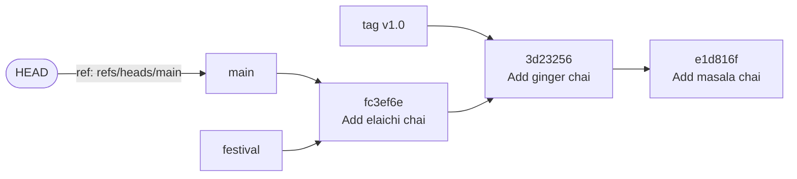
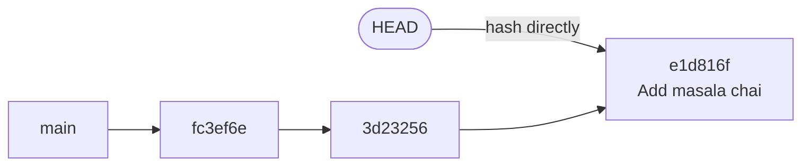
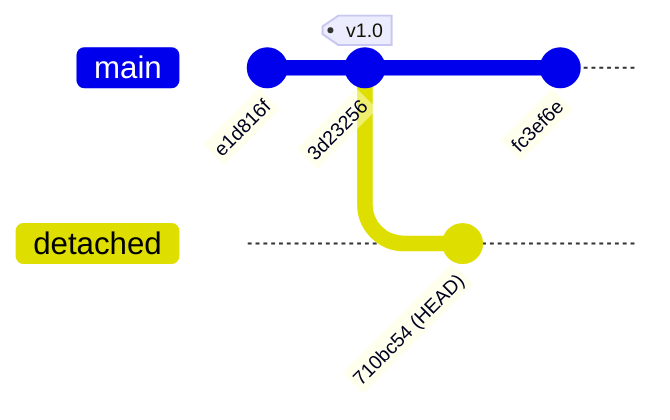

# Refs, HEAD and Detached HEAD: The Complete Guide

> 📚 **Before you start**
>
> - [Blobs, Trees, Commits and Tags](blobs-trees-commits-and-tags.md)
> - [Hashes and Content Addressing](hashes-and-content-addressing.md), for why commits are named by hashes
> - [Reading History with log, show and diff](../02-version-control-from-scratch/reading-history-with-log-show-and-diff.md), for `HEAD~1` and `^`

## Introduction

Nobody tells a friend "come to 19.0760° N, 72.8777° E". You say "come to my place" or "meet at the station". Those names point to a location, and some of them move: "my place" changes when you shift house, while "Mumbai CST" stays put.

Git has the same problem with hashes. Nobody wants to remember `fc3ef6e5155c485b7f92e2dd91bf47e2d83516f1`. So Git keeps **refs**: human-friendly names that point to commits. `main` is a ref. `v1.0` is a ref. `origin/main` is a ref. And there's one very special name, **`HEAD`**, which answers the question "where am I right now?"

This lesson explains exactly what refs are (they're astonishingly simple), how `HEAD` works, and what the famous **detached HEAD** state really means. Many developers panic at that phrase. By the end you'll know it's a normal, useful state, how to get into it on purpose, how to get out, and how to rescue commits you made while in it.

> 💡 **Key Insight**
>
> A **ref** is just a file containing a commit hash. A **branch** is a ref that moves forward automatically when you commit. **`HEAD`** normally doesn't hold a hash at all: it holds the **name of the current branch** (`ref: refs/heads/main`). "Detached HEAD" simply means `HEAD` holds a **hash directly** instead of a branch name, so new commits don't move any branch.

---

## Core Explanation

### 1. A Ref Is a File with a Hash in It

Make a repository with three commits and look inside `.git`:

```bash
git log --oneline --decorate
cat .git/refs/heads/main
```

Example output:

```
fc3ef6e (HEAD -> main) Add elaichi chai
3d23256 Add ginger chai
e1d816f Add masala chai
fc3ef6e5155c485b7f92e2dd91bf47e2d83516f1
```

That's the whole branch: a 41-byte file (40 hex characters and a newline) at `.git/refs/heads/main`. When you commit on `main`, Git writes the new commit and then overwrites this file with the new hash. Creating a branch just writes another such file:

```bash
git branch festival
cat .git/refs/heads/festival
```

Example output:

```
fc3ef6e5155c485b7f92e2dd91bf47e2d83516f1
```

This is why branches in Git are instant and free, no matter how big the project is. Module 4 builds everything on this fact.

### 2. The Ref Namespaces

Refs are organised in folders under `.git/refs/`:

| Ref name | Kind | Moves? |
|---|---|---|
| `refs/heads/main` | Local **branch** | Yes, forward on every commit on that branch |
| `refs/tags/v1.0` | **Tag** | No, it's meant to be permanent |
| `refs/remotes/origin/main` | **Remote-tracking branch**: your copy of where `main` was on the remote `origin` at the last fetch | Only when you fetch or push ([module 5](../05-remotes-and-github-basics/clone-fetch-pull-and-push.md)) |
| `refs/stash` | The **stash** (module 4) | When you stash |
| `refs/notes/...`, `refs/pull/...` | Notes; GitHub's pull request refs on the server | Varies |

You usually type the short name (`main`, `v1.0`, `origin/main`), and Git searches the namespaces in a fixed order to find it. Plumbing commands show the full names:

```bash
git tag v1.0 HEAD~1
git show-ref
```

Example output:

```
fc3ef6e5155c485b7f92e2dd91bf47e2d83516f1 refs/heads/festival
fc3ef6e5155c485b7f92e2dd91bf47e2d83516f1 refs/heads/main
3d23256964774100abee2db39e599e7a09b2e296 refs/tags/v1.0
```

`git for-each-ref` is the scriptable way to list refs with any fields you want:

```bash
git for-each-ref --format="%(refname) %(objectname:short) %(objecttype)"
```

Example output:

```
refs/heads/festival fc3ef6e commit
refs/heads/main fc3ef6e commit
refs/tags/v1.0 3d23256 commit
```

**Packed refs.** A repository with thousands of tags would have thousands of tiny files. Git can pack them into one file, `.git/packed-refs`, and does so during `git gc`:

```bash
git pack-refs --all
cat .git/packed-refs
```

Example output:

```
# pack-refs with: peeled fully-peeled sorted 
fc3ef6e5155c485b7f92e2dd91bf47e2d83516f1 refs/heads/festival
fc3ef6e5155c485b7f92e2dd91bf47e2d83516f1 refs/heads/main
3d23256964774100abee2db39e599e7a09b2e296 refs/tags/v1.0
```

After this, `.git/refs/heads/main` doesn't exist as a file any more, but `main` works exactly as before. When a ref changes, Git writes a fresh loose file that takes priority over the packed entry. The lesson: **don't read or edit ref files directly in scripts**. Use `git rev-parse`, `git show-ref`, `git for-each-ref` and `git update-ref`, which understand every storage format.

That advice matters more now because Git has a newer ref storage backend, **reftable** (added in Git 2.45), which keeps all refs in a compact binary table instead of files. It's much faster for repositories with huge numbers of refs. You can choose it with `git init --ref-format=reftable`, and the Git project plans to make it the default in Git 3.0. With reftable, there's no `.git/refs/heads/main` file to `cat` at all, but every command in this lesson behaves the same.

### 3. HEAD: "You Are Here"

```bash
cat .git/HEAD
git symbolic-ref HEAD
```

Example output:

```
ref: refs/heads/main
refs/heads/main
```

`HEAD` is a **symbolic ref**: instead of a hash, it contains the name of another ref. Asking for `HEAD` follows the pointer to `main`, then to the commit:

```bash
git rev-parse HEAD main refs/heads/main
```

Example output:

```
fc3ef6e5155c485b7f92e2dd91bf47e2d83516f1
fc3ef6e5155c485b7f92e2dd91bf47e2d83516f1
fc3ef6e5155c485b7f92e2dd91bf47e2d83516f1
```

Switching branches rewrites `HEAD` (and updates your working tree and index to match the new commit):

```bash
git switch festival
cat .git/HEAD
```

Example output:

```
Switched to branch 'festival'
ref: refs/heads/festival
```



**What happens on commit**: Git creates the commit with the current `HEAD` commit as parent, then updates **the branch `HEAD` points to**. `HEAD` itself still says `ref: refs/heads/main`; it moves along because `main` moved.

Useful shorthands: `@` alone means `HEAD`, and `git rev-parse --abbrev-ref HEAD` prints the current branch name (handy in scripts and shell prompts):

```bash
git rev-parse --abbrev-ref HEAD
```

Example output:

```
main
```

### 4. Detached HEAD

If you switch to something that **isn't a local branch** (a commit hash, a tag, a remote-tracking branch, `HEAD~2`), Git can't point `HEAD` at a branch, so it writes the commit hash straight into `HEAD`. That's a **detached HEAD**:

```bash
git switch --detach HEAD~2
git status
cat .git/HEAD
```

Example output:

```
HEAD is now at e1d816f Add masala chai
HEAD detached at e1d816f
nothing to commit, working tree clean
e1d816f2040cc23a3a7962cd3624bf472df8e7a1
```



`git switch` insists on `--detach` so you can't detach by accident. The older `git checkout` will detach without asking, and prints a long explanation when it does:

```bash
git checkout HEAD~1
```

Example output:

```
Note: switching to 'HEAD~1'.

You are in 'detached HEAD' state. You can look around, make experimental
changes and commit them, and you can discard any commits you make in this
state without impacting any branches by switching back to a branch.

If you want to create a new branch to retain commits you create, you may
do so (now or later) by using -c with the switch command. Example:

  git switch -c <new-branch-name>

Or undo this operation with:

  git switch -

Turn off this advice by setting config variable advice.detachedHead to false

HEAD is now at 3d23256 Add ginger chai
```

That message says it all. Detached HEAD is **useful** for:

- **Looking at an old version**: check out a tag to build or test exactly what was released.
- **Bisecting**: `git bisect` (module 4) moves a detached HEAD through history to find a bad commit.
- **Quick experiments** you might throw away.
- **CI systems**, which usually check out a specific commit hash, so builds always run in detached HEAD.

### 5. Committing in Detached HEAD, and Rescuing the Work

You can commit while detached. Each new commit moves `HEAD` forward, but **no branch** follows:

```bash
git checkout v1.0
echo "Kulhad chai: 30" >> menu.txt
git commit -am "Try kulhad chai"
git log --oneline --decorate -2
```

Example output:

```
Previous HEAD position was e1d816f Add masala chai
HEAD is now at 3d23256 Add ginger chai
[detached HEAD 710bc54] Try kulhad chai
 1 file changed, 1 insertion(+)
710bc54 (HEAD) Try kulhad chai
3d23256 (tag: v1.0) Add ginger chai
```



(The diagram calls the detached line `detached` because gitGraph needs a name; in Git it has **no** name.) Now switch back to `main`. Git warns you that a commit is about to be left behind:

```bash
git switch main
```

Example output:

```
Warning: you are leaving 1 commit behind, not connected to
any of your branches:

  710bc54 Try kulhad chai

If you want to keep it by creating a new branch, this may be a good time
to do so with:

 git branch <new-branch-name> 710bc54

Switched to branch 'main'
```

The commit isn't deleted. It still exists in the object database; it's just not reachable from any ref, so `git log --all` no longer shows it. Three ways to rescue it:

| Situation | Command |
|---|---|
| **Still detached**, want to keep the work | `git switch -c <new-branch>` creates a branch right where you are |
| **Already switched away**, and you saw the hash in the warning | `git branch <new-branch> 710bc54` |
| **Already switched away**, hash lost | Find it with `git reflog` (next lesson), then `git branch <name> <hash>` |

```bash
git reflog -5
git branch kulhad-experiment HEAD@{1}
git log --oneline --decorate --all
```

Example output:

```
fc3ef6e HEAD@{0}: checkout: moving from 710bc54f1569388fc516c605cec0a00d6899db8e to main
710bc54 HEAD@{1}: commit: Try kulhad chai
3d23256 HEAD@{2}: checkout: moving from e1d816f2040cc23a3a7962cd3624bf472df8e7a1 to v1.0
e1d816f HEAD@{3}: checkout: moving from main to HEAD~2
fc3ef6e HEAD@{4}: checkout: moving from festival to main
710bc54 (kulhad-experiment) Try kulhad chai
fc3ef6e (HEAD -> main, festival) Add elaichi chai
3d23256 (tag: v1.0) Add ginger chai
e1d816f Add masala chai
```

`HEAD@{1}` means "where HEAD was one move ago". The experiment is safe on its own branch again.

**Getting out of detached HEAD** when you made no commits is just `git switch <branch>` (or `git switch -` to go back to wherever you were before).

### 6. Other Special HEADs

Git writes a few more files in `.git` that work like refs during certain operations:

| Name | Set by | Points to |
|---|---|---|
| `ORIG_HEAD` | `reset`, `merge`, `rebase` and similar "big moves" | Where `HEAD` was **before** the move, so you can undo it with `git reset --hard ORIG_HEAD` |
| `FETCH_HEAD` | `git fetch` | What was just fetched |
| `MERGE_HEAD` | A merge in progress | The commit being merged in |
| `CHERRY_PICK_HEAD`, `REVERT_HEAD` | A cherry-pick or revert that stopped on a conflict | The commit being applied |

They appear only when relevant; in a fresh repository, `git rev-parse ORIG_HEAD` fails because nothing has set it yet. You'll use `ORIG_HEAD` in module 4.

### 7. Ref Syntax Cheat Sheet

| Expression | Meaning |
|---|---|
| `HEAD`, `@` | Current commit |
| `main`, `v1.0`, `origin/main` | Commit the ref points to (tags peeled to their commit when needed) |
| `HEAD~2`, `HEAD^`, `HEAD^2` | Ancestors (see module 2's history lesson) |
| `HEAD@{1}`, `main@{3}` | Where that ref was 1 or 3 moves ago (reflog, next lesson) |
| `main@{yesterday}`, `main@{2026-10-05 09:16}` | Where `main` was at that time, **in this clone** |
| `@{u}` or `@{upstream}` | The upstream of the current branch, such as `origin/main` (module 5) |
| `@{-1}` | The branch you were on before (what `git switch -` uses) |
| `v1.0^{commit}`, `HEAD^{tree}` | Peel to the commit or tree |

---

## Try It Yourself

1. **Read a branch by hand.** In a practice repo, compare `cat .git/refs/heads/main` (if the file exists) with `git rev-parse main`. Then run `git pack-refs --all` and try both again.
2. **Detach and return.** Check out a tag or an old commit, confirm with `cat .git/HEAD` and `git status`, then return with `git switch -`.
3. **Lose and rescue.** In detached HEAD, make two commits, switch to `main`, and rescue both commits onto a branch called `rescued` without scrolling up for the hash.
4. **Script it.** Write a one-line shell command that prints `on branch <name>` or `detached at <short-hash>`.

<details>
<summary>Show answers</summary>

1. They match. After packing, the loose file disappears (`cat` fails), but `git rev-parse main` still works, reading from `.git/packed-refs`.
2. `cat .git/HEAD` shows a bare hash and `git status` says `HEAD detached at ...`. `git switch -` returns to the previous branch, and `.git/HEAD` shows `ref: refs/heads/main` again.
3. `git reflog` shows the second commit at `HEAD@{1}`; `git branch rescued HEAD@{1}` keeps both, since the second commit's parent is the first.
4. One option: `b=$(git symbolic-ref --short -q HEAD) && echo "on branch $b" || echo "detached at $(git rev-parse --short HEAD)"`. `symbolic-ref -q` fails quietly when `HEAD` isn't a symbolic ref.

</details>

---

## Real-World Examples

### Example 1: CI Builds Run Detached

GitHub Actions and other CI systems check out the exact commit that triggered a run, so the build sees `HEAD detached at 5e3a1c2`. Scripts that call `git rev-parse --abbrev-ref HEAD` to get "the branch name" print `HEAD` in CI and break. CI systems provide the branch name in environment variables instead ([module 7](../course.md#m7)).

### Example 2: Investigating a Release

A customer reports a bug in version 2.4.1. A developer runs `git switch --detach v2.4.1`, reproduces the bug on exactly the released code, then creates a branch from the tag (`git switch -c fix-2.4.1-crash`) to fix it.

### Example 3: Thousands of Refs

Large hosting services and monorepos can have millions of refs (every pull request gets refs on the server). File-per-ref storage gets slow at that scale, which is the motivation for packed refs and, more recently, the reftable backend.

---

## Common Misconceptions

### Misconception 1: "A branch contains commits"

A branch is a pointer to **one** commit. The commits "on" a branch are just everything reachable by following parent links from that commit. Deleting a branch deletes the pointer, not the commits.

### Misconception 2: "Detached HEAD means something is broken"

It's a normal state that CI, bisect and code inspection use all the time. The only risk is committing without creating a branch and then forgetting the commits.

### Misconception 3: "HEAD is always the latest commit"

`HEAD` is where **you** are. If you check out an old tag, `HEAD` is that old commit, and newer commits exist on branches.

### Misconception 4: "origin/main is the remote's current main"

It's your **local memory** of where the remote's `main` was the last time you fetched. It can be out of date until you fetch again.

---

## Interview Relevance

"What is HEAD?" and "What is a detached HEAD and how do you recover from it?" are very common. A strong answer covers:

- **Refs are named pointers** stored in `refs/heads`, `refs/tags`, `refs/remotes` (as files, packed refs or reftable).
- **HEAD is a symbolic ref** to the current branch; committing moves the branch, and HEAD follows.
- **Detached HEAD**: HEAD holds a commit hash; commits made there belong to no branch.
- **Recovery**: `git switch -c <name>` while detached, or `git branch <name> <hash>` / reflog afterwards.
- **Special heads**: `ORIG_HEAD`, `FETCH_HEAD`, `MERGE_HEAD`.

---

## Key Takeaways

- A **ref** is a name for a commit hash; a **branch** is a ref that moves on commit; a **tag** is a ref that stays put.
- **`HEAD`** normally points to a branch name (`ref: refs/heads/main`), not to a hash.
- **Detached HEAD** = `HEAD` points straight at a commit. Safe for looking around, CI and bisect.
- Commits made while detached are kept by creating a branch: **`git switch -c <name>`**, or rescued later with **`git branch <name> <hash>`** and the **reflog**.
- Read refs with **`rev-parse`, `show-ref`, `for-each-ref`**, not by reading files, since refs may be packed or stored in **reftable**.

---

**Up next:** [The Reflog and Garbage Collection](the-reflog-and-garbage-collection.md)
