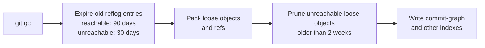

# The Reflog and Garbage Collection: The Complete Guide

> 📚 **Before you start**
>
> - [Refs, HEAD and Detached HEAD](refs-head-and-detached-head.md), for refs, `HEAD` and `HEAD@{1}`
> - [Hashes and Content Addressing](hashes-and-content-addressing.md), for loose objects and packfiles

## Introduction

Most phones keep a "recently deleted" album. Delete a photo by mistake and it's still there for 30 days; after that, the phone clears it out to free space. You don't think about it until the day you need it, and then it saves you.

Git has the same safety net, in two parts. The **reflog** is a private diary of every place your `HEAD` and your branches have pointed: every commit, checkout, reset, rebase and merge. Because Git never deletes commits immediately, the reflog lets you find and restore work that seems to have vanished after a bad `reset --hard`, a botched rebase or a deleted branch. **Garbage collection** is the clean-up crew that eventually removes objects nothing points to any more, after a generous delay.

By the end of this article you'll be able to read the reflog, use `HEAD@{n}` and time-based names, recover from the most common "I lost my commits" situations, find unreachable commits with `git fsck`, and explain exactly when Git really deletes data and how to control it.

> 💡 **Key Insight**
>
> **Git almost never deletes a commit right away.** Commands like `reset`, `rebase`, `commit --amend` and `branch -D` only move or remove **pointers**. The commits stay in the object database, and the **reflog** remembers where the pointers used to be, by default for **90 days** for reachable entries and **30 days** for unreachable ones. If you ever committed something, you can almost certainly get it back.

---

## Core Explanation

### 1. What the Reflog Records

Every time a ref changes, Git appends a line to that ref's log in `.git/logs/`. There's one log for `HEAD` (every move you make) and one per branch. Each entry stores the old hash, the new hash, who, when, and a short description of the operation:

```bash
cat .git/logs/HEAD
```

Example output (first three lines):

```
0000000000000000000000000000000000000000 e1d816f2040cc23a3a7962cd3624bf472df8e7a1 Asha Rao <asha@example.com> 1791171600 +0530	commit (initial): Add masala chai
e1d816f2040cc23a3a7962cd3624bf472df8e7a1 3d23256964774100abee2db39e599e7a09b2e296 Asha Rao <asha@example.com> 1791171900 +0530	commit: Add ginger chai
3d23256964774100abee2db39e599e7a09b2e296 fc3ef6e5155c485b7f92e2dd91bf47e2d83516f1 Asha Rao <asha@example.com> 1791172200 +0530	commit: Add elaichi chai
```

Two facts matter more than anything else here:

- **The reflog is local.** It lives only in your clone. It's never pushed, fetched or cloned. Your teammate's reflog can't save your work, and yours can't save theirs.
- **The reflog is enabled by default** in normal (non-bare) repositories (`core.logAllRefUpdates`). Server-side bare repositories usually don't keep one.

### 2. Reading the Reflog

`git reflog` (short for `git reflog show HEAD`) prints the HEAD log newest first, with handy names:

```bash
git log --oneline
git reset --hard HEAD~2
git log --oneline
```

Example output:

```
258b5e9 Add kulhad chai
fc3ef6e Add elaichi chai
3d23256 Add ginger chai
e1d816f Add masala chai
HEAD is now at 3d23256 Add ginger chai
3d23256 Add ginger chai
e1d816f Add masala chai
```

Two commits seem to be gone. `git log` can't see them because nothing points to them. The reflog can:

```bash
git reflog
```

Example output:

```
3d23256 HEAD@{0}: reset: moving to HEAD~2
258b5e9 HEAD@{1}: commit: Add kulhad chai
fc3ef6e HEAD@{2}: commit: Add elaichi chai
3d23256 HEAD@{3}: commit: Add ginger chai
e1d816f HEAD@{4}: commit (initial): Add masala chai
```

`HEAD@{0}` is where HEAD is now, `HEAD@{1}` is where it was one move ago, and so on. Any `HEAD@{n}` works anywhere a commit name does.

### 3. Recovery 1: Undo a reset --hard

Put `main` back where it was before the reset:

```bash
git reset --hard HEAD@{1}
git log --oneline
```

Example output:

```
HEAD is now at 258b5e9 Add kulhad chai
258b5e9 Add kulhad chai
fc3ef6e Add elaichi chai
3d23256 Add ginger chai
e1d816f Add masala chai
```

Both commits are back. (Right after a reset, `ORIG_HEAD` points to the same place, so `git reset --hard ORIG_HEAD` also works.) Each branch has its own reflog too, which reads more simply when HEAD has been jumping between branches:

```bash
git reflog show main
```

Example output:

```
258b5e9 main@{0}: reset: moving to HEAD@{1}
3d23256 main@{1}: reset: moving to HEAD~2
258b5e9 main@{2}: commit: Add kulhad chai
fc3ef6e main@{3}: commit: Add elaichi chai
3d23256 main@{4}: commit: Add ginger chai
e1d816f main@{5}: commit (initial): Add masala chai
```

> ⚠️ The reflog only rescues **committed** work. `reset --hard` also wipes uncommitted changes in your working tree, and those were never stored. Commit (or stash) before doing anything drastic.

### 4. Recovery 2: A Deleted Branch

```bash
git switch -c festival-menu
echo "Diwali special: 35" >> menu.txt
git commit -am "Add Diwali special"
git switch main
git branch -D festival-menu
```

Example output (last line):

```
Deleted branch festival-menu (was 65fd851).
```

Git even tells you the hash it was pointing at. If that's scrolled away, the HEAD reflog remembers the commit you made on the branch:

```bash
git reflog | head -4
```

Example output:

```
258b5e9 HEAD@{0}: checkout: moving from festival-menu to main
65fd851 HEAD@{1}: commit: Add Diwali special
258b5e9 HEAD@{2}: checkout: moving from main to festival-menu
258b5e9 HEAD@{3}: reset: moving to HEAD@{1}
```

```bash
git branch festival-menu HEAD@{1}
git log --oneline -1 festival-menu
```

Example output:

```
65fd851 Add Diwali special
```

The branch is back, pointing at the same commit. Note that the deleted branch's **own** reflog is gone (deleting a branch deletes its log), which is why the HEAD reflog is the one to search.

### 5. Recovery 3: An Amend or Rebase You Regret

`--amend` and `rebase` create **new** commits and move the branch to them; the originals stay in the reflog:

```bash
git commit --amend -m "Add kulhad chai (30 rupees)"
git reflog -3
```

Example output:

```
[main d91c84d] Add kulhad chai (30 rupees)
 Date: Mon Oct 5 09:25:00 2026 +0530
 1 file changed, 1 insertion(+)
d91c84d HEAD@{0}: commit (amend): Add kulhad chai (30 rupees)
258b5e9 HEAD@{1}: checkout: moving from festival-menu to main
65fd851 HEAD@{2}: commit: Add Diwali special
```

The pre-amend commit `258b5e9` is still there. Inspect it with `git show HEAD@{1}` and go back with `git reset --hard HEAD@{1}` if you prefer it. After a rebase that went wrong, look for the entry just before `rebase (start)` in the reflog and reset to it.

### 6. Time-Based Names

Reflog entries are timestamped, so you can ask where a ref was **at a time**:

```bash
git reflog --date=iso -3
git log --oneline -1 "main@{2026-10-05 09:16}"
```

Example output:

```
258b5e9 HEAD@{2026-10-05 09:50:00 +0530}: reset: moving to HEAD@{1}
3d23256 HEAD@{2026-10-05 09:35:00 +0530}: reset: moving to HEAD~2
258b5e9 HEAD@{2026-10-05 09:25:00 +0530}: commit: Add kulhad chai
3d23256 Add ginger chai
```

English works too: `main@{yesterday}`, `main@{2.hours.ago}`, `HEAD@{1.week.ago}`. Remember these are based on **your** reflog: "where was `main` in **my clone** yesterday", not "what was on the server yesterday".

`git log -g` (walk reflogs) is another view of the same data, combining `log` formatting with reflog entries.

### 7. Finding Commits the Reflog Doesn't Show: git fsck

Sometimes a commit isn't in any reflog: for example, after `git stash drop`, or after the reflog entry has expired. `git fsck` (file-system check) verifies the whole database and can list objects nothing points to:

```bash
git fsck --lost-found
```

Example output:

```
dangling commit 65fd8511a70f54b833eb579ad66a6232d7b1cedf
```

A **dangling** object is one that no other object or ref points to. `--lost-found` also copies their hashes into `.git/lost-found/commit/` for easy browsing. To include objects reachable only from reflogs, add `--no-reflogs`:

```bash
git fsck --unreachable --no-reflogs
```

Example output:

```
unreachable commit 258b5e9cf7d1a0397acd10b97f0f986e2504cd71
unreachable commit 65fd8511a70f54b833eb579ad66a6232d7b1cedf
unreachable blob 4e58efd58faac3f4b44cf7a97ba6d7bd52fae893
unreachable tree 3b18e8ebb6623565dfa56ea8fa70522833ec5056
```

Then `git show <hash>` each candidate and `git branch rescued <hash>` the one you want. This is the last resort that recovers **dropped stashes**, which are commits too.

### 8. Garbage Collection: When Git Really Deletes

Unreachable objects don't stay forever. **Garbage collection** (`git gc`) tidies the repository:



The timings are controlled by configuration (shown with their defaults):

| Setting | Default | Meaning |
|---|---|---|
| `gc.reflogExpire` | 90 days | Reflog entries older than this are removed |
| `gc.reflogExpireUnreachable` | 30 days | Entries for commits **not** reachable from the ref's current tip are removed sooner |
| `gc.pruneExpire` | 2 weeks ago | Unreachable loose objects younger than this are kept, even with no reflog entry |
| `gc.auto` | 6700 | Roughly how many loose objects trigger an automatic `gc --auto` after some commands |

So a commit you "lost" stays protected by its reflog entry for at least 30 days, and then for up to two more weeks as a loose object. You rarely need to run `git gc` yourself: Git runs `git gc --auto` in the background after commands like `commit`, `merge` and `fetch` when the repository gets messy. `git maintenance start` goes further, scheduling regular background tasks (prefetching, packing, updating the commit graph) for big repositories.

You can force an immediate, complete clean-up, which shows the safety net disappearing:

```bash
git count-objects -v
git reflog expire --expire-unreachable=now --all
git gc --prune=now
git fsck --unreachable --no-reflogs
git count-objects -v
```

Example output:

```
count: 16
size: 64
in-pack: 0
packs: 0
size-pack: 0
prune-packable: 0
garbage: 0
size-garbage: 0
count: 0
size: 0
in-pack: 12
packs: 1
size-pack: 2
prune-packable: 0
garbage: 0
size-garbage: 0
```

Sixteen loose objects became twelve packed ones: the four unreachable objects (the old kulhad commit, the deleted Diwali commit and their tree and blob) are gone for good, and `fsck` finds nothing unreachable any more. **Never run those two commands in a real repository unless you specifically mean to destroy recoverable history**; the main legitimate use is right after removing a leaked secret or huge file from history ([module 9](../course.md#m9)), so that the old objects really disappear from your clone.

### 9. The Stash Lives in a Reflog Too

`git stash` (module 4) saves work-in-progress as special commits and records them in the reflog of `refs/stash`. `stash@{0}` is literally reflog syntax:

```bash
git stash push -m "half-written menu change"
git stash list
git reflog show refs/stash
```

Example output:

```
stash@{0}: On main: half-written menu change
7b4227b refs/stash@{0}: On main: half-written menu change
```

### 10. A Recovery Cheat Sheet

| What happened | How to get it back |
|---|---|
| `git reset --hard` too far | `git reset --hard ORIG_HEAD` or `git reset --hard HEAD@{1}` |
| Deleted a branch | `git branch <name> <hash>` using the hash from the delete message or `git reflog` |
| Amended or rebased and want the old version | Find it in `git reflog`, then `git reset --hard <entry>` |
| Committed in detached HEAD and switched away | `git reflog`, then `git branch <name> <hash>` |
| Dropped a stash | `git fsck --unreachable \| grep commit`, inspect with `git show`, then `git stash apply <hash>` |
| Never committed or stashed the work | Not recoverable by Git; check your editor's local history |

---

## Try It Yourself

1. **Reset and recover.** Make four commits, run `git reset --hard HEAD~3`, then get all three commits back using only the reflog.
2. **Branch rescue.** Create a branch, commit twice on it, switch away and delete it with `-D`. Restore it **without** using the hash printed by the delete command.
3. **Read the diary.** Run `git reflog show main` and `git reflog` (HEAD). Why does the HEAD log have more entries?
4. **Time travel.** Use `main@{...}` with a time to show what `main` pointed to 10 minutes ago in your practice repository.

<details>
<summary>Show answers</summary>

1. `git reflog` shows the reset at `HEAD@{0}` and the pre-reset commit at `HEAD@{1}`; `git reset --hard HEAD@{1}` (or `ORIG_HEAD`) restores all three, because the newest one's parents lead back through the other two.
2. `git reflog` shows `commit: <your second message>` a few entries down; `git branch <name> HEAD@{n}` with that entry restores the branch with both commits.
3. HEAD's log records every switch between branches and every detached checkout as well as commits; a branch's log only records changes to that branch.
4. `git log --oneline -1 "main@{10.minutes.ago}"`. If the reflog doesn't go back that far, Git warns that the log only goes back to a later time and uses the oldest entry.

</details>

---

## Real-World Examples

### Example 1: The Friday Afternoon reset

A developer meant `git reset --soft HEAD~1` but typed `--hard HEAD~5`, wiping a week of commits from their branch. They feel sick for ten seconds, then run `git reflog`, see `reset: moving to HEAD~5` at the top, and run `git reset --hard HEAD@{1}`. Everything is back in under a minute.

### Example 2: The Rebase that Ate a Feature

During an interactive rebase, a developer accidentally deletes a line in the todo list and loses a commit. Rather than redoing a day's work, they search the reflog for the commit's message, find its hash and cherry-pick it back onto the branch.

### Example 3: Removing a Secret Properly

After rewriting history to remove a leaked password file, a team member notices the old commit is still recoverable from their clone via the reflog. That's expected: rewriting moves pointers. To truly purge it locally they expire the reflog and prune, and the hosting service is asked to purge cached views. Most importantly, the password itself was already rotated.

---

## Common Misconceptions

### Misconception 1: "reset --hard deletes commits"

It moves the branch pointer and resets your files. The commits remain and the reflog points to them. What `--hard` really destroys is **uncommitted** work.

### Misconception 2: "My teammates can recover my lost work from their reflogs"

Reflogs are per-clone and never shared. A teammate can only help if they had fetched your commits before you lost them.

### Misconception 3: "Unreachable commits are deleted the next time I run any command"

Automatic `gc` respects the expiry and prune grace periods. Unreachable work typically survives for weeks.

### Misconception 4: "git gc is something I should run regularly"

Git runs it automatically when needed. Manual runs are mostly for special situations, such as after a history rewrite or before archiving a repository.

---

## Interview Relevance

"I ran `git reset --hard` and lost my commits. What do I do?" is one of the most common scenario questions. A strong answer covers:

- **Don't panic, don't run gc**: the commits still exist.
- **`git reflog`** to find the previous position, then **`git reset --hard HEAD@{n}`** (or `ORIG_HEAD`), or **`git branch <name> <hash>`** to keep it separately.
- **What the reflog is**: a local, per-ref history of pointer movements, not shared with remotes.
- **Limits**: uncommitted changes aren't recoverable; reflog entries expire (90/30 days by default) and `gc` prunes old unreachable objects.
- **Last resort**: `git fsck --unreachable` / `--lost-found` for dropped stashes and expired reflog entries.

---

## Key Takeaways

- The **reflog** records every movement of `HEAD` and each branch, **locally only**.
- **`HEAD@{n}`**, **`main@{n}`** and **`main@{<time>}`** name past positions.
- Undo resets, deleted branches, amends and rebases with **`git reflog`** plus **`reset --hard`** or **`git branch <name> <hash>`**.
- **`git fsck --unreachable`** finds commits not in any reflog, such as dropped stashes.
- **Garbage collection** removes unreachable objects only after **reflog expiry** (90/30 days) and a **two-week prune** grace period.
- **Uncommitted work is never protected.** Commit or stash before risky commands.

---

**Up next:** [Lab: Explore the .git folder by hand](lab-explore-the-git-folder-by-hand.md)
