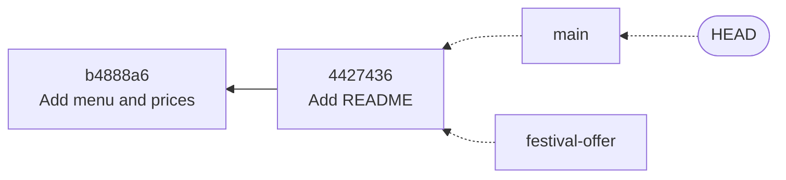
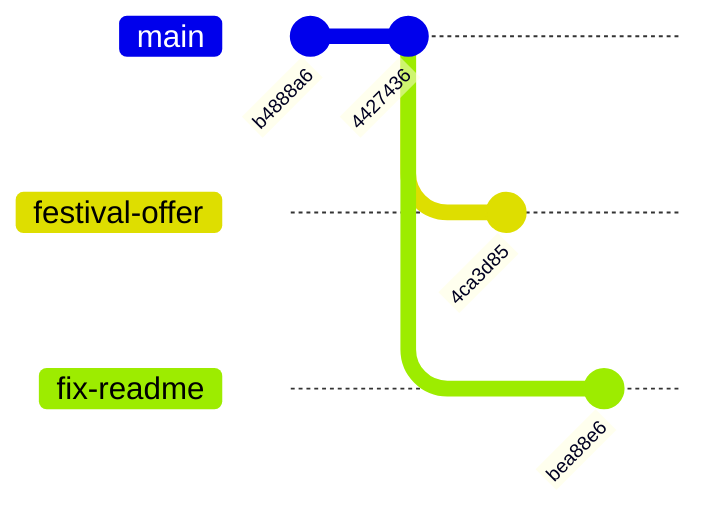

# Branches Are Just Pointers: The Complete Guide

> 📚 **Before you start**
>
> - [Refs, HEAD and Detached HEAD](../03-how-git-works-inside/refs-head-and-detached-head.md), for refs and how `HEAD` points to a branch
> - [Blobs, Trees, Commits and Tags](../03-how-git-works-inside/blobs-trees-commits-and-tags.md), for commits and parents
> - [The Three Areas: Working Tree, Staging and Repository](../02-version-control-from-scratch/the-three-areas-working-tree-staging-and-repository.md)

## Introduction

A chai stall owner wants to try a Diwali menu with special prices. She doesn't want to rip up the everyday menu board while she experiments, so she takes a fresh card, copies the current menu onto it and starts scribbling changes. If customers like it, the new card replaces the old board. If not, she throws the card away. Meanwhile, the everyday board keeps working, and she can still fix a typo on it.

That's what a **branch** gives you: a separate line of work that starts from some point in history, moves forward independently, and can later be combined back or thrown away. In older version control systems, a branch meant copying the whole project, so people avoided them. In Git, creating a branch takes milliseconds and 41 bytes of disk, no matter how big the project is. That changes how you work: in Git, every feature, bug fix and experiment gets its own branch.

By the end of this article you'll understand exactly what a branch is in Git, and you'll be able to create, list, switch, rename, copy and delete branches, compare them, see which are merged, and avoid the common traps (like losing uncommitted work when switching).

> 💡 **Key Insight**
>
> A branch is a **movable label on a commit**, nothing more. Creating a branch writes one small file containing a commit hash. When you commit, Git creates the new commit and **moves the label of the current branch** to it. The "history of a branch" is just everything you reach by following parent links back from that label.

---

## Core Explanation

### 1. A Branch Is a Label

Start with a repository that has two commits on `main`:

```bash
git log --oneline --decorate
```

Example output:

```
4427436 (HEAD -> main) Add README
b4888a6 Add menu and prices
```

Create a branch:

```bash
git branch festival-offer
git log --oneline --decorate
```

Example output:

```
4427436 (HEAD -> main, festival-offer) Add README
b4888a6 Add menu and prices
```

Nothing else changed: no files were copied, no commits were made. There are now two labels on the same commit. As you saw in module 3, `festival-offer` is literally a file, `.git/refs/heads/festival-offer`, containing `4427436...`.



`HEAD` still points to `main`, so you're still "on" `main`. `git branch` lists local branches and marks the current one with `*`; `-v` adds each branch's commit:

```bash
git branch -v
```

Example output:

```
  festival-offer 4427436 Add README
* main           4427436 Add README
```

### 2. Switching Branches

`git switch <branch>` does three things: points `HEAD` at that branch, updates the index, and updates your working tree to match the branch's commit.

```bash
git switch festival-offer
echo 'def festival_price(p): return round(p * 0.9)' > offers.py
git add offers.py
git commit -m "Add a 10 percent festival price"
git log --oneline --decorate --all --graph
```

Example output:

```
Switched to branch 'festival-offer'
[festival-offer 4ca3d85] Add a 10 percent festival price
 1 file changed, 1 insertion(+)
 create mode 100644 offers.py
* 4ca3d85 (HEAD -> festival-offer) Add a 10 percent festival price
* 4427436 (main) Add README
* b4888a6 Add menu and prices
```

The commit moved **only** the `festival-offer` label, because that's the branch `HEAD` points to. `main` stayed where it was. Switch back, and `offers.py` disappears from your working tree, because it doesn't exist in `main`'s snapshot:

```bash
git switch main
ls
```

Example output:

```
Switched to branch 'main'
README.md
menu.txt
prices.py
```

It isn't gone; it's safely stored in the commit on the other branch. Switching back brings it back.

### 3. Diverging History

Create another branch from `main` and commit there. `git switch -c` creates and switches in one step; `git switch -` goes back to the previous branch:

```bash
git switch -c fix-readme
echo "Tracks daily chai sales." >> README.md
git commit -am "Describe the project in the README"
git switch -
git log --oneline --graph --all
```

Example output:

```
Switched to a new branch 'fix-readme'
[fix-readme bea88e6] Describe the project in the README
 1 file changed, 1 insertion(+)
Switched to branch 'main'
* bea88e6 Describe the project in the README
| * 4ca3d85 Add a 10 percent festival price
|/  
* 4427436 Add README
* b4888a6 Add menu and prices
```



The two branches have **diverged**: each has a commit the other doesn't. Their **common ancestor** is `4427436`. Combining diverged branches is the job of merging, in the next lesson.

### 4. Every Branch Command You'll Need

| Task | Command |
|---|---|
| List local branches | `git branch` (`-v` with last commit, `-vv` with upstream too) |
| List remote-tracking / all branches | `git branch -r` / `git branch -a` |
| Create (don't switch) | `git branch <name>` or `git branch <name> <start-point>` |
| Create and switch | `git switch -c <name>` or `git switch -c <name> <start-point>` |
| Switch | `git switch <name>`; previous branch: `git switch -` |
| Rename | `git branch -m <old> <new>` (just `-m <new>` renames the current branch) |
| Copy | `git branch -c <old> <new>` |
| Delete (safe) | `git branch -d <name>`: refuses if its commits aren't merged |
| Delete (force) | `git branch -D <name>` |
| Which branches are merged into the current one? | `git branch --merged` / `--no-merged` |
| Filter by pattern | `git branch --list "fix-*"` |
| Sort by most recent commit | `git branch --sort=-committerdate` |

The **start point** can be any commit name: `git switch -c hotfix v1.0` starts a branch from a tag, and `git switch -c review origin/main` from a remote-tracking branch.

You'll still see `git checkout` everywhere, in tutorials and older scripts. It's the old do-everything command: `git checkout <branch>` switches, `git checkout -b <name>` creates and switches, and `git checkout -- <file>` restores a file. Git 2.23 split those jobs into `git switch` (branches) and `git restore` (files), which are clearer and harder to misuse. Both work; this course uses the new ones.

### 5. Merged or Not?

```bash
git branch --merged
git branch --no-merged
```

Example output:

```
* main
  festival-offer
  fix-readme
```

The first command lists only `main`; the second lists the two branches with commits that aren't in `main` yet. That's what `git branch -d` checks too:

```bash
git branch -d festival-offer
```

Example output:

```
error: the branch 'festival-offer' is not fully merged.
If you are sure you want to delete it, run 'git branch -D festival-offer'
```

`-d` protects you from losing work. `-D` forces it:

```bash
git branch -D festival-offer
```

Example output:

```
Deleted branch festival-offer (was 4ca3d85).
```

Deleting a branch deletes the **label**, not the commits. As long as you know the hash (Git just printed it) or can find it in the reflog, you can recreate it exactly:

```bash
git branch festival-offer 4ca3d85
git log --oneline -1 festival-offer
```

Example output:

```
4ca3d85 Add a 10 percent festival price
```

### 6. Renaming and Copying

```bash
git branch -m fix-readme readme-description
git branch
```

Example output:

```
  festival-offer
* main
  readme-description
```

Renaming a local branch doesn't rename it on GitHub. If you'd already pushed it, push the new name and delete the old one on the remote ([module 5](../05-remotes-and-github-basics/clone-fetch-pull-and-push.md)). Renaming `master` to `main` in an existing project is the classic example; GitHub also offers a rename button in a repository's branch settings that updates pull requests and redirects for you.

### 7. Switching with Uncommitted Changes

What happens to edits you haven't committed when you switch? Git **carries them along** if it safely can, and refuses if switching would overwrite them:

```bash
echo "uncommitted" >> menu.txt
git switch readme-description
```

Example output:

```
Switched to branch 'readme-description'
M	menu.txt
```

Here `menu.txt` is the same in both branches, so Git kept your edit and reminded you (`M menu.txt`) that it came along. Uncommitted changes don't belong to any branch; they live in your working tree. But if the file differs between the branches, Git stops to protect your work:

```
error: Your local changes to the following files would be overwritten by checkout:
	menu.txt
Please commit your changes or stash them before you switch branches.
Aborting
```

Your choices: commit the work (often best: a small "WIP" commit on your branch is fine and can be tidied up later), stash it (see [Stash, Worktrees and bisect](stash-worktrees-and-bisect.md)), or discard it with `git restore`. `git switch --discard-changes` throws away local changes and switches, and `git switch -m` tries to merge your changes into the target branch; use both with care.

### 8. Naming Branches Well

Branch names are refs, so they follow ref rules: no spaces, no `..`, no `~ ^ : ? * [` characters, and they can't end with `/` or `.lock`. Slashes are allowed and often used as folders. Common team conventions:

| Pattern | Example |
|---|---|
| `type/short-description` | `feature/upi-payments`, `fix/empty-csv-crash`, `docs/readme-usage` |
| Include the ticket | `fix/LEDGER-142-gst-rounding` |
| Personal prefix | `asha/weekly-report` |

Keep names short, lowercase, hyphenated, and descriptive enough that `git branch` reads like a to-do list. One catch with slashes: you can't have both a branch `feature` and a branch `feature/x`, because one would need to be a file and the other a folder.

### 9. Why Cheap Branches Change How You Work

Because a branch costs nothing, Git workflows use them constantly:

- **One branch per task.** Each feature or fix lives on its own branch until it's ready; `main` stays working.
- **Experiments are free.** Try an idea on a throwaway branch. Delete it if it fails.
- **Review per branch.** On GitHub, a pull request is "please merge this branch" ([module 6](../06-collaborating-on-github/pull-requests-end-to-end.md)).
- **Context switching is safe.** An urgent bug? Commit or stash, switch to a new branch from `main`, fix, switch back.

---

## Try It Yourself

1. **Two labels, one commit.** Create a branch, then run `git log --oneline --decorate` and `git rev-parse main <branch>`. What do you notice?
2. **Diverge.** Make one commit on a new branch and one on `main`. Draw the graph on paper, then compare with `git log --oneline --graph --all`.
3. **Safe delete.** Try `git branch -d` on your unmerged branch. Then delete it with `-D` and restore it using only the reflog.
4. **Blocked switch.** Make the same file differ between two branches, edit it without committing, and try to switch. Read the error, then get past it in two different ways.

<details>
<summary>Show answers</summary>

1. Both names point to the same commit hash; `--decorate` shows both labels on one line.
2. The graph shows a fork at the common ancestor: one line per branch, each with its own commit.
3. `-d` refuses with "not fully merged". After `-D`, `git reflog` shows `commit: <message>` for the branch's commit; `git branch <name> HEAD@{n}` (or the hash) recreates it.
4. Option 1: `git commit -am "WIP"` then switch. Option 2: `git stash`, switch, and later `git stash pop`. (A third, destructive option: `git restore <file>` or `git switch --discard-changes`.)

</details>

---

## Real-World Examples

### Example 1: Feature Branches at a Product Company

Every task in a team's tracker gets its own branch, like `feature/LEDGER-87-monthly-report`. The developer pushes it, opens a pull request, gets a review, and merges. A typical repository has a handful of long-lived branches (`main`, sometimes `release/*`) and dozens of short-lived ones that come and go every day.

### Example 2: The Urgent Production Fix

In the middle of a half-finished feature, a developer hears that checkout is broken. They commit their work-in-progress on the feature branch, run `git switch -c hotfix/checkout-timeout main`, fix and ship, then `git switch feature/...` and carry on exactly where they left off.

### Example 3: Throwaway Spikes

Before committing to a new charting library, an engineer creates `spike/new-charts`, hacks for an afternoon to see if it fits, and then deletes the branch. The useful lessons go into a design note; the messy code never touches `main`.

---

## Common Misconceptions

### Misconception 1: "Creating a branch copies the project"

It writes one 41-byte ref. Files aren't copied; switching branches rewrites your working tree from the stored snapshots.

### Misconception 2: "Commits belong to a branch"

Commits belong to the graph. A branch is a pointer, and a commit can be reachable from many branches at once (every commit before a fork is "on" both branches).

### Misconception 3: "Uncommitted changes are saved on the branch I was on"

They're in your working tree and travel with you when you switch. Only commits are stored on a branch.

### Misconception 4: "Deleting a branch deletes its commits"

It deletes the label. The commits stay until garbage collection, and the reflog helps you find them.

---

## Interview Relevance

"What is a branch in Git?" is a common opener, often followed by "How is it different from SVN?" A strong answer covers:

- **A branch is a ref**, a pointer to a commit, stored in `refs/heads/`.
- **HEAD points to the current branch**; committing advances that branch only.
- **Why branches are cheap**, and how that enables per-task branches and pull requests.
- **Practical commands**: `switch -c`, `branch -d/-D/-m`, `--merged`, recovering deleted branches.
- **Uncommitted changes** aren't on any branch, and when Git blocks a switch.

---

## Key Takeaways

- A **branch is a movable pointer** to a commit; creating one is instant.
- **Committing moves the current branch** (the one `HEAD` points to) and nothing else.
- Use **`git switch`** (and `-c`, `-`) for branches; `git checkout` is the older equivalent.
- **`git branch -d`** is safe, **`-D`** forces; deleted branches can be recreated from a hash or the **reflog**.
- **Uncommitted changes** travel with you when you switch, unless they'd be overwritten, in which case Git stops.
- Name branches clearly, for example **`feature/upi-payments`**, and use one branch per task.

---

**Up next:** [Fast-Forward and Three-Way Merges](fast-forward-and-three-way-merges.md)
