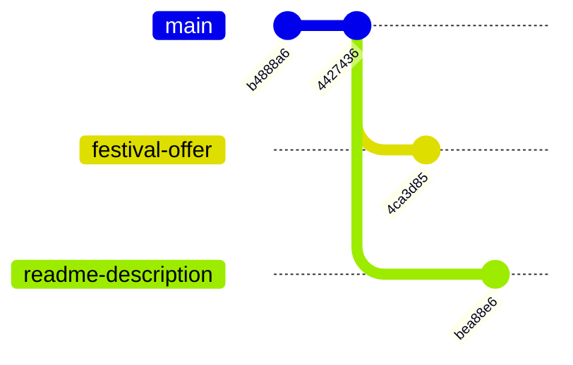
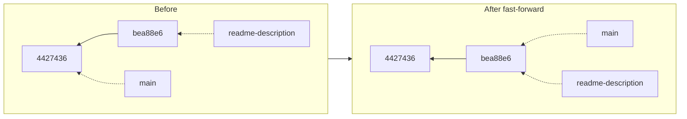
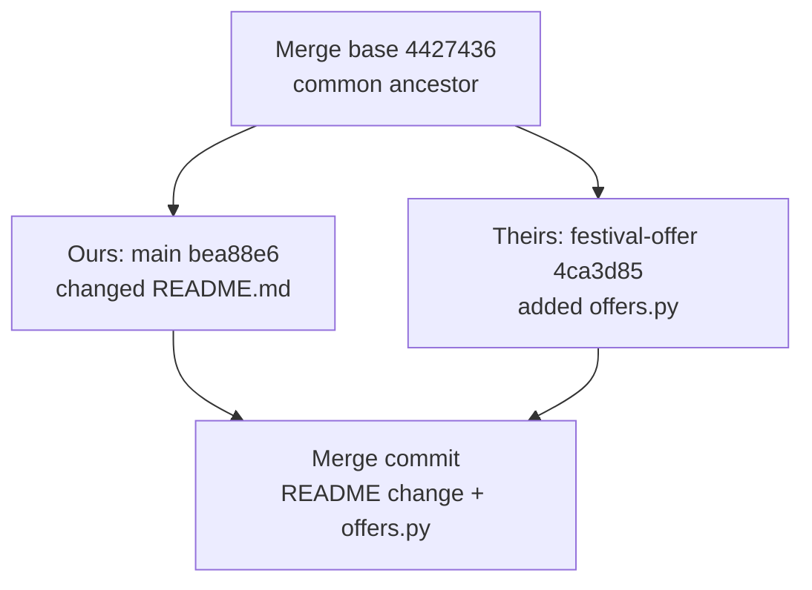
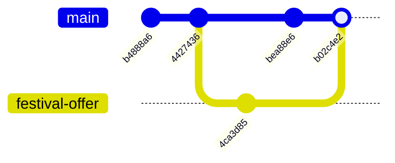
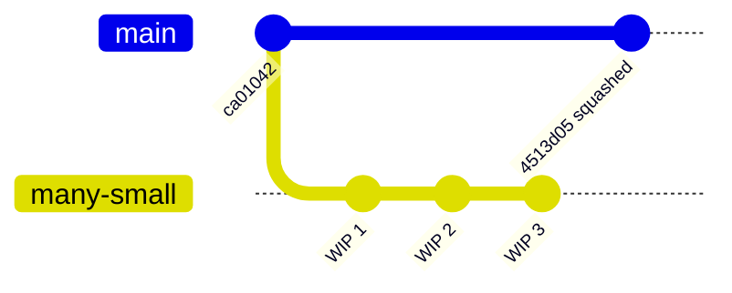

# Fast-Forward and Three-Way Merges: The Complete Guide

> 📚 **Before you start**
>
> - [Branches Are Just Pointers](branches-are-just-pointers.md)
> - [Reading History with log, show and diff](../02-version-control-from-scratch/reading-history-with-log-show-and-diff.md), for `^2` and `--graph`

## Introduction

Two friends are planning a Goa trip in a shared itinerary. Asha adds the flights, Ravi adds the hotel. When they compare notes, combining is easy: take both additions. But how did they know these were *additions* and not one person deleting the other's work? Because they both started from the same original plan. Comparing each version against that **common starting point** shows exactly what each person changed.

Git merges work exactly like that. Sometimes there's nothing to combine at all (only one person made changes), and Git simply moves a label forward: a **fast-forward**. When both sides changed things, Git compares each side with their **merge base**, the common starting point, and combines the two sets of changes into a new **merge commit**: a **three-way merge**.

By the end of this article you'll know which kind of merge will happen and why, how to force or forbid each kind (`--ff-only`, `--no-ff`), what a merge commit looks like inside, how to read merged history with `--first-parent` and `^2`, and what `--squash` really does.

> 💡 **Key Insight**
>
> `git merge X` asks: "is my current commit an ancestor of X?" If **yes**, nothing needs combining, so Git just **moves the branch label forward** to X (fast-forward, no new commit). If **no**, the histories have diverged, so Git finds the **merge base**, combines both sides' changes since then, and records a **merge commit with two parents**.

---

## Core Explanation

### 1. The Starting Point

We have the history from the last lesson: two branches that diverged from `main`'s commit `4427436`. `readme-description` has one commit, `festival-offer` has another, and `main` hasn't moved:



You always merge **into the branch you're on**: switch to the receiving branch, then name the branch to bring in.

### 2. Fast-Forward Merges

```bash
git switch main
git merge readme-description
```

Example output:

```
Updating 4427436..bea88e6
Fast-forward
 README.md | 1 +
 1 file changed, 1 insertion(+)
```

`main`'s commit `4427436` was an **ancestor** of `bea88e6`: everything on `main` was already in `readme-description`. There was nothing to combine, so Git moved the `main` label forward to `bea88e6` and updated your files. No new commit was created:

```bash
git log --oneline --graph --all
```

Example output:

```
* bea88e6 Describe the project in the README
| * 4ca3d85 Add a 10 percent festival price
|/  
* 4427436 Add README
* b4888a6 Add menu and prices
```



The history stays a straight line. It looks as if the commit had been made on `main` directly.

### 3. Three-Way Merges

Now merge `festival-offer`. `main` (now at `bea88e6`) is **not** an ancestor of `4ca3d85`: each side has a commit the other lacks. First, find their merge base:

```bash
git merge-base main festival-offer
```

Example output:

```
4427436b9d013940fba5bfc478876b93001f3172
```

Git will compare three snapshots: the **base** (`4427436`), **ours** (`main`, the branch we're on) and **theirs** (`festival-offer`, the branch coming in):



For each file and each region of a file:

| Base | Ours | Theirs | Result |
|---|---|---|---|
| A | A | A | A (nobody changed it) |
| A | **B** | A | **B** (only we changed it) |
| A | A | **C** | **C** (only they changed it) |
| A | **B** | **B** | **B** (both made the same change) |
| A | **B** | **C** | **Conflict**: both changed the same region differently (next lesson) |

This is why the base matters: without it, Git couldn't tell "they added a line" from "we deleted a line".

```bash
git merge festival-offer -m "Merge branch festival-offer"
git log --oneline --graph --all
```

Example output:

```
Merge made by the 'ort' strategy.
 offers.py | 1 +
 1 file changed, 1 insertion(+)
 create mode 100644 offers.py
*   b02c4e2 Merge branch festival-offer
|\  
| * 4ca3d85 Add a 10 percent festival price
* | bea88e6 Describe the project in the README
|/  
* 4427436 Add README
* b4888a6 Add menu and prices
```

(Without `-m`, Git opens your editor with a default message, `Merge branch 'festival-offer'`, which is usually fine to accept.) **ort** ("Ostensibly Recursive's Twin") is Git's default merge strategy, the algorithm that combines the changes. It replaced the older `recursive` strategy and handles renames and complicated histories well.



### 4. Inside a Merge Commit

A merge commit is an ordinary commit with **two parents**:

```bash
git cat-file -p HEAD
```

Example output:

```
tree bc5339ed18c0237c040d747a37f9343da18d19fa
parent bea88e610204800bac08bc650d03464d90606b63
parent 4ca3d8544d30901db6fcc8d698a592918d38927b
author Asha Rao <asha@example.com> 1791179880 +0530
committer Asha Rao <asha@example.com> 1791179880 +0530

Merge branch festival-offer
```

The **first parent** is the branch you were on (`main`'s previous commit); the **second parent** is the branch you merged in. Order matters for reading history:

- `HEAD^1` (or `HEAD^`) is the first parent; `HEAD^2` is the second parent.
- `git log --first-parent` follows only first parents, giving the story of `main` itself: one entry per merged feature.

```bash
git log --oneline --first-parent
```

Example output:

```
b02c4e2 Merge branch festival-offer
bea88e6 Describe the project in the README
4427436 Add README
b4888a6 Add menu and prices
```

`git show` on a merge displays `Merge: bea88e6 4ca3d85` and, by default, only a **combined diff** of lines that differ from *both* parents (often nothing for a clean merge). To see what the merge brought into `main`, diff against the first parent:

```bash
git diff HEAD^1 HEAD --stat
```

Example output:

```
 offers.py | 1 +
 1 file changed, 1 insertion(+)
```

Merges with more than two parents exist too: an **octopus merge** (`git merge a b c`) combines several branches at once when there are no conflicts. They're rare outside special workflows.

### 5. Controlling Fast-Forwards: --no-ff and --ff-only

Sometimes you want a merge commit even when a fast-forward is possible, so the history shows that a group of commits arrived together as one feature. `--no-ff` forces one:

```bash
git switch -c tidy-prices
# edit prices.py, then:
git commit -qam "Put one price per line"
git switch main
git merge --no-ff tidy-prices -m "Merge branch tidy-prices"
git log --oneline --graph -5
```

Example output:

```
Switched to a new branch 'tidy-prices'
Switched to branch 'main'
Merge made by the 'ort' strategy.
 prices.py | 5 ++++-
 1 file changed, 4 insertions(+), 1 deletion(-)
*   ca01042 Merge branch tidy-prices
|\  
| * f95e8da Put one price per line
|/  
*   b02c4e2 Merge branch festival-offer
|\  
| * 4ca3d85 Add a 10 percent festival price
* | bea88e6 Describe the project in the README
|/  
```

The opposite, `--ff-only`, says "merge only if it's a fast-forward; otherwise refuse". It's a safe default for updating a branch you don't work on directly:

```bash
git merge --ff-only late-branch
```

Example output:

```
hint: Diverging branches can't be fast-forwarded, you need to either:
hint: 
hint: 	git merge --no-ff
hint: 
hint: or:
hint: 
hint: 	git rebase
hint: 
hint: Disable this message with "git config advice.diverging false"
fatal: Not possible to fast-forward, aborting.
```

| Option | If fast-forward is possible | If branches diverged |
|---|---|---|
| (default) | Fast-forward | Merge commit |
| `--no-ff` | Merge commit anyway | Merge commit |
| `--ff-only` | Fast-forward | **Refuse** |

The `merge.ff` setting changes the default (`false` behaves like `--no-ff`, `only` like `--ff-only`).

### 6. Squash Merges

`git merge --squash` takes all the changes from a branch and **stages them as one change**, without making a merge commit or recording the branch as merged. You then commit it yourself:

```bash
git merge --squash many-small
git status -s
git commit -m "Add notes about the stall"
git log --oneline -3
```

Example output:

```
Updating ca01042..8504333
Fast-forward
Squash commit -- not updating HEAD
 notes.txt | 3 +++
 1 file changed, 3 insertions(+)
 create mode 100644 notes.txt
A  notes.txt
[main 4513d05] Add notes about the stall
 1 file changed, 3 insertions(+)
 create mode 100644 notes.txt
4513d05 Add notes about the stall
ca01042 Merge branch tidy-prices
f95e8da Put one price per line
```

Three "WIP" commits became one clean commit on `main`. The catch: the new commit has **one** parent. Git doesn't know `many-small` was merged, so `git branch -d many-small` still says "not fully merged", and merging that branch again later would try to apply the same changes twice. Squash merging is common on GitHub (the "Squash and merge" button, [module 6](../course.md#m6)), where the branch is deleted right after.



### 7. Before, During and After a Merge

**Before:** have a clean working tree (commit or stash first), and check what's coming in with `git log --oneline main..feature` and `git diff main...feature` (three dots: changes on `feature` since the merge base).

**During:** if a merge stops with conflicts, `git merge --abort` returns everything to how it was before ([Resolving Merge Conflicts](resolving-merge-conflicts.md)). While a merge is in progress, `.git/MERGE_HEAD` holds the commit being merged.

**After:** `ORIG_HEAD` remembers where your branch was before the merge, so if you merged the wrong thing and haven't pushed, `git reset --hard ORIG_HEAD` undoes it. If you have pushed, revert the merge instead ([Undoing Things](undoing-things-restore-reset-revert-and-cherry-pick.md)).

Useful checks:

| Question | Command |
|---|---|
| Is `feature` fully merged into `main`? | `git branch --merged main` or `git merge-base --is-ancestor feature main && echo yes` |
| What would merging bring in? | `git log --oneline main..feature` |
| What changed on `feature` since it split off? | `git diff main...feature` |

---

## Try It Yourself

1. **Predict the merge type.** Create `a` from `main` and commit on it. Without committing on `main`, merge `a` into `main`. Fast-forward or merge commit? Then create `b`, commit on both `b` and `main`, and merge `b`. Which one now?
2. **Read the parents.** After the three-way merge, print both parents with `git log --oneline -1 HEAD^1` and `git log --oneline -1 HEAD^2`. Which is which?
3. **Force a merge commit.** Repeat step 1's first case with `--no-ff`. How does the graph differ?
4. **Squash and check.** Squash-merge a branch with three commits, then run `git branch --merged`. Is the branch listed? Why?

<details>
<summary>Show answers</summary>

1. The first is a fast-forward (`main` was an ancestor of `a`). The second makes a merge commit because both branches have new commits.
2. `HEAD^1` is the commit `main` was on before the merge; `HEAD^2` is the tip of `b`.
3. With `--no-ff`, the graph shows a bubble: the branch's commit on a side line and a merge commit joining it, instead of a straight line.
4. No. The squash commit has only one parent, so the branch's commits aren't ancestors of `main`, even though their changes are included.

</details>

---

## Real-World Examples

### Example 1: Merge Commits as Feature Markers

Many teams merge pull requests with merge commits. `git log --first-parent --oneline main` then reads like a changelog: one line per merged pull request, each linking to the review discussion.

### Example 2: Fast-Forward-Only Deploy Branches

Some teams keep a `production` branch that must only ever move forward to commits already on `main`. Deploy scripts run `git merge --ff-only main` on it; if that fails, someone committed directly to `production` and the deploy stops for a human to look.

### Example 3: Squash for Tidy History

Open-source projects with many first-time contributors often squash-merge pull requests, so a contributor's "fix typo", "address review" and "oops" commits become one clean commit on `main`.

---

## Common Misconceptions

### Misconception 1: "Every merge creates a merge commit"

Fast-forwards create no commit at all; they just move the label. Use `--no-ff` if you want one anyway.

### Misconception 2: "Merging compares the two branch tips"

It compares each tip with the **merge base**. Two-way comparison can't tell an addition from a deletion; three-way can.

### Misconception 3: "git merge feature merges main into feature"

It merges **into the current branch**. To bring `feature` into `main`, switch to `main` first.

### Misconception 4: "A squash merge is the same as a merge"

A squash merge applies the changes as a single ordinary commit and forgets the branch's history. Git won't consider the branch merged.

---

## Interview Relevance

"What's the difference between a fast-forward and a three-way merge?" is a standard question. A strong answer covers:

- **Fast-forward**: the current branch is an ancestor of the other; the label moves, no new commit.
- **Three-way**: diverged histories; Git combines changes relative to the **merge base** and creates a **two-parent merge commit**.
- **`--no-ff` vs `--ff-only`**, and why teams choose each.
- **First vs second parent**, `--first-parent`, and `^2`.
- **Squash merges**: one commit, one parent, history of the branch not preserved.

---

## Key Takeaways

- You merge **into the current branch**: `git switch main && git merge feature`.
- **Fast-forward** when the current branch is an ancestor: just move the label.
- **Three-way merge** when histories diverged: compare both sides with the **merge base**, create a **merge commit with two parents**.
- **`--no-ff`** always makes a merge commit; **`--ff-only`** refuses anything but a fast-forward.
- **`--squash`** applies all changes as one new commit without recording a merge.
- **`--first-parent`**, **`HEAD^2`** and **`git merge-base`** help you read merged history.

---

**Up next:** [Resolving Merge Conflicts](resolving-merge-conflicts.md)
