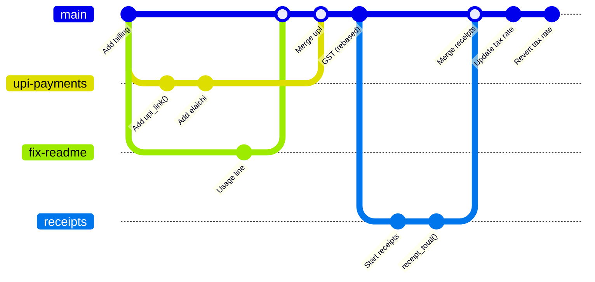

# Lab: Branching Kata with Conflicts

> 📚 **Before you start**
>
> - [Branches Are Just Pointers](branches-are-just-pointers.md)
> - [Fast-Forward and Three-Way Merges](fast-forward-and-three-way-merges.md)
> - [Resolving Merge Conflicts](resolving-merge-conflicts.md)
> - [Rebase and Interactive Rebase](rebase-and-interactive-rebase.md)
> - [Undoing Things: restore, reset, revert and cherry-pick](undoing-things-restore-reset-revert-and-cherry-pick.md)

## What You'll Build

A **kata** is a practice routine you repeat until the moves become automatic. In this one you'll play a small team building `billing.py` for a chai stall, and you'll go through every branching situation from this module in one sitting:

1. Three feature branches from the same starting point.
2. A **fast-forward** merge.
3. A **three-way** merge with a merge commit.
4. A **rebase that conflicts**, resolved by hand, followed by a fast-forward.
5. An **interactive rebase** that turns a messy branch into clean commits.
6. A bad commit pushed to `main`, undone with **revert**.
7. A **cherry-pick** onto a release branch.



> 💡 **Key Insight**
>
> Before every command, **say what you expect the graph to look like afterwards**, then check with `git log --oneline --graph --all`. Branching stops being scary the moment the graph in your head matches the graph on the screen.

Set up a clearer conflict style first (if you didn't already):

```bash
git config --global merge.conflictStyle zdiff3
```

---

## Step 1: The Starting Point

```bash
mkdir chai-kata && cd chai-kata
git init
```

Create `billing.py`:

```python
PRICES = {"masala": 20, "ginger": 25}
TAX_RATE = 0.05


def bill(order):
    subtotal = sum(PRICES[item] for item in order)
    return round(subtotal * (1 + TAX_RATE))
```

And a `README.md` containing `# Chai Kata`, plus a `.gitignore` containing `__pycache__/` (Python creates that folder when you import `billing`). Then:

```bash
git add .
git commit -m "Add billing with a flat 5 percent tax"
```

A quick check of the logic (this is the same `bill()` function, run directly):

```python
print(bill(["masala", "ginger"]))
print(bill(["masala"]))
```

Output:

```
47
21
```

---

## Step 2: Three Branches, Three Features

**Branch 1, `upi-payments`:** two commits. Add a payment link function to the end of `billing.py`, commit, then add elaichi chai to `PRICES`, commit:

```bash
git switch -c upi-payments
```

Append to `billing.py`:

```python
def upi_link(amount, upi_id="chaistall@okbank"):
    return f"upi://pay?pa={upi_id}&am={amount}"
```

```bash
git commit -am "Add upi_link() for QR payments"
# change the PRICES line to: PRICES = {"masala": 20, "ginger": 25, "elaichi": 25}
git commit -am "Add elaichi chai to prices"
```

**Branch 2, `gst-rates`:** from `main`, change the first two lines to:

```
PRICES = {"masala": 22, "ginger": 25}
TAX_RATE = 0.05  # GST on restaurant service
```

```bash
git switch main
git switch -c gst-rates
# edit the two lines
git commit -am "Document GST and raise masala to 22"
```

**Branch 3, `fix-readme`:** from `main`, add a usage line to `README.md`:

```bash
git switch main
git switch -c fix-readme
echo "Run: python3 -c 'import billing; print(billing.bill([\"masala\"]))'" >> README.md
git commit -am "Add a usage line to the README"
```

Predict the graph, then look:

```bash
git log --oneline --graph --all
```

Example output:

```
* c89e505 Add a usage line to the README
| * 0cc4e3b Document GST and raise masala to 22
|/  
| * 218a433 Add elaichi chai to prices
| * c806033 Add upi_link() for QR payments
|/  
* 13a37b8 Add billing with a flat 5 percent tax
```

Three branches fan out from one commit. Note that `upi-payments` and `gst-rates` both touch the `PRICES` line. That's the conflict waiting for you in step 5.

---

## Step 3: A Fast-Forward Merge

`main` hasn't moved since `fix-readme` branched off, so merging it needs no new commit:

```bash
git switch main
git merge fix-readme
git branch -d fix-readme
```

Example output:

```
Switched to branch 'main'
Updating 13a37b8..c89e505
Fast-forward
 README.md | 1 +
 1 file changed, 1 insertion(+)
Deleted branch fix-readme (was c89e505).
```

`-d` succeeded without complaint because the branch is fully merged.

---

## Step 4: A Three-Way Merge

`main` now has a commit `upi-payments` doesn't, and vice versa. They changed different lines, so Git combines them automatically into a merge commit:

```bash
git merge --no-edit upi-payments
git log --oneline --graph --all
```

Example output:

```
Merge made by the 'ort' strategy.
 billing.py | 6 +++++-
 1 file changed, 5 insertions(+), 1 deletion(-)
*   8303638 Merge branch 'upi-payments'
|\  
| * 218a433 Add elaichi chai to prices
| * c806033 Add upi_link() for QR payments
* | c89e505 Add a usage line to the README
|/  
| * 0cc4e3b Document GST and raise masala to 22
|/  
* 13a37b8 Add billing with a flat 5 percent tax
```

---

## Step 5: Rebase with a Conflict

`gst-rates` is behind `main` and changes the same `PRICES` line as the merged UPI work. The team prefers a linear history for small branches, so rebase it onto `main`:

```bash
git switch gst-rates
git rebase main
```

Example output:

```
Switched to branch 'gst-rates'
Auto-merging billing.py
CONFLICT (content): Merge conflict in billing.py
error: could not apply 0cc4e3b... Document GST and raise masala to 22
hint: Resolve all conflicts manually, mark them as resolved with
hint: "git add/rm <conflicted_files>", then run "git rebase --continue".
hint: You can instead skip this commit: run "git rebase --skip".
hint: To abort and get back to the state before "git rebase", run "git rebase --abort".
Could not apply 0cc4e3b... Document GST and raise masala to 22
```

Read the file:

```bash
cat billing.py
```

Example output:

```
<<<<<<< HEAD
PRICES = {"masala": 20, "ginger": 25, "elaichi": 25}
TAX_RATE = 0.05
||||||| parent of 0cc4e3b (Document GST and raise masala to 22)
PRICES = {"masala": 20, "ginger": 25}
TAX_RATE = 0.05
=======
PRICES = {"masala": 22, "ginger": 25}
TAX_RATE = 0.05  # GST on restaurant service
>>>>>>> 0cc4e3b (Document GST and raise masala to 22)


def bill(order):
    subtotal = sum(PRICES[item] for item in order)
    return round(subtotal * (1 + TAX_RATE))


def upi_link(amount, upi_id="chaistall@okbank"):
    return f"upi://pay?pa={upi_id}&am={amount}"
```

Decode it with the three sections. Remember that during a rebase, `HEAD` is `main` (plus anything already replayed) and the bottom section is **your** commit being replayed:

- **HEAD** (main): added elaichi.
- **Base**: the original two lines.
- **Your commit**: raised masala to 22 and added a GST comment.

Both intentions should survive. Replace the whole marked region with:

```
PRICES = {"masala": 22, "ginger": 25, "elaichi": 25}
TAX_RATE = 0.05  # GST on restaurant service
```

Check the combined diff before staging:

```bash
git diff
```

Example output:

```
diff --cc billing.py
index 92ebf63,d8555f4..0000000
--- a/billing.py
+++ b/billing.py
@@@ -1,5 -1,5 +1,5 @@@
- PRICES = {"masala": 20, "ginger": 25, "elaichi": 25}
- TAX_RATE = 0.05
 -PRICES = {"masala": 22, "ginger": 25}
++PRICES = {"masala": 22, "ginger": 25, "elaichi": 25}
+ TAX_RATE = 0.05  # GST on restaurant service
  
  
  def bill(order):
```

The `++` line is new compared with **both** sides: that's your hand-merged line. Finish the rebase:

```bash
git add billing.py
git rebase --continue
git log --oneline --graph --all
```

Example output:

```
[detached HEAD 4409b3c] Document GST and raise masala to 22
 1 file changed, 2 insertions(+), 2 deletions(-)
Successfully rebased and updated refs/heads/gst-rates.
* 4409b3c Document GST and raise masala to 22
*   8303638 Merge branch 'upi-payments'
|\  
| * 218a433 Add elaichi chai to prices
| * c806033 Add upi_link() for QR payments
* | c89e505 Add a usage line to the README
|/  
* 13a37b8 Add billing with a flat 5 percent tax
```

The GST commit now sits on top of `main` with a new hash (`4409b3c`). Test the merged logic: masala at 22 plus elaichi at 25, plus 5% tax, should be round(47 × 1.05) = 49:

```bash
python3 -c 'import billing; print(billing.bill(["masala", "elaichi"]))'
```

Example output:

```
49
```

Bring it into `main`. It must be a fast-forward now, so say so:

```bash
git switch main
git merge --ff-only gst-rates
git branch -d gst-rates upi-payments
```

Example output:

```
Switched to branch 'main'
Updating 8303638..4409b3c
Fast-forward
 billing.py | 4 ++--
 1 file changed, 2 insertions(+), 2 deletions(-)
Deleted branch gst-rates (was 4409b3c).
Deleted branch upi-payments (was 218a433).
```

---

## Step 6: Clean Up a Messy Branch with Interactive Rebase

Start a `receipts` branch and make four commits, the way real work often goes:

```bash
git switch -c receipts
```

1. Create `receipts.py` with the line `def receipt(order):` and commit as **"Start receipts"**.
2. Add the body line `    return "\n".join(order)` and commit as **"wip"**.
3. Create `debug_receipts.py` with `print("DEBUG", receipt(["masala"]))` and commit as **"debug print"**.
4. Append a `receipt_total()` function to `receipts.py` and commit as **"Add receipt_total()"**:

```python
def receipt_total(order):
    from billing import bill
    return f"Total: Rs {bill(order)}"
```

```bash
git log --oneline main..receipts
```

Example output:

```
6ff3868 Add receipt_total()
5285470 debug print
06d8902 wip
0885c63 Start receipts
```

"wip" belongs inside "Start receipts", and the debug file should never be shared. Rewrite before anyone sees it:

```bash
git rebase -i main
```

Change the to-do list to:

```
pick 0885c63 Start receipts
fixup 06d8902 wip
drop 5285470 debug print
pick 6ff3868 Add receipt_total()
```

Save and close.

Example output:

```
Successfully rebased and updated refs/heads/receipts.
```

```bash
git log --oneline main..receipts
cat receipts.py
```

Example output:

```
0628a64 Add receipt_total()
510ec59 Start receipts
```

```
def receipt(order):
    return "\n".join(order)


def receipt_total(order):
    from billing import bill
    return f"Total: Rs {bill(order)}"
```

Two clean commits; the debug file is gone. Merge with an explicit merge commit so the feature is visible as a unit:

```bash
git switch main
git merge --no-ff --no-edit receipts
```

Example output:

```
Switched to branch 'main'
Merge made by the 'ort' strategy.
 receipts.py | 7 +++++++
 1 file changed, 7 insertions(+)
 create mode 100644 receipts.py
```

---

## Step 7: Undo a Bad Commit Safely

Someone "updates" the tax rate directly on `main` with a typo, `0.5` instead of `0.05`, and (pretend) it's already pushed:

```bash
sed -i 's/TAX_RATE = 0.05/TAX_RATE = 0.5/' billing.py
git commit -qam "Update tax rate"
python3 -c 'import billing; print(billing.bill(["masala"]))'
```

Example output:

```
33
```

A 22-rupee chai billed at 33. Because the commit is shared, don't reset; **revert**:

```bash
git revert --no-edit HEAD
python3 -c 'import billing; print(billing.bill(["masala"]))'
```

Example output:

```
[main 42a6870] Revert "Update tax rate"
 Date: Mon Oct 5 11:56:00 2026 +0530
 1 file changed, 1 insertion(+), 1 deletion(-)
23
```

(On macOS, use `sed -i ''` in the first command, or edit the file by hand.)

---

## Step 8: Backport with Cherry-Pick

The stall's old tablet runs "release 1.0", which was the code right after the README fix (`c89e505` in our run). It needs the UPI link function, but none of the other changes. Create the release branch there and copy just that commit:

```bash
git switch -c release-1.0 c89e505
git cherry-pick -x c806033
git log --oneline
```

Example output:

```
Switched to a new branch 'release-1.0'
[release-1.0 ab922d4] Add upi_link() for QR payments
 Date: Mon Oct 5 09:24:00 2026 +0530
 1 file changed, 4 insertions(+)
ab922d4 Add upi_link() for QR payments
c89e505 Add a usage line to the README
13a37b8 Add billing with a flat 5 percent tax
```

Use your own hashes from `git log --oneline --all`. Finally, look at the whole kata:

```bash
git switch main
git log --oneline --graph --all
```

Example output:

```
* ab922d4 Add upi_link() for QR payments
| * 42a6870 Revert "Update tax rate"
| * a4297c1 Update tax rate
| *   81551e6 Merge branch 'receipts'
| |\  
| | * 0628a64 Add receipt_total()
| | * 510ec59 Start receipts
| |/  
| * 4409b3c Document GST and raise masala to 22
| * 8303638 Merge branch 'upi-payments'
|/| 
| * 218a433 Add elaichi chai to prices
| * c806033 Add upi_link() for QR payments
* | c89e505 Add a usage line to the README
|/  
* 13a37b8 Add billing with a flat 5 percent tax
```

Read it top to bottom: the release branch with its cherry-picked commit on the left; `main` on the right with the revert, the receipts merge, the rebased GST commit and the UPI merge.

---

## Try It Yourself

1. **Repeat with merges only.** Redo the kata in a fresh folder, but integrate `gst-rates` with a merge instead of a rebase. Where does the conflict appear now, and how does the final graph differ?
2. **Abort and retry.** In step 5, run `git rebase --abort` after seeing the conflict, then try `git merge main` on `gst-rates` instead. Resolve it there.
3. **Undo the revert.** Re-apply the bad tax commit by reverting the revert. Then fix it properly with a new commit setting `0.05`. Which three commits are now on top of `main`?
4. **Time yourself.** Do the whole kata again from memory. Aim for under 15 minutes without looking at this page.

<details>
<summary>Show answers</summary>

1. The conflict appears during `git merge gst-rates` on `main`, with `HEAD` meaning `main` and the bottom section meaning `gst-rates`. The graph shows an extra merge commit where `gst-rates` joins, instead of a straight line.
2. `git rebase --abort` restores `gst-rates` exactly; `git merge main` then conflicts on the same lines, and after resolving and committing, `gst-rates` has a merge commit with `main` as its second parent.
3. `git revert --no-edit HEAD` creates `Reapply "Update tax rate"`; fixing gives a third commit. Top of `main`: your fix, `Reapply "Update tax rate"`, `Revert "Update tax rate"`.
4. Speed comes from predicting each graph before you look. Repeat until no step surprises you.

</details>

---

## What You've Learned

- **Fan-out branches** from one commit and watch them diverge.
- **Fast-forward** (`--ff-only`) vs **three-way** merges (`--no-ff`, default).
- **Rebase with conflicts**: read `zdiff3` markers, remember ours/theirs are swapped, `add`, `--continue`.
- **Interactive rebase**: `fixup` and `drop` to clean a branch before sharing.
- **Revert** for shared mistakes; **cherry-pick -x** for backports.
- Reading a real **commit graph** with merges, rebased commits and a release branch.

---

**Up next:** [clone, fetch, pull and push](../05-remotes-and-github-basics/clone-fetch-pull-and-push.md)
