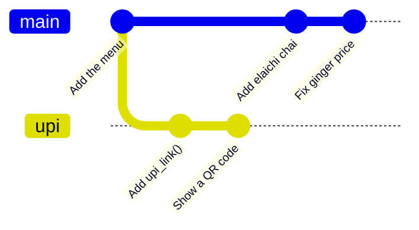
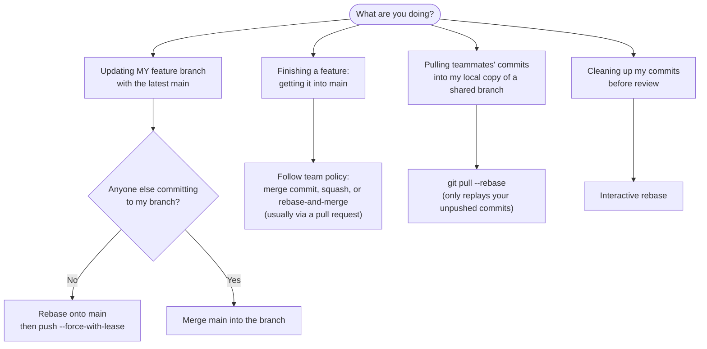

# Merge vs Rebase: The Complete Guide

> 📚 **Before you start**
>
> - [Fast-Forward and Three-Way Merges](fast-forward-and-three-way-merges.md)
> - [Rebase and Interactive Rebase](rebase-and-interactive-rebase.md)

## Introduction

Ask ten developers whether to merge or rebase and you'll start a debate that lasts longer than a T20 match. Some teams insist on a perfectly straight history; others say rewriting history is dishonest and merge commits are the truth. Both camps ship great software.

The reason there's no single right answer is that merge and rebase are **two tools for the same job**, integrating work from one branch into another, and they trade off different things: an accurate record of what happened versus a clean, readable story. Once you understand the trade-offs, you can pick the right one for each situation and follow your team's policy confidently instead of guessing.

By the end of this article you'll be able to compare the histories each approach produces, explain the advantages and risks of each, choose the right one for common situations (updating your branch, finishing a feature, pulling changes), and recognise the team policies built on them.

> 💡 **Key Insight**
>
> **Merge preserves history** exactly as it happened, adding a merge commit where branches join. **Rebase rewrites history** to look as if work happened in a straight line. A common, safe combination: **rebase your own unshared work** to keep it clean and up to date, and **merge (or squash) finished work into shared branches**. Never rewrite history other people have.

---

## Core Explanation

### 1. The Same Starting Point, Two Results

`main` gained two commits while you built two commits on `upi`:



**Option A: merge** `upi` into `main`:

```bash
git switch main
git merge upi
git log --oneline --graph
```

Example output:

```
Merge made by the 'ort' strategy.
 upi.py | 2 ++
 1 file changed, 2 insertions(+)
 create mode 100644 upi.py
*   d97163a Merge branch 'upi'
|\  
| * 0200145 Show a QR code
| * f3088df Add upi_link()
* | e13fc30 Fix ginger price
* | 1cf99f0 Add elaichi chai
|/  
* 18ac7ce Add the menu
```

**Option B: rebase** `upi` onto `main`, then fast-forward:

```bash
git switch upi
git rebase main
git switch main
git merge upi
git log --oneline --graph
```

Example output:

```
Switched to branch 'upi'
Successfully rebased and updated refs/heads/upi.
Switched to branch 'main'
Updating e13fc30..c00401e
Fast-forward
 upi.py | 2 ++
 1 file changed, 2 insertions(+)
 create mode 100644 upi.py
* c00401e Show a QR code
* ced607e Add upi_link()
* e13fc30 Fix ginger price
* 1cf99f0 Add elaichi chai
* 18ac7ce Add the menu
```

Same final files in both cases. Different histories:

| | Merge | Rebase |
|---|---|---|
| **Shape** | Branches and joins; a merge commit | A straight line |
| **Original commits** | Kept, same hashes | Replaced by copies with new hashes |
| **Records when integration happened** | Yes, the merge commit | No |
| **Safe on shared branches** | Yes | No (rewrites history) |
| **Conflicts** | Resolved once, in the merge commit | Possibly once per replayed commit |
| **Undo the whole feature** | Revert one merge commit (`git revert -m 1`) | Revert each commit (or squash first) |

### 2. The Case for Merging

- **It's honest.** The history shows what really happened: work happened in parallel and was combined at a specific point.
- **It's safe.** Nothing is rewritten, so nobody's clone is disrupted. It's the only sensible choice for integrating into shared branches like `main` or `release/*` locally.
- **Feature boundaries are visible.** `git log --first-parent main` shows one entry per merged feature; reverting a whole feature is one `git revert -m 1 <merge>`.
- **Conflicts are resolved once.**

```bash
git log --oneline --first-parent
```

Example output:

```
d97163a Merge branch 'upi'
e13fc30 Fix ginger price
1cf99f0 Add elaichi chai
18ac7ce Add the menu
```

The downside: busy repositories get noisy graphs full of "Merge branch 'main' into feature" commits, especially when people merge `main` into their feature branches every day just to stay up to date.

### 3. The Case for Rebasing

- **Readable, linear history.** `git log` reads like a story, one change after another.
- **Easier tools.** `git bisect` walks a straight line; `git blame` and `git log -p` don't jump between parallel branches.
- **Clean pull requests.** Your branch sits on top of the latest `main`, so reviewers see only your changes and CI tests exactly what will land.
- **Interactive cleanup.** Before sharing, squash fixups and reword messages.

The downsides: rebasing **rewrites commits**, so it's dangerous on anything shared; a long branch may need the same conflict resolved commit by commit; and the record of *when* work was integrated is lost.

### 4. Choosing in Common Situations



| Situation | Usual choice | Why |
|---|---|---|
| Update your own feature branch | **Rebase** onto `main` | Clean branch, no noise; only you are affected |
| Update a branch shared with others | **Merge** `main` into it | Doesn't rewrite commits others have |
| Finish a feature into `main` | Team policy: **merge commit**, **squash**, or **rebase-and-merge**, usually via a pull request | Each gives a different `main` history ([Merge Strategies and Merge Queues](../course.md#m6)) |
| `git pull` with local unpushed commits | **`pull --rebase`** | Avoids pointless "Merge branch 'main' of origin" commits |
| Tidy commits before review | **Interactive rebase** | Rewrite while the commits are still private |
| Long-running release branches | **Merge** (and cherry-pick fixes) | Shared, long-lived, must never be rewritten |

### 5. Pull: Merge or Rebase?

`git pull` is `git fetch` followed by an integration step. If both you and the remote have new commits on the same branch, Git must either merge or rebase. Older Git versions silently merged; modern Git stops and asks you to choose when the branches have diverged and you haven't configured a preference. Set your preference once:

```bash
git config --global pull.rebase true     # rebase local commits on top of fetched ones
git config --global pull.rebase false    # merge (the traditional behaviour)
git config --global pull.ff only         # refuse unless it's a fast-forward
```

Many developers choose `pull.rebase true`: your unpushed local commits are replayed on top of the remote's, which is safe because nobody else has them yet. The details are in [clone, fetch, pull and push](../05-remotes-and-github-basics/clone-fetch-pull-and-push.md).

### 6. Team Policies You'll Meet

| Policy | How it works | History on `main` |
|---|---|---|
| **Merge commits for everything** | PRs merged with "Create a merge commit" | Bubbles; `--first-parent` gives a clean feature list |
| **Squash and merge** | Each PR becomes one commit on `main` | Linear, one commit per PR; branch commits discarded |
| **Rebase and merge** | PR commits replayed onto `main` | Linear, every commit kept |
| **Linear history required** | Branch protection forbids merge commits on `main` | Straight line; contributors must rebase or squash |

All are reasonable. What matters is that the team picks one and that individuals follow the **golden rule**: rewrite only what's yours and unshared.

### 7. Force-Pushing After a Rebase

If you rebase a branch you've already pushed, a normal push fails, because the remote has commits your branch no longer contains. Overwrite your **own** branch with:

```bash
git push --force-with-lease
```

`--force-with-lease` only overwrites the remote branch if it's still where you last saw it. If a teammate pushed in the meantime, it refuses, so you don't silently destroy their work. Plain `--force` has no such check. Never force-push shared branches like `main`; branch protection on GitHub usually forbids it anyway ([module 6](../course.md#m6)).

---

## Try It Yourself

1. **Two histories.** Recreate section 1: make a branch with two commits, add two commits to `main`, copy the repository folder, then merge in one copy and rebase-plus-fast-forward in the other. Compare `git log --oneline --graph`.
2. **Revert a feature.** In the merged copy, undo the whole `upi` feature with one command. What would you need in the rebased copy?
3. **Choose.** For each, choose merge or rebase and say why: (a) your branch, only you work on it, behind `main` by five commits; (b) a `release/2.0` branch three people commit to, which needs a fix from `main`; (c) you have two local commits on `main` and `git pull` reports divergence.
4. **Configure pull.** Set `pull.rebase` to your preference and explain what `git pull` will now do when branches diverge.

<details>
<summary>Show answers</summary>

1. The merged copy shows a merge commit joining two lines; the rebased copy is a straight line with new hashes for the two `upi` commits.
2. `git revert -m 1 <merge-hash>` in the merged copy. In the rebased copy, revert each of the two commits (`git revert <newest> <older>`), or both in one command with `git revert --no-commit <first>^..<last>` followed by a commit.
3. (a) Rebase: private branch, clean result. (b) Merge (or cherry-pick the fix): the branch is shared and long-lived. (c) `git pull --rebase`: your two commits are unpushed, so replaying them is safe and avoids a pointless merge commit.
4. With `pull.rebase true`, Git fetches, then replays your local commits on top of the upstream branch; with `false`, it creates a merge commit; with `pull.ff only`, it refuses if a fast-forward isn't possible.

</details>

---

## Real-World Examples

### Example 1: The Linux Kernel

Kernel maintainers merge subsystem trees into the main tree with merge commits, preserving who integrated what and when, while individual contributors are expected to send clean, rebased patch series. Rebase locally, merge publicly.

### Example 2: A Startup with Squash Merges

A product team enables only "Squash and merge" on GitHub. Developers rebase or merge `main` into their branches however they like while working; `main` ends up with exactly one commit per pull request, each linking to its review.

### Example 3: Monorepos and Merge Queues

Large monorepos often require linear history and use a merge queue that rebases each pull request onto the latest `main` and tests it before landing ([module 6](../course.md#m6)). Developers never merge by hand.

---

## Common Misconceptions

### Misconception 1: "Rebase is always better because history is cleaner"

Clean history has costs: lost integration context and risk on shared branches. Merges are the safe, honest default for shared branches.

### Misconception 2: "Merge commits are mistakes"

They're records of integration. Use `--first-parent` to read history at the level of merged features.

### Misconception 3: "Rebasing my pushed feature branch is forbidden"

It's fine if only you work on it: rebase, then `push --force-with-lease`. The rule is about history *others* depend on.

### Misconception 4: "Squash merge and rebase are the same thing"

Squash merge creates a single new commit on `main` from all of a branch's changes. Rebase replays each commit individually, keeping them separate.

---

## Interview Relevance

"Merge or rebase, which do you prefer and why?" is one of the most common Git interview questions. A strong answer avoids dogma and covers:

- **What each does to history** (merge commit vs linear rewritten commits) and the trade-offs.
- **The golden rule**: never rebase shared history; use `--force-with-lease` for your own branches.
- **A practical workflow**: rebase private branches onto `main`, `pull --rebase` for local commits, merge or squash into `main` via pull requests, per team policy.
- **Consequences** for `bisect`, `revert -m 1`, conflict resolution and review.

---

## Key Takeaways

- **Merge preserves** what happened (parallel lines, merge commits); **rebase rewrites** for a straight line.
- **Rebase private work, merge shared work.** Never rewrite commits others have.
- Use **`git pull --rebase`** (or `pull.rebase true`) to avoid needless merge commits from pulling.
- After rebasing your own pushed branch, use **`git push --force-with-lease`**, never plain `--force`.
- Teams choose a **policy for `main`**: merge commits, squash merges or rebase-and-merge. Follow it consistently.

---

**Up next:** [Undoing Things: restore, reset, revert and cherry-pick](undoing-things-restore-reset-revert-and-cherry-pick.md)
