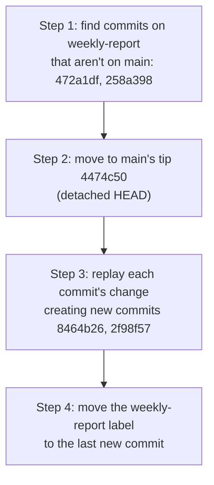
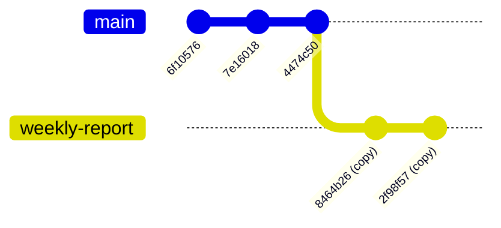
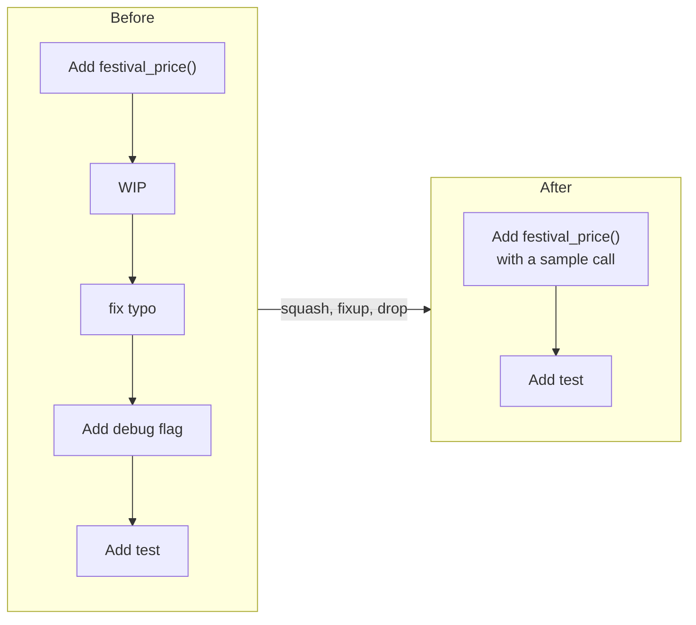
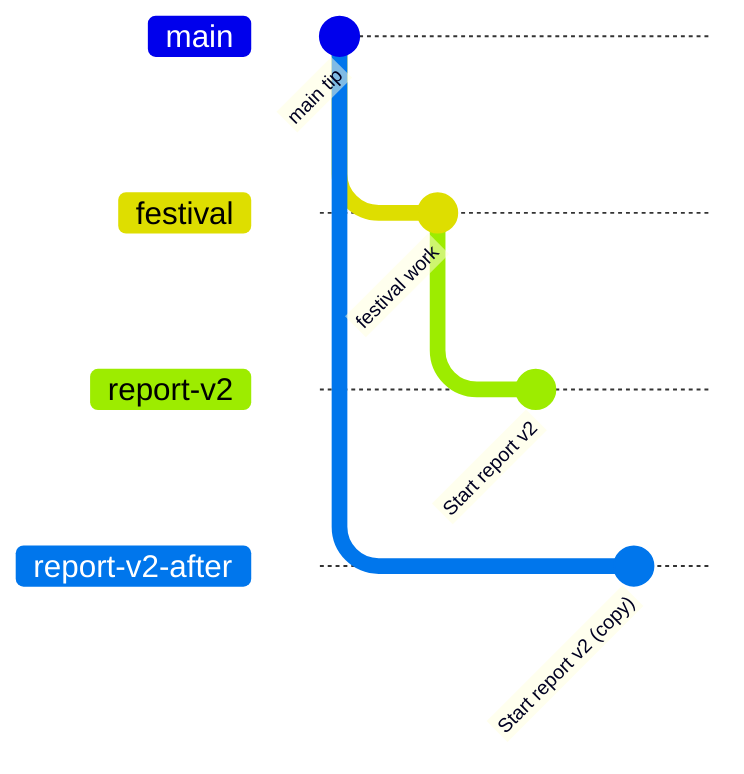
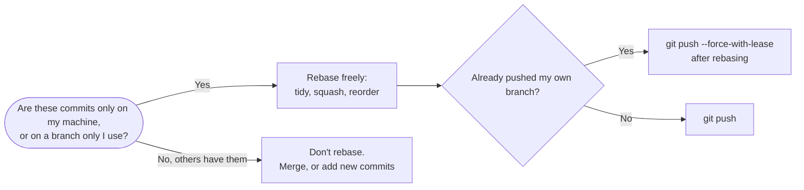

# Rebase and Interactive Rebase: The Complete Guide

> 📚 **Before you start**
>
> - [Fast-Forward and Three-Way Merges](fast-forward-and-three-way-merges.md)
> - [Resolving Merge Conflicts](resolving-merge-conflicts.md)
> - [Hashes and Content Addressing](../03-how-git-works-inside/hashes-and-content-addressing.md), for why rewritten commits get new hashes
> - [The Reflog and Garbage Collection](../03-how-git-works-inside/the-reflog-and-garbage-collection.md), your safety net for this lesson

## Introduction

You've written a report over a week, building on Monday's company figures. On Friday, the finance team publishes corrected Monday figures. You could staple a note to the front saying "combine my report with the new figures" (that's a merge). Or you could **redo** your week's work on top of the corrected figures, so the report reads as if you'd started from the right numbers all along. That second approach is a **rebase**.

Rebasing replays your commits, one by one, on top of a different starting point. The result is a clean, straight history with no merge bubbles. **Interactive rebase** goes further: before replaying, it gives you a to-do list where you can reorder commits, edit messages, combine "WIP" and "fix typo" commits into the commits they belong to, or drop commits entirely. It's how professionals turn a messy afternoon of commits into a tidy, reviewable story before sharing it.

Rebase rewrites history, so it comes with one serious rule. By the end of this article you'll know how rebase works internally, how to rebase a branch onto `main`, handle conflicts mid-rebase, use every interactive command, use `--autosquash`, `--exec` and `--onto`, recover from a bad rebase, and when you must **not** rebase.

> 💡 **Key Insight**
>
> Rebase **doesn't move commits**; it **creates new copies** of them on a new base, then moves your branch label to the copies. New parent means new hash. The originals still exist (the reflog can find them), but anyone else who had the old commits now has a different history from yours. Hence the golden rule: **only rebase commits that you haven't shared**, or that only you work on.

---

## Core Explanation

### 1. What Rebase Does

Our `weekly-report` branch split off from `main` at "Add prices". Since then, `main` gained "Add elaichi chai":

```bash
git log --oneline --graph --all
```

Example output:

```
* 4474c50 Add elaichi chai
| * 258a398 Print a sample weekly total
| * 472a1df Add weekly_total()
|/  
* 7e16018 Add prices
* 6f10576 Add the menu
```

Rebase the branch onto `main`:

```bash
git switch weekly-report
git rebase main
```

Example output:

```
Successfully rebased and updated refs/heads/weekly-report.
```

```bash
git log --oneline --graph --all
```

Example output:

```
* 2f98f57 Print a sample weekly total
* 8464b26 Add weekly_total()
* 4474c50 Add elaichi chai
* 7e16018 Add prices
* 6f10576 Add the menu
```

A straight line. But look at the hashes: the two report commits are now `8464b26` and `2f98f57`, not `472a1df` and `258a398`. Here's what Git did:



The reflog shows those steps exactly:

```bash
git reflog -4
```

Example output:

```
2f98f57 HEAD@{0}: rebase (finish): returning to refs/heads/weekly-report
2f98f57 HEAD@{1}: rebase (pick): Print a sample weekly total
8464b26 HEAD@{2}: rebase (pick): Add weekly_total()
4474c50 HEAD@{3}: rebase (start): checkout main
```



Now `main` is an ancestor of `weekly-report`, so merging the branch into `main` will be a fast-forward. That's the usual purpose: **bring your branch up to date with `main` without a merge commit**, and keep the final history linear.

`git rebase main` is shorthand: "take the commits in `main..HEAD` and replay them onto `main`". You can name the branch to rebase too: `git rebase main weekly-report` switches to `weekly-report` first.

### 2. Conflicts During a Rebase

Each replayed commit is applied like a mini-merge, so conflicts can happen at any step. Here `menu-tweak` changes the ginger price to 26 while `main` changed it to 27:

```bash
git rebase main
```

Example output:

```
Auto-merging menu.txt
CONFLICT (content): Merge conflict in menu.txt
error: could not apply a6c3d70... Ginger chai to 26
hint: Resolve all conflicts manually, mark them as resolved with
hint: "git add/rm <conflicted_files>", then run "git rebase --continue".
hint: You can instead skip this commit: run "git rebase --skip".
hint: To abort and get back to the state before "git rebase", run "git rebase --abort".
Could not apply a6c3d70... Ginger chai to 26
```

`git status` tells you which commit stopped and what's left:

```bash
git status
```

Example output:

```
interactive rebase in progress; onto 293a6a7
Last command done (1 command done):
   pick a6c3d70 Ginger chai to 26
Next command to do (1 remaining command):
   pick b783268 Add lemon tea
  (use "git rebase --edit-todo" to view and edit)
You are currently rebasing branch 'menu-tweak' on '293a6a7'.
  (fix conflicts and then run "git rebase --continue")
  (use "git rebase --skip" to skip this patch)
  (use "git rebase --abort" to check out the original branch)

Unmerged paths:
  (use "git restore --staged <file>..." to unstage)
  (use "git add <file>..." to mark resolution)
	both modified:   menu.txt

no changes added to commit (use "git add" and/or "git commit -a")
```

```bash
cat menu.txt
```

Example output:

```
Masala chai: 20
<<<<<<< HEAD
Ginger chai: 27
Elaichi chai: 25
=======
Ginger chai: 26
>>>>>>> a6c3d70 (Ginger chai to 26)
```

> ⚠️ **Ours and theirs are swapped during a rebase.** `HEAD` is the new base being built (here, `main`'s version plus any commits already replayed). The incoming side is **your** commit being replayed. So `git checkout --ours` gives the *upstream* version and `--theirs` gives *yours*.

Resolve exactly as in the conflicts lesson, `git add` the file, then continue (Git may open your editor to confirm the commit message):

```bash
git add menu.txt
git rebase --continue
git log --oneline --graph main~2..menu-tweak
```

Example output:

```
[detached HEAD 2c648e2] Ginger chai to 26
 1 file changed, 1 insertion(+), 1 deletion(-)
Successfully rebased and updated refs/heads/menu-tweak.
* a0afbd3 Add lemon tea
* 2c648e2 Ginger chai to 26
* 293a6a7 Ginger chai to 27
* 4474c50 Add elaichi chai
```

Your three choices at every stop:

| Command | Effect |
|---|---|
| `git rebase --continue` | Commit the resolved step and carry on |
| `git rebase --skip` | Drop this commit entirely and carry on (useful when upstream already contains the same change) |
| `git rebase --abort` | Stop and put the branch back exactly where it was before the rebase |

A long branch can conflict at several steps, which is one reason to rebase small branches often. `rerere` (previous lesson) helps when the same conflict keeps reappearing.

### 3. Interactive Rebase: Edit History Before Sharing

`git rebase -i <base>` opens your editor with a **to-do list** of the commits after `<base>`, oldest first. Here's a messy feature branch:

```bash
git log --oneline main..festival
```

Example output:

```
136e141 Add test for festival_price
4139e81 Add debug flag
f32d028 fix typo
b7f8e84 WIP
b8ca63e Add festival_price()
```

```bash
git rebase -i main
```

Your editor opens with (plus a long comment explaining the commands):

```
pick b8ca63e Add festival_price()
pick b7f8e84 WIP
pick f32d028 fix typo
pick 4139e81 Add debug flag
pick 136e141 Add test for festival_price
```

Note the order: **oldest at the top**, the reverse of `git log`. Each line is an instruction Git will execute from top to bottom. Change the words (and the order of lines) to rewrite history:

| Command | Short | What it does |
|---|---|---|
| `pick` | `p` | Use the commit as is |
| `reword` | `r` | Use the commit, but stop to edit its message |
| `edit` | `e` | Use the commit, then stop so you can amend it (change files, split it) |
| `squash` | `s` | Combine into the previous commit and edit the **combined** message |
| `fixup` | `f` | Combine into the previous commit and **discard** this commit's message (`fixup -C` keeps this message instead) |
| `drop` | `d` | Remove the commit (deleting the line does the same) |
| `exec` | `x` | Run a shell command at this point; the rebase stops if it fails |
| `break` | `b` | Pause here (continue with `git rebase --continue`) |

Edit the list to:

```
pick b8ca63e Add festival_price()
squash b7f8e84 WIP
fixup f32d028 fix typo
pick 136e141 Add test for festival_price
drop 4139e81 Add debug flag
```

Save and close. Because of `squash`, Git opens the editor once more with both messages so you can write the combined one; we write `Add festival_price() with a sample call`. Result:

```
[detached HEAD 6e204b9] Add festival_price() with a sample call
 Date: Mon Oct 5 10:24:00 2026 +0530
 1 file changed, 2 insertions(+)
 create mode 100644 offers.py
Successfully rebased and updated refs/heads/festival.
```

```bash
git log --oneline main..festival
```

Example output:

```
17748bb Add test for festival_price
6e204b9 Add festival_price() with a sample call
```

Five commits became two clean, meaningful ones. The debug flag is gone; the typo fix and WIP were folded into the commit they belonged to.



**Splitting a commit with `edit`.** Mark the commit `edit`. When the rebase stops there, run `git reset HEAD~` to un-commit it while keeping the changes in your working tree, then `git add -p` and `git commit` as many times as you like, and finally `git rebase --continue`.

**Changing the to-do list mid-way.** `git rebase --edit-todo` reopens the remaining list while a rebase is paused.

**Rewriting from the very first commit.** `git rebase -i --root` includes the root commit in the list.

### 4. fixup Commits and --autosquash

Finding the right line to mark `fixup` is tedious. Let Git do it. When you notice a mistake in an earlier commit, commit the fix with `--fixup <commit>`:

```bash
git commit --fixup HEAD~1
git log --oneline main..festival
```

Example output:

```
23b884c fixup! Add festival_price() with a sample call
17748bb Add test for festival_price
6e204b9 Add festival_price() with a sample call
```

Then rebase with `--autosquash`, which moves each `fixup!` commit under its target and marks it `fixup` automatically:

```bash
git rebase -i --autosquash main
```

The to-do list opens already arranged:

```
pick 6e204b9 Add festival_price() with a sample call
fixup 23b884c fixup! Add festival_price() with a sample call
pick 17748bb Add test for festival_price
```

Save and close:

```bash
git log --oneline main..festival
```

Example output:

```
6fbb65c Add test for festival_price
7e6e791 Add festival_price() with a sample call
```

Set `git config --global rebase.autoSquash true` to make this the default for interactive rebases. `git commit --squash <commit>` works the same way but keeps the message for editing. Since Git 2.32, `git commit --fixup=reword:<commit>` creates a commit that only rewords the target's message.

### 5. Running Tests on Every Commit: --exec

`--exec` (or `-x`) adds an `exec` line after every commit, so you can check that **each** commit still passes your tests, not just the last one:

```bash
git rebase main --exec "python3 -m pytest -q"
```

If any command fails, the rebase stops at that commit so you can fix it, then `git rebase --continue`. (Our demo used a stand-in command that always passes:)

```
Executing: python3 -c "print(1)" >/dev/null && echo tests passed
tests passed
Executing: python3 -c "print(1)" >/dev/null && echo tests passed
tests passed
Successfully rebased and updated refs/heads/festival.
```

### 6. Moving a Branch to a Different Base: --onto

Sometimes you started a branch from the wrong place. `report-v2` was accidentally branched from `festival` instead of `main`, so it carries `festival`'s commits too:

```bash
git log --oneline --graph main..report-v2
```

Example output:

```
* 5662e8f Start report v2
* 6fbb65c Add test for festival_price
* 7e6e791 Add festival_price() with a sample call
```

`git rebase --onto <new-base> <old-base> <branch>` takes the commits in `old-base..branch` and replays them onto `new-base`:

```bash
git rebase --onto main festival report-v2
git log --oneline --graph main..report-v2
```

Example output:

```
Successfully rebased and updated refs/heads/report-v2.
* 0832709 Start report v2
```



Only the report's own commit moved; `festival`'s commits are no longer part of `report-v2`. (`report-v2-after` in the diagram is just the label `report-v2` after the move.)

### 7. More Useful Options

| Option | Use |
|---|---|
| `--autostash` | Stash uncommitted changes before the rebase and restore them after (`rebase.autoStash` makes it the default) |
| `--update-refs` | When you have **stacked** branches (branch B built on branch A), rebasing B also moves A's label to its rewritten commits (Git 2.38+) |
| `--rebase-merges` | Keep merge commits in the rebased history instead of flattening them |
| `--quit` | Stop the rebase but leave HEAD and files where they are (unlike `--abort`) |
| `-X ours` / `-X theirs` | Prefer one side in conflicting hunks (remember the swap) |

And `git pull --rebase` (or `pull.rebase = true`) rebases your local commits on top of what you just fetched, instead of creating a merge commit ([module 5](../05-remotes-and-github-basics/clone-fetch-pull-and-push.md)).

### 8. Recovering from a Bad Rebase

Because the old commits still exist, every rebase is undoable:

- **Still in progress:** `git rebase --abort`.
- **Just finished:** `git reset --hard ORIG_HEAD` (rebase sets `ORIG_HEAD` to where the branch was before).
- **Finished a while ago:** `git reflog`, find the entry just before `rebase (start)` (or `rebase -i (start)`), and `git reset --hard <that entry>`.

### 9. The Golden Rule

**Don't rebase commits that other people have based work on.** If you rebase commits you've already pushed to a shared branch, everyone else still has the old copies. When they pull, Git sees two different histories with duplicate-looking commits, and conflicts multiply.



Rebasing **your own feature branch**, even after pushing it for a pull request, is normal and common; you then update the remote with `git push --force-with-lease`, which refuses if someone else pushed to the branch in the meantime ([module 5](../05-remotes-and-github-basics/clone-fetch-pull-and-push.md)). Rebasing a shared branch like `main` is not.

---

## Try It Yourself

1. **Simple rebase.** Create a branch with two commits, add a commit to `main`, rebase the branch onto `main`, and compare the hashes before and after. Then fast-forward `main` to it.
2. **Clean up.** Make four commits: "Add feature", "wip", "typo", "Add tests". Use interactive rebase to end with two commits.
3. **Autosquash.** Make a fix for an older commit with `git commit --fixup <hash>` and fold it in with `git rebase -i --autosquash`.
4. **Undo it.** After any rebase, restore the branch to its pre-rebase state with `ORIG_HEAD` or the reflog.

<details>
<summary>Show answers</summary>

1. The two branch commits get new hashes; `git switch main && git merge feature` reports `Fast-forward`.
2. To-do list: `pick` "Add feature", `fixup` "wip", `fixup` "typo", `pick` "Add tests" (use `squash` instead of `fixup` if you want to edit the combined message).
3. The `fixup!` commit appears directly under its target, already marked `fixup`; after saving, it's gone from `git log` and its change is part of the target commit.
4. `git reset --hard ORIG_HEAD` immediately after, or `git reflog` and `git reset --hard HEAD@{n}` where `n` is the entry just before `rebase (start)`.

</details>

---

## Real-World Examples

### Example 1: Updating a Pull Request Branch

A developer's pull request falls behind `main`. They run `git fetch` and `git rebase origin/main`, fix one conflict, run the tests, and `git push --force-with-lease`. The pull request now shows their commits on top of the latest `main`, with no "Merge branch 'main' into feature" noise.

### Example 2: Review-Ready History

Before asking for review, an engineer runs `git rebase -i origin/main` and turns eleven commits ("try this", "oops", "address lint") into three: "Add the parser", "Use the parser in the importer", "Add parser tests". Reviewers read each step independently, and `git bisect` later points at a meaningful commit.

### Example 3: Stacked Changes

A developer splits a big feature into three branches stacked on each other (`api`, `api-client` on top of `api`, `ui` on top of `api-client`). After review changes to `api`, one `git rebase --update-refs` from the top branch moves all three branch labels correctly.

---

## Common Misconceptions

### Misconception 1: "Rebase moves my commits"

It creates new commits with the same changes and new parents, so they have new hashes. The old commits remain until garbage collection.

### Misconception 2: "Rebase is dangerous and should be avoided"

Rebasing **local or personal** commits is safe and widely used, and the reflog makes it undoable. Only rebasing commits others depend on is harmful.

### Misconception 3: "git rebase main updates main"

It updates the **current branch** by replaying it onto `main`. `main` doesn't move.

### Misconception 4: "squash and fixup are the same"

Both combine a commit into the previous one. `squash` lets you edit the combined message; `fixup` silently keeps only the earlier commit's message.

---

## Interview Relevance

Rebase is a favourite topic: "What does `git rebase` do?", "What is interactive rebase used for?", "What's the golden rule of rebasing?". A strong answer covers:

- **Mechanism**: replay commits onto a new base, creating new commits with new hashes, then move the branch.
- **Uses**: update a feature branch with `main` linearly; clean history with `-i` (squash, fixup, reword, edit, drop, reorder).
- **Conflicts**: resolve, `add`, `--continue`; `--skip`; `--abort`; ours/theirs are swapped.
- **Golden rule**: don't rewrite shared history; use `--force-with-lease` for your own branches.
- **Recovery**: `ORIG_HEAD` and the reflog.

---

## Key Takeaways

- **Rebase replays commits onto a new base**, creating **new commits** and moving the branch label.
- Use it to **update a branch with `main` linearly**, so the final merge can fast-forward.
- **Interactive rebase** (`-i`) rewrites local history: **pick, reword, edit, squash, fixup, drop, exec**.
- **`--fixup` + `--autosquash`** fold corrections into the right commit automatically.
- On conflicts: resolve, `git add`, **`--continue`**; or **`--skip`** / **`--abort`**. **Ours and theirs are swapped.**
- **Never rebase shared history**; undo any rebase with **`ORIG_HEAD`** or the **reflog**.

---

**Up next:** [Merge vs Rebase](merge-vs-rebase.md)
